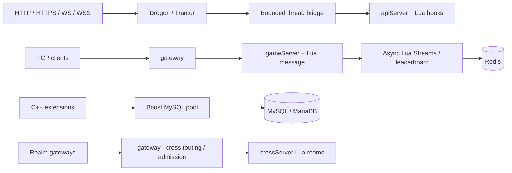

<p align="center">
  
</p>

<h1 align="center">Mistlane</h1>

<p align="center">
  <a href="https://github.com/cuihairu/mistlane/actions/workflows/ci.yml"></a>
  <a href="LICENSE"></a>
  <a href="CMakeLists.txt"></a>
  <a href="docs/dependencies.md"></a>
  <a href="vcpkg.json"></a>
  <a href="docs/index.md"></a>
  
</p>

**English | [简体中文](README.zh-CN.md)**

A C++20 / Lua framework **extracted and reorganized from a legacy game backend**, published for **research and learning**. It demonstrates service separation, asynchronous networking, Lua embedding, and dependency modernization.

This is an educational framework candidate, not a production deployment recommendation. It removes the old game's gameplay, content tables, account/payment integration, channel SDKs, production configuration, and repository history. New interfaces and a new wire protocol mean it cannot directly replace the original cluster.

## Components

| Area | Implementation |
|---|---|
| Async networking | Boost.Asio |
| HTTP / HTTPS / WS / WSS | Drogon / Trantor and OpenSSL |
| HTTP client | libcurl C++ adapter |
| Cross-server | Native gateway cross routing/crossServer roles, room affinity and admission |
| Diagnostics | Optional private `/metrics` (Prometheus) listener, internal PROBE1 liveness/readiness probe, Crashpad local minidumps |
| MySQL pool | Existing Boost.MySQL connection_pool |
| Redis data | Optional Boost.Redis Streams and sorted-set leaderboard APIs for Lua |
| Scripting | Lua module lifecycle and replaceable VMs |
| C++ dependencies | CMake Presets + pinned vcpkg manifest |
| Documentation | VitePress, English and Chinese |

The diagram below describes the current communication prototype, not the complete legacy game architecture. See [target process responsibilities](docs/process-roles.md); gateway connects directly to gameServer in the default deployment.



gateway selects an upstream per new connection, then keep the session there and process requests serially. Drogon/Trantor handles HTTP, HTTPS, WS and WSS; Asio owns internal TCP and Lua callbacks, with a bounded bridge between event loops. apiServer instances expose Lua request hooks. Start a Lua gameServer with `--redis IP:PORT` to enable asynchronous Redis Streams publish, consume groups, ACK and pending recovery; requests are bounded and credentials can come from environment variables. Native gateway cross routing/crossServer roles route group/room pairs and enforce connection admission without restoring game logic. Lua services can expose an optional private Prometheus endpoint with `--metrics-listen IP:PORT` and an internal liveness/readiness probe with `--probe-listen IP:PORT`; cross upstreams take `IP:PORT[:PROBE]` to gate new joins on crossServer readiness (see the [cross-server design](docs/cross-server.md)). Boost.MySQL and libcurl remain C++ interfaces without Lua bindings. See [architecture](docs/architecture.md), [Lua lifecycle](docs/lua.md) and [cross-server design](docs/cross-server.md).

## Build

Linux x64, C++20, CMake 3.25+, Ninja, Git, curl, zip/unzip, tar, pkg-config, Perl and the OpenSSL CLI are required to build. Default CTest integration checks and developer tools require Python 3; configure with BUILD_TESTING=OFF to build without the integration tests. Running mistlane does not require Python. Use a vcpkg checkout at the manifest baseline:

```bash
git clone https://github.com/microsoft/vcpkg.git "$HOME/vcpkg-mistlane"
git -C "$HOME/vcpkg-mistlane" checkout a5f736224e85b32e25a8ffc52562333180396642
"$HOME/vcpkg-mistlane/bootstrap-vcpkg.sh" -disableMetrics
export VCPKG_ROOT="$HOME/vcpkg-mistlane"
cmake --preset linux-debug
cmake --build --preset linux-debug
ctest --preset linux-debug
```

Use linux-release for Release. The baseline supplies Boost 1.92.0, Lua 5.5.1, and OpenSSL 3.6.5#2. OpenSSL upstream has 4.0.3; this project uses the version packaged in vcpkg. [Dependency policy](docs/dependencies.md).

## Run

Start these in three terminals from the repository root:

```bash
./build/debug/mistlane --role gameServer --listen 127.0.0.1:7102 --script examples/echo.lua
./build/debug/mistlane --role gateway --listen 127.0.0.1:7100 --upstream 127.0.0.1:7102
```

```bash
python3 tools/client.py 'hello mistlane'
```

Game clients can connect through a WS gateway while the gameServer uses internal TCP:

```bash
./build/debug/mistlane --role gateway --listen 0.0.0.0:8080 \
  --transport ws --upstream 127.0.0.1:7102
```

Connect to `ws://server:8080/ws`; game messages reach Lua `message(payload)`. Each WS message is one payload with no TCP length header; responses are binary. For WSS select `--transport wss --cert FILE --key FILE` and connect to `wss://certificate-hostname:port/ws`. A gameServer can also listen directly with `--transport ws/wss --script FILE`. Sessions are full duplex: clients may pipeline requests, handlers may reply with nil, and Lua pushes to one or many live sessions through `mistlane.session.send`/`mistlane.session.broadcast` under a per-session output bound; an optional request-id correlation mode (`MLC2`) keeps replies and pushes distinguishable, internal legs can require a service identity handshake (`MLS1`, `--service-token`/`--upstream-token`) that stays invisible to clients, and a gateway may share one upstream connection across all of its sessions (`MLM1`, `--upstream-multiplex on`) with per-session logical ids. A `--role coordinator` process keeps a live process registry (`MLR1`): gameServer/crossServer members register and heartbeat readiness and load, and read-only `QUERY`/`PLACE` commands answer placement lookups per scope. Script-role HTTP listeners expose a separate WebSocket push API. See the [game connection guide](docs/guide.md) for both topologies, browser code and template certificate configuration.

For HTTP/HTTPS, run a gameServer with --transport http/https and examples/http.lua. The Lua handler accepts method/path/query/headers/body and returns status/headers/body. Its before_request, http, after_request, on_error, init, start, tick, stop and shutdown hooks are documented in the [lifecycle guide](docs/lua.md).

Generate a starter project with `./build/debug/mistlane init ./my-service`. It includes per-instance shell configuration, Lua entrypoints, local process operations and a systemd unit template. See [legacy and modern architecture comparison](docs/architecture-comparison.md) for the configuration and deployment analysis. The launcher shell files stay canonical for the generated project; the runtime itself also parses a native `KEY=VALUE` config through `--config FILE` (see the [guide](docs/guide.md)).

## Bilingual documentation

With Node.js 22.12+ and the pnpm version pinned in package.json (enable Corepack if needed):

```bash
pnpm install --frozen-lockfile
pnpm docs:dev
pnpm docs:build
pnpm docs:preview
```

Validate diagrams after building (also runs in CI):

```sh
pnpm exec playwright install chromium
pnpm docs:check
```

English pages live at docs/, Chinese pages at docs/zh/. The VitePress language menu switches between them. Default base: /mistlane/; override with DOCS_BASE for another deployment path. Building does not publish the site.

## Source release and licensing

```bash
python3 tools/export.py
```

Only reviewed files in release-files.txt enter the source archive, with SHA256 checksums. The archive excludes original game files, Git history, private configuration, dependency binaries, and build output.

Mistlane is licensed under [Apache License 2.0](LICENSE). The original FOGS-derived utility files retain their provenance and attribution in [NOTICE](NOTICE); third-party dependency and port licenses are listed in [THIRD_PARTY.md](THIRD_PARTY.md). The original meaning of FOGS is unconfirmed.

## Further reading

- [Lua services and lifecycle](docs/lua.md)
- [Native cross-server routing and overload protection](docs/cross-server.md)
- [Drogon and libcurl](docs/http.md)
- [Legacy and modern architecture comparison](docs/architecture-comparison.md)

Running mistlane needs the compiled program and its application script/certificates. Python is only used by tests and developer tools; configure with BUILD_TESTING=OFF to build without Python integration tests. Node.js and pnpm are documentation development dependencies.
