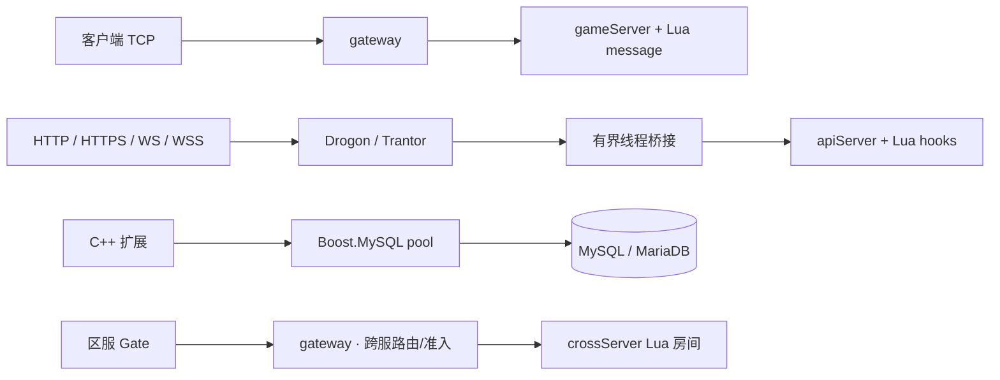

<p align="center">
  
</p>

<h1 align="center">Mistlane</h1>

<p align="center">
  <a href="https://github.com/cuihairu/mistlane/actions/workflows/ci.yml"></a>
  <a href="LICENSE"></a>
  <a href="CMakeLists.txt"></a>
  <a href="docs/zh/dependencies.md"></a>
  <a href="vcpkg.json"></a>
  <a href="docs/zh/index.md"></a>
  
</p>

**[English](README.md) | 简体中文**

从**老游戏服务端抽取并整理**的 C++20 / Lua 多进程框架，主要用于**研究与学习**，不作为生产环境框架推荐。独立仓库：[cuihairu/mistlane](https://github.com/cuihairu/mistlane)。原名 FOGS 的具体来源没有找到明确说明。

当前是 0.1 开源候选：提供可运行的网络与 Lua 核心、成熟 MySQL 连接池接入，不包含原游戏业务。它采用新接口和新协议，尚不能直接替换原游戏服务集群。

## 组成

- Boost.Asio：异步 TCP、定时器、信号和协程。
- Drogon / Trantor：HTTP/HTTPS、WS/WSS；apiServer 支持 Lua handler 及完整生命周期。
- libcurl：有超时、证书校验与响应大小上限的 C++ HTTP 客户端。
- 原生 gateway cross routing/crossServer：固定房间路由和硬准入，剥离旧跨服玩法。
- 诊断：可选私有 `/metrics`（Prometheus）端点、内部 PROBE1 存活/就绪探测、Crashpad 本地 minidump。
- Boost.MySQL：`connection_pool`，负责连接分配、归还、重置、健康检查与重连。
- Boost.Redis：可选 Asio 原生连接，向 Lua 提供异步 Redis Streams 消费组 API。
- Redis 排行榜：Lua 可调用 sorted-set 增分、名次、分页和删除 API。
- Lua：单线程模块生命周期、消息回调、tick 和可回滚的脚本重载。
- CMake + vcpkg manifest：固定 baseline 管理直接和间接依赖。

下图仅表示当前通信原型，不是老游戏的完整服务架构。目标进程职责与命名见[职责说明](docs/zh/process-roles.md)；标准部署由 gateway 直接连接 gameServer。



gateway 通过新连接轮询上游；每条会话固定到一个上游，全双工转发（请求可流水，推送可主动下发）。Drogon/Trantor 负责 HTTP、HTTPS、WS、WSS，Asio 线程运行内部 TCP 与 Lua；有界桥接隔离两个事件循环。apiServer 使用 Lua handler 和请求钩子。gameServer 使用 `--redis IP:PORT` 可启用 Redis Streams Lua API，支持发布、消费组、ACK 和 pending 恢复；请求数有界，凭据可从环境变量读取。原生 gateway cross routing/crossServer 对 group/room 固定路由并执行连接数硬准入，不包含旧游戏玩法。gameServer 可用 `--metrics-listen IP:PORT` 开启私有 Prometheus 端点、用 `--probe-listen IP:PORT` 开启内部存活/就绪探测；cross 上游可写 `IP:PORT[:PROBE]`，按 crossServer 就绪状态挡住新加入（见[跨服设计](docs/zh/cross-server.md)）。Boost.MySQL 与 libcurl 是 C++ 扩展，尚未绑定 Lua。

## 构建

支持 Linux x64。构建需要 C++20 编译器、CMake ≥ 3.25、Ninja、Git、curl、zip/unzip、tar、pkg-config、Perl 和 OpenSSL 命令行工具。默认 CTest 集成验证及开发工具需要 Python 3；只编译服务端可使用 BUILD_TESTING=OFF。运行 mistlane 不依赖 Python。源码不携带预编译库。

准备 vcpkg（已有安装可复用，但需包含 baseline 对应的 Git 对象和版本数据库）：

```bash
git clone https://github.com/microsoft/vcpkg.git "$HOME/vcpkg-mistlane"
git -C "$HOME/vcpkg-mistlane" checkout a5f736224e85b32e25a8ffc52562333180396642
"$HOME/vcpkg-mistlane/bootstrap-vcpkg.sh" -disableMetrics
export VCPKG_ROOT="$HOME/vcpkg-mistlane"
```

项目 overlay 将 Drogon 固定在稳定版 1.9.14，vcpkg 管理它及 Trantor；boost baseline 自身不包含所需 Drogon 新版本。在本目录执行：

```bash
cmake --preset linux-debug
cmake --build --preset linux-debug
ctest --preset linux-debug
```

Release 使用 `linux-release` preset。第一次配置会由 vcpkg 下载和编译依赖；后续复用二进制缓存。`CMakeUserPresets.json` 可保存个人路径，已忽略提交。

使用 `./build/debug/mistlane init ./my-service` 生成应用模板，内含逐进程 shell 配置、Lua 入口、本地运维脚本和 systemd unit 模板。旧项目配置/部署结构与新模板依据见[架构对比](docs/zh/architecture-comparison.md)。启动脚本仍是生成项目的标配；运行时也可经 `--config FILE` 直接解析原生 `KEY=VALUE` 配置（见[指南](docs/zh/guide.md)）。

baseline 内 Boost 为 1.92.0，Lua 为 5.5.1，OpenSSL 为 3.6.5#2。OpenSSL 上游另有更新的 4.0.3；当前选用该 vcpkg baseline 提供的最新 port，不自行增加未经验证的 overlay。详见 [依赖策略](docs/zh/dependencies.md)。

## 启动最小集群

在本目录的三个终端分别运行：

```bash
./build/debug/mistlane --role gameServer --listen 127.0.0.1:7102 --script examples/echo.lua
./build/debug/mistlane --role gateway --listen 127.0.0.1:7100 --upstream 127.0.0.1:7102
```

```bash
python3 tools/client.py 'hello mistlane'
```

`--upstream` 可重复指定多个 gameServer，按连接轮询。游戏客户端使用 WS 时，启动独立游戏网关，内部 gateway/gameServer 保持 TCP：

```bash
./build/debug/mistlane --role gateway --listen 0.0.0.0:8080 \
  --transport ws --upstream 127.0.0.1:7102
```

客户端连接 `ws://服务器地址:8080/ws`，消息进入 gameServer 的 Lua `message(payload)`。一条 WS 消息就是一个 payload，无须额外 TCP 长度头。单进程也可使用 `gameServer --transport ws --script examples/echo.lua` 直接监听；它与 apiServer 的 `http(request)` 是两种入口。

WSS 示例（使用你自己的证书链与私钥）：

```bash
./build/debug/mistlane --role gateway --listen 127.0.0.1:7443 \
  --transport wss --cert /path/to/fullchain.pem --key /path/to/private-key.pem \
  --upstream 127.0.0.1:7102
```

证书和私钥不进入源码包。WS/WSS 的实现直接使用 Drogon；内部 TCP payload 为四字节网络序长度加数据，最大 1 MiB，允许空消息和二进制内容。

WSS 客户端连接 `wss://证书对应域名:7443/ws`，远程接入时将上述 WSS 监听地址改为合适的服务端网卡地址。响应是 binary WS 消息；会话全双工，客户端可流水发送，Lua 通过 `mistlane.session.send`/`mistlane.session.broadcast` 向单个或全部游戏会话主动推送（每会话输出积压有界），可选的请求 ID 关联模式（`MLC2`）让响应与推送可区分，内部链路可要求服务身份握手（`MLS1`，`--service-token`/`--upstream-token`）且客户端全程不可见，gateway 还可让全部会话共享一条上游连接（`MLM1`，`--upstream-multiplex on`，按会话分配逻辑 id），脚本角色 HTTP 监听另有独立的 WebSocket 推送 API。浏览器代码、网关/直接 gameServer 两种拓扑及初始化模板的 `CERT`/`KEY` 配置见[游戏接入指南](docs/zh/guide.md)。

## Lua 扩展

TCP/WS/WSS gameServer 和 crossServer 的脚本必须提供 `message(payload, context) -> string`。HTTP/HTTPS apiServer 改为提供 `http(request) -> response`，可省略 message。HTTP 请求依次经过可选 `before_request`、主 `http`、`after_request`；异常由 `on_error` 处理。完整请求/响应字段、生命周期和限制见 [Lua 生命周期说明](docs/zh/lua.md)。

初始化 context 后，监听就绪时调用 `start`；运行期间串行执行消息/HTTP handler 与 tick；正常停止依次调用 `stop`、`shutdown`。tick 在上次完成后约 100ms 再调度，并非实时帧率。SIGHUP 创建候选 VM，执行 init/start 成功才激活并退役旧 VM；失败保留当前 VM。成功重载重置模块内状态，不迁移房间状态，也不回滚生命周期钩子的外部副作用。钩子始终在 Asio 所属线程执行，必须快速返回。

Lua 是可信应用代码，不是安全沙箱。指令计数钩子可以发现常见死循环，但没有 Lua 内存配额，也不提供不可绕过的 CPU 隔离。

## MySQL 接入

`include/mistlane/mysql_pool.hpp` 只配置并返回 `boost::mysql::connection_pool`；应用直接使用其 `async_get_connection` 和 RAII `pooled_connection`。没有另写池、线程池、重连器或 SQL 协议。通过 `boost::mysql::with_params` 绑定查询值。

```bash
export MISTLANE_MYSQL_HOST=localhost
export MISTLANE_MYSQL_PORT=3306
export MISTLANE_MYSQL_USER=your_user
# 由你的环境安全注入 MISTLANE_MYSQL_PASSWORD；示例不提供默认凭据。
./build/debug/mistlane-mysql-probe
```

默认要求 TLS，验证 CA 与主机名。可通过 `SSL_CERT_FILE` 指定私有 CA。仅在明确的本地测试环境设置 `MISTLANE_MYSQL_TLS=disable`。示例池上限设为 1，连续执行三次参数化 SELECT，验证借出与自动归还。错误凭据 / 不可达服务器会在取连接的五秒期限内失败。

如果安装了本地 MariaDB 工具，可执行独立的临时数据库验证：

```bash
python3 tests/mysql_integration.py ./build/debug/mistlane-mysql-probe
```

脚本在临时目录启动独立 MariaDB、使用临时端口、随机测试凭据和临时证书，并在结束后停止和清理。也可配置 `-DMISTLANE_TEST_LOCAL_DATABASE=ON` 纳入 CTest。

## 发布范围

```bash
python3 tools/export.py
```

生成 `dist/mistlane-0.1.0.tar.gz`，只包含 `release-files.txt` 中审核过的文件及 SHA256 清单。包内无父仓库、Git 历史、旧游戏 Lua、原协议、表结构、支付、渠道 SDK、生产配置或预编译产物。解压后可作为新仓库根目录；CI 按这个独立根设计。

完整能力边界见 [架构与迁移说明](docs/zh/architecture.md)。Mistlane 使用 [Apache License 2.0](LICENSE)；原 FOGS 派生文件的来源与署名见 [NOTICE](NOTICE)，第三方依赖及 vcpkg port 的授权见 [THIRD_PARTY.md](THIRD_PARTY.md)。

## 中英文文档站

文档使用 VitePress + Mermaid，提供中英文成对页面、语言切换、本地搜索、生命周期与跨服架构图。安装 Node.js 22.12+ 和 package.json 固定版本的 pnpm 后运行（需要时启用 Corepack）：

```bash
pnpm install --frozen-lockfile
pnpm docs:dev
pnpm docs:build
pnpm docs:preview
```

文档图表验收（在构建后运行；CI 同样执行）：

```sh
pnpm exec playwright install chromium
pnpm docs:check
```

中文入口为 [docs/zh/index.md](docs/zh/index.md)，英文入口为 [docs/index.md](docs/index.md)。默认站点路径 /mistlane/，可用 DOCS_BASE 调整。构建不会自动发布站点。

## 进一步阅读

- [Lua 脚本与生命周期](docs/zh/lua.md)
- [原生跨服与过载保护](docs/zh/cross-server.md)
- [Drogon 与 libcurl](docs/zh/http.md)
- [老架构与现代架构对比](docs/zh/architecture-comparison.md)

运行 mistlane 只需要编译后的程序及相应 Lua 脚本/证书。Python 仅用于开发期 tests 集成验证和 tools 辅助工具；关闭 BUILD_TESTING 可构建不运行 Python 测试的服务端。文档开发依赖 Node.js 与 pnpm。
