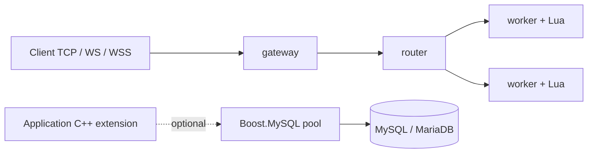

# Mistlane

**[English](README.md) | 简体中文**

从**老游戏服务端抽取并整理**的 C++20 / Lua 多进程框架，主要用于**研究与学习**，不作为生产环境框架推荐。独立仓库：[cuihairu/mistlane](https://github.com/cuihairu/mistlane)。原名 FOGS 的具体来源没有找到明确说明。

当前是 0.1 开源候选：提供可运行的网络与 Lua 核心、成熟 MySQL 连接池接入，不包含原游戏业务。它采用新接口和新协议，尚不能直接替换原游戏服务集群。

## 组成

- Boost.Asio：异步 TCP、定时器、信号和协程。
- Boost.Beast：标准 WebSocket 与 TLS WebSocket，负责握手、掩码、分片和控制帧。
- Boost.MySQL：`connection_pool`，负责连接分配、归还、重置、健康检查与重连。
- Lua：单线程模块生命周期、消息回调、tick 和可回滚的脚本重载。
- CMake + vcpkg manifest：固定 baseline 管理直接和间接依赖。



网关和 router 当前都按新连接轮询上游，同一会话固定到同一上游。内部链路使用 TCP，每个下游会话对应一个上游连接，每条会话按请求 / 响应串行处理。MySQL 接入通过独立 C++ target 和可执行示例提供，尚未绑定到 Lua 消息回调。

## 构建

支持 Linux x64。安装 C++20 编译器、CMake ≥ 3.25、Ninja、Git、curl、zip/unzip、tar、pkg-config、Perl、Python 3 和 OpenSSL 命令行工具。源代码不携带预编译库。

准备 vcpkg（已有安装可复用，但需包含 baseline 对应的 Git 对象和版本数据库）：

```bash
git clone https://github.com/microsoft/vcpkg.git "$HOME/vcpkg-mistlane"
git -C "$HOME/vcpkg-mistlane" checkout a5f736224e85b32e25a8ffc52562333180396642
"$HOME/vcpkg-mistlane/bootstrap-vcpkg.sh" -disableMetrics
export VCPKG_ROOT="$HOME/vcpkg-mistlane"
```

在本目录执行：

```bash
cmake --preset linux-debug
cmake --build --preset linux-debug
ctest --preset linux-debug
```

Release 使用 `linux-release` preset。第一次配置会由 vcpkg 下载和编译依赖；后续复用二进制缓存。`CMakeUserPresets.json` 可保存个人路径，已忽略提交。

baseline 内 Boost 为 1.92.0，Lua 为 5.5.1，OpenSSL 为 3.6.5#2。OpenSSL 上游另有更新的 4.0.3；当前选用该 vcpkg baseline 提供的最新 port，不自行增加未经验证的 overlay。详见 [依赖策略](docs/zh/dependencies.md)。

## 启动最小集群

在本目录的三个终端分别运行：

```bash
./build/debug/mistlane-node --role worker --listen 127.0.0.1:7102 --script examples/echo.lua
./build/debug/mistlane-node --role router --listen 127.0.0.1:7101 --upstream 127.0.0.1:7102
./build/debug/mistlane-node --role gateway --listen 127.0.0.1:7100 --upstream 127.0.0.1:7101
```

```bash
python3 tools/client.py 'hello mistlane'
```

`--upstream` 可重复指定多个 worker，按连接轮询。使用 WS 网关时增加 `--transport ws`；浏览器发送一条 WebSocket 消息即对应一个 payload，不需要额外的 TCP 长度头。

WSS 示例（使用你自己的证书链与私钥）：

```bash
./build/debug/mistlane-node --role gateway --listen 127.0.0.1:7443 \
  --transport wss --cert /path/to/fullchain.pem --key /path/to/private-key.pem \
  --upstream 127.0.0.1:7101
```

证书和私钥不进入源码包。WS/WSS 的实现直接使用 Beast；内部 TCP payload 为四字节网络序长度加数据，最大 1 MiB，允许空消息和二进制内容。

## Lua 扩展

脚本返回一个 table，必须提供 `message(payload) -> string`，可选 `init()`、`tick()`、`shutdown()`。tick 间隔为 100ms。VM 仅在所在节点的 io_context 线程访问；回调应快速返回，不执行阻塞数据库操作。

向 worker 发送 SIGHUP 会先构造并初始化新 VM，成功后替换旧 VM，失败则继续使用旧 VM。重载会重置 Lua 模块状态；目前不迁移状态，也不在替换时执行旧 VM 的 shutdown。SIGTERM/SIGINT 停止接受连接、取消活动 I/O 并调用当前服务的 shutdown。

Lua 是受信任的应用扩展，不是执行外部用户脚本的安全沙箱。指令 hook 可中断典型死循环，但不构成完整 CPU / 内存资源隔离。

## MySQL 接入

`include/mistlane/mysql_pool.hpp` 只配置并返回 `boost::mysql::connection_pool`；应用直接使用其 `async_get_connection` 和 RAII `pooled_connection`。没有另写池、线程池、重连器或 SQL 协议。通过 `boost::mysql::with_params` 绑定查询值。

```bash
export MISTLANE_MYSQL_HOST=localhost
export MISTLANE_MYSQL_PORT=3306
export MISTLANE_MYSQL_USER=your_user
# 由你的环境安全注入 MISTLANE_MYSQL_PASSWORD；示例不提供默认凭据。
./build/debug/mistlane-mysql-probe
```

默认要求 TLS，验证 CA 与主机名。可通过 `SSL_CERT_FILE` 指定私有 CA。仅在明确的本地测试环境设置 `MISTLANE_MYSQL_TLS=disable`。示例池上限设为 1，连续执行三次参数化 SELECT，验证借出与自动归还。错误凭据 / 不可达服务器会在取连接的五秒期限内失败。

如果安装了本地 MariaDB 工具，可执行独立的临时数据库验证：

```bash
python3 tools/mysql_integration.py ./build/debug/mistlane-mysql-probe
```

脚本在临时目录启动独立 MariaDB、使用临时端口、随机测试凭据和临时证书，并在结束后停止和清理。也可配置 `-DMISTLANE_TEST_LOCAL_DATABASE=ON` 纳入 CTest。

## 发布范围

```bash
python3 tools/export.py
```

生成 `dist/mistlane-0.1.0.tar.gz`，只包含 `release-files.txt` 中审核过的文件及 SHA256 清单。包内无父仓库、Git 历史、旧游戏 Lua、原协议、表结构、支付、渠道 SDK、生产配置或预编译产物。解压后可作为新仓库根目录；CI 按这个独立根设计。

完整能力边界见 [架构与迁移说明](docs/zh/architecture.md)，新代码沿用独立仓库的 MIT 许可证，原项目派生文件保留 Apache-2.0。来源及第三方授权见 [NOTICE](NOTICE) 和 [THIRD_PARTY.md](THIRD_PARTY.md)。

## 中英文文档站

文档使用 VitePress，提供中英文成对页面、语言切换、本地搜索和独立导航。安装 Node.js 20+ 后运行：

```bash
npm ci
npm run docs:dev
npm run docs:build
npm run docs:preview
```

中文入口为 [docs/zh/index.md](docs/zh/index.md)，英文入口为 [docs/index.md](docs/index.md)。默认站点路径 /mistlane/，可用 DOCS_BASE 调整。构建不会自动发布站点。
