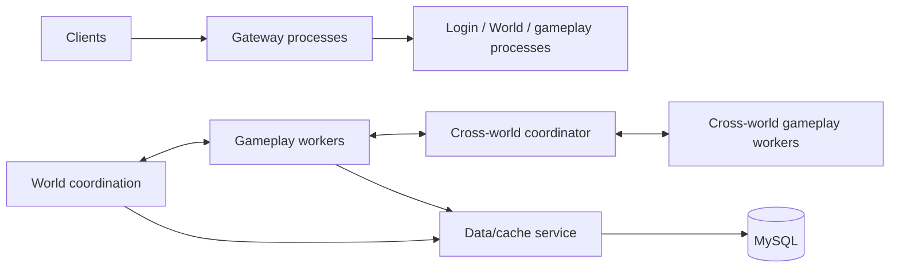

# Legacy MMO backend and modern server architecture

## Classification

Yes. The source is an MMO-style backend: it has long-lived regional worlds, gateways, login and data services, Lua gameplay workers, and cross-region gameplay. The architecture is a multi-process online game server, not a match-only backend.

The important qualification is that “MMO backend” describes the product shape. It does not mean the implementation already has modern distributed ownership, failure recovery, or horizontal scaling. The old design is a service-oriented process layout from an earlier generation, with configuration and routing strongly tied to a shared deployment environment.

## What the old design does

The repository shows separate native executables and Lua entrypoints for gateway, World, gameplay, cross-world and supporting services. Deployment scripts generate shared and per-service Lua configuration, compute port ranges and process counts, then start services in a prescribed order. Runtime scripts expect a particular current directory and derive binary, config, Lua, log and pid paths from it. The older command line accepts an explicit service config, instance index and log config.

This separation remains useful: gateways, game logic, storage and control services have different resource needs and failure modes. The weak point is the shared coordinator path. Multiple cross-game workers do not help if they all depend on one coordinator for global routing, broadcasts or shared state. The old capacity fallback could also select an already-full gameServer, and one queue append path had no local item/byte cap. These are concrete overload risks, but they do not prove the cause of the historical crash.

## Comparison with common modern patterns

| Area | Legacy backend evidence | Common modern pattern | Mistlane today |
|---|---|---|---|
| Process packaging | Many purpose-built binaries with separate Lua/config entrypoints | A small set of reusable roles, packaged consistently and deployed declaratively | One binary with `gateway`, `gameServer`, `crossServer` and `apiServer` roles |
| Configuration | Shared Lua globals plus generated per-daemon files; scripts rely on working-directory conventions | Explicit per-instance configuration, versioned deployment config, secrets supplied separately | `mistlane init` generates per-instance shell-assignment files with root-relative paths; launchers translate them to CLI arguments, and the runtime also parses a native `KEY=VALUE` file through `--config` |
| Game-state ownership | World/gameplay/cross services coordinate through application-specific routing and RPC | A world, zone, room or match has one clear authoritative owner; partitions are explicit and bounded | Static room hash across a configured crossServer list, local hard admission, no leases or state migration |
| Cross-server scaling | Cross coordinator can remain a hot point while gameplay workers are added | Partition by independent state domains; separate control-plane operations from hot gameplay data paths | Cross forwards to shards but remains a single ingress per deployment and uses static upstream order |
| Overload handling | Worker preference can fall back to a full gameServer; queue sizing needs wider tracing | Admission, queue bytes and task budgets are bounded; reject or defer work before the main loop stalls | Connection, frame, rate and room limits exist, plus local readiness gating; no global bytes/queue budget or measured capacity |
| Failure recovery | Custom registration, reconnect and persistence behavior is tied to the old framework | Explicit health/readiness, drain, fencing/epochs, idempotency, snapshots and recovery policy | Timeouts and epoch mismatch; PROBE1 readiness gates new cross joins; no discovery, drain protocol, replay or migration |
| Operations | Shell scripts generate configs, start/stop processes, inspect pids/logs | systemd or an orchestrator manages process lifecycle, restart policy, resource limits and rollout | `mistlane init` generates local cluster scripts and a systemd unit template; production hardening and deployment validation remain |
| Observability | Logs and a Lua long-call interruption hook | Metrics, traces, profiles and native crash dumps answer different diagnostic questions | Optional Prometheus scrape endpoint, Crashpad local capture (validated by the dump drill) and the internal PROBE1 listener are wired; external-sampler profiling and deployment workflows remain |

“Modern” does not require Kubernetes, microservices, or an actor framework in every game. Modernization means making ownership, resource limits, placement, health, deployment and recovery contracts explicit. A single well-bounded process can be more reliable than many services joined by unbounded queues.

## Two modern game-server shapes

Session-based games allocate a dedicated process per match/session. Agones provides atomic allocation from ready server fleets and fleet autoscaling; this fits disposable sessions and short matches better than a persistent shared world. [Agones allocation](https://agones.dev/site/docs/reference/gameserverallocation/) · [Agones autoscaling](https://agones.dev/site/docs/reference/fleetautoscaler/).

Persistent-world games usually partition the world into regions, zones, instances or rooms. Each partition has one active state owner, while gateways, account services, matchmaking and persistence are supporting services. A server-authoritative match system similarly keeps one match state on one host for consistency, then distributes independent matches across nodes; Nakama documents this model and its tick-driven match lifecycle. [Nakama authoritative multiplayer](https://heroiclabs.com/docs/nakama/concepts/multiplayer/authoritative/).

The old game is closer to the persistent-world model. It should not be rewritten as “one container per room” without measuring room lifetime, cross-room interactions, world persistence and player migration costs.

## Recommended modernization path

1. Keep the one-owner-per-room principle and hard admission. Measure Lua tick lag, request latency, CPU/RSS, active sessions, room sizes and queued bytes before selecting capacity values.
2. Separate control-plane work (service registration, placement, deployment) from gameplay traffic. Local readiness gating ships; leases/fencing and cluster placement must still precede automatic owner selection. A failed health probe must not silently move live state to another crossServer.
3. Split hot global activities into independently owned rooms or zones; use bounded messaging, subscriptions/AOI, batching and asynchronous persistence. Do not solve one overloaded room by adding workers that still share the same state owner.
4. Add observability in layers: Prometheus for trends and saturation, Crashpad for native postmortem dumps, a sampling profiler for CPU attribution, and internal probes for process/event-loop responsiveness. A Lua timeout hook is only an interruption guard.
5. Start with explicit per-instance config and systemd for a single host. Adopt a game-server orchestrator only when fleet placement, warm capacity, rolling updates or multi-host allocation justify it.

## Mistlane assessment

Mistlane modernizes dependencies and extracts generic process roles; it is not yet a modern MMO runtime. Its gateway cross routing/crossServer code is a research implementation of stable room affinity and local overload rejection. Cross nodes already gate new room joins on a crossServer's PROBE1 readiness. It lacks dynamic service discovery, route leases, room migration, globally coordinated limits, durable request handling and capacity tests. The optional Prometheus endpoint and Crashpad capture are initial diagnostics, not a complete operations platform. Its deterministic hash can remap rooms when the ordered crossServer list changes, so topology changes require drain or application-level migration.

The project initializer now generates instance-specific configuration, a foreground launcher, local start/stop/status/log tools and a systemd unit template. Internal liveness/readiness endpoints exist and a profiler route is decided (external sampler; none ships in-process). The next increment is target-environment drills (crash, metrics scraping, probe overload, stress profiling), documenting secrets and deployment permissions, validating the unit on a target distribution, and then adding leases/fencing and room drain/migration before attempting automatic cross-shard recovery.
