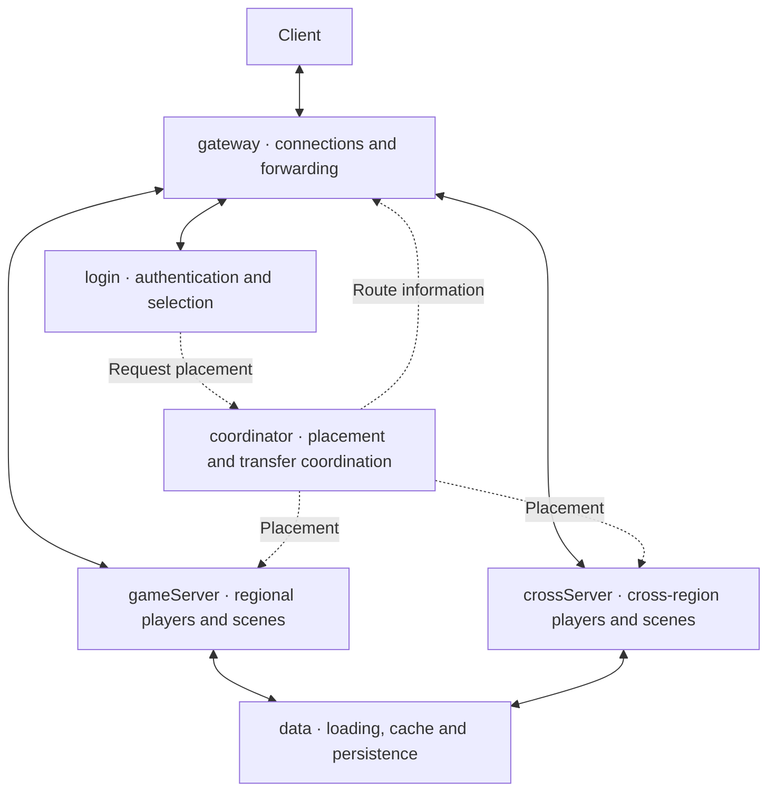
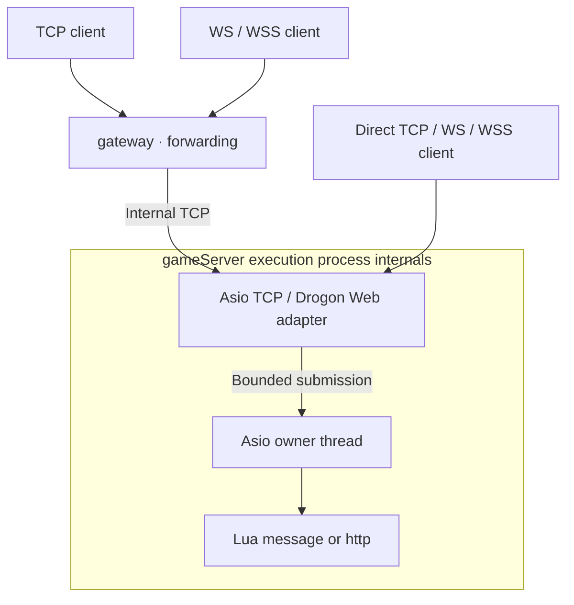

# Architecture and implementation boundary

## Target game-service architecture

This is the **planned responsibility model**, not a completed runtime. Boxes denote service responsibilities, potentially sharing one binary. Solid edges denote intended message/data paths; dashed edges denote placement/route information, not implemented transactions. See [process responsibilities](./process-roles.md). Coordinators operate per region or cross-region group, not as compulsory gameplay relays.

data denotes ownership-aware service access rather than one shared database for every region. Permanent crossServer changes return to home data; protocol/acknowledgement semantics remain unimplemented and the edge does not authorize dual writers. Optional apiServer ingress and its callback flow are described in [HTTP and WebSocket](./http.md).

## Current runnable prototype

Current code provides forwarding, Lua execution and static gateway-to-crossServer routing, not the complete legacy coordination/character/scene runtime. The existing cross-routing policy does not implement World coordination.

Libraries, owner thread and callbacks are grouped inside the execution process. Clients can connect directly or through gateway. `--transport` selects the primary listener, and each extra `--listener PROTO://IP:PORT` adds an independent listener, so one process can serve TCP, WS/WSS and HTTP/HTTPS side by side (cleartext and TLS together). Script roles route HTTP requests to Lua http, game WS/WSS to Lua message, and WebSocket upgrades on an HTTP/HTTPS listener to the Lua websocket lifecycle. MySQL/curl are C++ interfaces; selected bounded asynchronous Redis APIs are exposed to Lua.

## Code layout

| Path | Responsibility |
|---|---|
| `include/mistlane/transport.hpp` | A payload channel shared by TCP, HTTP/HTTPS and WS/WSS |
| `src/node.cpp` | TCP framing, sessions, limits, deadlines, forwarding, routing, lifecycle |
| `src/web.cpp` | Drogon WS/WSS adapter; no custom handshake, masking, or control-frame parser |
| `src/lua_service.cpp` | Lua module table, registry ownership, protected calls, stack restoration |
| `src/lua_service.cpp` | Boost.Redis connection lifecycle and Lua Streams/leaderboard callbacks |
| `include/mistlane/mysql_pool.hpp` | Configuration glue for Boost.MySQL's existing pool |
| `include/mistlane/token_bucket.hpp` | A monotonic-clock limiter adapted from the original design |
| `lua/mistlane/min_heap.lua` | An extracted utility with a module-local export |
| `examples` | Echo, native cross context, MySQL and libcurl examples |
| `tools` | Example client and allowlisted export; integration checks are in tests |

The CMake targets are `mistlane::core` for Lua, `mistlane::net` for nodes, and `mistlane::mysql` for the database pool adapter. They can be linked after adding the project with CMake add_subdirectory. The C++ MySQL interface is not yet bound to Lua.

## Execution and connection model

Each node owns one Asio thread for internal TCP, timers, signals and Lua. Web nodes additionally use Drogon/Trantor event loops for HTTP/TLS/WS, with at most one submitted payload per session. Lua is only entered on Asio. Sessions are full duplex: client frames arrive independently of replies, a handler may send nothing, and unsolicited upstream frames reach the client without a matching request.

Gateway is the forwarding role in this version. Each new session selects an upstream in round-robin order. By default one downstream session owns one upstream TCP connection and stays with that upstream; with `--upstream-multiplex on` the gateway instead shares one connection per upstream across all of its sessions (see the identity paragraph below). A new client connection may select another gameServer; this does not provide player-ID affinity.

A session reads frames as they arrive and keeps one frame in flight toward each peer, so a slow downstream applies back pressure to upstream instead of buffering indefinitely. Writes are queued per channel and bounded: internal frames accept about 2 MiB of backlog and refuse beyond it, while the Drogon side of a WS session is capped by the Trantor 2 MiB high-water mark. Drogon assembles WS/WSS messages and adapts them to internal TCP frames.

TCP frames use a four-byte big-endian payload length. A WS message is one payload without that header. Empty and binary payloads are supported, with a 1 MiB limit. WS responses are binary. The base protocol has no business message ID, account ID, or registration schema. An optional correlation mode adds one: the first frame `MLC2` switches the session to a four-byte big-endian request id carried inside each frame payload (`id | payload`); replies echo the id, unsolicited pushes carry id 0, and `MLC2` is honored only as the first frame — cross routing (`MLC1`) stays exclusive and rejects it. Sessions without the handshake keep the plain framing.

Internal legs can require a service identity: with `--service-token TOKEN`, a session-role node accepts only connections whose first frame is `MLS1 <role> <instance> <token>` and answers `MLS1 OK`; a missing or wrong secret gets `MLS1 ERR TOKEN`, a malformed frame `MLS1 ERR INVALID`, and a plain node that needs no identity answers `MLS1 ERR UNEXPECTED` — every refusal closes the connection. A gateway with `--upstream-token TOKEN --service-name NAME` presents that handshake to each upstream before any business frame and consumes the verdict itself, so clients never see it; `MLC2` may stack on an accepted handshake. With `--upstream-multiplex on` (requires the token, gateways with session routing only) the gateway further upgrades that single upstream leg with `MLM1`: the server answers `MLM1 OK`, every following frame becomes `u32 id | payload` (big-endian), each client session owns an id, unknown ids spawn a logical session on the server under its admission limits, and id 0 carries the `CLOSE <id>` text control either side uses to retire a leg. Correlation stays per logical session — a `MLC2` handshake travels inside one id's payload exactly as on a dedicated connection — and a client-sent `MLM1` is refused with `MLM1 ERR UNEXPECTED`. This is a plain token comparison that surfaces deliberate misconfiguration, not mTLS; the flags refuse to start on cross routing, where `MLC1` is the identity.

A `--role coordinator` node is the process registry, not a forwarding plane: gameServer and crossServer members started with `--coordinator ADDR:PORT` (optionally `--scope NAME`) keep one control connection open, register and heartbeat readiness and load every 500 ms, and are retired on disconnect. `MLR1 QUERY` and `MLR1 PLACE` answer read-only placement lookups in a named scope, preferring ready members with the lowest active/capacity share. A `login` with `--coordinator` is a registry client, not a member: Lua `mistlane.place` asks `MLR1 PLACE` over a fresh connection and returns the placed address to the script. The role refuses scripts and upstreams; placement decisions, ownership states and transfer handshakes are not implemented yet.

| Control | Current behavior |
|---|---|
| Connections | Minimum of --max-connections and conservative memory admission; default effective cap 42 |
| Message rate | Per-session bucket: capacity 200, refill 100 messages/second |
| Handshake | 10-second deadline |
| Waiting for request | 60 seconds idle in either direction; 10 seconds for the cross join verdict |
| Output backlog | About 2 MiB per session; Lua pushes refuse with `session backlogged`, relayed frames close the session |
| Protocol/timeout/callback/upstream failure | Close the affected session; do not automatically replay a potentially executed request |
| SIGTERM / SIGINT | Close listener, cancel sessions, invoke current shutdown callback, drain cancellation handlers |
| SIGHUP | Load and initialize another VM; replace only on success; reset module state |

Shutdown currently cancels active requests; it is not transactional persistence, application request draining, or a graceful WS close handshake. Successful VM replacement retires the previous module through stop/shutdown but does not migrate its state.

## What was extracted or replaced

See the [migration status ledger](./migration-status) for the fuller inventory of retained, replaced, deferred and excluded framework capabilities.

| Original component | Outcome |
|---|---|
| FogsProcess / FogsServer / LuaCallHandler | Retained lifecycle concepts, reimplemented as Node / LuaService |
| TcpConn / SendBuffer / handwritten WebSocket | New TCP framing; mature Drogon WS/WSS implementation; wire compatibility intentionally broken |
| ServerConnBase | Shared-connection multiplexing migrated as `MLM1`; original registration handshake and reconnect behavior not migrated |
| Gateway / World / Hegel | Generic forwarding/execution only; World coordination and Hegel character/scene hosting are not fully migrated; see process responsibilities |
| TokenBucket | Rewritten around a monotonic clock with accumulated replenishment |
| MinHeap | Extracted utility with module export; original bounded heap semantics retained |
| SQL and custom connection management | Boost.MySQL pool and parameter binding; no old schemas or dirty-write cache |
| Game and delivery environment | Gameplay, configuration, payments, SDKs, operations scripts, and binaries excluded |

Most of this is a new implementation of architectural ideas, not the original C++ tree compiled against newer dependencies. Directly derived utility material is limited to MinHeap and the limiter design. Source provenance and retained third-party license notices are listed in NOTICE.

The heap retains the original bounded-selection behavior: when full, smaller incoming elements are discarded. It is not an unbounded general-purpose priority queue.

## Current limitations

Original login, account routing, player migration, legacy cross-server gameplay, navigation, caches, and operational features are excluded. This version also lacks service discovery, discovery-based health routing (cross nodes do gate new joins on the static PROBE1 readiness of their configured upstreams), automatic reconnect, durable replay, distributed consistency, global backpressure, production metrics collection, and measured capacity limits.

Scripts are trusted application code. The instruction hook helps with typical infinite loops but is not an unbypassable CPU budget or a memory quota. Database integration is a separate C++ adapter and example; a general asynchronous Lua database bridge is not implemented. Successful network delivery does not imply transaction durability.

## Suggested next experiments

1. Use a small application to study deployment, error contracts, session recovery, and lifecycle behavior.
2. Add registration/authentication, request correlation, routing policies, or reconnect only as needed, retaining mature network and database implementations.
3. Introduce an asynchronous application database interface with value binding, timeouts, transactions, and explicit errors, rather than exposing raw pointers to Lua.
4. Define application state migration and request draining before attempting a complete game migration.
5. Use stress, soak, and fault-injection results before making operational stability claims.

## Detailed contracts

See [Lua lifecycle](./lua), [native cross-server routing and admission](./cross-server), and [Drogon/libcurl HTTP integration](./http).

Character transfer, home-data persistence and map-loading boundaries are covered in [players, scenes and cross-region execution](./player-scene-model.md).
