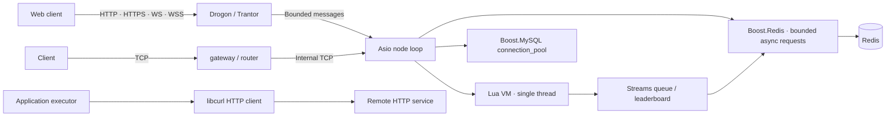

# Architecture and migration

Mistlane is an extraction and modernization exercise from a legacy game backend, intended for research and learning. The current version does not claim production readiness or compatibility with the old cluster.

## System architecture

MySQL and curl remain C++ extension interfaces. Redis is optional and is exposed to worker Lua scripts through bounded asynchronous Streams and sorted-set leaderboard APIs.

## Code layout

| Path | Responsibility |
|---|---|
| `include/mistlane/transport.hpp` | A payload channel shared by TCP, HTTP/HTTPS and WS/WSS |
| `src/node.cpp` | TCP framing, sessions, limits, deadlines, forwarding, routing, lifecycle |
| `src/web.cpp` | Drogon WS/WSS adapter; no custom handshake, masking, or control-frame parser |
| `src/lua_service.cpp` | Lua module table, registry ownership, protected calls, stack restoration |
| `src/lua_service.cpp` | Boost.Redis connection lifecycle and Lua Streams/leaderboard callbacks |
| `include/mistlane/mysql_pool.hpp` | Configuration glue for Boost.MySQL's existing pool |
| `include/mistlane/token_bucket.hpp` | A monotonic-clock limiter adapted from the original design |
| `lua/mistlane/min_heap.lua` | An extracted utility with a module-local export |
| `examples` | Echo, native cross context, MySQL and libcurl examples |
| `tools` | Example client and allowlisted export; integration checks are in tests |

The CMake targets are `mistlane::core` for Lua, `mistlane::net` for nodes, and `mistlane::mysql` for the database pool adapter. They can be linked after adding the project with CMake add_subdirectory. The C++ MySQL interface is not yet bound to Lua.

## Execution and connection model

Each node owns one Asio thread for internal TCP, timers, signals and Lua. Web nodes additionally use Drogon/Trantor event loops for HTTP/TLS/WS, with at most one submitted payload per session. Lua is only entered on Asio. WS clients must wait for each response before submitting another request; pipelining closes the session.

Gateway and router are deployment roles with the same forwarding mechanism in this version. Each new session selects an upstream in round-robin order. One downstream session owns one upstream TCP connection and stays with that upstream. A new client connection may select another worker; this does not provide player-ID affinity.

A session reads one request, obtains one response, writes it, and then reads the next request. There is no unbounded application send queue. Drogon assembles WS/WSS messages and adapts them to internal TCP frames.

TCP frames use a four-byte big-endian payload length. A WS message is one payload without that header. Empty and binary payloads are supported, with a 1 MiB limit. WS responses are binary. There is no business message ID, account ID, or registration schema in this protocol.

| Control | Current behavior |
|---|---|
| Connections | Minimum of --max-connections and conservative memory admission; default effective cap 42 |
| Message rate | Per-session bucket: capacity 200, refill 100 messages/second |
| Handshake | 10-second deadline |
| Waiting for request | 60 seconds to read the next complete request |
| Request/response | 10 seconds from a complete request through forwarding and response |
| Protocol/timeout/callback/upstream failure | Close the affected session; do not automatically replay a potentially executed request |
| SIGTERM / SIGINT | Close listener, cancel sessions, invoke current shutdown callback, drain cancellation handlers |
| SIGHUP | Load and initialize another VM; replace only on success; reset module state |

Shutdown currently cancels active requests; it is not transactional persistence, application request draining, or a graceful WS close handshake. Successful VM replacement retires the previous module through stop/shutdown but does not migrate its state.

## What was extracted or replaced

See the [migration status ledger](./migration-status) for the fuller inventory of retained, replaced, deferred and excluded framework capabilities.

| Original component | Outcome |
|---|---|
| FogsProcess / FogsServer / LuaCallHandler | Retained lifecycle concepts, reimplemented as Node / LuaService |
| TcpConn / SendBuffer / handwritten WebSocket | New TCP framing; mature Drogon WS/WSS implementation; wire compatibility intentionally broken |
| ServerConnBase | Per-session upstream connection; original shared connection, registration handshake, and reconnect behavior not migrated |
| Gateway / World / Hegel | Generic gateway / router / worker topology without player, scene, or global gameplay logic |
| TokenBucket | Rewritten around a monotonic clock with accumulated replenishment |
| MinHeap | Extracted utility with module export; original bounded heap semantics retained |
| SQL and custom connection management | Boost.MySQL pool and parameter binding; no old schemas or dirty-write cache |
| Game and delivery environment | Gameplay, configuration, payments, SDKs, operations scripts, and binaries excluded |

Most of this is a new implementation of architectural ideas, not the original C++ tree compiled against newer dependencies. Directly derived utility material is limited to MinHeap and the limiter design. Source provenance and retained third-party license notices are listed in NOTICE.

The heap retains the original bounded-selection behavior: when full, smaller incoming elements are discarded. It is not an unbounded general-purpose priority queue.

## Current limitations

Original login, account routing, player migration, legacy cross-server gameplay, navigation, caches, and operational features are excluded. This version also lacks service discovery, discovery-based health routing (cross nodes do gate new joins on the static PROBE1 readiness of their configured upstreams), shared-connection multiplexing, request correlation, automatic reconnect, durable replay, distributed consistency, global backpressure, production metrics collection, and measured capacity limits.

Scripts are trusted application code. The instruction hook helps with typical infinite loops but is not an unbypassable CPU budget or a memory quota. Database integration is a separate C++ adapter and example; a general asynchronous Lua database bridge is not implemented. Successful network delivery does not imply transaction durability.

## Suggested next experiments

1. Use a small application to study deployment, error contracts, session recovery, and lifecycle behavior.
2. Add registration/authentication, request correlation, multiplexing, routing policies, or reconnect only as needed, retaining mature network and database implementations.
3. Introduce an asynchronous application database interface with value binding, timeouts, transactions, and explicit errors, rather than exposing raw pointers to Lua.
4. Define application state migration and request draining before attempting a complete game migration.
5. Use stress, soak, and fault-injection results before making operational stability claims.

## Detailed contracts

See [Lua lifecycle](./lua), [native cross-server routing and admission](./cross-server), and [Drogon/libcurl HTTP integration](./http).
