# Avatar lifecycle: the full player-object cycle and its oracle

Status: design note (2026-11-22). This page extends the [avatar runtime](./avatar-runtime.md) from its six-state skeleton into the complete player-object cycle: login and character selection, scene and AOI entry, in-scene sync, transfer (same process, cross process, cross server), disconnect and reconnect, logout and reclamation, the server-wide daily reset, and the runtime spawn and destroy of objects. It is the anchor for the whole lifecycle effort: the oracle state machine below is the single authoritative table that the spawn/destroy contract, the reconnect and daily-reset contract, and the cross-server lifecycle contract are measured against. Nothing on this page changes CLI behavior; the framework today has sessions, framing, Lua message execution, an in-process entity runtime with descriptor-driven spawn/route/destroy, and an MLD1 record endpoint, and no Avatar type (`grep -rniE "\b(struct|class)\s+(Scene|Map|Avatar)\b" include/ src/` returns nothing). No runtime described below is implemented or validated.

Ownership stays where the baseline pages put it: the Session/Avatar split and data ownership are the [model page's](./player-scene-model.md); instance prepare states and cleanup order are the [scene lifecycle's](./scene-lifecycle.md); single-writer authority, the participant context and the writer-lease handoff are the [cross return protocol's](./cross-return-protocol.md); the property schema, dirty tracking, snapshot encoding and AOI dispatch are the [entity contract chain's](./entity-contract.md). Those pages are cited, not copied. Where this page narrows an existing statement the [errata table](#relationship-and-errata) names the line and the point; the old pages are not edited here.

## The oracle: states

The baseline page fixes six states — five non-terminal (`loading`, `active`, `suspended`, `transferring`, `closing`) and one terminal (`closed`). The full cycle needs three more. Each addition is argued here, not slipped in:

| New state | Why six is not enough | What it isolates |
|---|---|---|
| `reconnecting` | The baseline folds a reattach into one edge (`suspended --> active : reattach within grace`). A reattach is not instantaneous: the framework must authenticate the returning session (ticket or renewed ticket), re-bind the client leg and catch the avatar's state up (oplog replay or snapshot baseline plus delta) before any handler may run. During that window the avatar is neither `suspended` (a reattach is in flight; it cannot be re-attempted concurrently) nor `active` (handlers must still be refused). Without the state, "reattach rejected mid-flight" has no home and the refusal code cannot be decided mechanically | The in-flight reattach attempt inside the grace window |
| `visiting` | The baseline has one `transferring` state and one `active` state, both written from the home host's point of view. A character executing on a crossServer is not `transferring` (nothing is in flight) and is not plain `active` (its durable writes ride a provisional lease, its return route is pinned, its admission can be revoked). The cross-server lifecycle page expands this state's interior (lease table, admission hooks, return paths); the oracle here only fixes its position | Active participation on a crossServer under a provisional write lease |
| `purged` | The baseline's only terminal is `closed`, reached through ordered cleanup. A runtime destroy (a character kicked mid-session, an object deleted while active) is not an ordered close: the cleanup budget is bounded, obligations are flushed best-effort, and the durable record is deleted or tombstoned rather than kept for reload. Folding that into `closed` would make "absent, re-loadable" and "absent, destroyed" indistinguishable, and the destroy contract's tombstone semantics would have no state to attach to | Forced destruction with a bounded cleanup and a destroyed durable record |

`closed` and `purged` are both "absent from this host"; they differ in the durable record (`closed` retains it for reload, `purged` deletes or tombstones it per the destroy contract) and in how the cleanup ran (ordered vs bounded best-effort).

The oracle runs over *(state, hosting role)* pairs, hosting role ∈ {`home`, `cross`}. The pair is needed because three transitions name their destination by role (`load_ok`, `reattach_ok`, `transfer_fail` land on `active` at a home host and on `visiting` at a cross host). The role is a fixed attribute of the host process, never a per-event choice, so the machine stays decidable.

### State diagram

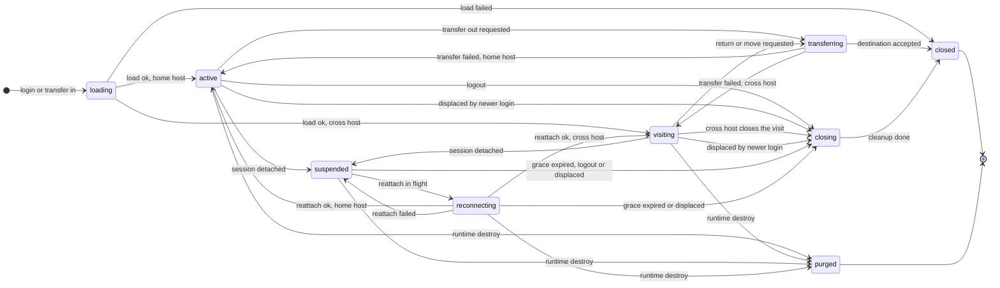

### Events

The oracle recognizes exactly these events. Anything else is not a lifecycle event and cannot move the machine.

| Event | Meaning | Raised by |
|---|---|---|
| `load_ok` | The record (home data or transfer snapshot) resolved and passed validation | The load path |
| `load_fail` | The load failed, was refused, or overran its budget | The load path |
| `detach` | The owning session disconnected (heartbeat timeout or TCP RST, indistinguishable at the lifecycle) | The session layer |
| `reattach_req` | A session presents itself as the owner's return; authentication and catch-up begin | The session layer |
| `reattach_ok` | The reattach authenticated and the state catch-up completed | The reattach path |
| `reattach_fail` | The reattach was refused (credential, generation or catch-up failure); the grace window keeps running | The reattach path |
| `grace_expire` | The suspension grace window elapsed with no successful reattach | The grace timer |
| `displaced` | A newer login or admission for the same character won the single-writer slot | Login or the coordinator |
| `close_req` | An explicit logout or an ordered host shutdown reaching this avatar | Session or host |
| `destroy_req` | A runtime destroy of this object (kick with record deletion, GM delete, business destroy) | Application through the destroy contract |
| `transfer_req` | A transfer out was requested and accepted for processing | Scene, coordinator or application |
| `transfer_ok` | The destination accepted the participant; the source releases | The transfer path |
| `transfer_fail` | The transfer failed or timed out before the destination fence | The transfer path |
| `cleanup_done` | The close path finished its ordered obligations | The close path |

### The authoritative transition table

Every legal transition is listed. A *(state, event)* pair not listed is refused without moving the machine, and the refusal carries the state's lifecycle code from the per-state table below. `load_ok`, `reattach_ok` and `transfer_fail` resolve their destination by the hosting role fixed above.

| State | Event | Next state | Notes |
|---|---|---|---|
| `loading` | `load_ok` | `active` / `visiting` | `visiting` only at a cross host materializing from a transfer snapshot |
| `loading` | `load_fail` | `closed` | No avatar is published; the entry is refused with the cause |
| `loading` | `destroy_req` | `purged` | A destroy arriving during load wins: nothing was published, so the record tombstone is all that remains |
| `active` | `detach` | `suspended` | Grace window opens; pending save obligations still run |
| `active` | `close_req` | `closing` | Ordered cleanup: final save, AOI leave, release |
| `active` | `displaced` | `closing` | The newer login wins; this avatar saves and releases |
| `active` | `destroy_req` | `purged` | Bounded cleanup; record deleted or tombstoned |
| `active` | `transfer_req` | `transferring` | In-flight handlers complete first; arrivals are refused from here on |
| `suspended` | `reattach_req` | `reconnecting` | One reattach in flight at a time |
| `suspended` | `grace_expire` | `closing` | Obligations flush; the record is retained for reload |
| `suspended` | `close_req` | `closing` | Explicit close during suspension |
| `suspended` | `displaced` | `closing` | A newer login claims the slot; save and release |
| `suspended` | `destroy_req` | `purged` | Bounded cleanup of a suspended object |
| `suspended` | `detach` | `suspended` | Idempotent: a second transport loss re-arms nothing and moves nothing |
| `reconnecting` | `reattach_ok` | `active` / `visiting` | Handlers resume only after the catch-up commit |
| `reconnecting` | `reattach_fail` | `suspended` | Back into the same grace window; another attempt may follow |
| `reconnecting` | `grace_expire` | `closing` | The window is not extended by failed attempts |
| `reconnecting` | `displaced` | `closing` | The newer login wins even mid-reattach |
| `reconnecting` | `destroy_req` | `purged` | Bounded cleanup |
| `transferring` | `transfer_ok` | `closed` | Destination accepted and the home fence committed; the source releases |
| `transferring` | `transfer_fail` | `active` / `visiting` | The avatar returns to where it was, with its state intact |
| `transferring` | `destroy_req` | `purged` | A destroy aborts the transfer first, then runs the bounded cleanup |
| `visiting` | `detach` | `suspended` | The visit is paused, not ended; the lease obligations stay |
| `visiting` | `transfer_req` | `transferring` | Return to home or move to another cross host |
| `visiting` | `close_req` | `closing` | The cross host closes the visit (shutdown, admission revoked) |
| `visiting` | `displaced` | `closing` | A newer claim on the character wins |
| `visiting` | `destroy_req` | `purged` | Bounded cleanup on the cross host; the return protocol governs what flushes |
| `closing` | `cleanup_done` | `closed` | Always: a failed save is surfaced to the operator, it does not hold the avatar open |
| *any* | anything else | refused | The state's lifecycle code; the machine does not move |

### Per-state contract

| State | Entered when | Left when | Hooks that may run | Refused, with code | Persistence obligation | Sync visibility |
|---|---|---|---|---|---|---|
| `loading` | The framework creates the avatar from a loaded record or a transfer snapshot | `load_ok` or `load_fail` (or `destroy_req`) | `avatar_load` only | Every handler and every other hook — `IN_FLIGHT` | None: no durable write may originate here; the record belongs to the home data domain | Invisible: no AOI presence, no client traffic |
| `active` | `load_ok` at a home host, or `reattach_ok` returning home | Any `active`-row event above | `avatar_enter`, `avatar_tick`, `avatar_save`, `message` handlers, `avatar_leave`, the AOI pair (`onEnterWorld` on the avatar, `onEnterAOI`/`onLeaveAOI` on either side of a sight edge), the daily-reset pair | Lifecycle events other than the listed ones — `INVALID`; a draining host refuses handlers with the existing `NOT_READY` | Durable writes allowed while the hosting generation is current; `avatar_save` is the only forced-save entry | Visible to observers within interest; owner receives `OWN_CLIENT` deltas |
| `suspended` | `detach` while `active` or `visiting` | `reattach_req`, `grace_expire`, `close_req`, `displaced`, `destroy_req` | `avatar_save` (pending obligations), `avatar_fail`; nothing else | Every handler, `avatar_tick`, new participation — `DETACHED` | Pending save obligations still run; no new durable gameplay writes | Still observer-visible (the body persists through the grace window); the owner receives nothing |
| `reconnecting` | `reattach_req` while `suspended` | `reattach_ok`, `reattach_fail`, `grace_expire`, `displaced`, `destroy_req` | None: authentication and catch-up are framework operations, not hooks | Every handler — `DETACHED`; a second concurrent reattach — `IN_FLIGHT` | Same as `suspended`: pending obligations continue | Same as `suspended`; owner deltas resume only after `reattach_ok` commits |
| `transferring` | `transfer_req` while `active` or `visiting` | `transfer_ok`, `transfer_fail`, `destroy_req` | `avatar_transfer_out` (source) / `avatar_transfer_in` (destination); `avatar_fail` | Every handler and tick — `IN_FLIGHT` | Freeze and flush the final ordered changes; the home fence must commit before the source releases | Frozen: the source stops syncing at `transfer_req`; the destination syncs only after its own `load_ok` |
| `visiting` | `load_ok` at a cross host, or `reattach_ok` back into a visit | Any `visiting`-row event above | The `active` set plus the cross-visit hooks (`onCrossVisitStart`/`onCrossVisitEnd` fire at the edges; admission and lease hooks are the cross-server lifecycle page's) | Same refusal set as `active`; a revoked admission — `FORBIDDEN` | Durable character changes ride the provisional write lease and need `ACK durable`; cross-local state stays cross-local | Visible to observers on the cross host; owner deltas flow over the visit leg |
| `closing` | `close_req`, `grace_expire`, `displaced` (or the cross host closing a visit) | `cleanup_done` | `avatar_save` (best-effort final), `avatar_leave`, `avatar_fail` | Every handler and new entry — `IN_FLIGHT` | Best-effort final flush; a failed save is reported, not retried inside the close | AOI leave runs first, then the avatar stops being observable |
| `closed` | `cleanup_done`, `load_fail`, or `transfer_ok` (source release) | Never on this host; a later login creates a new avatar through `loading` | None: the object is absent | Everything — `ABSENT` | The durable record is retained, re-loadable | Absent |
| `purged` | `destroy_req` from any live state | Never; the record is gone or tombstoned | `avatar_leave` and the destroy contract's obligations, `avatar_fail` | Everything — `ABSENT` | Record deleted or tombstoned per the destroy contract; unacknowledged lease writes are lost by the return protocol's rules | Absent after the AOI leave broadcast |

### Refusal codes

The lifecycle reuses the closed `EntityError` vocabulary wherever one already names the condition (`NOT_READY` for a draining host or a scene that is not ready, `STALE` for a lost generation race, `CAPACITY` for bounded-queue refusal, `INVALID` for a malformed or nonsensical request, `UNROUTED` for no current route) and adds exactly three codes so every lifecycle refusal is decidable from the state alone:

| Code | Meaning | Answered from |
|---|---|---|
| `IN_FLIGHT` | The avatar exists but is mid-transition (`loading`, `transferring`, `closing`); nothing is accepted, nothing is queued | `loading`, `transferring`, `closing` |
| `DETACHED` | The avatar is present but its owner session is gone; the only way back is the reattach path | `suspended`, `reconnecting` |
| `ABSENT` | No avatar exists at this identity on this host; a new entry goes through `loading`, never a resurrection | `closed`, `purged` |

A resurrected `closed` avatar is a *new* avatar object: the oracle has no `closed → active` edge, and the baseline's rule that a reconnect never resurrects a closed avatar stays verbatim.

## The cycle, segment by segment

Eight segments cover the cycle. Each is drawn as it is *specified*, not as anything implemented today; the implementation status stays with the baseline pages.

### 1. Login, character selection and first activation

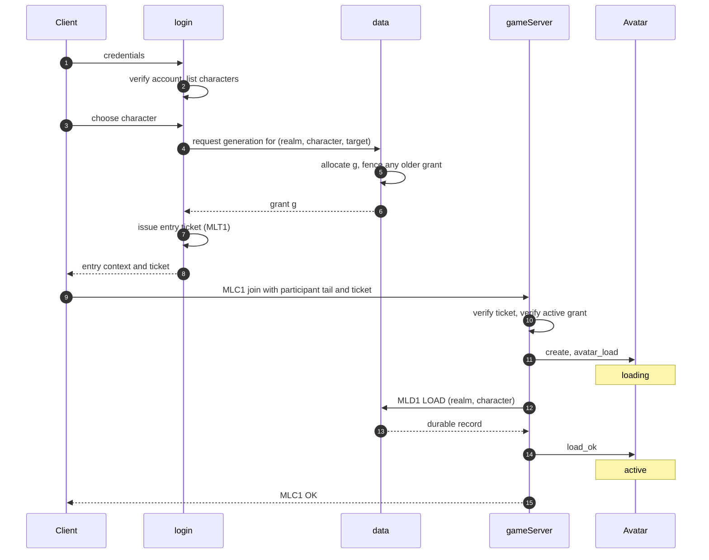

A failed `avatar_load` publishes nothing: the join is refused with the cause and the avatar goes `closed` without ever having been visible. A failed ticket or grant refuses the join before any avatar exists.

### 2. Scene entry and AOI appearance

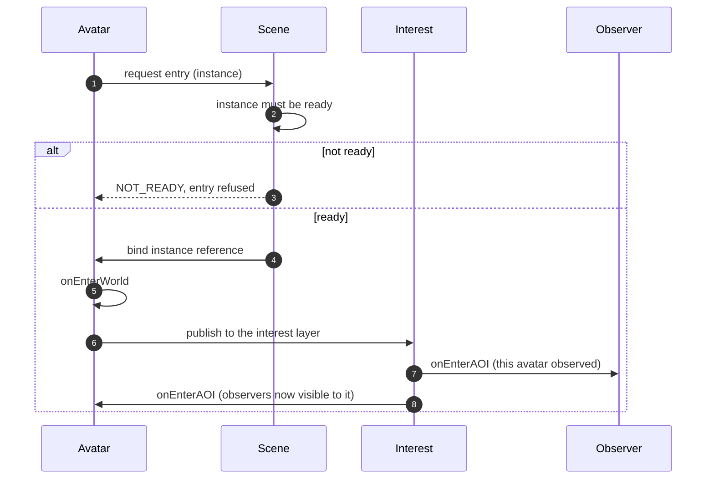

Entry is refused unless the instance is `ready` — the scene lifecycle's rule, unchanged here. The two AOI hooks are one edge seen from both sides: the entering avatar's own `onEnterWorld` fires once at the avatar, and each affected observer pair exchanges `onEnterAOI`. Leaving an interest radius is the mirrored `onLeaveAOI` on both sides; it is not a lifecycle transition and the avatar stays `active`.

### 3. In-scene sync and heartbeat

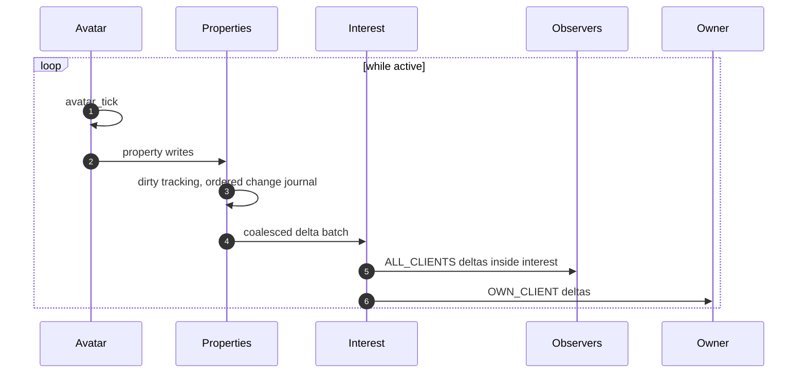

Nothing in this segment moves the oracle. Dirty tracking, baseline/delta encoding and AOI filtering are the entity contract chain's; the lifecycle only guarantees the state they run in (`active` or `visiting`) and that no other state runs them.

### 4. Transfer

Same-process scene switches do not touch the oracle (the avatar stays `active`, only its instance reference changes). Cross-process and cross-server transfers share one source-side sequence; the difference is the destination's role.

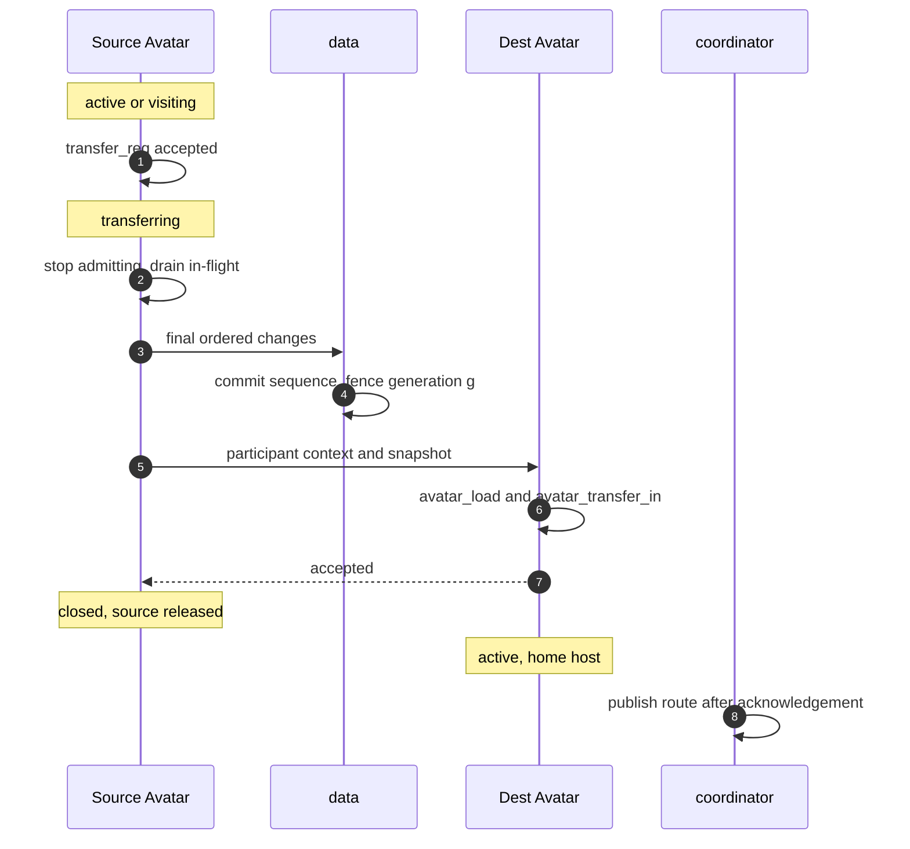

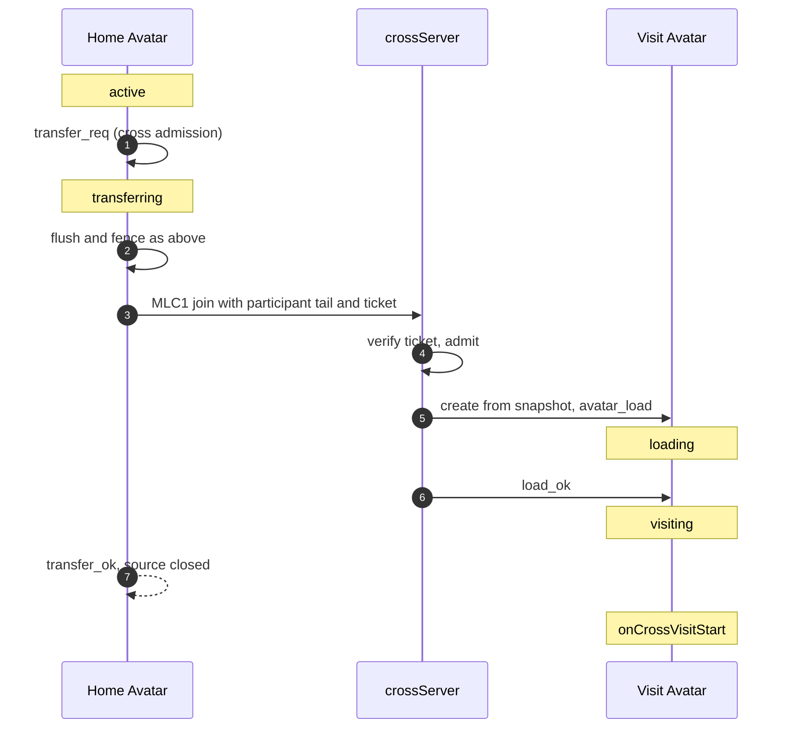

A failure or timeout before the destination fence returns the source to where it was (`active` at a home host, `visiting` at a cross host) with its state intact; after the fence the destination must resume, or recovery must issue a newer generation — the return protocol's rule, not re-decided here.

### 5. Disconnect, reattach and the grace window

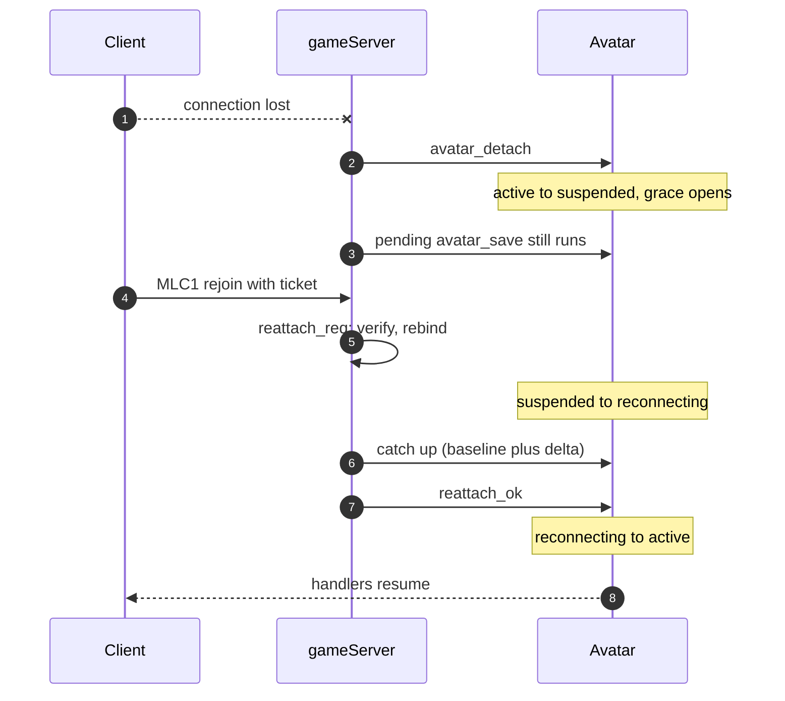

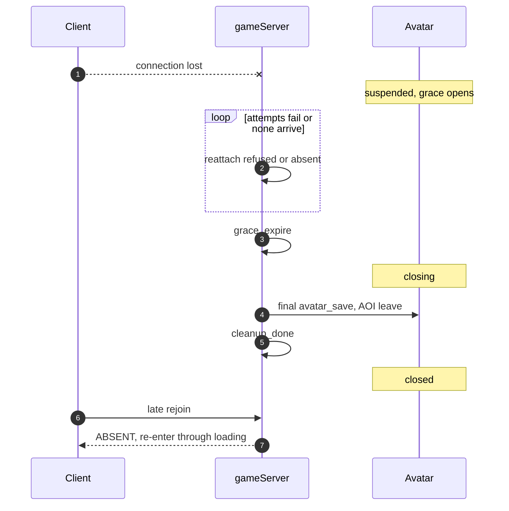

A disconnect is detected as a transport loss; the lifecycle does not distinguish heartbeat timeout from TCP RST — that classification is the session layer's problem and stays there. Failed reattach attempts return to `suspended` and never extend the window. A newer login for the same character (`displaced`) closes the old avatar through the ordinary `closing` path from any live state. The full reconnect contract — detection thresholds, reattach credential rules, the catch-up pipeline, the displacement race — is expanded in its own slice; the oracle here is the frame it must fit.

### 6. Logout, save and reclamation

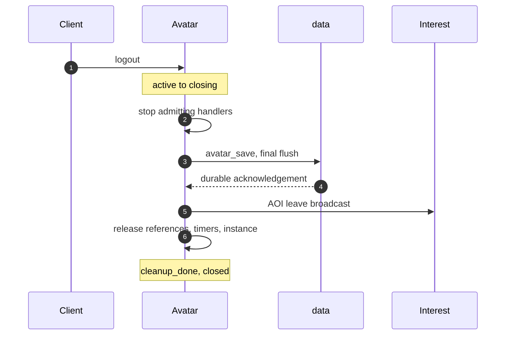

The ordered cleanup is the scene lifecycle's order applied to the avatar: stop accepting entry, stop timers, evacuate the AOI presence, free instance state, release references. `avatar_save` is the only forced-save entry; the close path waits for the durable acknowledgement of the final change-set where the return protocol requires one, and a failed save is surfaced to the operator without holding the avatar open.

### 7. Daily reset

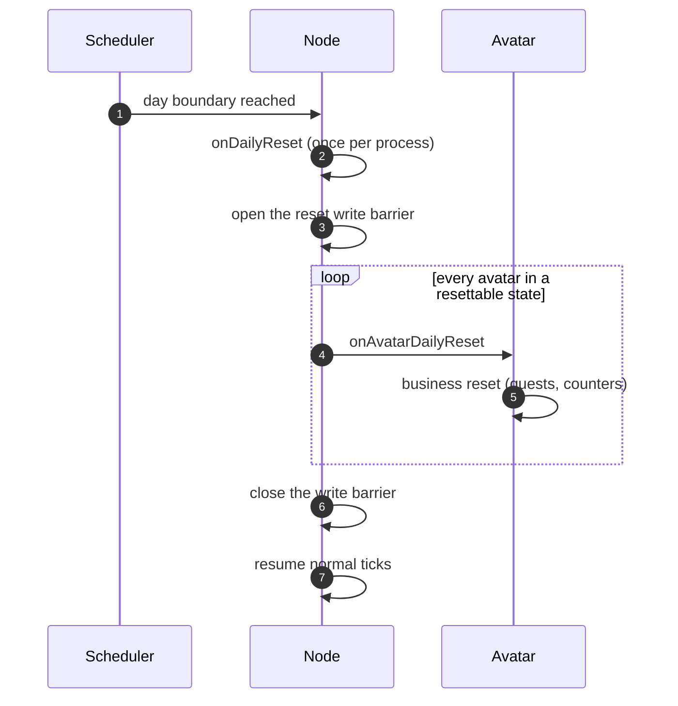

Daily reset is an *event*, not a state: it never appears in the transition table. It is delivered to avatars in `active` and `visiting`, deferred for `suspended` and `reconnecting` avatars until they leave the suspension window, and never delivered to `loading`, `transferring`, `closing` or absent avatars — a missed reset is recovered by the deferred queue, never by re-firing into a mid-transition state. The reset hooks, the trigger surface (one scheduler versus per-process self-trigger), the three-layer touch order, the write barrier and the failure compensation are specified in the reconnect-and-daily-reset slice; this segment fixes only the touch surface above and its interaction with the oracle.

### 8. Runtime spawn and destroy

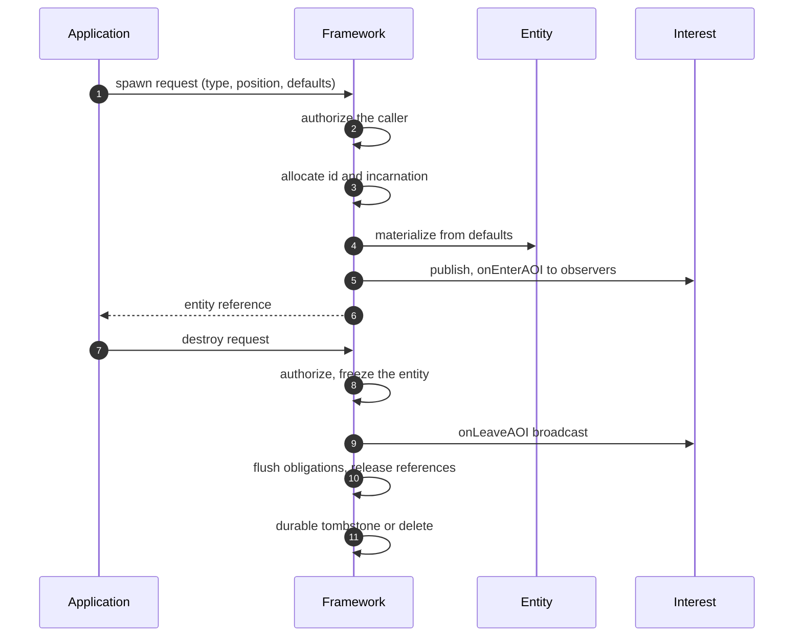

Spawn and destroy of non-avatar objects (monsters, NPCs, business entities) do not appear in the avatar transition table — they are the entity contract chain's objects. They touch the oracle only through the AOI edges (`onEnterAOI`/`onLeaveAOI`) that avatars observe while `active` or `visiting`, and through `purged` when the destroyed object is an avatar itself. Creation mid-lifecycle (a spawn arriving while the scene is mid-prepare or the target avatar is `transferring`) and mid-life destruction (an active entity destroyed under load) with their failure compensation are specified in the spawn/destroy contract slice; this segment fixes only the edges the oracle already names.

## Relationship and errata

| Concept here | Baseline page and section | Relation |
|---|---|---|
| Six baseline states, five non-terminal plus `closed` | [avatar runtime, Avatar states](./avatar-runtime.md) | Extended by `reconnecting`, `visiting`, `purged`, each argued above |
| Session/Avatar split, identity tuple, one active writer per character | [model page, Session, Avatar and data ownership](./player-scene-model.md) | Cited, unchanged |
| `loading` refuses everything, no invisible queueing | [avatar runtime, state rules](./avatar-runtime.md) | Restated as `IN_FLIGHT`; the code vocabulary is new, the rule is the baseline's |
| `suspended` keeps pending save obligations, refuses new participation | [avatar runtime, state rules](./avatar-runtime.md) | Restated; `reconnecting` narrows the reattach edge into two steps, `reattach_fail` returns to `suspended` |
| `transferring` freezes, flushes, fences before release | [cross return protocol, writer lease handoff](./cross-return-protocol.md) | Cited, unchanged; `transfer_ok` is that protocol's post-fence release |
| Scene entry only into a `ready` instance | [scene lifecycle, instance states](./scene-lifecycle.md) | Cited, unchanged; the avatar's `NOT_READY` refusal is that page's rule |
| Ordered cleanup order on close | [scene lifecycle, cleanup](./scene-lifecycle.md) | Applied to the avatar in segment 6 |
| Durable writes need `ACK durable`; unacknowledged lease writes are lost on crash | [cross return protocol, MLD1](./cross-return-protocol.md) | Cited in `visiting` and `purged`; zero protocol conflict |
| AOI is a requirement, not an implemented feature | [big map](./big-map.md), [entity contract chain](./entity-contract.md) | Cited; segments 2–3 specify behavior for the runtime that implements those requirements |
| Entry ticket and `MLC1` tail | [cross server, handshake](./cross-server.md), [service contracts, login](./service-contracts.md) | Cited in segments 1 and 4; unchanged |

Errata — conflicts between this page and the older pages, listed for a decision rather than edited in place:

| Baseline line | Conflict | This page's position |
|---|---|---|
| `docs/avatar-runtime.md:53` | "`active` — The only state that runs `message` handlers and `avatar_tick`" | `visiting` also runs handlers and ticks (a cross host's active participation). The sentence is true per host, false globally; the per-state table above states it per host |
| `docs/avatar-runtime.md:44` | "`transferring --> active : transfer failed or timed out`" is unconditional | On a cross host the failed transfer must return to `visiting`, not `active`; the transition is role-conditional above |

No other conflict was found: every other statement this page touches is either cited unchanged or explicitly extended with an argued new state.

## Deliberately not decided here

- The property schema, dirty tracking, snapshot encoding, baseline/delta catch-up and AOI dispatch: the [entity contract chain](./entity-contract.md).
- Reconnect detection thresholds, reattach credential rules, catch-up ordering, displacement races, grace and budget numbers: the reconnect-and-daily-reset slice; the oracle here fixes only the states they land in.
- Daily reset trigger topology, three-layer ordering, write-barrier mechanics and compensation: the same slice.
- Spawn/destroy authority surfaces, required fields, persistence edges, mid-life destroy compensation and tombstone mechanics: the spawn/destroy contract slice.
- The cross-server visit interior — lease table, admission hooks, degradation order, return and takeover paths: the cross-server lifecycle slice; `visiting` here is only its position in the oracle.
- The single hook registry (names, signatures, threads, failure semantics, Lua mapping): the hook-surface slice; names above are provisional exactly as the baseline page says.
- Grace periods, tick budgets, save cadences and every duration number: measured at implementation, never named here.

## Verification

None today: no Avatar type exists, so this page has no test and no runtime acceptance, and validation records must not claim avatar behavior. The page-level acceptance is documentary: the transition table above is exhaustive (every legal *(state, event)* pair is listed; everything else is refused with the state's code), every mermaid diagram on this page renders, and every relative link resolves. When implemented, acceptance is the ledger's runtime validation chain — login, bounded messaging, scene switch, cross-process and cross-server transfer with return, reconnect inside and outside the grace window, daily reset, and destroy with recovery — not a subset.

Related: [avatar runtime](./avatar-runtime.md), [players, scenes and cross-region execution](./player-scene-model.md), [scene lifecycle](./scene-lifecycle.md), [cross return and single-writer protocol](./cross-return-protocol.md), [cross-server routing and overload](./cross-server.md), [entity contracts and generation](./entity-contract.md), [big maps](./big-map.md).
