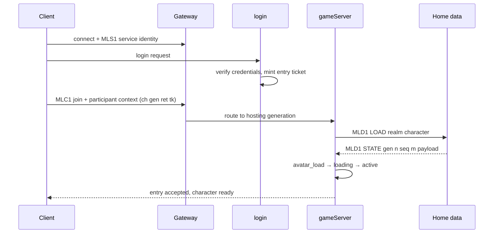
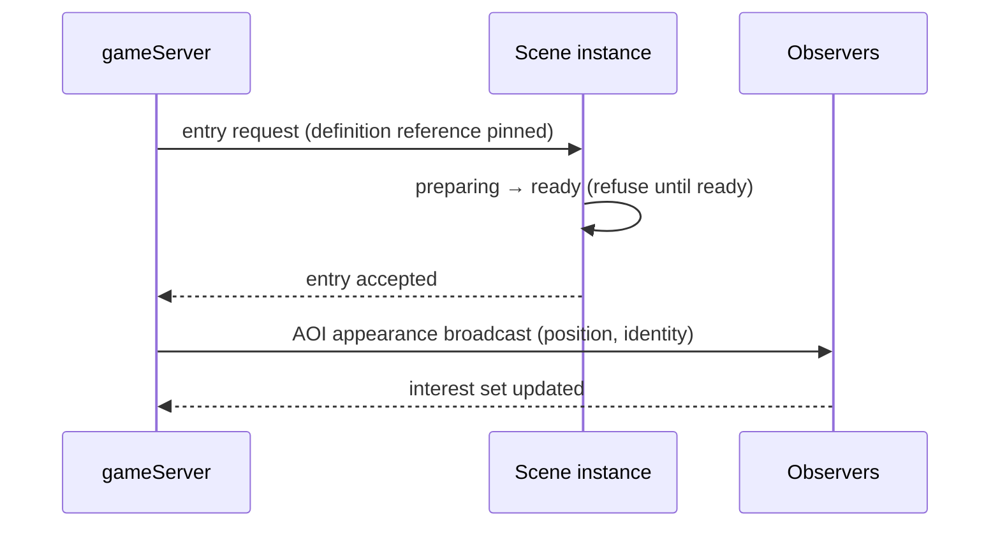
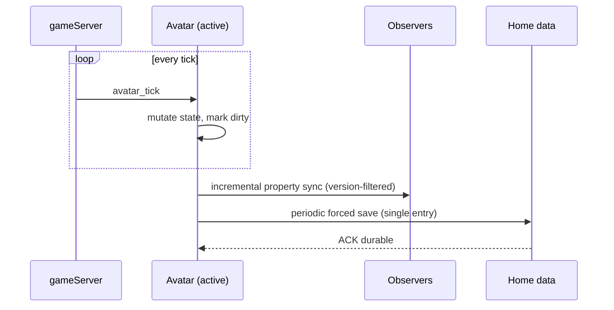
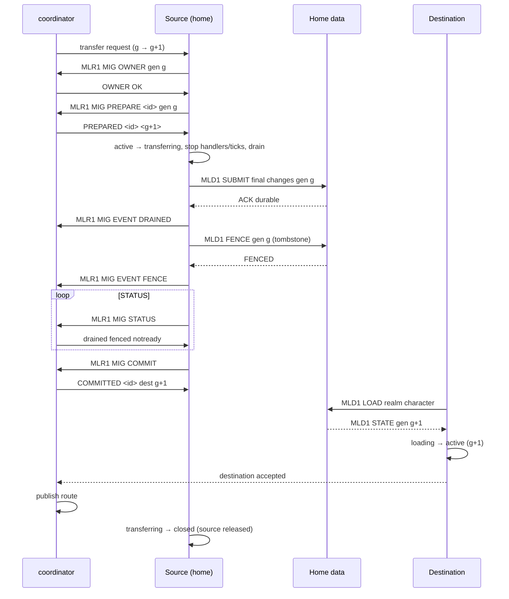
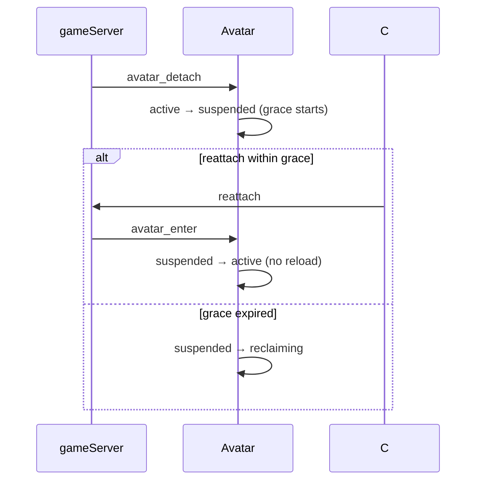
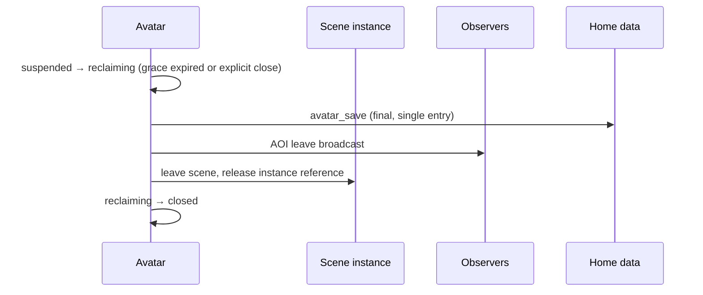
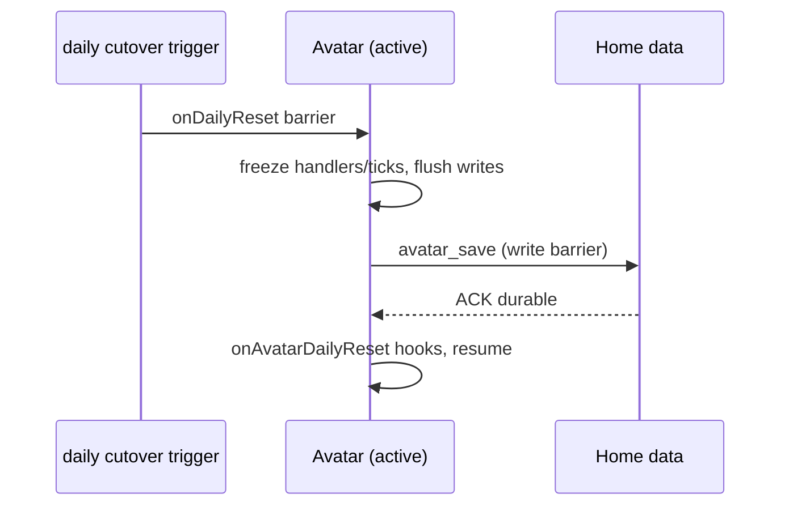
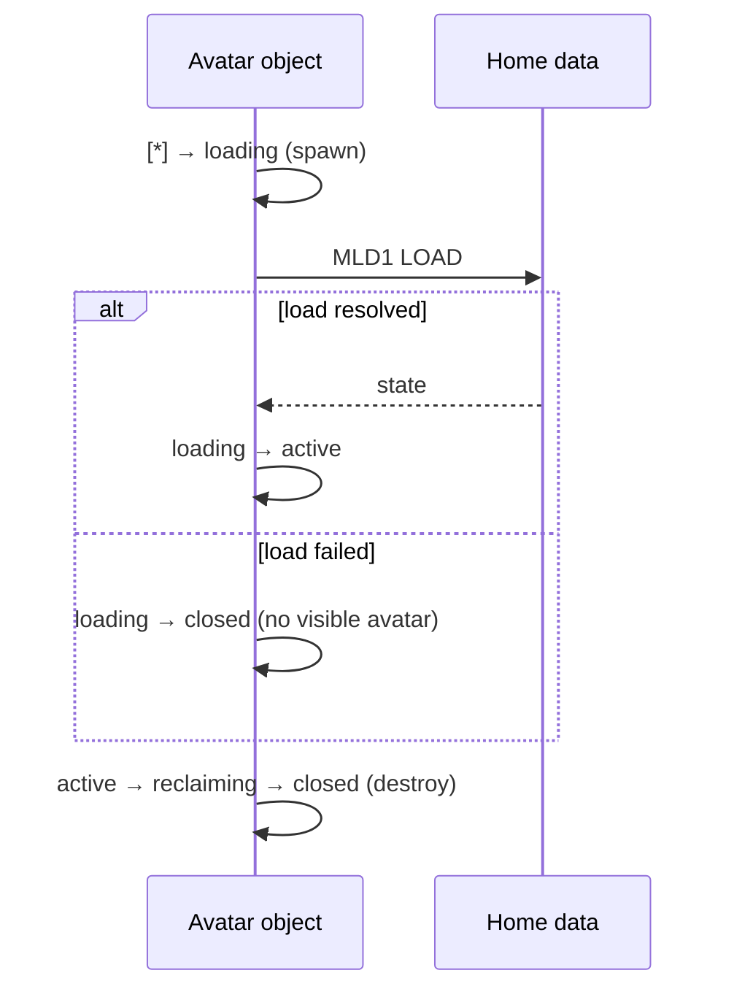
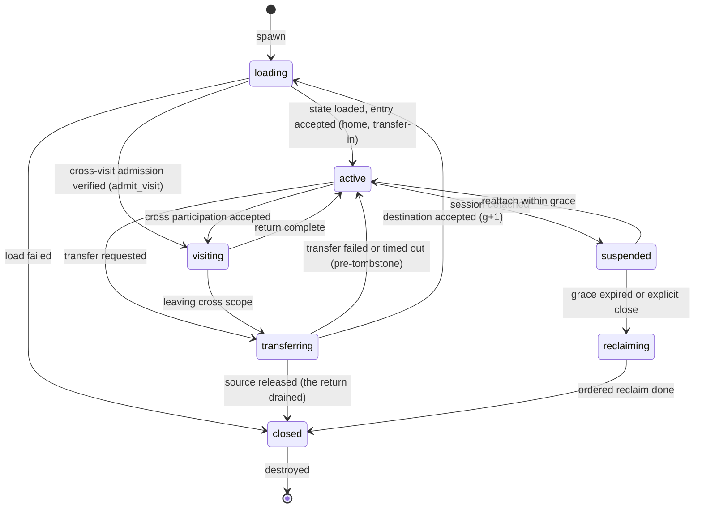

# Avatar full lifecycle: segments, oracle state machine and relationships

Status: decided design (2026-11-22); implemented and pinned end to end since (login chain, transfer, scenes, settlement — 2026-10-20 → 2026-11-26). The seven-state oracle model is implemented and pinned by the avatar.lifecycle model test, its Lua hook surface is wired through the service VM and pinned by the avatar.lua test, and the cross-visit entry edge — `admit_visit`, `close_visit` and the node retirement face — is implemented and pinned by the avatar.session test, so a crossServer join now creates a real `visiting` avatar; the home login path is also wired — a join entering its own realm (realm == return_realm) creates the `active` avatar (avatar_load then avatar_enter), the disconnect suspends it (the grace window opens), a reconnect within grace reattaches to active without a reload, and the node tick runs the ordered reclaim (final save, closed) after grace — pinned by the avatar.home test; and the graceful cross return is wired on the source — a disconnecting visitor whose crossServer has a `--data` endpoint leaves cross scope and releases its avatar exactly when the return queue drains (`cross_leave` then `release`, no best-effort save), pinned by the avatar.return test, while a no-data crossServer keeps the abnormal `close_visit` — the [runtime page](./avatar-runtime.md) names the files; and the destination side of the transfer is wired on the same host — a node polls the coordinator's `MLR1 MIG DESTINED` enumeration for the fenced gaps its own destination lease awaits, loads the frozen record, builds the avatar through `avatar_load` + `avatar_transfer_in`, lands it active and unbound, and acknowledges READY, so the coordinator publishes the destination route — pinned by the avatar.transfer.destination test, while the source side is pinned by avatar.transfer.source; and the avatar now holds its scene reference, which a script moves through `mistlane.scene.switch` — the avatar stays `active`, only the reference changes, no save and no state round-trip, pinned by the avatar.scene.switch test — and the destination transfer-in seeds the landed avatar's scene from the coordinator's `MLR1 MIG DESTINED` answer (now `DESTINED <count> [<realm> <character> <id> <generation> <scene>]...`), pinned by the avatar.transfer.destination and avatar.transfer.full tests — and the scene lifecycle's node wiring is landed too (scene.serving: the resident instances load from their definition's real file and host the avatars that hold them) — the runtime acceptance (the composed normal-login entry flow) remains a later slice
(`grep -rniE "\b(struct|class)\s+(Avatar|Charactor|Player)\b" include/ src/` returns nothing),
so nothing on this page changes CLI behavior and no runtime below is implemented or
validated. This page is the **unified** lifecycle contract the [Avatar runtime](./avatar-runtime.md)
page's five states, the [cross return protocol](./cross-return-protocol.md)'s lease states and the
[scene lifecycle](./scene-lifecycle.md)'s instance states each cover partially; it records where
they agree, where they diverge, and what a single mechanically-decidable oracle looks like.
It does **not** edit those pages — conflicts are recorded as corrigenda (below) and left to a
maintainer. Cross-language page: [简体中文](./zh/avatar-lifecycle.md).

## Why one page

Three contracts describe the same object from three angles, and they already disagree about
what a state means:

| Contract | Subject | States it names | Gap this page closes |
|---|---|---|---|
| [avatar-runtime](./avatar-runtime.md) | The Avatar object at its host | `loading` `active` `suspended` `transferring` `closing` `closed` | No cross-participation state; `suspended → closing` collapses reclaim and operator close |
| [cross-return-protocol](./cross-return-protocol.md) | The **lease**, not the Avatar | `active(g)` `requested(g+1)` `relinquished/tombstoned(g)` `active(g+1)` | Lease states ≠ Avatar states; a crossServer Avatar is a lease, not home authority |
| [scene-lifecycle](./scene-lifecycle.md) | The **scene instance**, not the Avatar | `creating` `preparing` `ready` `failed` | Instance cleanup order must be pinned against Avatar reclaim |

The single-writer invariant is the reason the union matters: [cross-return-protocol](./cross-return-protocol.md#single-writer-authority)
allows **at most one writable Avatar per character** and gives a crossServer only a
*provisional bounded write lease*, while [avatar-runtime](./avatar-runtime.md#avatar-states)'s
`active` means "durable writes allowed". If a cross-hosted Avatar is labelled `active`, the
state machine cannot decide whether a durable write is permitted — the one property the
whole contract chain exists to protect. This page therefore expands the Avatar states to
seven and gives the migration table and transition function that make that decision mechanical.

## The eight lifecycle segments

Each segment is a sequence over the Avatar's lifetime. They are the acceptance-shape the
ledger names (normal login, two-way messaging, same-process scene switch, cross-process and
cross-region transfer with return, callbacks, multi-listener), here decomposed per segment
rather than as one undifferentiated runtime claim.

### 1. Login and character selection

Selection binds the **session** to an **avatar**: the session is the connection's, the avatar is
the character's, and the two lifetimes are deliberately different (the
[object split](./avatar-runtime.md#object-split-session-and-avatar)).

### 2. Enter map and AOI appearance

The instance is `ready` or the entry is refused (scene-lifecycle: "a not-ready destination
refuses entry with an explicit failure"). The map does not travel; only the participant
context and instance-scoped state do.

### 3. Sync heartbeat

`avatar_save` is the only forced-save entry (avatar-runtime property 1). The legacy online
save cadence (300000 ms) and the scene sync cadence (UPDATE_INTERVAL=1000) are observations;
the target cadences are measurement, not this page.

### 4. Transfer

Abort before the tombstone returns the source to `active` (the driver sends ABORT then
EVENT CLEANUP so the request lease is released and the key is not blocked for a later
transfer); after the tombstone only a newer generation may resume. This is the
[lease handoff](./cross-return-protocol.md#writer-lease-handoff) sequence, drawn over the
Avatar object rather than the lease; the source side is implemented (avatar.transfer.source) and
the destination side is implemented on the same host (a node polls the coordinator's `MLR1 MIG
DESTINED` enumeration for the fenced gaps its own destination lease awaits, loads the frozen
record, builds the avatar through `avatar_load` + `avatar_transfer_in`, lands it active and
unbound, and acknowledges READY, so the coordinator publishes the destination route —
avatar.transfer.destination). The composed chain is pinned end-to-end with both hosts real: the
source's `mistlane.transfer` hands off to the destination's poll with no raw-frame driving on
either side, and the destination's READY is what unblocks the source's COMMIT (avatar.transfer.full).

### 5. Disconnect and reconnect

`suspended` never accepts new participation; it exists to finish obligations, not to host
gameplay (avatar-runtime rule 3). Reattach within grace returns to `active` without a reload.

### 6. Offline reclaim

The reclaim order is the scene-lifecycle cleanup order (stop entry, stop timers, evacuate,
free state, release definition reference) applied to this participant; it runs on the failure
path too.

### 7. Daily cutover

Daily cutover is a **barrier, not a state**: it applies to `active` (and `visiting`), forces a
durable save, runs the daily-reset hooks, and returns to the same state. It is the one place
the "five states are enough" intuition is right — adding a state for it would make the oracle
larger without adding a decision.

### 8. Runtime object spawn and destroy

A failed load produces no visible avatar; a failed transfer-out leaves the avatar `active`
where it was (avatar-runtime rule 2). Spawn and destroy are the avatar object's own edges,
independent of any session.

## Oracle state machine

Seven states. The expansion over the five-state page is argued directly below the diagram.

### Why five states are not enough

| Reason | Five-state gap | Consequence if not expanded |
|---|---|---|
| Cross participation is a **lease**, not authority | No state for a crossServer Avatar; it would be labelled `active` | Cannot decide "is a durable write permitted?" — the single-writer invariant becomes unrepresentable |
| Reclaim and operator close are different sequences | `suspended → closing` collapses both | The ordered reclaim (final save, scene release, AOI leave, ref release) cannot be pinned per path |
| Load source differs | `loading` covers home load and transfer-in identically | Cannot decide whether a new generation may resume after a tombstone |

The expansion is **`visiting`** (cross participation, provisional lease, durable changes return
via MLD1) and **`reclaiming`** (ordered reclaim before `closed`, superseding the `closing`
label). `loading` is kept single but gains a **load source** attribute
(`home` | `transfer-in` | `cross-visit`) that the transition function reads: the first two
resolve into `active` after the entry edge, a cross-visit resolves into `visiting` (the lease
face — the framework's verified admission, not `avatar_enter`, is the crossServer's entry
gate). Daily cutover is deliberately **not** a state (segment 7).

## Authoritative migration table

Per state: entry threshold (what must be true to enter), exit triggers, tunable hooks,
rejection code, persistence obligation, sync visibility.

| State | Entry threshold | Exits | Tunable hooks | Rejection code | Persistence obligation | Sync visibility |
|---|---|---|---|---|---|---|
| `loading` | Data request issued; no handler may target this character | load ok → `active` (home, transfer-in); cross-visit → `visiting`; load fail → `closed` | `avatar_load` | `AVATAR_LOADING` | None (no published avatar) | None |
| `active` | Home domain; hosting generation current; entry accepted | detach → `suspended`; transfer → `transferring`; cross accept → `visiting`; destroy → `reclaiming` | `avatar_enter` `avatar_tick` `avatar_save` | `AVATAR_ALREADY_ATTACHED` (duplicate attach) | Durable writes allowed; `avatar_save` is the only entry | Full (AOI) |
| `suspended` | Session detached; grace open; pending save obligations still run | reattach → `active`; grace expired → `reclaiming` | `avatar_detach` | `AVATAR_SUSPENDED` | Pending saves still run | Detach broadcast only |
| `visiting` | Cross admission verified (entry ticket); provisional lease granted | leave → `transferring`; return complete → `active` | `avatar_tick` (cross-local) | `AVATAR_VISITING` (durable write) | Cross-local only; durable changes return via MLD1 | Cross-scope AOI |
| `transferring` | Transfer in flight; no handlers, no ticks; in-flight work drained | pre-tombstone abort → `active`; destination accepted → `loading`; source released (return drained) → `closed` | `avatar_transfer_out` `avatar_transfer_in` | `AVATAR_TRANSFERRING` | Source flushes final ordered changes before tombstone; a pre-tombstone abort also aborts the coordinator transaction (ABORT + CLEANUP); a cross return drains its queue before the release | Frozen |
| `reclaiming` | Grace expired or explicit close; cleanup must run | reclaim done → `closed` | `avatar_save` (final) | `AVATAR_RECLAIMING` | Final save acknowledged before `closed` | AOI leave broadcast |
| `closed` | Ordered cleanup finished | destroyed → `[*]` | `avatar_fail` | `AVATAR_CLOSED` | None | None |

## Transition function (mechanical decidability)

Let the event alphabet be `E_ATTACH, E_DETACH, E_REATTACH, E_GRACE_EXPIRED, E_ENTER,
E_TRANSFER_REQ, E_CROSS_ACCEPT, E_CROSS_LEAVE, E_TRANSFER_ABORT, E_TOMBSTONE_ACCEPT,
E_RETURN_COMPLETE, E_RETURN_RELEASE, E_SPAWN, E_DESTROY, E_DAILY_CUTOVER, E_SAVE_FAIL,
E_LOAD_FAIL, E_OPERATOR_CLOSE`. The oracle is `δ(state, event) → next | refuse(code)`, total by the rule:

> **Every event not listed for a state is refused with that state's rejection code.**

| State | Accepted events (→ next or refuse) |
|---|---|
| `loading` | `E_LOAD_FAIL → closed` · `E_ATTACH/E_ENTER → refuse(AVATAR_LOADING)` · load resolved → `active` (home, transfer-in) · load resolved (source cross-visit) → `visiting` |
| `active` | `E_DETACH → suspended` · `E_TRANSFER_REQ → transferring` · `E_CROSS_ACCEPT → visiting` · `E_DESTROY → reclaiming` · `E_ATTACH → refuse(AVATAR_ALREADY_ATTACHED)` · `E_DAILY_CUTOVER → active` (barrier) |
| `suspended` | `E_REATTACH → active` · `E_GRACE_EXPIRED → reclaiming` · `E_OPERATOR_CLOSE → reclaiming` · `E_ATTACH → refuse(AVATAR_SUSPENDED)` |
| `visiting` | `E_CROSS_LEAVE → transferring` · `E_RETURN_COMPLETE → active` · `E_DAILY_CUTOVER → visiting` (barrier) · durable write → `refuse(AVATAR_VISITING)` |
| `transferring` | `E_TRANSFER_ABORT → active` · `E_TOMBSTONE_ACCEPT → loading` (load source transfer-in) · `E_RETURN_RELEASE → closed` · `E_ATTACH/E_ENTER → refuse(AVATAR_TRANSFERRING)` |
| `reclaiming` | reclaim done → `closed` · `E_SAVE_FAIL → reclaiming` (retry or surfaced) |
| `closed` | `E_SPAWN → loading` · everything else → `refuse(AVATAR_CLOSED)` |

Every transition is framework-driven (only the framework moves an avatar between states;
hooks run at the edges, never inside). The function is total by the refusal rule, so any
event sequence is mechanically decidable: walk the sequence, applying `δ`; a `refuse` halts
with the code and no state change.

## Hook surface per state

The [avatar-runtime hook table](./avatar-runtime.md#the-lua-hook-surface) is unchanged in
signature and failure semantics; this page only assigns which state each hook is valid in.

| Hook | Valid in | Notes |
|---|---|---|
| `avatar_load` | `loading` | Entry to `active` (home, transfer-in) or `visiting` (cross-visit) only on success; failure → `closed`, no visible avatar |
| `avatar_enter` | `loading → active` edge | Entry refused with explicit reason |
| `avatar_leave` | `active → suspended`, `visiting → transferring` | Never blocks the detach. The session detach only: the return's own `cross_leave` (no session bound anymore) runs no hook |
| `avatar_tick` | `active`, `visiting` | Cross-local only when `visiting` |
| `avatar_save` | `active`, `suspended`, `visiting`, `reclaiming` | Single forced-save entry; `reclaiming` save must be durable before `closed`. The return's release never saves (its changes already landed through MLD1); only the abnormal cross close saves best-effort |
| `avatar_transfer_out` | `active → transferring` edge | Abort returns to `active` |
| `avatar_transfer_in` | `loading` (transfer-in) | Failure closes on this host; source keeps the avatar |
| `avatar_detach` | `active → suspended` edge | Logged; avatar goes `suspended` regardless |
| `avatar_fail` | Any state | Best effort; original consequence stands |

## Relationship to the four contracts

| Page | What it contributes | What this page adds |
|---|---|---|
| [avatar-runtime](./avatar-runtime.md) | Object split, hook surface, migration rules, error/reentrancy rules | The oracle that makes the five states mechanically decidable; the `visiting`/`reclaiming` expansion |
| [player-scene-model](./player-scene-model.md) | Session vs Avatar ownership, observed legacy path, target boundary | The segment decomposition that turns the "no Avatar type" status into per-segment acceptance |
| [scene-lifecycle](./scene-lifecycle.md) | Instance prepare states, cleanup order, ref-driven release | Pins Avatar reclaim *against* instance cleanup: reclaim runs before an instance may be closed empty |
| [cross-return-protocol](./cross-return-protocol.md) | Participant context, single-writer authority, MLD1, lease handoff | Maps the lease's `requested/relinquished/tombstoned` onto Avatar `transferring`; `visiting` is the lease's `active` face |

## Corrigenda (recorded, not edited)

These are the conflicts found while unifying; none of the source pages was changed. Each is
recorded here for a maintainer to resolve.

| # | Source | Conflict | Disposition |
|---|---|---|---|
| C1 | [avatar-runtime](./avatar-runtime.md#avatar-states) :41 | `suspended --> closing : grace expired or explicit close` collapses reclaim and operator close into one edge | Split into `suspended → reclaiming` (both triggers); `closing` superseded by `reclaiming` |
| C2 | [avatar-runtime](./avatar-runtime.md#avatar-states) | No cross-participation state; a crossServer Avatar is implied `active` | Add `visiting`; `active` means home authority only |
| C3 | [cross-return-protocol](./cross-return-protocol.md#writer-lease-handoff) | Lease states `requested(g+1)/relinquished(g)/tombstoned(g)` are lease-level, not Avatar-level; two state machines named differently | Map lease → Avatar: `requested`=transfer requested, `relinquished`=`transferring` pre-tombstone, `tombstoned`=loading(g+1) |
| C4 | [scene-lifecycle](./scene-lifecycle.md#cleanup-and-reference-release) :87 | Instance close is attempted "only when the instance is empty or after an explicit evacuation" | Avatar reclaim is the participant's evacuation; it must precede the instance-close empty check |

## Deliberately not decided here

- The property schema, dirty tracking and incremental sync: the entity contract chain (unchanged).
- Rejection-code numbers, grace periods, tick/save cadences and budgets: measurement, not this page.
- The AOI implementation: the legacy `enable9Grid` observation does not prove an active spatial AOI; sync visibility above is a contract, not an implementation.
- The exact `visiting`/`reclaiming` hook names and signatures: fixed when implemented in code; the state semantics above are the contract.

## Verification

- **Mechanical decidability:** the transition function is total by the refusal rule — any event
  sequence terminates in a state or a named refusal. This is checkable by inspection and is the
  ledger's acceptance ("状态机可机械判定任意事件序列").
- **Mermaid:** all nine diagrams (eight segments + the state machine) render; `docs:check`
  covers renderability, desktop/mobile, light/dark and expansion.
- **Runtime acceptance:** pinned — the composed normal-login entry flow (`login.entry`, 2026-11-26)
  and the composed cross-host transfer (`avatar.transfer.full`); the seven-state oracle
  model is implemented and model-tested (avatar.lifecycle), the home join and cross-visit
  session/Lua/transport wiring is implemented and pinned (avatar.home, avatar.session), and the
  graceful cross return is wired and pinned on the source (avatar.return: cross_leave then
  release exactly on the queue drain, no best-effort save), the transfer chain is wired on both
  halves and composed end-to-end (avatar.transfer.source, avatar.transfer.destination,
  avatar.transfer.full), and the same-process scene switch is wired and pinned
  (avatar.scene.switch: the avatar stays active and only its scene reference moves), and the scene
  lifecycle's serving path is wired and pinned too (scene.serving: resident instances load from
  their definition's real file and host the avatars that hold them) — the runtime acceptance is
  pinned (the composed normal-login entry flow, `login.entry`, 2026-11-26; the composed
  cross-host transfer, `avatar.transfer.full`). Validation records claim the pinned slices, not
  the full avatar behavior (unchanged from the avatar-runtime page).

Related: [Avatar runtime](./avatar-runtime.md), [cross return and single-writer protocol](./cross-return-protocol.md),
[scene lifecycle](./scene-lifecycle.md), [players, scenes and cross-region execution](./player-scene-model.md).
