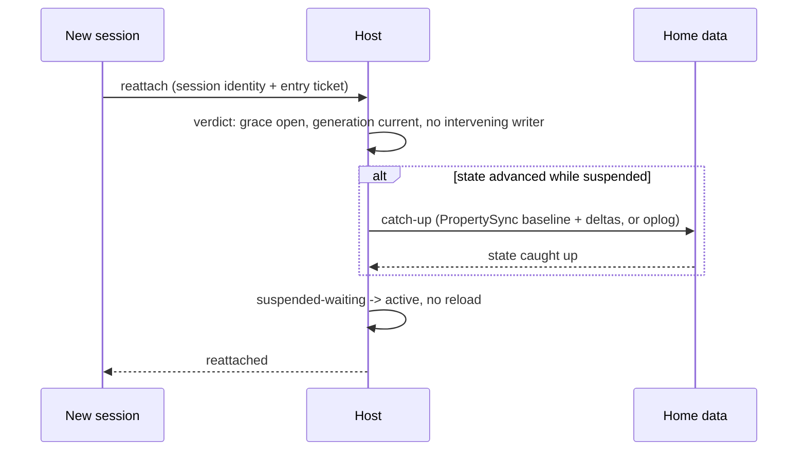
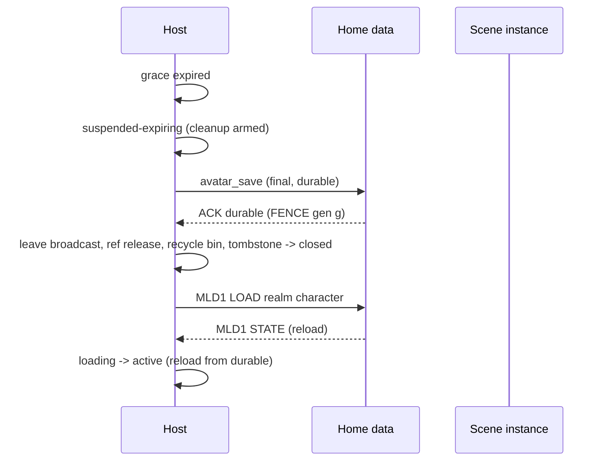
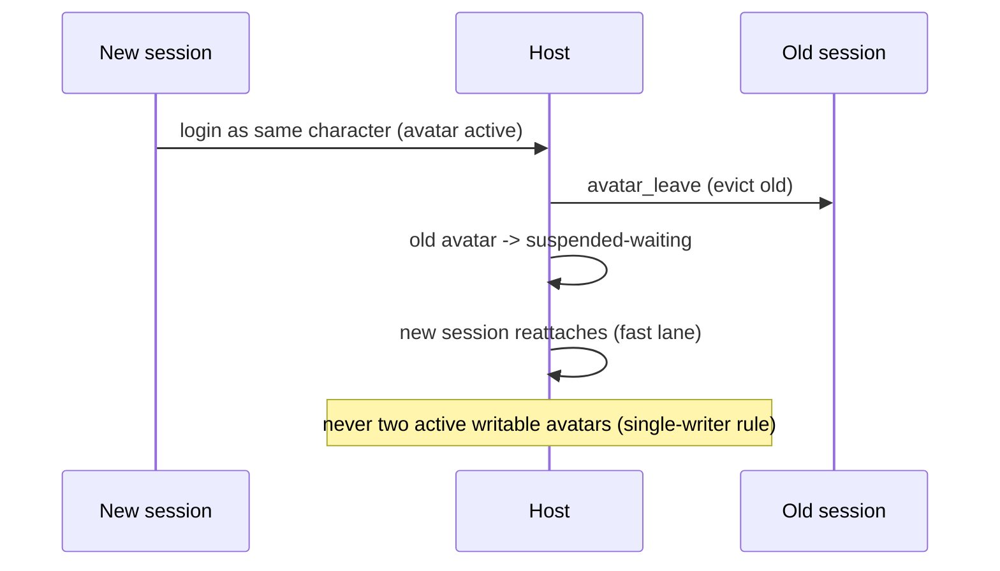
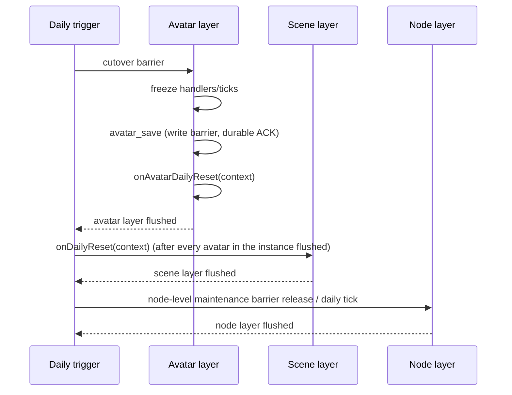

# Avatar reconnect and daily cutover contract

Status: decided design (2026-11-22). No Avatar type exists, so nothing here changes CLI
behavior and no runtime below is implemented or validated. This page is the ledger's PL-3:
the reconnect double-lane (detection verdict, grace window, reattach auth, catch-up, timeout
cleanup chain, kick-on-relogin), the explicit `suspended` sub-states, and the daily cutover
(trigger surface, three-layer touch order, write barrier, failure compensation,
`onDailyReset`/`onAvatarDailyReset` signatures and order). It refines the
[lifecycle oracle](./avatar-lifecycle.md) — PL-1's `suspended` becomes two explicit
sub-states, and the daily-cutover barrier gains its hooks. Machine-readable form:
`contracts/avatar-reconnect-cutover.json`. Cross-language page: [简体中文](./zh/avatar-reconnect-cutover.md).

## Reconnect double-lane

Two lanes, one verdict. The detection verdict chooses the lane; it is never inferred from a
timeout alone.

| Lane | Verdict condition | Result |
|---|---|---|
| **Fast** | Reattach within grace AND generation still current AND no intervening writer AND in-memory state retained | `suspended-waiting → active`, no reload, no tombstone |
| **Slow** | Grace expired OR generation changed OR in-memory state lost | `suspended-waiting → suspended-expiring → reclaiming → closed → loading → active` (reload from the durable record) |

**Catch-up** (fast lane, sub-step): if the durable cursor advanced while the avatar was
suspended (a save or a timer ran), the avatar catches up before resuming — a
`PropertySync` baseline + gapless per-property deltas, or a replay of the ordered change
journal (the [entity chain's](./entity-contract.md) mechanisms). A divergent in-memory state
is never resumed as-is.

**Kick-on-relogin (顶号):** a new session logging in as the same character while the avatar
is `active`/`visiting` evicts the old session (`avatar_leave`) and reattaches the avatar
through the fast lane — it never creates a second writable avatar (single-writer rule). If
the old avatar is mid-transfer, the new session is refused with the transfer rejection code
and must retry after the transfer settles.

**Timeout cleanup chain** (slow lane, after grace expiry): stop accepting reattach → flush
the final save durable → AOI leave broadcast → release the scene-instance reference →
recycle bin → tombstone the generation → `closed`. This is the
[destroy obligation list](./avatar-spawn-destroy.md#destroy-obligation-list-in-order) order.

**Never:** a reconnect never resurrects a closed avatar; re-entry always goes through
`loading` (avatar-runtime). A session without a validated participant context cannot reattach
a durable-writable avatar.

## Suspended sub-states (explicit)

PL-1's `suspended` is one state; this page makes the two phases it hides explicit. The union
is PL-1's `suspended`; the transition function's `suspended` row expands accordingly.

| Sub-state | Rule | Exits |
|---|---|---|
| `suspended-waiting` | Grace open; in-memory state retained; fast-lane eligible | Reattach (fast) → `active`; grace expired → `suspended-expiring` |
| `suspended-expiring` | Cleanup armed; only the slow lane remains; flush in progress | Flush durable → `reclaiming`; cleanup done → `closed` |

Reattach during `suspended-expiring` is refused with `AVATAR_SUSPENDED`.

## Three reconnect paths

### 1. Fast-lane reattach

### 2. Slow-lane reload

### 3. Kick-on-relogin

## Daily cutover

### Trigger surface

The cutover is triggered by a day boundary, a configured schedule, an operator command, or a
maintenance window. The trigger issues `E_DAILY_CUTOVER` to every `active`/`visiting` avatar
and holds a node-level barrier until every layer has flushed.

### Three-layer touch order (bottom-up)

The touch order is guaranteed: avatar layer before scene layer before node layer; each layer's
write barrier completes before the next begins; within a layer, deterministic order by
identity.

### Write barrier and hook order

- **The flush is the barrier.** `avatar_save` acknowledged durable is what makes a layer
  complete; a hook that runs after the flush does not re-dirty the flushed state.
- **Order within an avatar:** `avatar_save` (durable) then `onAvatarDailyReset(context)`. The
  hook observes the flushed state.
- **Order across layers:** avatar → scene → node.

### Hook signatures and failure semantics

| Hook | Signature | Called | Failure |
|---|---|---|---|
| `onAvatarDailyReset` | `(context) → nothing` | Per `active`/`visiting` avatar, after its `avatar_save` flushed durable | Logged; the flush stands (it is the barrier); the cutover proceeds |
| `onDailyReset` | `(context) → nothing` | Per scene instance, after every avatar in it flushed | Logged; retried within the barrier; the barrier is not released until the layer's flush is durable |

### Failure compensation

| Interruption | Barrier state | Compensation |
|---|---|---|
| Save fails at the avatar layer | Held | Retry within the configured budget; no partial cutover published; surface to the operator |
| Hook fails at the avatar layer | Held (flush already durable) | Logged; the flush is authoritative, the cutover proceeds |
| Node-layer barrier not released | Held | No layer advances; a partial cutover is never published; recovery resumes the barrier |

## Hooks in the oracle

The reconnect/cutover events extend the PL-1 transition function. The
[lifecycle oracle's hook table](./avatar-lifecycle.md#hook-surface-per-state) gains two
rows, and the transition rows for `suspended` expand:

| Hook | Valid in | Notes |
|---|---|---|
| `onAvatarDailyReset` | `active`, `visiting` | Post-flush, observes the flushed state |
| `onDailyReset` | scene instance (not an avatar state) | Post-avatar-flush, per instance |

| State | New/expanded events |
|---|---|
| `suspended` (now `suspended-waiting` + `suspended-expiring`) | `E_REATTACH → active` (fast lane, waiting) · `E_GRACE_EXPIRED → suspended-expiring` · reattach in `suspended-expiring → refuse(AVATAR_SUSPENDED)` |
| `active`, `visiting` | `E_DAILY_CUTOVER → same state` (barrier; added to the oracle) |

## Deliberately not decided here

- The catch-up encoding (oplog vs snapshot+delta): the entity contract chain's `PropertySync`
  and change journal, still deferred.
- The `MLR1 ROUTE` binding for reattach routing: avatar-runtime notes the wire verbs exist but
  there is no Lua binding yet.
- Grace-window length, catch-up budget and cutover cadence: measurement, not this page.

## Verification

- **Machine-checkable:** `contracts/avatar-reconnect-cutover.json` pins the sub-states, the
  two-lane verdicts, the three reconnect paths, the three-layer touch order and the failure
  compensation; the fixture asserts the invariants so drift fails the test.
- **Mermaid:** the four acceptance diagrams (three reconnect paths + daily cutover) render;
  `docs:check` covers renderability, desktop/mobile, light/dark and expansion.
- **Runtime acceptance:** none today — no Avatar type exists.

Related: [Avatar lifecycle](./avatar-lifecycle.md), [Avatar spawn/destroy contract](./avatar-spawn-destroy.md),
[Avatar runtime](./avatar-runtime.md), [cross return and single-writer protocol](./cross-return-protocol.md),
[entity contracts and generation](./entity-contract.md).
