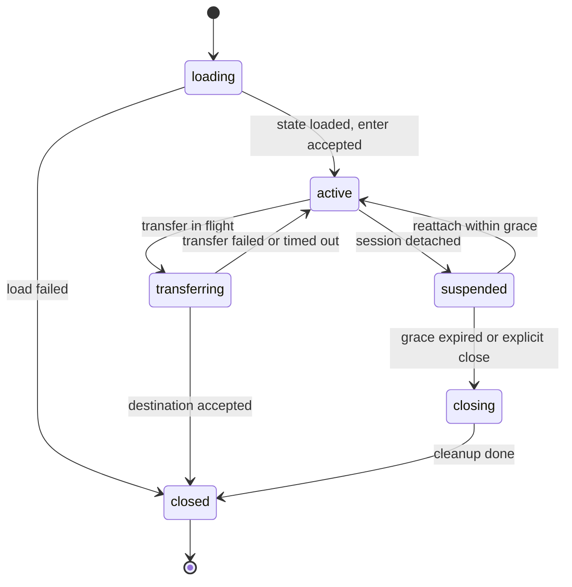

# Avatar runtime: sessions, lifecycle hooks, migration and load/save

Status: decided design (2026-10-19). The framework today has sessions, framing, handshake layers and one Lua VM per gameServer/crossServer invoked serially, and no Avatar type (`grep -rniE "\b(struct|class)\s+(Scene|Map|Entity|Avatar|Chunk)" include/ src/` excluding tests returns nothing) — nothing on this page changes CLI behavior, and no runtime described below is implemented or validated. It specifies the hook contract the [model page](./player-scene-model.md) names as an extraction target ("hooks need thread/error/reentrancy/timeout contracts and rules during transfer"), feeds the coordinator-coordinated transfer slices, and stays within the [process roles](./process-roles.md). Durability ownership and single-writer authority remain the [cross return protocol's](./cross-return-protocol.md); instance prepare states are the [scene lifecycle's](./scene-lifecycle.md); the property schema, dirty tracking and incremental sync are the [entity contract chain](./entity-contract.md) and stay deferred. Implementation of any new Avatar API is gated on the client protocol contract recovery (ledger items 88-91).

## Baseline: what the framework has today

| Surface | Current state |
|---|---|
| Session identity | Numeric framed-session id in the `message` context; crossServer joins add realm/group/room/epoch, participant joins add `character`, `generation` and the nested `route` table |
| Outbound | Bounded `mistlane.session.send`/`broadcast` (~2 MiB per channel, explicit reasons), pushes preserved in reply order, correlation (`MLC2`) echo |
| Identity layers | `MLS1` service identity, `MLM1` upstream multiplexing — independent optional layers |
| Lua execution | One VM per node, serial on the Asio thread; protected calls with an instruction-count budget (~1M instructions) catching runaway loops; `message` errors close the session, `tick` errors are logged |
| Node hooks | `init`/`start`/`message`/`http`/`tick`/`stop`/`shutdown` and the websocket trio; **no player connect/disconnect hooks** |
| Reload | SIGHUP loads a candidate VM, swaps, retires the old through `stop`/`shutdown`; reload resets module state and exports nothing |
| Placement | `mistlane.place(role, scope?, callback)` against the coordinator registry |
| Avatar | Does not exist. No character object, no load path, no save entry, no transfer |

A node that only provides `message` has request handling, not a character runtime. That gap is exactly why this page exists: lifetime, state ownership and transfer need their own contract.

## Object split: Session and Avatar

| | Session | Avatar |
|---|---|---|
| Owns | The client connection, its framing identity, the current-host route at the gateway | The character's data and behavior at the hosting process |
| Identity | The framed-session numeric id (per leg) | `(origin realm, character id, hosting generation)` — the same tuple as the [participant context](./cross-return-protocol.md) |
| Lifetime | Bound to the connection or logical leg | Independent of any one connection: disconnect detaches the session, not the durability obligations |
| Count | Many per gateway; one per client leg | At most one **active** per character (single-writer); at most one bound to a session per host |
| Carries | No character identity of its own | No client address, ever |

The avatar identity deliberately reuses the participant context tuple so one shape crosses the `MLC1` handshake, the routing record and the `MLD1` submission without translation.

## Avatar states

| State | Rule |
|---|---|
| `loading` | Data requested from the home domain; no handler may target this character; requests are refused with an explicit failure, never queued invisibly |
| `active` | The only state that runs `message` handlers and `avatar_tick`; durable writes allowed while the hosting generation is current |
| `suspended` | Session disconnected; no handlers run; pending save obligations still run; reattach inside the grace period returns to `active` without a reload |
| `transferring` | A transfer in flight; no handlers, no ticks; in-flight work completes before the transfer starts (the VM is serial) |
| `closing` / `closed` | Ordered cleanup finished; the character is absent from this host |

1. Only the framework moves an avatar between states; hooks are called at the edges of a transition, never inside one.
2. A failed hook never half-publishes: a failed load produces no visible avatar; a failed transfer-out leaves the avatar `active` where it was.
3. `suspended` never accepts new participation; it exists to finish obligations, not to host gameplay.
4. All grace periods and budgets are configuration named at implementation time with measured defaults.

## The Lua hook surface

These hooks are additions to the existing module contract; `message`/`http` keep their roles unchanged. Hook names are provisional until implementation lands them in code — what this page fixes is the arguments, ordering and failure semantics.

| Hook | Called when | Arguments → result | On error or timeout |
|---|---|---|---|
| `avatar_load` | An avatar is created at this host from a loaded record | `(context, state)` → avatar table | Load failed: no avatar is published, entry is refused with the cause |
| `avatar_enter` | A session attaches to an active avatar | `(context)` → nothing | Entry refused with an explicit reason |
| `avatar_leave` | A session detaches (logout, evacuation) | `(context)` → nothing | Logged; never blocks the detach |
| `avatar_tick` | Node tick, active avatars only | `(context)` → nothing | Logged; the avatar stays (matches `tick` semantics) |
| `avatar_save` | The single forced-save entry | `(context)` → state table | Save failed: surfaced to the operator; retry belongs to the sender queue, not the hook |
| `avatar_transfer_out` | This host stops hosting | `(context)` → state snapshot | Transfer aborted; the avatar returns to `active` |
| `avatar_transfer_in` | This host takes over hosting | `(context, state)` → nothing | The incoming avatar closes on this host; the source keeps its avatar |
| `avatar_detach` | The session disconnected | `(context)` → nothing | Logged; the avatar goes `suspended` regardless |
| `avatar_fail` | Any avatar hook failed or timed out | `(context, reason)` → nothing | Best effort: it may not run during a VM replacement |

Three properties are the point of this surface:

1. **`avatar_save` is the only forced-save entry.** Nothing a hook does — sending messages, pushing, entering scenes — clears dirty state or triggers a save by side effect. What counts as dirty inside the state is the entity contract chain's problem; the single-entry rule is this page's.
2. **State enters and leaves only through `avatar_load`/`avatar_save`/`avatar_transfer_out`/`avatar_transfer_in`.** Anything a hook keeps in module globals or upvalues is volatile and is lost on SIGHUP replacement by the existing reload rule; the framework will not export module state. Avatars must not use module state as storage.
3. **Every failure has a named consequence.** No hook failure silently degrades into "probably fine".

## Migration and transfer rules

| Movement | What happens | What travels |
|---|---|---|
| Same-process scene switch | The avatar stays `active`; only its instance reference changes. No save, no state round-trip | Nothing — the scene lifecycle's no-repeat rule applies to the avatar too |
| Cross-process transfer (same region) | Source `avatar_transfer_out` → transfer → destination `avatar_load` + `avatar_transfer_in` → source released. The source stays `transferring` until the destination answers; on failure or timeout the source avatar returns to `active` | Participant context + state snapshot. The map does not travel |
| Cross participation | The cross-process rules plus the return route; leaving completes only when the final change-set is acknowledged durably, per the return protocol | Participant context + snapshot + the bounded sender queue's obligations |

- Handlers already executing finish before a transfer begins; handlers arriving during `transferring`/`loading`/`suspended` are refused with an explicit failure. Bounded queues remain where they are today: at the session and transport layer.
- Avatar-owned timers stop when a transfer starts and re-arm only if the transferred snapshot declares them; undeclared timers do not travel.
- A reconnect never resurrects a closed avatar. The coordinator's placement record routes the new session to the current host; a failed transfer leaves the route on the source; re-entry always goes through `loading`.
- A VM replacement (SIGHUP) is a node-level retirement, not an avatar migration: every avatar in the old VM gets a best-effort `avatar_save` and then closes; sessions re-enter through `loading` after the swap. This keeps the existing honest rule — reload does not migrate state.

## Errors, timeouts and reentrancy

| Event | Consequence |
|---|---|
| Hook error | The per-hook consequence in the table above; logged with the avatar identity |
| Hook overruns its budget | The instruction-count budget aborts the call with the same consequences as a hook error. Budget numbers are measured at implementation, not named here |
| Disconnect during `transferring` | The transfer continues; the source/destination decision does not depend on the connection |
| Disconnect during `active` | `avatar_detach` runs; the avatar goes `suspended` and its pending save obligations still run |
| SIGINT/SIGTERM | The existing shutdown order runs; avatars get best-effort saves. Crash, SIGKILL and power loss guarantee nothing — unchanged |
| `avatar_fail` itself fails | Logged; the original failure consequence stands |

Reentrancy is excluded by construction, not by discipline: the VM is serial, so no two hooks ever interleave; the framework never calls a second avatar hook while one runs; and a message handler cannot trigger a lifecycle transition synchronously — transitions are scheduled to a handler boundary, in the same style as `mistlane.place`'s callback-after-return. This is what removes the reentrancy class instead of asking scripts to avoid it.

## Deliberately not decided here

- The property schema, dirty tracking, incremental sync and snapshot encoding: the entity contract chain, which supersedes the earlier Avatar-only scope and stays deferred.
- The client protocol, bindings and method exposure: gated on the protocol contract recovery (ledger items 88-91); game-fogs contains no `.sproto` source text, only the compiled `sproto.spb` and the `Protocol.lua` name table.
- Exact hook names and signatures: fixed when implemented in code; the arguments, ordering and failure semantics above are the contract.
- Grace periods, tick budgets and save cadences: measured at implementation.
- The crossServer sender's bounded retry queue and read-only transition: return-protocol slices, waiting on the persistence chain.

## Verification

None today: no Avatar type exists, so this page has no test and no runtime acceptance. Validation records must not claim avatar behavior. When implemented, acceptance is the runtime validation the ledger names: normal login, bounded two-way messaging, same-process scene switch, cross-process and cross-region transfer with return, callbacks and multi-listener — the whole chain, not a subset.

Related: [players, scenes and cross-region execution](./player-scene-model.md), [cross return and single-writer protocol](./cross-return-protocol.md), [scene lifecycle](./scene-lifecycle.md), [entity contracts and generation](./entity-contract.md), [Lua services and the complete lifecycle](./lua.md).
