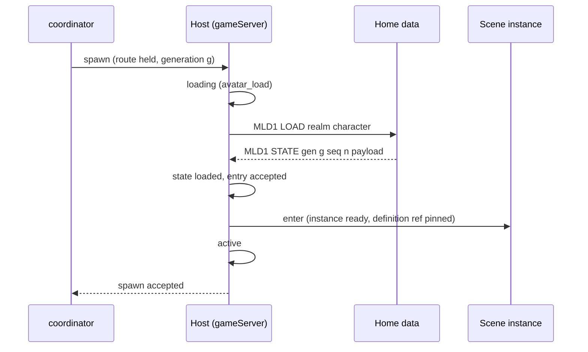
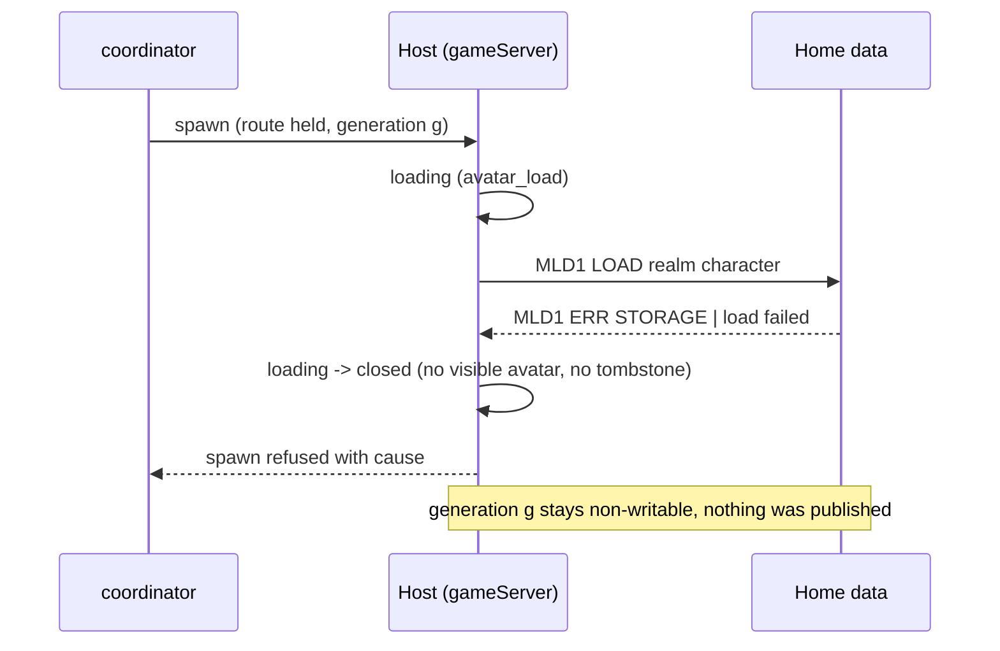
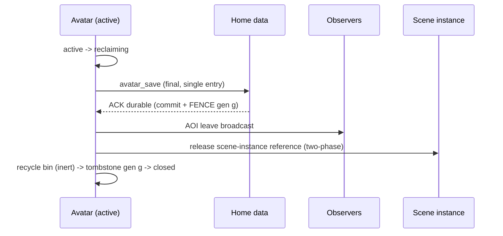
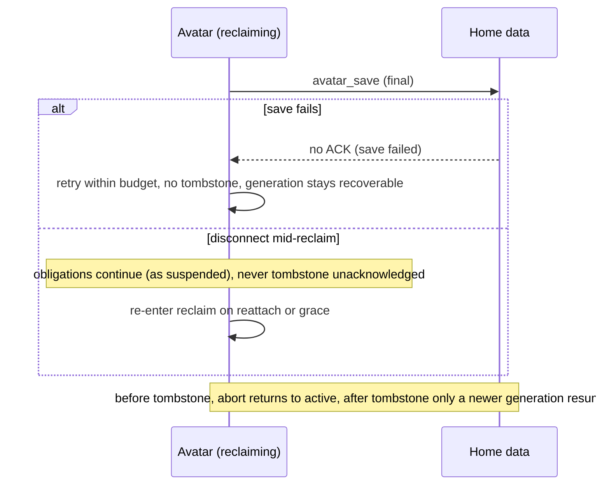

# Avatar spawn/destroy runtime contract

Status: decided design (2026-11-22). No end-to-end Avatar runtime exists yet (the seven-state oracle model is implemented and model-tested; session and transport wiring are later slices), so nothing here changes CLI
behavior and no runtime below is implemented or validated. This page is the object
create/reclaim contract the ledger names (PL-2): creator authority, required fields and
defaults, persistence semantics, AOI broadcast edges, the destroy obligation list, mid-life
reclaim, and the four-path acceptance. It is the obligation counterpart to the
[lifecycle oracle](./avatar-lifecycle.md) — that page fixes the *states*, this page fixes
what creation and reclamation *must do*. Machine-readable form:
`contracts/avatar-spawn-destroy.json`. Cross-language page: [简体中文](./zh/avatar-spawn-destroy.md).

## Creator authority

- **Only the framework creates an Avatar.** The coordinator publishes the hosting generation;
  a host may spawn only a route it holds at the current generation. A script cannot call spawn.
- **A spawn without a route**, or a duplicate spawn for the same `(realm, character, generation)`
  with an existing `loading`/`active`/`visiting` avatar, is refused with `AVATAR_ALREADY_ATTACHED`.
- **The creator is the host, the identity is the character.** The object split is unchanged:
  the session owns the connection, the avatar owns the character (the
  [object split](./avatar-runtime.md#object-split-session-and-avatar)).

## Required fields and defaults

| Field | Type | Required | Default | Rule |
|---|---|---|---|---|
| `origin_realm` | realm | yes | — | Names a data domain, never a process address (cross-return) |
| `character_id` | id | yes | — | Unique within the origin realm |
| `hosting_generation` | generation | yes | — | The version of the current hosting assignment; carried on every return submission |
| `load_source` | enum | yes | `home` | `home` (load from the home domain) or `transfer-in` (destination of a transfer, resumes at `g+1`) |
| `declared_timers` | list | no | `[]` | Only declared timers travel with a transfer; undeclared timers do not re-arm |

Tunable numbers (grace period, tick budget, save cadence) are configuration, named at
implementation time with measured defaults — not this page.

## Persistence semantics

- **Spawn itself does not persist.** A spawn loads a record (`MLD1 LOAD` or the home domain);
  it never writes by side effect.
- **A spawn is visible only after `avatar_load` succeeds.** A failed load produces no visible
  avatar (avatar-runtime rule 2). There is no "spawned but half-loaded" state.
- **The single forced-save entry is `avatar_save`.** Nothing a hook does clears dirty state or
  triggers a save (avatar-runtime property 1).

## AOI broadcast edges

| Edge | Broadcast | When |
|---|---|---|
| `spawn → active` | Appearance (position, identity) | Entry accepted; the scene instance was `ready` |
| `reclaiming → closed` | Leave | After the final save is durable, before the instance reference is released |

The legacy `enable9Grid` observation does not prove an active spatial AOI; these are contract
edges, not an implementation claim.

## Destroy obligation list (in order)

The order is mandatory and is the [scene-lifecycle cleanup](./scene-lifecycle.md#cleanup-and-reference-release)
order applied to this participant, with the [writer-lease handoff](./cross-return-protocol.md#writer-lease-handoff)
`FENCE` appended as the final step:

1. **Flush** — the final `avatar_save` (single entry) is acknowledged durable (`ACK durable`,
   i.e. an MLD1 commit + `FENCE` of the generation).
2. **Leave broadcast** — AOI leave to scene observers.
3. **Reference release** — release the scene-instance reference; the spatial cache decides
   eviction (two-phase, so a late reference cannot resurrect freed memory).
4. **Recycle bin** — the object stays addressable but inert until the obligations complete; it
   is never freed mid-reclaim.
5. **Tombstone** — fence the hosting generation; only a strictly newer generation may resume
   (single-writer rule). No tombstone is committed before the flush is durable.

**In-flight handlers:** already-executing handlers finish; handlers arriving during
`transferring`/`loading`/`suspended`/`reclaiming` are refused with the state's rejection code.
A handler cannot trigger a lifecycle transition synchronously — transitions are scheduled to
a handler boundary.

## Mid-life reclaim (destroy while `active`)

Reclaiming a `active` avatar (not a suspended one) is a distinct path and must:

1. **Drain or refuse** in-flight handlers and stop ticks (the VM is serial; no two hooks interleave).
2. **Run the full destroy obligation list** — flush durable, leave broadcast, ref release,
   recycle bin, tombstone.
3. **Tombstone only after the final save is durable** — the single-writer rule is never relaxed
   to "save eventually".

It must never half-publish a visible avatar, tombstone an unacknowledged change, or free the
object mid-obligation.

## Four-path acceptance

### 1. Create success

### 2. Failure rollback

### 3. Reclaim complete

### 4. Reclaim-interrupt recovery

## Failure compensation

| Interruption point | State held | Compensation |
|---|---|---|
| Save fails during reclaiming | `reclaiming` | Retry within the configured budget; no tombstone; the generation stays recoverable; surface the condition to the operator/application |
| Disconnect during reclaiming | `reclaiming` | Obligations continue (as `suspended`); never tombstone an unacknowledged change — only an `ACK durable` justifies a durability claim |
| Host crash mid-reclaim | `closed` (abrupt) | Crash guarantees nothing (avatar-runtime); coordinator recovery issues a strictly newer generation |
| Reference-release interrupted | `reclaiming` | Two-phase release prevents resurrection; re-enter reclaim; the tombstone is not committed until the flush is durable |

## Deliberately not decided here

- The property schema, dirty tracking and snapshot encoding: the entity contract chain.
- Grace periods, tick/save cadence, retry budgets and the recycle-bin retention window: measurement.
- The spatial AOI implementation: the broadcast edges are a contract, not an implementation.
- `contracts/entities/Avatar.def` and `contracts/types/*.xml`: the entity-contract chain's suggested
  sources, still deferred.

## Verification

- **Machine-checkable:** `contracts/avatar-spawn-destroy.json` pins the obligation order, the
  required fields and defaults, the four paths and the failure compensation; the fixture
  `tests/test_avatar_contract.py` (ctest `mistlane_avatar_contract`) asserts the invariants
  (obligation order, four paths, compensation coverage, mid-life never-rules) so an accidental
  drift fails the test.
- **Mermaid:** the four acceptance diagrams render; `docs:check` covers renderability,
  desktop/mobile, light/dark and expansion.
- **Runtime acceptance:** none today — no end-to-end Avatar runtime exists; the oracle model is
  model-tested (avatar.lifecycle) but wiring is not.

Related: [Avatar lifecycle](./avatar-lifecycle.md), [Avatar runtime](./avatar-runtime.md),
[scene lifecycle](./scene-lifecycle.md), [cross return and single-writer protocol](./cross-return-protocol.md).
