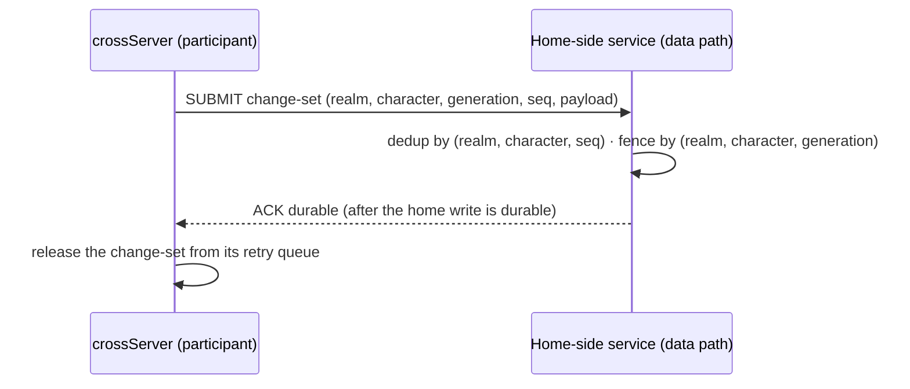

# Cross return and single-writer protocol

Status: decided design (2026-10-19); the participant context, MLD1 endpoint and a per-participant ordered sender queue boundary are implemented. The queue is not wired into a crossServer runtime and the endpoint still answers volatile receipts only. This page fixes the return and persistence-confirmation protocol and single-writer authority before transfer, settlement and handoff implementation. It targets the responsibilities in [process roles](./process-roles.md); the observed legacy path and its gaps are on the [model page](./player-scene-model.md). Durable storage, durable ACK handling and single-writer lease enforcement remain unimplemented.

## Participant and return context

Entering crossServer changes execution placement, not account, character identity or the home data domain. A cross admission therefore carries a participant context; without it the crossServer hosts an anonymous session and must not mutate durable character state.

| Field | Meaning | Rule |
|---|---|---|
| Origin realm | The home region/group the character belongs to | Required; names a data domain, never a gameServer address |
| Character identity | Stable character id in the home domain | Required; unique within the origin realm |
| Hosting generation | Version of the current hosting assignment | Required; carried on every return submission and compared by the home side |
| Return route | How the character gets back (realm/group/room or scene references) | Required at entry; durable records must not pin process addresses |
| Entry ticket | Authorization to enter this cross scope | Optional until an issuer exists; the crossServer side treats its absence as "unvalidated" and marks the session read-only for durable writes |

`MLC1` was widened rather than given a follow-up frame: after the routing fields, an optional trailing group `ch <character> gen <generation> ret <realm> <group> <room>` carries the participant context, its three parts declared together or not at all (wire format in [cross-server](./cross-server.md)). Lua receives the participant fields with the session (`character`, `generation`, nested `route`); anonymous five-field joins keep working and stay anonymous. The entry ticket has no issuer yet, so no session is validated — until one exists, the rule **a session without a validated participant context cannot submit durable character changes** keeps every session out of durable writes, and application code may still run gameplay for anonymous sessions.

## Single-writer authority

1. At most one writable Avatar per character exists at any time. The home data domain is the durable writer of record; a crossServer holds only a provisional, bounded write lease scoped to the cross participation.
2. The lease is identified by the hosting generation. The home side rejects any submission whose generation is not the newest issued for that character — a late or duplicated writer cannot overwrite a newer state by arriving last.
3. Lease expiry, a missing heartbeat or a process crash alone never creates a second writable owner. Reclaiming a lease requires an explicit takeover step on the home side (new generation issued, old generation tombstoned), not a timeout inference. This mirrors the responsibility rule that a missed heartbeat cannot authorize a second active owner.
4. Disconnect ends participation but not durability obligations: changes already submitted and acknowledged survive; unacknowledged changes are only as durable as the protocol below makes them.

## Return and persistence confirmation (MLD1)

The legacy path (cross field changes → `C_SyncDataFromCross` → CrossWorld routes by `wid` → home World submits to home Data/Cache) is observation, not a contract: it has no durable acknowledgement, no idempotency key, and sending is not committing. The target protocol between a crossServer and the home-side services is:



- **Submission:** a change-set carries the participant context, a monotonically increasing sequence number per `(realm, character)`, and the payload. Cross-local state (scene progress, ephemeral battle results) is not submitted by the framework — what counts as a durable character change is an application decision surfaced as a Lua API.
- **Confirmation:** the home side acknowledges only after its own write is durable. A received-but-not-durable frame is indistinguishable from a lost frame, so the sender keeps it in a bounded retry queue.
- **Delivery:** at-least-once with idempotent dedup on the home side. The sender retries with backoff within the configured retry budget; a full queue makes the participant read-only for durable writes and reports the condition to the application instead of dropping or silently overflowing.
- **Ordering:** the home side accepts only the next sequence (`stored + 1`) for each `(realm, character)`. The sender serializes submissions per participant and holds later entries until the missing sequence arrives; submitted changes retry within the configured budget, and exhaustion surfaces a failed return, not silent data loss. Different realms may use the same character id independently.
- **Return:** leaving the cross scope is complete only when the character's final change-set is acknowledged durably. Until then the character remains a cross participant of record; a forced route change before acknowledgement is a failed return (below).

The wire format is the shared u32 BE length frame with no per-message prefix, and it is implemented on the `data` role (see the [service contracts](./service-contracts.md)):

```text
MLD1 LOAD <realm> <character>
MLD1 SUBMIT <realm> <character> gen <n> seq <m> [<payload>]

MLD1 EMPTY
MLD1 STATE gen <n> seq <m> [<payload>]
MLD1 RECEIVED gen <n> seq <m>
MLD1 ERR INVALID | MLD1 ERR STALE gen <n> | MLD1 ERR SEQ seq <n> | MLD1 ERR FULL
```

**Key migration and compatibility:** MLD1 already carries `realm`, and current endpoint records are volatile and reset on restart; switching the in-memory lookup key to `(realm, character)` therefore needs no live data migration. Any future persisted table using only `character` must backfill realm before writes resume and reject or explicitly resolve ambiguous collisions. Existing frame syntax remains unchanged.

The endpoint keys both fence and sequence state by `(realm, character)`. It enforces the fence (`STALE` when the submitted generation is lower than the stored one) and strict sequence discipline (the next sequence must be exactly one past the stored one; resends of the stored sequence dedup to a second `RECEIVED` without changing the stored change-set; a fresh key starts at one). The sender queue boundary allows only one in-flight submission per key, holds gaps, and retries only within its caller-supplied attempt budget. A `RECEIVED` frees the transport slot so the next contiguous change can be sent, but does not remove the change from the retry queue; only a future durable ACK may do that. Today records live in the data process only and a restart answers `EMPTY` again; merging change-sets into entity state stays deferred entity-contract work. The queue is not wired into a crossServer runtime, and persistence, durable ACK handling, queue-full read-only transition and return completion remain unimplemented.

## Failure handling

| Failure | Rule |
|---|---|
| Home unreachable | Retry within the bounded queue; the participant stays writable for cross-local state but cannot finish a return. No timeout may convert an unacknowledged change into an acknowledged one. |
| Sender crash after submit, before ACK | The home side sees a duplicate after restart and dedups by sequence; at-least-once plus idempotency, never at-most-once. |
| Lost ACK (delivered, reply lost) | Same dedup path; the resend produces a second ACK for the same sequence and the queue drains. |
| Generation mismatch on submission | The home side rejects and answers with the current generation; the old writer stops and the outcome is surfaced to the operator/application. No overwrite. |
| Return refused or entry ticket invalid | The character never becomes a durable writer in that scope; already-acknowledged changes stand, the rest stays queued or is discarded per application choice. |
| Offline during participation | The bounded queue outlives the connection in the crossServer process; leaving players does not flush it. Bounded means a longest-waiting entry can force the participant read-only — memory safety beats delivery completeness, and the condition is observable. |
| CrossServer crash | Unacknowledged submissions in its queue are lost by design; anything the application declared durable was acknowledged before the crash. The framework does not pretend otherwise. |

## Deliberately not decided here

- Wire format and framing of MLD1: decided with the implemented endpoint — the grammar and reply vocabulary are in the section above; framing is the shared u32 BE length frame.
- Settlement, reward and ranking business rules, cross-scene templates, and the actual Avatar/scene runtime: later crossServer slices and the entity-contract chain. The Avatar/Session runtime contract is now designed on the [avatar runtime](./avatar-runtime.md) page; the entity property runtime remains the chain's.
- Lease duration numbers, queue bounds and retry budgets: configuration named at implementation time with defaults justified by measurement, not by this page.
- Whether the entry ticket is signed, and by whom: an authentication design gated on the login contract.

The participant context, endpoint keying and ordered queue boundary have tests (validation records: cross routing, record endpoint and return queue). This slice does not implement persistent ACK wire format or full lease handoff timing; both remain later work alongside the persistence chain and runtime wiring.
