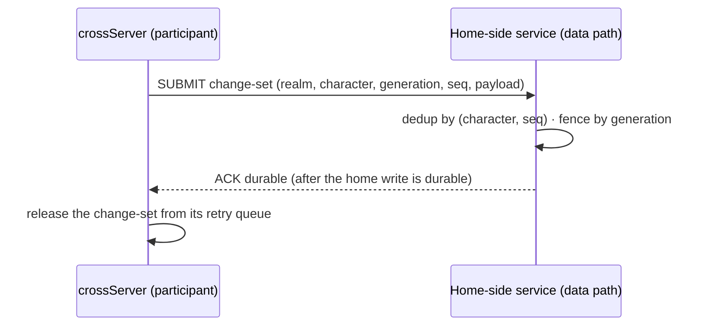

# Cross return and single-writer protocol

Status: decided design (2026-10-19), implementation pending. This page fixes the contracts named as the first gate of the crossServer migration item — the return and persistence-confirmation protocol and single-writer authority — before any transfer, settlement, retry, offline or failed-return implementation begins. It targets the responsibilities in [process roles](./process-roles.md); the observed legacy path and its gaps are on the [model page](./player-scene-model.md). Nothing here is implemented yet, and no page claim below changes CLI behavior today.

## Participant and return context

Entering crossServer changes execution placement, not account, character identity or the home data domain. A cross admission therefore carries a participant context; without it the crossServer hosts an anonymous session and must not mutate durable character state.

| Field | Meaning | Rule |
|---|---|---|
| Origin realm | The home region/group the character belongs to | Required; names a data domain, never a gameServer address |
| Character identity | Stable character id in the home domain | Required; unique within the origin realm |
| Hosting generation | Version of the current hosting assignment | Required; carried on every return submission and compared by the home side |
| Return route | How the character gets back (realm/group/room or scene references) | Required at entry; durable records must not pin process addresses |
| Entry ticket | Authorization to enter this cross scope | Optional until an issuer exists; the crossServer side treats its absence as "unvalidated" and marks the session read-only for durable writes |

The existing `MLC1` cross handshake carries realm/group/room but no participant fields. The implementation will extend the admission context (either by widening `MLC1` or a follow-up frame) so Lua receives the participant context with the session; the choice is an implementation decision bound by one rule: **a session without a validated participant context cannot submit durable character changes.** Application code may still run gameplay for anonymous sessions.

## Single-writer authority

1. At most one writable Avatar per character exists at any time. The home data domain is the durable writer of record; a crossServer holds only a provisional, bounded write lease scoped to the cross participation.
2. The lease is identified by the hosting generation. The home side rejects any submission whose generation is not the newest issued for that character — a late or duplicated writer cannot overwrite a newer state by arriving last.
3. Lease expiry, a missing heartbeat or a process crash alone never creates a second writable owner. Reclaiming a lease requires an explicit takeover step on the home side (new generation issued, old generation tombstoned), not a timeout inference. This mirrors the responsibility rule that a missed heartbeat cannot authorize a second active owner.
4. Disconnect ends participation but not durability obligations: changes already submitted and acknowledged survive; unacknowledged changes are only as durable as the protocol below makes them.

## Return and persistence confirmation (MLD1)

The legacy path (cross field changes → `C_SyncDataFromCross` → CrossWorld routes by `wid` → home World submits to home Data/Cache) is observation, not a contract: it has no durable acknowledgement, no idempotency key, and sending is not committing. The target protocol between a crossServer and the home-side services is:

- **Submission:** a change-set carries the participant context, a monotonically increasing per-character sequence number, and the payload. Cross-local state (scene progress, ephemeral battle results) is not submitted by the framework — what counts as a durable character change is an application decision surfaced as a Lua API.
- **Confirmation:** the home side acknowledges only after its own write is durable. A received-but-not-durable frame is indistinguishable from a lost frame, so the sender keeps it in a bounded retry queue.
- **Delivery:** at-least-once with idempotent dedup on the home side. The sender retries with backoff while the queue is within bounds; a full queue makes the participant read-only for durable writes and reports the condition to the application instead of dropping or silently overflowing.
- **Ordering:** sequence numbers let the home side accept out-of-order arrivals and reject gaps it cannot fill; a gap that persists past the retry budget surfaces as a failed return, not as silent data loss.
- **Return:** leaving the cross scope is complete only when the character's final change-set is acknowledged durably. Until then the character remains a cross participant of record; a forced route change before acknowledgement is a failed return (below).

## Failure handling

| Failure | Rule |
|---|---|
| Home unreachable | Retry within the bounded queue; the participant stays writable for cross-local state but cannot finish a return. No timeout may convert an unacknowledged change into an acknowledged one. |
| Sender crash after submit, before ACK | The home side sees a duplicate after restart and dedups by sequence; at-least-once plus idempotency, never at-most-once. |
| Lost ACK (delivered, reply lost) | Same dedup path; the resend produces a second ACK for the same sequence and the queue drains. |
| Generation mismatch on submission | The home side rejects and answers with the current generation; the old writer stops and the outcome is surfaced to the operator/application. No overwrite. |
| Return refused or entry ticket invalid | The character never becomes a durable writer in that scope; already-acknowledged changes stand, the rest stays queued or is discarded per application choice. |
| Offline during participation | The bounded queue outlives the connection in the crossServer process; leaving players does not flush it. Bounded means a longest-waiting entry can force the participant read-only — memory safety beats delivery completeness, and the condition is observable. |
| CrossServer crash | Unacknowledged submissions in its queue are lost by design; anything the application declared durable was acknowledged before the crash. The framework does not pretend otherwise. |

## Deliberately not decided here

- Wire format and framing of MLD1, and whether the home-side endpoint is the `data` role or a home-region gateway in front of it: bound to the login/data service contract item, which this page feeds rather than preempts.
- Settlement, reward and ranking business rules, cross-scene templates, and the actual Avatar/scene runtime: later crossServer slices and the entity-contract chain.
- Lease duration numbers, queue bounds and retry budgets: configuration named at implementation time with defaults justified by measurement, not by this page.
- Whether the entry ticket is signed, and by whom: an authentication design gated on the login contract.

The first implementation slice must bring the participant context into the cross admission path with tests, then MLD1 against whatever home-side endpoint the service-contract item fixes.
