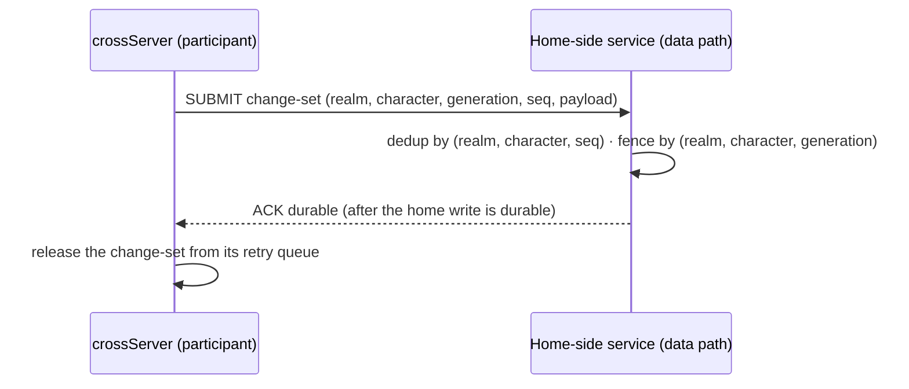

# Cross return and single-writer protocol

Status: protocol grammar, sender ACK handling, a deterministic lease model and the store-backed MLD1 record/ACK path are implemented (2026-10-19 for the grammar, 2026-10-27 for the store); the sender-side queue wiring and runtime lease authority are not. The participant context with its optional entry-ticket tail, the MLD1 endpoint and the per-participant ordered sender queue boundary are implemented. A data node with `--journal FILE` answers `ACK durable` only after an SQLite commit; without it the endpoint answers volatile receipts only. This page fixes the return and persistence-confirmation protocol and single-writer authority before transfer, settlement and handoff runtime wiring. It targets the responsibilities in [process roles](./process-roles.md); the observed legacy path and its gaps are on the [model page](./player-scene-model.md).

## Participant and return context

Entering crossServer changes execution placement, not account, character identity or the home data domain. A cross admission therefore carries a participant context; without it the crossServer hosts an anonymous session and must not mutate durable character state.

| Field | Meaning | Rule |
|---|---|---|
| Origin realm | The home region/group the character belongs to | Required; names a data domain, never a gameServer address |
| Character identity | Stable character id in the home domain | Required; unique within the origin realm |
| Hosting generation | Version of the current hosting assignment | Required; carried on every return submission and compared by the home side |
| Return route | How the character gets back (realm/group/room or scene references) | Required at entry; durable records must not pin process addresses |
| Entry ticket | Authorization to enter this cross scope | Decided: login-issued, short-lived HMAC-SHA256 ticket using a per-realm secret; the hex form rides the `MLC1` `tk` tail and the C++ issue/verify primitives exist, and a crossServer started with `MISTLANE_TICKET_SECRETS` verifies the join's ticket (2026-10-21; a failed verdict answers `MLC1 ERR TICKET`). Claims stay per process, so a verified join marks eligibility, not a durable write |

`MLC1` was widened rather than given a follow-up frame: after the routing fields, an optional trailing group `ch <character> gen <generation> ret <realm> <group> <room>` carries the participant context, its three parts declared together or not at all, and its last group `tk <hex>` carries the entry ticket (wire format in [cross-server](./cross-server.md)). Lua receives the participant fields with the session (`character`, `generation`, nested `route`); anonymous five-field joins keep working and stay anonymous. Login is the decided ticket issuer. The ticket's wire form is hex (the canonical `MLT1` bytes plus the raw 32-byte signature); the join decodes it and refuses the whole join rather than stripping the ticket when the hex does not decode or names a different character or hosting generation than the tail declares. A crossServer configured with `MISTLANE_TICKET_SECRETS` runs the verifier on the join (2026-10-21, see [service contracts](./service-contracts.md#login)) and exposes the verdict to the script as `context.verified`; without that configuration no session has a validated ticket. **A session without a validated participant context cannot submit durable character changes**; application code may still run gameplay for anonymous sessions. Supplying `ch`/`gen`/`ret` or passing MLS1 alone does not grant a writer lease.

## Single-writer authority

1. At most one writable Avatar per character exists at any time. The home data domain is the durable writer of record; a crossServer holds only a provisional, bounded write lease scoped to the cross participation.
2. The lease is identified by the hosting generation. The home side rejects any submission whose generation is not the newest issued for that character — a late or duplicated writer cannot overwrite a newer state by arriving last.
3. Lease expiry, a missing heartbeat or a process crash alone never creates a second writable owner. Reclaiming a lease requires an explicit takeover step on the home side (new generation issued, old generation tombstoned), not a timeout inference. This mirrors the responsibility rule that a missed heartbeat cannot authorize a second active owner.
4. Disconnect ends participation but not durability obligations: only changes acknowledged with `ACK durable` have a durability guarantee. A data node without a durable store replies `RECEIVED` and provides none; a store-backed node acknowledges only after its oracle commit, so unacknowledged changes are only as durable as the protocol below makes them.

## Return and persistence confirmation (MLD1)

The legacy path (cross field changes → `C_SyncDataFromCross` → CrossWorld routes by `wid` → home World submits to home Data/Cache) is observation, not a contract: it has no durable acknowledgement, no idempotency key, and sending is not committing. The target protocol between a crossServer and the home-side services is:



- **Submission:** a change-set carries the participant context, a monotonically increasing sequence number per `(realm, character)`, and the payload. Cross-local state (scene progress, ephemeral battle results) is not submitted by the framework — what counts as a durable character change is an application decision surfaced as a Lua API.
- **Confirmation:** the home side acknowledges only after its own write is durable. A received-but-not-durable frame is indistinguishable from a lost frame, so the sender keeps it in a bounded retry queue.
- **Delivery:** at-least-once with idempotent dedup on the home side. The sender retries with backoff within the configured retry budget; a full queue makes the participant read-only for durable writes and reports the condition to the application instead of dropping or silently overflowing.
- **Ordering:** the home side accepts only the next sequence (`stored + 1`) for each `(realm, character)`. The sender serializes submissions per participant and holds later entries until the missing sequence arrives; submitted changes retry within the configured budget, and exhaustion surfaces a failed return, not silent data loss. Different realms may use the same character id independently.
- **Return:** leaving the cross scope is complete only when the character's final change-set is acknowledged durably. Until then the character remains a cross participant of record; a forced route change before acknowledgement is a failed return (below).

The wire format uses the shared u32 BE length frame with no per-message prefix. LOAD/SUBMIT/RECEIVED and the store-backed `ACK durable` are implemented on the `data` role (see the [service contracts](./service-contracts.md)); the sender-side queue remains the crossServer runtime contract:

```text
MLD1 LOAD <realm> <character>
MLD1 SUBMIT <realm> <character> gen <n> seq <m> [<payload>]

MLD1 EMPTY
MLD1 STATE gen <n> seq <m> [<payload>]
MLD1 RECEIVED gen <n> seq <m>
MLD1 ACK durable <realm> <character> gen <n> seq <m>
MLD1 ERR INVALID | MLD1 ERR STALE gen <n> | MLD1 ERR SEQ seq <n> | MLD1 ERR FULL
```

`ACK durable` echoes the exact `(realm, character)` key, hosting generation and accepted sequence. It is emitted only after home data atomically commits both payload and sequence durably. The sender validates the key, generation and next durable cursor before deleting a queued change; a mismatched generation is rejected. `RECEIVED` remains a volatile process-memory receipt that only frees the per-key transport slot; it never drains the retry queue. Malformed ACK fields use `MLD1 ERR INVALID`; stale submissions retain `ERR STALE`, sequence gaps `ERR SEQ`, capacity exhaustion `ERR FULL`, and a failed store commit answers `ERR STORAGE` without changing the in-memory view.

**Key migration and compatibility:** MLD1 already carries `realm`; switching the persistent key from a process-local map to `(realm, character)` needs no live data migration. Any future persisted table using only `character` must backfill realm before writes resume and reject or explicitly resolve ambiguous collisions. Existing frame syntax remains unchanged.

The endpoint keys both fence and sequence state by `(realm, character)`. It enforces the fence (`STALE` when the submitted generation is lower than the stored one) and strict sequence discipline (the next sequence must be exactly one past the stored one; resends of the stored sequence dedup to a second `RECEIVED` without changing the stored change-set; a fresh key starts at one). With `--journal FILE` the same store backs every accepted row, a restart restores the fence, sequence and payload, and a lost-ACK replay returns the committed `ACK durable`; without it records stay process-local and a restart answers `EMPTY` again. Merging change-sets into entity state stays deferred entity-contract work, and the queue is not wired into a crossServer runtime, so queue-full read-only transition and return completion remain unimplemented.

## Writer lease handoff

The home data service is the sole generation authority. The state sequence is `active(g) → requested(g+1) → relinquished/tombstoned(g) → active(g+1)`: coordinator requests the transfer; the source stops admitting handlers and ticks, drains already executing work, freezes and flushes the final ordered changes; home data commits the final sequence and fences generation `g`; only then may the destination load the durable cursor and activate `g+1`; coordinator publishes its route after destination acknowledgement. A duplicate request/grant is idempotently refused once the state advanced. Source writes arriving after tombstone fail `STALE`; timeout before tombstone may abort back to source active, while after tombstone the destination must resume or recovery must issue a newer generation. In-flight handlers complete before request acceptance; queued arrivals are refused during transfer; Avatar timers stop at request and only explicitly serialized timers may be restored by the destination. The current C++ lease model enforces this state order and generation check, but coordinator/data persistence and Avatar runtime are not connected.

The [coordinator migration transaction first slice](./protocol-analysis.md#coordinator-migration-transaction-first-slice) now implements a separate typed protocol model for prepare/commit, abort/cleanup and checkpoint recovery, reusing this lease gate. Before the home fence, abort cleans up the target and restores the source; after the fence recovery waits for target acknowledgement and commits forward. Its in-memory checkpoints do not supply the durable authority or runtime wiring required above.

## Failure handling

| Failure | Rule |
|---|---|
| Home unreachable | Retry within the bounded queue; the participant stays writable for cross-local state but cannot finish a return. No timeout may convert an unacknowledged change into an acknowledged one. |
| Sender crash after submit, before ACK | The in-memory sender queue is lost; there is no automatic replay or recovery guarantee. If an application can reconstruct the exact submission and a store-backed data process still holds that generation and latest sequence, replay returns the committed `ACK durable`. Recoverable sender replay remains gated on a durable sender-side replay source, which does not exist today. |
| Lost reply (delivered, reply lost) | Replay of the same generation and latest stored sequence returns the committed `ACK durable` and preserves the payload; an older sequence is rejected with `ERR SEQ`. The durable reply survives a data restart because the record store restores it. |
| Data process restart | A store-backed data process restores every acknowledged payload, sequence and generation; LOAD returns the committed state and stale submissions stay fenced. A data node without a store still resets to `EMPTY` and must not claim durability. |
| Generation mismatch on submission | The home side rejects and answers with the current generation; the old writer stops and the outcome is surfaced to the operator/application. No overwrite. |
| Return refused or entry ticket invalid | The character never becomes a durable writer in that scope; only durably acknowledged changes stand, the rest stays queued or is discarded per application choice. |
| Offline during participation | The bounded queue outlives the connection in the crossServer process; leaving players does not flush it. Bounded means a longest-waiting entry can force the participant read-only — memory safety beats delivery completeness, and the condition is observable. |
| CrossServer crash | Unacknowledged submissions in its process-local queue are lost by design. Only an actual `ACK durable` from the store-backed data endpoint justifies a durability claim. |

## Fixed decisions and remaining work

- Wire format and framing of MLD1: grammar and codec are implemented above; framing is the shared u32 BE length frame.
- Settlement, reward and ranking business rules, cross-scene templates, and the actual Avatar/scene runtime: later crossServer slices and the entity-contract chain. The Avatar/Session runtime contract is now designed on the [avatar runtime](./avatar-runtime.md) page; the entity property runtime remains the chain's.
- Lease duration numbers, queue bounds and retry budgets: configuration named at implementation time with defaults justified by measurement, not by this page.
- Entry-ticket signing and issuer are decided in the login contract: HMAC-SHA256, login, per-realm secret. C++ issue/verify primitives, canonical ticket encoding and transport remain implementation work; the initial generation and renewal lifecycle are specified in [service contracts](./service-contracts.md#login).

The participant context, endpoint keying, ordered queue, durable ACK codec/queue gate, lease state model and the store-backed record/ACK path have tests (validation records: cross routing, record endpoint, record journal and return queue). The crossServer sender-side retry wiring and the coordinator/Avatar runtime remain later work.
