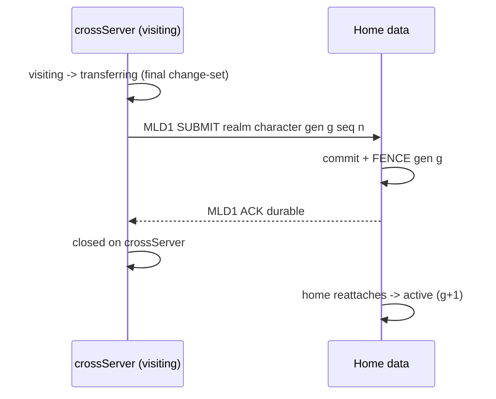
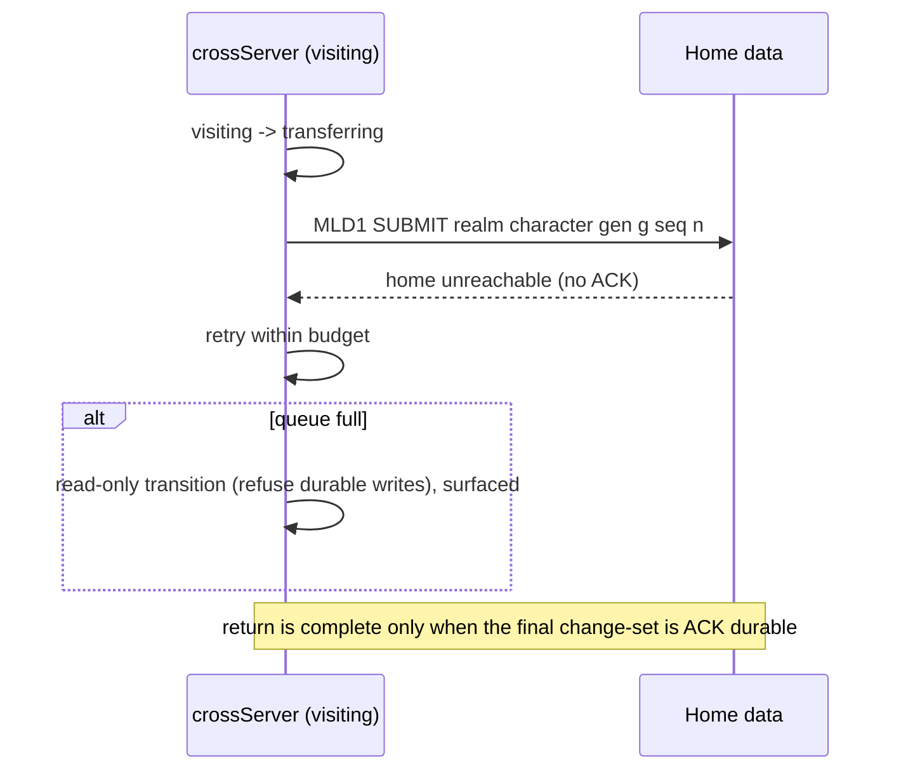
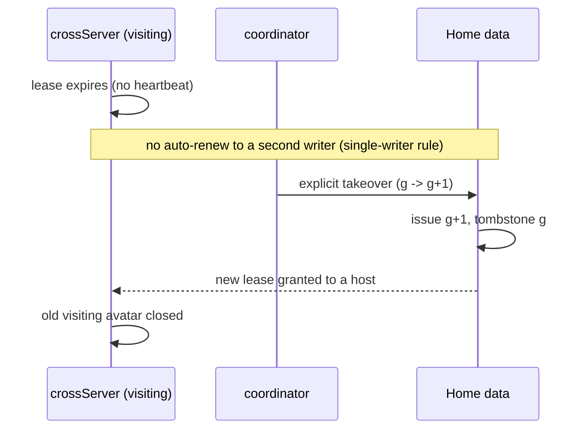
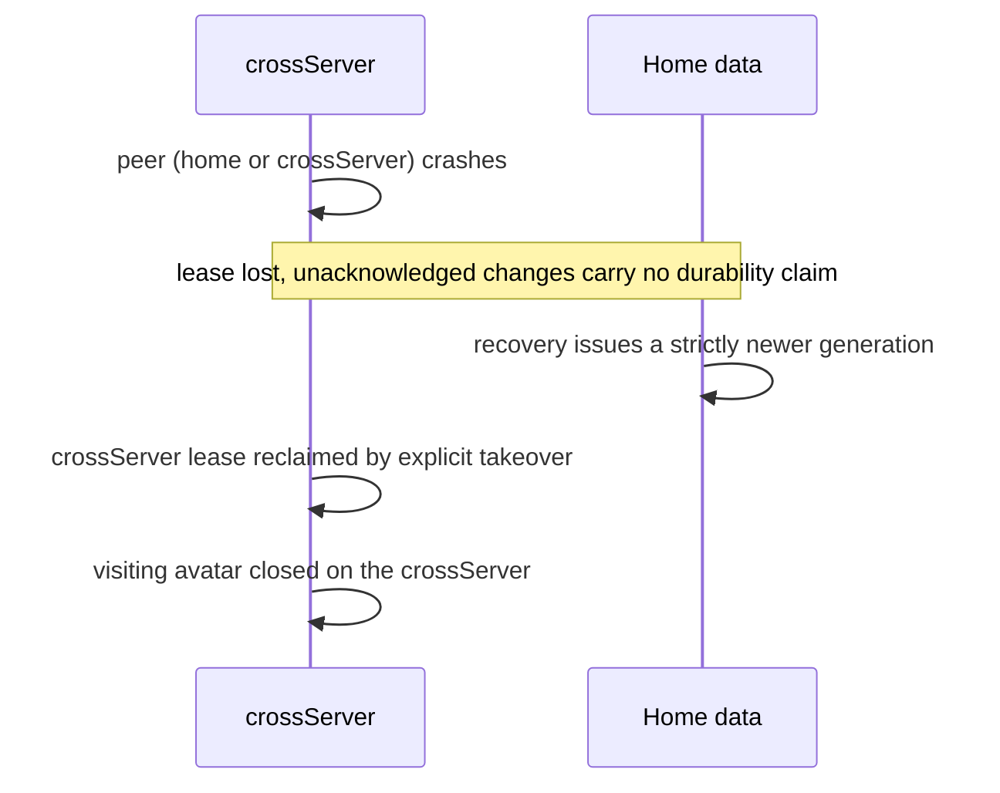

# Cross-server visitation and lease lifecycle

Status: decided design (2026-11-22). The crossServer role, the MLC1 handshake, admission
quotas and the PROBE1 readiness probe exist; the MLD1 record/ACK path and sender-side queue
are implemented; the coordinator-coordinated transfer lease path is wired end-to-end
(avatar.transfer.source/.destination/.full; coordinator.migration.client) and the Avatar scene runtime
hosts avatars on the node (scene.serving). Nothing below is implemented or
validated beyond those, except the offline takeover and recovery scenarios
and the composed normal-login acceptance. This page is the ledger's PL-4: the
cross-server session object lifecycle (create/active/return/abnormal termination, with
`transferring` settling into the `visiting` state face), the writer lease management plane
(lease table, heartbeat, takeover, expiry reclaim), the admission control hook
(`onCrossVisitAdmit`) and overload degradation order, and the event hooks
(`onCrossVisitStart`/`End`, `onLeaseTaken`/`Lost`). It must stay zero-conflict with MLD1.
Machine-readable form: `contracts/cross-server-lifecycle.json`.
Cross-language page: [简体中文](./zh/cross-server-lifecycle.md).

## What it reconciles

| Layer | Page | What it owns | What this page adds |
|---|---|---|---|
| Network admission | [cross-server](./cross-server.md) | MLC1 handshake, room/group/shard quotas, PROBE1 readiness, memory envelope | The application-level `onCrossVisitAdmit` gate and the overload degradation order |
| Durability | [cross return protocol](./cross-return-protocol.md) | MLD1 SUBMIT/ACK durable/FENCE, single-writer, lease handoff | The runtime lease plane and the `visiting` session object that holds the lease |
| States | [Avatar lifecycle](./avatar-lifecycle.md) | `visiting` (cross participation, provisional lease) | The crossServer end of `transferring` settles in `visiting`, not `active` |

## Visiting lifecycle

The crossServer-hosted Avatar is a **lease, not home authority** (cross-return single-writer
rule). Its lifecycle at the crossServer is the `visiting` state face of the
[transfer path](./avatar-lifecycle.md#oracle-state-machine):

| Phase | Rule |
|---|---|
| Create | Cross admission accepted (`MLC1 OK` + verified entry ticket) → the visiting avatar is created at the crossServer |
| Active | `visiting`: provisional bounded write lease; cross-local writes allowed; durable changes return via MLD1 |
| Return | `visiting → transferring` (final SUBMIT) → MLD1 `ACK durable` + `FENCE` → `closed` on the crossServer; the home reattaches → `active` |
| Abnormal termination | peer-down / lease lost / admission revoked / lease-expiry takeover → `closed` on the crossServer; unacknowledged changes carry no durability claim |

**Transferring expands to the visiting face:** PL-1's `transferring` is the in-flight state;
its crossServer destination lands in `visiting` (not `active`), because the destination holds
only a provisional lease. The home-side source of the same transfer remains `transferring`
until the destination answers.

## Writer lease management plane

| Surface | Rule |
|---|---|
| Lease table | Per `(origin realm, character id, hosting generation)` → a lease record `{granted_at, heartbeat, scope, state}` |
| Heartbeat | The crossServer renews its provisional lease on a local timer; a lease with no heartbeat past the threshold is expiring |
| Takeover | Explicit coordinator takeover: the home issues a strictly newer generation (`g+1`), tombstones `g`, grants a new lease. **Never auto-renewed by timeout** (a missed heartbeat cannot authorize a second active owner) |
| Expiry reclaim | Lease expires → the crossServer flushes already-submitted changes, closes the visiting avatar, grants no second writer; the home recovers with a newer generation |

## Admission control and overload degradation

**`onCrossVisitAdmit(context)`** runs before the lease is granted, after the network quotas
(`ROOM_FULL`/`GROUP_FULL`/`SHARD_FULL`) and the verified ticket. It is the application-level
gate the quotas do not express (duplicate login, realm/group/room authorization, business
admission rules).

**Overload degradation order** (when the crossServer is saturated, per PROBE1 readiness):

1. Reject new joins (`MLC1 ERR NOT_READY`).
2. Admit only already-verified reconnects.
3. Stop granting new leases.
4. Drain and return existing visiting avatars.
5. Refuse durable writes on a full sender queue (read-only transition, surfaced).

The order is the union of the network readiness rule (cross-server) and the queue-full
read-only rule (cross-return); it degrades *admission* before it degrades *durability*.

## Event hooks

| Hook | Signature | Called |
|---|---|---|
| `onCrossVisitStart` | `(context) → nothing` | The visiting avatar was created |
| `onCrossVisitEnd` | `(context) → nothing` | The visiting avatar closed (returned or terminated) |
| `onLeaseTaken` | `(context) → nothing` | This host holds the lease |
| `onLeaseLost` | `(context) → nothing` | The lease expired or was taken over |

## Four-path acceptance

### 1. Normal return

### 2. Interrupted return

### 3. Lease-expiry takeover

### 4. Peer-down

## Zero conflict with MLD1

- The lease plane is **in-process and separate from the MLD1 wire**; it introduces no new
  wire frame.
- MLD1 remains the **only durable-return channel** (SUBMIT / `ACK durable` / `FENCE` /
  sequence discipline).
- The lease's generation is the **hosting generation MLD1 already carries** — no translation.
- The heartbeat is a local timer; takeover is coordinator-coordinated through the existing
  lease-gate states (`requested` / `relinquished` / `tombstoned`).

## Deliberately not decided here

- Lease duration, heartbeat interval and reclaim thresholds: measurement.
- A cross-process lease table or distributed lease store: out of scope (the lease is
  process-local at the crossServer; durability is MLD1's).
- Business settlement, rewards and ranking on return: later crossServer slices.
- The `MLR1 ROUTE` binding for reattach routing: still absent (avatar-runtime).

## Verification

- **Machine-checkable:** `contracts/cross-server-lifecycle.json` pins the visiting phases,
  the lease plane surfaces, the degradation order, the event hooks, the four paths and the
  MLD1 zero-conflict rules; the fixture asserts the invariants so drift fails the test.
- **Mermaid:** the four acceptance diagrams render; `docs:check` covers renderability,
  desktop/mobile, light/dark and expansion.
- **Runtime acceptance:** partial — the crossServer role, admission, PROBE1 and the MLD1
  record/ACK path are implemented and validated (validation records); the lease authority,
  the Avatar scene runtime and the event hooks are not.

Related: [cross return and single-writer protocol](./cross-return-protocol.md),
[cross-server and overload](./cross-server.md), [Avatar lifecycle](./avatar-lifecycle.md),
[process responsibilities](./process-roles.md).
