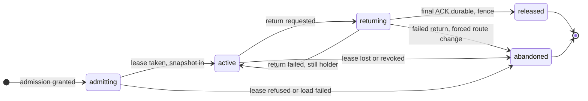
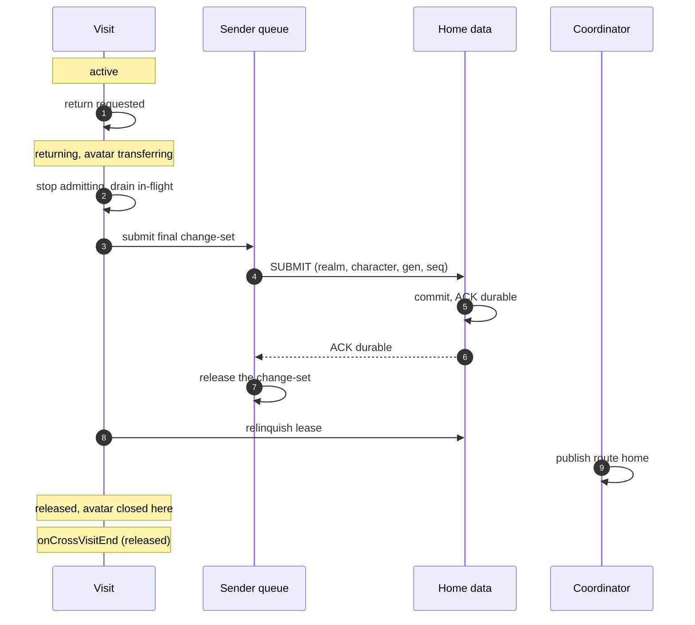
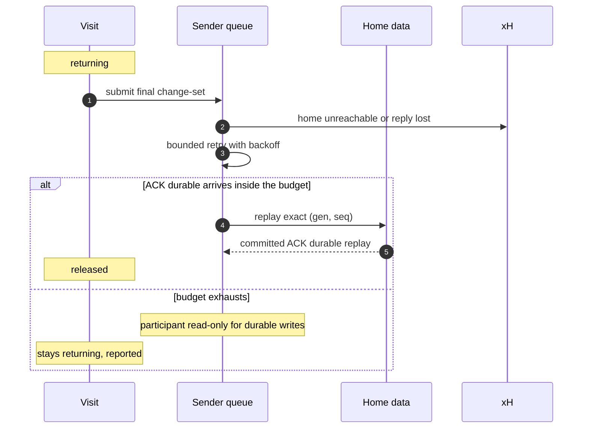
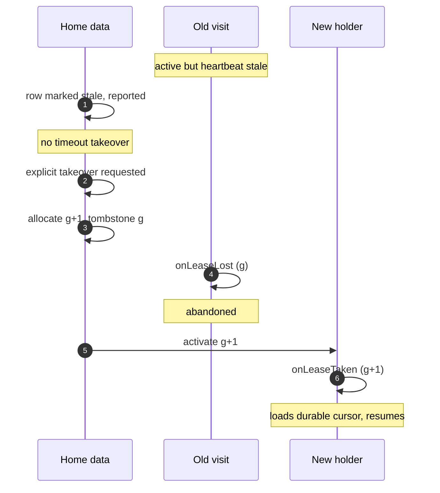
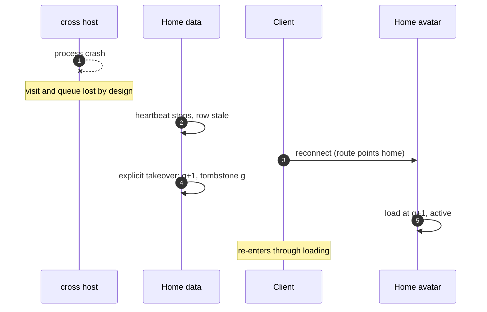

# Cross-server lifecycle: visit objects, leases and admission

Status: design note (2026-11-22). This page unifies the cross-server support management above the two existing cross pages: the [routing topology and overload protection](./cross-server.md) (how traffic reaches a crossServer) and the [cross return and single-writer protocol](./cross-return-protocol.md) (how durable writes get home). What neither fixes is the *managed object*: the cross-server visit — its creation, active life, return and abnormal termination — and the surfaces that manage it: the writer-lease table, admission control and the cross-visit event hooks. Everything here is the contract form of the [avatar lifecycle oracle's](./avatar-lifecycle.md) `visiting` region: the visit object's states drive avatar oracle states, and no transition here contradicts an oracle edge. Nothing on this page changes CLI behavior; the framework today has cross routing, `MLC1` admission with participant tails and ticket verification, the MLD1 record endpoint and the crossServer sender-side retry queue — and no Avatar or visit runtime, so nothing below is implemented or validated.

## The visit object

A *visit* is the cross host's object for one cross participation: it carries the participant context (origin realm, character identity, hosting generation, return route), the entry ticket verdict, the provisional write lease and the bounded sender queue. It is created by an admission, not by a spawn — the spawn/destroy contract's `caller` surface does not apply to it; the framework is its only creator.

| Visit state | Meaning | Drives avatar oracle state |
|---|---|---|
| `admitting` | Ticket verified, admission granted, lease acquisition in flight | `loading` |
| `active` | Lease held, snapshot materialized, handlers run | `visiting` |
| `returning` | Return in flight: final change-set submitted, fence awaited | `transferring` |
| `released` | Return completed: final `ACK durable`, lease relinquished | `closed` |
| `abandoned` | Abnormal end: lease lost or revoked, crash, or a failed return | `purged` |

The mapping is one-way deterministic: a visit in `active` implies the avatar is `visiting`, and an avatar in `visiting` implies its visit is `active`. The two machines never disagree because both are driven by the same edges (admission, lease grant, return request, fence, revocation).

## The writer-lease management surface

The [return protocol](./cross-return-protocol.md) fixes the lease's *semantics* (generation authority, fence, tombstone, explicit takeover). This page fixes its *management surface* — the table, the heartbeat and the reclaim:

| Surface | Rule |
|---|---|
| Lease table | Keyed by `(realm, character)`; rows carry holder, generation `g`, heartbeat cursor and tombstone state. The home data service owns the table; the crossServer holds only its own view |
| Heartbeat | The crossServer heartbeats its lease to home. A missed heartbeat marks the row stale and reports it; it never creates a second owner — the single-writer rule that a timeout cannot authorize a takeover |
| Takeover | An explicit home-side step only: allocate `g+1`, tombstone `g`, activate the destination, publish the route. Who may request a takeover (the coordinator on a forced return; login on a displacement) is the authority surface below |
| Expiry reclaim | A tombstoned row is garbage-collected only after its bounded retry budget is exhausted and the fence has committed. Expiry alone reclaims nothing |

The lease handoff order is the return protocol's, restated as the visit's own sequence: source stops admitting and drains, freezes and flushes the final ordered changes, home commits the final sequence and fences `g`, destination loads the durable cursor and activates `g+1`, the coordinator publishes the route after acknowledgement. Zero conflict: this page adds no generation rule, no fence rule and no takeover inference; it only names who manages the table and when the hooks fire.

## Admission control and overload

The [cross page's](./cross-server.md) quotas (room/group/shard/session caps, the memory envelope, `MLC1 ERR ROOM_FULL`/`GROUP_FULL`/`SHARD_FULL`/`NOT_READY`) are the hard admission gates. This page adds the *decision hook* above them:

| `onCrossVisitAdmit` verdict | Meaning | Aftermath |
|---|---|---|
| `allow` | Admit within the existing quotas | The visit proceeds to lease acquisition |
| `queue` | Hold the join in a bounded queue with jittered retry | An admitted slot re-evaluates queued joins; the queue is bounded and observable, never a silent wait |
| `reject(reason)` | Refuse with an explicit reason | The join answers a typed `MLC1 ERR` and the participant never becomes a writer |

Overload degrades in a fixed order, and the order is the contract — an implementation may not reorder it silently:

1. Stop new admissions (readiness flips to `notready`; queued joins drain first).
2. Shed cross-local load that has no durable obligation (idle room content, spectators).
3. Return the most recently admitted visits that can return without data loss (their final change-sets flush first).
4. Reject with `SHARD_FULL`/`NOT_READY` and report the condition.

A stateful visit is never silently reassigned to another shard — the [cross page's](./cross-server.md) rule that a stateful room cannot safely move merely because its owner is unready, restated for the visit object.

## Event hooks

The cross-visit event surface, with call guarantees consistent with the oracle and the avatar runtime's reentrancy exclusion (the VM is serial; hooks never interleave; a message handler cannot trigger a lifecycle transition synchronously):

| Hook | Called when | Arguments → result | Ordering guarantee | On error |
|---|---|---|---|---|
| `onCrossVisitAdmit` | A participant join arrives, after quota gates, before lease acquisition | `(context)` → `allow` \| `queue` \| `reject(reason)` | Once per join attempt; before `onCrossVisitStart` | An error is a `reject(INVALID)`, never a silent allow |
| `onCrossVisitStart` | The visit becomes `active` (lease taken, snapshot materialized) | `(context)` → nothing | After `onCrossVisitAdmit` allowed; after `avatar_transfer_in` at this host | The visit aborts: the lease is relinquished and the join is refused |
| `onCrossVisitEnd` | The visit reaches `released` or `abandoned` | `(context, outcome)` → nothing | Exactly once per started visit, after the final flush decision | Logged; never blocks the release |
| `onLeaseTaken` | This host acquires a lease (a new generation becomes current) | `(context, generation)` → nothing | Before any durable write under that generation; before `onCrossVisitStart` | The lease is relinquished; the visit aborts |
| `onLeaseLost` | This host's lease is taken over or revoked | `(context, generation)` → nothing | Before any `onLeaseTaken` for a newer generation at this host; after the last durable write under the old one | Logged; the loss stands — the holder stops writing either way |

The machine-consumable form of this surface is `contracts/hooks.xml`, the single hook registry, whose [human-readable face](./hook-registry.md) shows every hook from every lifecycle page in one validated table.

## Path 1 — normal return

## Path 2 — return interrupted

A forced route change before the final acknowledgement is a *failed return* — the visit goes `abandoned`, unacknowledged changes are lost or queued per application choice, and the home side recovers by an explicit takeover. No timeout converts an unacknowledged change into an acknowledged one.

## Path 3 — lease expiry and explicit takeover

The stale row alone changes nothing; only the explicit takeover moves authority. A late submission from the old generation answers `ERR STALE`, exactly the MLD1 fence.

## Path 4 — cross host crash

Unacknowledged submissions in the crashed host's process-local queue are lost by design — the return protocol's rule, restated. Only an actual `ACK durable` ever justified a durability claim; recovery is a fresh load at the new generation, never a resurrection of the visit.

## Contract landing

`contracts/hooks.xml` is the single hook registry, in the same authored-XML idiom as `contracts/lifecycle.xml`: closed vocabularies, explicit hook names, and per-hook attributes for signature, timing, thread, failure semantics and the avatar-lifecycle state the hook is legal in. It now holds the cross-visit surface above alongside every hook from the avatar lifecycle, reconnect, daily-reset and spawn/destroy pages; `tools/check_hooks.py` validates that no hook is an orphan (every hook names an oracle state or a declared trigger) and that the Lua mapping is total.

## Relationship and errata

| Concept here | Baseline page and section | Relation |
|---|---|---|
| Participant context, ticket verdict, `MLC1` tail | [cross server, handshake](./cross-server.md) | Cited; admission builds on the verified join |
| Hard quotas, `ROOM_FULL`/`SHARD_FULL`/`NOT_READY` | [cross server, options and overload](./cross-server.md) | Cited; `onCrossVisitAdmit` sits above them, never replaces them |
| Generation authority, fence, tombstone, explicit takeover | [cross return protocol, single-writer and lease handoff](./cross-return-protocol.md) | Cited, zero conflict: no new generation or fence rule is introduced here |
| Bounded retry queue, read-only transition, failed return | [cross return protocol, MLD1](./cross-return-protocol.md) | Cited; path 2 is that contract drawn as the visit's own sequence |
| `visiting`/`transferring` states, `purged` abnormal end | [avatar lifecycle oracle](./avatar-lifecycle.md) | The visit machine maps one-way onto the oracle (table above); no new avatar state |
| Serial-VM reentrancy exclusion | [avatar runtime, errors and reentrancy](./avatar-runtime.md) | The cross hooks inherit it unchanged |

Zero conflict with the MLD1/lease semantics was found, so there is no errata row for it. One placement note, not a conflict: the return protocol's "coordinator requests the transfer" line names the coordinator as a transfer requester, which this page keeps — the takeover *authority* surface above names the coordinator (forced return) and login (displacement) as the two requesters, and the home data service stays the only authority that grants.

## Deliberately not decided here

- Wire messages for lease heartbeat and takeover requests: implementation slices on the MLD1/data surface; this page fixes who owns the table and when hooks fire, not the frames.
- Queue bounds, retry budgets, heartbeat intervals, queue jitter and every duration: measured at implementation.
- Cross-visit *business* semantics (matchmaking, settlement, rewards): later crossServer slices, exactly as the return protocol defers them.
- Seamless visit-to-visit moves (chaining cross hosts without returning home): a later slice; today a move is return-then-admit.
- The full hook registry's generated outputs (descriptors, Lua stubs): the [hook registry page](./hook-registry.md) names the validator as the only script.

## Verification

None today: no visit runtime exists, so this page has no test and no runtime acceptance, and validation records must not claim cross-visit behavior. Page-level acceptance is documentary: the four paths (normal return, return interrupted, lease-expiry takeover, cross-host crash) are each drawn; the visit-to-oracle mapping is one-way and total; every hook names its ordering guarantee and error consequence; the MLD1/lease relationship table cites the exact sections and finds zero conflict; and every mermaid diagram renders with every relative link resolving. When implemented, acceptance is per-path: each of the four paths is a named test against a real crossServer/data/coordinator topology, and the takeover path is exercised with a stale-heartbeat row proving no timeout inference.

Related: [cross return and single-writer protocol](./cross-return-protocol.md), [cross-server routing and overload](./cross-server.md), [avatar lifecycle and oracle](./avatar-lifecycle.md), [service contracts](./service-contracts.md), [process responsibilities](./process-roles.md).
