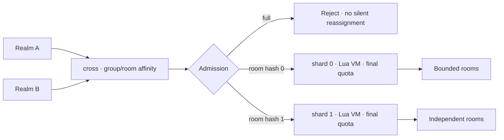

# Native cross-server routing and overload protection

## Legacy design and evidence

The old game coordinated regional World/Gate processes through CrossWorld and executed cross gameplay on multiple CrossHegels. Distributed CrossHegel indices existed, but those processes connected to the first serverList CrossWorld entry. Cross RPC forwarding, JSON re-encoding, global state and broadcasts concentrated work there. Adding gameplay workers did not automatically scale that coordinator.

ServerManager.pickupCrossHegel first preferred an online node below HegelLimit; when all were full it still randomly selected an online node. That was a soft preference, not hard admission. ServerConnBase.pushQueue appended to a deque without an item/byte cap at that entry point; callers and buffering need further tracing.

These observations do not establish the historical crash cause. Core dumps, OOM logs, RSS/CPU, queue bytes, connections, room population and Lua tick delay are needed to distinguish memory exhaustion, a native crash and saturation. The public source package contains analysis, not original business code or production configuration.

## Implemented topology



cross and shard are native mistlane roles over internal framed TCP. The same group/room maps to the same shard across realms using fixed 64-bit FNV-1a modulo the ordered upstream list. A session owns one upstream connection with serial request/response; no shared-connection multiplexing, unbounded application send queue or automatic replay is introduced. A full stateful room is rejected rather than silently split.

```sh
build/debug/mistlane --role shard --listen 127.0.0.1:7201 --script examples/cross.lua --route-epoch 1 --max-room-sessions 16
build/debug/mistlane --role shard --listen 127.0.0.1:7202 --script examples/cross.lua --route-epoch 1 --max-room-sessions 16
build/debug/mistlane --role cross --listen 127.0.0.1:7300 --upstream 127.0.0.1:7201 --upstream 127.0.0.1:7202 --route-epoch 1 --max-room-sessions 16
```

Run each command in a separate terminal. Limits are illustrative, not measured capacity.

## Handshake and application context

The first framed payload is ASCII: MLC1 1 realm-a group-1 room-42. Fields are protocol marker, route epoch, source realm, cross group and room. Identifiers contain 1–64 ASCII letters, digits, underscores or hyphens; the handshake is at most 256 bytes. Epoch is a positive decimal integer up to 1000000000.

cross admits and forwards the handshake to the selected shard. The shard performs final admission and returns MLC1 OK 1. Subsequent payloads reach Lua message with the context as its second argument. Failures return MLC1 ERR followed by INVALID, EPOCH, ROOM_FULL, GROUP_FULL or SHARD_FULL (or UPSTREAM for an incompatible shard response), then close. Transport errors and global connection admission can close without a response. Successful admission is neither authentication nor durability.

| Option | Default | Meaning |
|---|---|---|
| --max-room-sessions | 64 | Connections for one group/room |
| --max-group-sessions | 128 | Connections for one group |
| --max-shard-sessions | 256 | Connections to one destination shard |
| --max-connections | 1024 | Node limit, further reduced by memory admission |
| --memory-budget-mib | 256 | Conservative network admission envelope of 6 MiB + 64 KiB per session; default effective cap is 42 |
| --route-epoch | 1 | Matching configuration generation on cross and shards |

Ingress quotas are local to each cross process. Each shard enforces final quotas across all its ingress connections, preventing multiple routers from bypassing its room cap. Group quotas across different shards are not globally coordinated. Disconnection/failure/timeout releases admission and empty room records are removed.

These limits count **connections, not distinct authenticated players**. Applications must validate tickets, duplicate logins and realm/group/room authorization. Use trusted private networking: mTLS and signed tickets are not implemented.

The memory envelope bounds admitted sessions before protocol buffers are allocated. TCP checks the 1 MiB length before body allocation; Drogon has body and WS message limits. This is an estimate, not a hard RSS quota, and excludes Lua state, TLS, allocator overhead and some third-party buffers. Lua can allocate a large response before the transport rejects its size. Measure actual memory and apply process/cgroup limits.

## Reconfiguration and failures

Changing upstream order/count remaps rooms. Stop new joins, drain affected rooms or migrate application state, then update route epoch and configuration together. Epoch rejects differing generation numbers; it does not validate identical upstream lists.

A failed shard closes affected sessions without automatic replay or stateful failover. Other shards remain usable. Recovery needs application snapshots, idempotent request IDs, reconnect and compensation. Durable route tables, leases, discovery, distributed transactions and online migration remain unimplemented. Native support means generic routing/admission, not restored legacy gameplay.

## Capacity plan

Measure representative room workloads and message sizes, using tick delay, P99 latency, CPU/RSS and output backlog to set a hard room cap with headroom. Partition large activities into independent matches/rooms with one state owner each; more shards increase room capacity, not the capacity of one unbounded room. Use AOI/subscriptions, batching and broadcast frequency limits. Keep persistence asynchronous and bounded.

Reject full rooms or use an external bounded queue with retry jitter. Exercise slow consumers, slow/down shards, burst joins, disconnect churn and recovery after capacity is released. Observe admission rejections, active sessions, bytes, tick drift, timeouts and reconnect rates. Production metric collection and a sustained load generator are not yet integrated; functional tests are not capacity evidence.

## Internal diagnostics status

There is no cross/shard liveness or readiness probe yet. A TCP connection or OS keepalive only establishes transport-level reachability; it cannot show that the Asio/Lua loop is making progress. The old code has a Lua call timeout hook (`C_monitorDeadLoop`), but no CPU/memory profiler or service-to-service health protocol. That hook can interrupt some runaway Lua execution and does not identify hot functions or explain native stalls.

| Signal | Purpose | Design boundary |
|---|---|---|
| Prometheus metrics | Track active sessions, admission rejects, payload sizes and latency, Lua callback/tick duration, event-loop timer lag, and RSS/CPU where available | Scrape from a private metrics listener; keep labels low-cardinality (role/shard/result, never player/room IDs). |
| Internal probe | Report process responsiveness and readiness/capacity state | Use a separate control listener with nonce/deadline; measure probe round-trip and event-loop lag. Readiness false blocks new joins but preserves existing room ownership. |
| Crashpad | Preserve a local minidump after native crashes | Start the out-of-process handler and use a bounded local database; no upload endpoint by default. Archive matching symbols per build. |
| Profiler | Attribute CPU and allocation cost to code paths | Add an opt-in diagnostic mode after metrics establish a reproducible workload; profiler output is not a health signal. |

The optional `/metrics` listener currently exports readiness, active sessions, admission rejections, Lua callback duration, and resident memory. Crashpad can be enabled explicitly and keeps reports in a local database with uploads disabled. Internal liveness probes, traffic/tick metrics, crash-dump generation tests, retention limits and symbol workflows remain pending. Health-based automatic shard reassignment is excluded: a stateful room cannot safely move merely because its owner is temporarily unready. These additions provide overload evidence; they do not prove a capacity fix.
