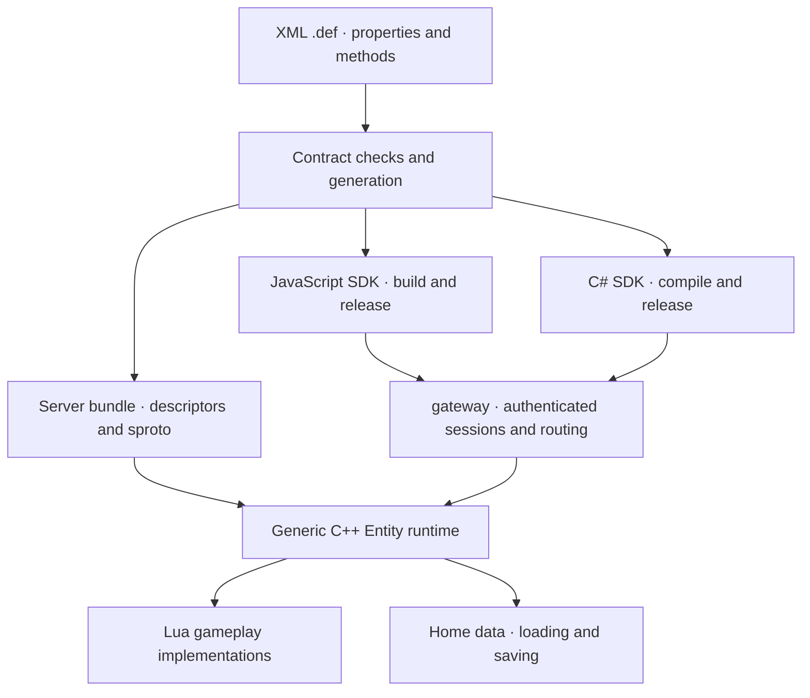

# Entity contracts and code generation

> Deferred draft: prioritize the agreed legacy process responsibilities and message paths. This phase does not implement a contract library, code generation or automatic property replication.

Status: design proposal; the format itself is now pinned by a definition-time prototype. `include/mistlane/entity_contract.hpp` parses the XML subset and enforces the semantic rules of this page (explicit stable ids, closed vocabularies, typed defaults, array/struct resolution, recursion refusal, DOCTYPE/entity refusal), declares retired ids in a `Reserved` group, and emits both artifacts the release process needs: the project-specific XSD (each member's id and type pinned) and the release lock (every assignment plus the model digest). Unit-asserted in `core.contracts`; the `mistlane contract check|build` command (`src/contract_tool.cpp`, case `contract.tool`) validates `.def` documents and, only after every file passes, emits the project XSD, release lock and digest artifacts. Still missing: sproto emission, release-compatibility reports, server bundle loading and any runtime. This page applies to Mistlane and does not rename Apollo components. Clients target JavaScript and C#. Contract changes regenerate and rebuild clients; supported server business contract changes do not rebuild the C++ executable. Paths, commands and APIs below remain proposed interfaces beyond the prototype's scope.

## Design choice

Use XML `.def` files as the only handwritten entity contracts, following the organization of BigWorld/KBEngine entity definitions. This does not promise file or wire compatibility. Generate sproto descriptions for encoding rather than maintain a second handwritten `.sproto`. Lua implements gameplay; a generic C++ Entity runtime loads descriptors, binds methods, resolves objects, replicates properties and submits persistence.

XML accommodates entity identity, defaults, persistence, replication, method direction and caller permissions together. Standard XML tooling and a supplied XSD validate document structure; the compiler and loader validate identifiers, references, compatibility and implementations. XML is data, not executable code; disable external entities and external DTD loading.

Entity is the common abstraction; Avatar, Monster and NPC are concrete types. Complete objects still run in gameServer/crossServer without introducing Base/Cell separation. Use `ServerMethods` and `ClientMethods` for execution sides, avoiding names for hosting layers that do not exist here.

References: [KBEngine Avatar.def](https://github.com/kbengine/kbengine_demos_assets/blob/master/scripts/entity_defs/Avatar.def) illustrates properties, persistence and methods by execution side. [sproto RPC and schema documentation](https://github.com/cloudwu/sproto#rpc-api) supplies request/response declarations and loadable codec descriptions. Entity routing, replication, database mapping and release compatibility remain Mistlane responsibilities.

## One contract

The following is the proposed Mistlane format, not an existing KBEngine file or a completed parser.

```xml
<Entity name="Avatar" id="1">
  <Properties>
    <level id="1" type="UINT16"
              default="1" flags="OWN_CLIENT" persistent="true" />
    <hp id="2" type="UINT32"
              default="100" flags="ALL_CLIENTS" persistent="false" />
    <gold id="3" type="INT64"
              default="0" flags="OWN_CLIENT" persistent="true" />
    <inventory id="4" type="Inventory"
               flags="OWN_CLIENT" persistent="true" />
  </Properties>

  <ServerMethods>
    <Method name="attack" id="1" mode="notify" caller="owner">
      <Arg name="target" id="0" type="EntityRef" />
    </Method>
    <Method name="getProfile" id="2" mode="request" caller="owner">
      <Returns>
        <Field name="level" id="0" type="UINT16" />
      </Returns>
    </Method>
    <Method name="applyDamage" id="3" mode="notify" caller="server">
      <Arg name="amount" id="0" type="UINT32" />
    </Method>
  </ServerMethods>

  <ClientMethods>
    <Method name="onReward" id="1" mode="notify" audience="owner">
      <Arg name="itemId" id="0" type="UINT32" />
      <Arg name="count" id="1" type="UINT32" />
    </Method>
  </ClientMethods>
</Entity>
```

- `OWN_CLIENT` replicates to the bound owner; `ALL_CLIENTS` includes the owner and authorized current observers, not every connected player. `SERVER_ONLY` never replicates to clients. Entities need not have a client connection.
- `caller="owner"` permits the authenticated owning client; `server` permits authorized internal services. Other caller policies require explicit definitions and default to denial. Internal permission to invoke an owner method must also be explicit.
- `notify` has no business response and is not proof of durable settlement. `request` has typed returns, correlation, deadlines and errors. Client methods initially support notify only.
- Persistence and replication are independent. Nonpersistent fields may still belong in process-transfer snapshots.
- Initial types: BOOL, INT32, UINT16, UINT32, INT64, STRING, BYTES, named Struct and Array. The built-in EntityRef carries scope, runtime entity ID and incarnation; it is not a database key. Arbitrary Lua values, functions and cyclic values are excluded.
- JavaScript uses `bigint` and C# uses `long` for INT64. Numeric ranges are checked. Debug JSON/manifests represent 64-bit IDs as decimal strings, not JS numbers. Do not claim full UINT64 support over sproto signed 64-bit integers.

Reusable named types live in XML type files explicitly included by the build manifest. A type is defined once. The first version excludes entity inheritance and executable default expressions; adding inheritance requires explicit identifier and collision rules.

## XML validation and reusable library boundaries

XML is the only handwritten format for entities and complex types. Property names are element names, for example `<level id="1" type="UINT16" flags="OWN_CLIENT" />`. Define reusable structures in types.xml and reference them by name. Inner fields inherit the top-level property's replication/persistence policy instead of repeating distribution flags.

```xml
<Types>
  <Item>
    <itemId id="0" type="UINT32" />
    <count id="1" type="UINT32" default="1" />
  </Item>
  <Inventory>
    <capacity id="0" type="UINT16" default="20" />
    <items id="1" type="ARRAY" of="Item" />
  </Inventory>
</Types>
```

IDs remain explicit and stable. Validate named structures and fields too. Missing defaults follow type rules: zero/false/empty strings, empty arrays and per-field structure initialization; explicit defaults override those rules. Missing flags mean SERVER_ONLY and persistence defaults to false. Unknown flags are errors, not defaults.

Retired IDs are declared, not implied: a `Reserved` group under the entity lists the exact tags a meaning has retired, so a later contract can never silently reuse one.

```xml
<Entity name="Avatar" id="1">
  <!-- ... Properties / ServerMethods / ClientMethods ... -->
  <Reserved>
    <Property id="5" />        <!-- an old property tag, kept out of circulation -->
    <ServerMethod id="9" />    <!-- a retired server method tag -->
    <ClientMethod id="7" />
  </Reserved>
</Entity>
```

A reserved ID must not be live anywhere in the same contract, must not repeat within its kind, and carries no other attributes: "this tag is retired" and "this tag is free" are kept distinct. The prototype enforces all of that and carries the reserved tags into the dump, the XSD and the lock, so they participate in compatibility checks exactly like live members.

[XML Schema/XSD](https://www.w3.org/TR/xmlschema-0/) validates structure, required information, lexical types, enumerations and scoped key/reference constraints. Editors with XML/XSD support and an associated schema can offer completion and diagnostics. Tooling and CI must explicitly validate; using XML alone does not execute schema checks.

A generic XSD cannot enumerate every project member when member names are element names. A permissive wildcard does not fully validate arbitrary child attributes. The contract checker must enforce their shared rules; it can generate a project-specific XSD from the resolved model for editor support and strict validation. Applications do not maintain a second handwritten schema.

The prototype implements this generator (`EntityContract::xsd()`): it enumerates the declared types, entities and their members, pins every member's id and declared type as enumeration restrictions (a renumbered or re-typed member fails the schema outright), restates the closed vocabularies, and feeds its own output back through the well-formedness check so a malformed schema cannot ship.

| Stage | Checks |
|---|---|
| XML/XSD | Structure, allowed elements/attributes, required fields, enumerations and basic lexical formats; project-specific schemas add concrete member declarations |
| Contract semantics | Type references, typed defaults, cross-file ID conflicts, recursive types/ownership and generated JS/C# naming collisions |
| Release compatibility | Reserved IDs, changed meaning/types, client compatibility and data migrations against published locks |
| Service loading | Lua implementations and descriptor/runtime compatibility; become ready only after bindings pass |

The mechanisms can form a reusable library/toolchain. First establish module boundaries inside Mistlane, then publish separately when justified by actual reuse. This proposal does not create another repository or choose another product name.

| Reusable module | Integration adapters |
|---|---|
| XML loading, XSD/semantic checks and descriptor model | Project manifest, published versions and compatibility policy |
| Codec descriptors/generation and JS/C# SDK generation | Selected codec backend; sproto is the initial preference, not a dependency of the core type model |
| Typed properties, nested change tracking and baseline/delta application | Entity lifecycle/identity, recipient sets, scheduling and connections |
| Method bindings and RPC encoding/dispatch | Authenticated caller context, current routes, transport and deadlines |
| Snapshot codecs, defaults and migration interfaces | Home data, database transactions, write ownership and commit acknowledgement |

Applications compose deployment, login and gameplay around these mechanisms. XML is parsed at definition/build/load time; wire messages remain binary rather than sending XML per change. Descriptors do not generate native business classes, preserving server updates without recompilation within supported engine capabilities. JS/C# clients regenerate and rebuild.

## Stable identity and filenames

Entity type IDs are globally unique. Property IDs are unique within a type; method IDs within a type and execution side. Argument/structure field tags are unique within their structure. Filenames only organize sources; moving a file does not alter wire identity.

IDs are explicit. Neither traversal order, declaration order nor hashes may renumber published definitions. Retired IDs are reserved and never reused for another meaning or type. Collisions between properties, implementation methods and engine members fail the build. Method IDs may coincide across directions, but the first version rejects duplicate entity member names across groups to avoid binding ambiguity.

Generated sproto uses unique internal names such as `E1_Server_1` and recorded bundle-level protocol tags. A generated release lock preserves assignments and allocates only new tags. Entity RPC IDs and internal sproto tags are checked against that mapping; business code does not maintain either generated map.

The prototype already emits that lock as text (`EntityContract::lock()`): every live and retired assignment in declaration order plus the model digest, reproducible from the source document alone. A released version ships this file; the next version diffs against it and must not renumber or re-type anything already listed.

## Generated artifacts

Suggested sources: `contracts/entities/Avatar.def`, `contracts/types/*.xml`, `contracts/manifest.xml`; handwritten behavior lives in `game/entities/Avatar.lua`. `generated/` contains generated artifacts only. Generators never overwrite business implementations; missing-method reports and optional new-file templates are separate outputs.

| Output | Purpose |
|---|---|
| Server bundle | Normalized type/property/permission/persistence descriptors, sproto schema, Lua bindings, digests and compatibility metadata |
| JavaScript SDK | ESM proxies, notification dispatch, property views, validation and `.d.ts`; application code can remain JavaScript |
| C# SDK | Typed entity proxies, request/return types, notification handlers and codec descriptors, built with a common runtime |
| Check report | Missing implementations, collisions, reserved IDs, compatibility changes and migration requirements |
| Data descriptors | Persistent snapshot codecs and explicit migration plans; no destructive automatic startup DDL |

Proposed `mistlane contract check` and `mistlane contract build` commands invoke offline tooling. They do not run the online service or compile C++. The initial Entity/sproto integration requires engine development and a binary build; subsequent supported business definitions generate descriptors rather than C++ classes.

A generic descriptor interpreter establishes C++/Lua bindings at runtime. Before accepting traffic, loading verifies required implementations, unknown/reserved entries, defaults and dependencies. JS/C# codec implementations or generators must first pass shared byte-level conformance cases; no existing third-party binding is assumed adequate.

## Application code

Lua implements declared methods and lifecycle hooks. The release manifest binds implementation files; filenames are not routing addresses.

```lua
local Avatar = {}

function Avatar:attack(ctx, target)
    -- Gameplay still validates range, cooldown and scene membership.
    -- ctx is readonly and supplied by the engine, not the client.
end

function Avatar:getProfile(ctx)
    return { level = self.level }
end

function Avatar:applyDamage(ctx, amount)
    self.hp = math.max(0, self.hp - amount)
end

return Avatar
```

`self` is controlled Entity userdata. Declared properties are writable with validation and change tracking; engine proxies such as `self.client` are readonly. Methods live in a separate implementation table and are bound by the engine. Incoming strings cannot address arbitrary Lua functions.

The client primarily communicates through its own Avatar, created and bound by the engine after login. Application code directly calls methods, reads replicated properties and receives notifications on that object, without public `.server`/`.client` proxy layers. The client object corresponds to the server Avatar through the contract; it is not a reference to Lua process memory.

- `avatar.attack(...)` invokes the generated server RPC.
- `avatar.level` reads local replicated state, without an RPC for each read. The server controls mutations.
- `avatar.onReward` receives contract-declared notifications dispatched by the engine.

By default, only the owning Avatar exposes player-facing RPCs. Observed monsters, NPCs and other players expose visible state; having a replica does not authorize arbitrary remote calls. Player actions enter through the owning Avatar. Generic server-side Entity RPC remains available under engine-enforced permissions.

Proposed generated call surfaces:

```javascript
avatar.attack(monster.ref);
const profile = await avatar.getProfile();
const level = avatar.level; // Local replicated property
avatar.onReward = (itemId, count) => showReward(itemId, count);
```

```csharp
avatar.Attack(monster.Ref);
var profile = await avatar.GetProfileAsync();
var level = avatar.Level; // Local replicated property
avatar.OnReward += (itemId, count) => ShowReward(itemId, count);
```

C# requests use Task with deadlines/cancellation support. JavaScript uses callback subscriptions and C# events/handler interfaces for notifications. Client replicas expose readonly properties.

```lua
self.client:onReward(itemId, count)
target:applyDamage(amount)
```

Notifications return through the original gateway. Internal references obey contract permissions and deadlines too. Server-side self.client is the reverse notification route, distinct from direct client Avatar access. Not every Entity has an owner client; missing/offline delivery has explicit outcomes and does not implicitly activate a player or create unbounded queues. All these APIs remain unimplemented.

### How bindings are produced

Parse XML into one resolved type model, validate references, IDs and compatibility, then emit descriptors and client code from that model. For attack, it records entity type 1, server method 1, owner permission and one EntityRef argument. The generated Avatar directly exposes JS attack and C# Attack as instance methods wrapping a shared RPC runtime, using generated descriptors rather than separate handwritten message maps.

The server loads the same descriptors and the implementation table returned by Avatar.lua through the release manifest. It binds attack under `(type ID, execution side, method ID)`. Dispatch validates the invocation before calling the Lua function with target Entity userdata and readonly ctx. Generic userdata accessors read/write typed property storage using descriptors. Adding business members therefore changes descriptors, Lua and client outputs, without adding C++ members or functions.

Generators must also reject language keywords and collisions after casing or Async suffix conversion. Descriptor format, generator and runtime compatibility versions belong in the bundle manifest; an older engine rejects unsupported descriptor formats.

## Runtime flow



An invocation carries scope, target entity ID/incarnation, type and method IDs; requests also carry correlation and deadlines, and internal routing carries the hosting generation. The contract digest lives in the client handshake and the internal service identity, not in every invocation, because gateway routing already filters to compatible hosts and repeating a 64-bit digest per call would cost bandwidth for no safety gain. Authentication comes from trusted connections, not self-reported owner fields. Receivers validate type, exposure, caller ownership and parameters; gameplay validates game rules.

References hide fixed IPs and hosts. Transfer needs updateable routes, bounded queues/retry rules or explicit errors, and rejection of stale owners. Local calls use the same authorization and scheduling boundary to avoid synchronous reentrancy. RPC does not promise exactly-once execution: timeout can mean an unknown outcome. Do not silently retry non-idempotent gameplay; settlement needs business operation IDs. Bound packet size, outstanding requests, queues and execution time.

## Invocation envelope and error protocol (decided, unimplemented)

The envelope below pins the transport of an entity invocation. Nothing speaks it yet: the runtime has no entity objects, so the wire verb that carries it does not exist. What is fixed here is the decision.

An entity invocation is a payload kind inside the existing transport framing (MLC1/MLC2/MLM1 frames or a client session channel), not a new TCP protocol; it stays inside the bounded 1 MiB frame. Fields, in order:

- `scope` u32 — scope id resolved from the config's realm/scope list, never a string.
- `type_id` u32 — entity type id from the contract lock, never a string.
- `entity_id` i64 — runtime entity id (INT64 maps to JS `bigint`/C# `long`).
- `incarnation` u32 — generation of this entity instance; routes and snapshots carry it, and a request for a known entity id but an unknown incarnation is answered `STALE`, never misdelivered.
- `side` u8 — `server` or `client`; it selects which method-id space the descriptor resolves.
- `method_id` u16 — side-local; the descriptor decides notify versus request.
- `correlation_id` u64 — caller-assigned, echoed verbatim by the answer; `0` means notify (no answer exists). Bounded: the SDK must not guess or reuse a correlation id while unanswered.
- `hosting_generation` u32 — only internal routing; the receiving host asserts it matches its current ownership generation. Zero for calls that originate at a client.
- `deadline_ms` u32 — the caller's remaining budget in milliseconds; monotonic, not a wall-clock promise. A request that would exceed it answers `TIMEOUT` even if the operation completed, because a late answer is unusable. Notify still carries one so a saturated host can refuse the work.
- payload — sproto-encoded arguments; request answers carry the typed returns.

The addressing key `(scope, type_id, entity_id, incarnation)` is exactly what `EntityRef` carries (as fixed under [Stable identity](#stable-identity-and-filenames)), so a method argument of type `EntityRef` and a call target share one addressing vocabulary rather than two.

The inner entity `correlation_id` is deliberately independent of the outer transport correlation: the gateway maps the client's outer correlation onto the inner entity request and back through its own bounded table, so one client channel can multiplex many entity requests without consuming transport correlation ids.

**Errors form one closed, versioned set** (`EntityError`), never business-defined free-form bodies. A request answers with exactly one of: the typed returns, or a single `EntityError`. Never both, never partial, and an error is the terminal answer for that correlation id.

| Code | Meaning |
|---|---|
| `INVALID` | Malformed envelope, wrong encoding, or a field combination the schema rejects; the only error allowed a `reason` string, for diagnostics |
| `UNROUTED` | No route or owner for `(type_id, entity_id)` right now |
| `STALE` | The entity id is known but not this incarnation |
| `FORBIDDEN` | Caller policy denied the method: not the owner, not an authorized service, or a client-side method invoked from the server |
| `TIMEOUT` | The deadline expired before completion |
| `CANCELLED` | Cancelled by the caller |
| `NO_IMPLEMENTATION` | The descriptor declares the method but the loaded implementation table has no binding |
| `NOT_READY` | The host is draining, not ready, or does not own the entity here |
| `CAPACITY` | A bounded queue or admission control rejected the request |
| `CONFLICT` | Business-level conflict, e.g. a lost write generation or a duplicate operation id |

The receiver validates in this order and answers with the first failure: envelope shape → descriptor lookup (`type_id`, `side`, `method_id`) → permissions → implementation binding → incarnation/ownership → argument decoding → argument value checks. Permissions are checked before arguments are decoded, so an unauthorized caller learns nothing from a malformed payload. Unknown error codes are treated as `INVALID` by clients; codes are versioned with the contract digest.

**Decisions and rejected alternatives.** Free-form per-method error payloads were rejected: without a closed set, no client can handle errors mechanically. A notify ACK was rejected: it turns a one-way call into a second request channel, doubles traffic, and contradicts "notify is not proof of durable settlement". Reusing the transport correlation id as the entity correlation id was rejected: the gateway's outer correlation is consumed by the client hop, so the two levels need independent ids for multiplexing. Partial results on partial failure were rejected: they are ambiguous for replication and persistence. Putting error codes in the sproto schema instead of a closed host/SDK enum was rejected: the error set is transport policy, not business data, and per-contract redefinition would break shared client SDKs.

## Automatic property replication

Create, reconnect and observer entry establish a visible full baseline. Later messages carry changed property IDs/values and replication sequence numbers. Observer departure removes replicas; reentry establishes a new baseline. Missing/stale baselines or sequence gaps require resynchronization. Replication sequence and persistence revision are distinct.

Lua writes are tracked by the engine. Struct/Array values use controlled proxies that track nested writes, insertions and removals; raw tables cannot bypass tracking. Use nested path deltas as specified below; reserve full values for explicit initialization/replacement or rebaselining. Generate readonly client views and property-change notifications.

Owner identity and authorized scene observer sets enforce visibility; this is not proof of spatial AOI. Ordinary property updates may coalesce to the latest value per interval and do not replace ordered gameplay events. Private server properties must never appear in unauthorized client snapshots.

### Verified BigWorld and KBEngine behavior

The original BigWorld Server Programming Guide's [property callback section (archive)](https://howarduong.github.io/github.io/doc/html/server_programming_guide/ch06.html) distinguishes top-level replacement, setNested callbacks and setSlice array changes. BigWorld must not be described as supporting only top-level assignments.

Static tracing of current public KBEngine master finds the entity [assignment entry](https://github.com/kbengine/kbengine/blob/master/kbe/src/lib/entitydef/entity_macro.h) calling onDefDataChanged. Ordinary [FixedDict mutation](https://github.com/kbengine/kbengine/blob/master/kbe/src/lib/entitydef/fixeddict.cpp) checks types and updates storage; [Sequence mutation](https://github.com/kbengine/kbengine/blob/master/kbe/src/lib/pyscript/sequence.cpp) updates items/slices without a visible owner-entity notification in those paths. Do not assume ordinary in-place container mutation automatically replicates. EntityComponent notification is separate. This finding is limited to the inspected version and paths.

No author statement establishing performance or cycle prevention as the reason was found. A simpler ownership/change protocol is a reasonable inference; resending large containers can increase bandwidth. Cycle constraints and nested replication are separate design decisions.

### Mistlane target behavior

Property replication is an Entity engine feature, not manual gameplay RPC glue. Server code writes controlled properties directly:

```lua
self.hp = 90
self.inventory.items[3].count = 5
self.inventory.items:append(item)
self.inventory.items:removeAt(3)
```

inventory and its types must first be declared; these are proposed behaviors, not working APIs. The engine detects mutations, filters recipients and replicates changes. Clients read the resulting avatar state without refetching entire containers. Cover scalars, structures, nested fields, array elements and structural changes. Immutable STRING/BYTES require replacement assignments rather than mutable internal byte access.

Nested deltas are the target. Changing one inventory item must not normally resend the whole inventory. Whole-property values remain for initialization, explicit replacement, rebaselining or a controlled fallback when cheaper than deltas. A scalar-only prototype is not complete property synchronization.

1. **Tracking:** C++ owns storage and Lua userdata intercepts writes. Nested containers track the entity, top-level property and parent. Changes propagate along that ownership chain, without per-frame deep comparison or manual dirty calls/reassignment.
2. **Representation:** top-level property ID, field-ID/index path, operation and new value. Field IDs come from contracts; wire indices are zero-based and Lua bindings translate one-based indices. Ordered slice operations represent array insertion/removal and apply only against matching baselines/sequences.
3. **Coalescing/callbacks:** collapse repeated scalar writes only when structure is unchanged. Insertions, removals and parent replacements invalidate naive path merging. Apply each client batch atomically before generated property callbacks; these callbacks do not require handwritten ClientMethods.
4. **Ownership/cycles:** properties are bounded typed value trees. Reject cycles and initially reject by-value recursive types. Mutable values have one owner; assignment validates and copies values instead of sharing ownership. Replaced/removed handles become invalid and reject writes. Entity relationships use references/DB identities rather than embedding Entity objects. Bound depth, element count, value size and batch size.
5. **Persistence:** nested changes also dirty the owning persistent property. Wire deltas and database commit protocols remain distinct; initial storage may still save complete persistent snapshots. Confirm replication sequences and data revisions separately, with bounded backpressure/coalescing/rebaseline behavior.

Acceptance covers nested arrays/writes, head/tail insertion/removal, delete-then-write, child-write-then-parent-replace, copying, cycles, stale handles, equal values, missing baselines, mixed-version observers and saves in flight. Benchmark a large inventory with one changed item using bytes, allocations and CPU, rather than assignment cost alone. Deltas are not assumed cheaper for every value size.

## Loading and persistence

Only persistent properties enter database snapshots; entities need not have database records. Runtime EntityRefs are not permanent foreign keys. Durable relationships use stable database identities/type information and resolve runtime references on load. Never serialize sockets, Lua functions, client proxies or native pointers.

Initially use generic MySQL records keyed logically by `entity_type_id + db_id`, with data schema version, commit revision, ownership generation and a sproto payload. Home data owns database access. Searchable/unique fields require explicit index projections and migrations instead of automatically adding a SQL column for every property.

Load: read record → decode its version → explicit migration/default initialization → validate → create Entity under valid write ownership → loading hook → publish readiness. Creation and loading existing records are separate operations; missing or corrupt records cannot silently become defaults and overwrite data.

Save: capture persistent changes → home data conditionally writes by ownership generation/revision → database commit → acknowledge that revision. New writes remain dirty while an earlier batch is in flight; sending a message does not clear them. Conflicts/timeouts/failures have explicit outcomes. Periodic, transfer and shutdown saves use the same mechanism.

Keep one forced-save API and avoid the ambiguous sync name. Proposed placement is the readonly engine namespace: `mistlane.entities.writeToDB(entity, callback)`, avoiding an entity business member collision. Completion acknowledges the persistent revision captured at invocation, not later changes. This proposed API neither synchronizes client properties nor replaces payment transactions.

Old writers must not erase unknown fields from newer snapshots: reject unsupported data versions or use a verified lossless conversion path. Deletion, renaming, type changes and rollback require explicit data migrations; replacing XML cannot restore a database.

## No server rebuild: limits and two update modes

| Change | Rebuild C++? | Release mechanism |
|---|---|---|
| Lua behavior, unchanged contract | No | Safe implementation switch or process migration |
| Properties/methods using supported types | No | New bundle and rebuilt client SDK; new server process loads bundle and receives entities |
| Data schema evolution | Usually no | Explicit migration, write compatibility and rollback plan |
| Native types, transport, native capabilities or plugin ABI | Possibly | Engine binary update |

**Code-only update:** the contract digest is unchanged. Validate a new Lua implementation in isolation and atomically switch method tables at an event-loop safe point. The C++ runtime retains entity state; hooks handle Lua-private state and timers, with the old implementation retained on failure. Existing SIGHUP recreates the VM and resets module state; it does not implement this proposal.

**Protocol update:** start new gameServer/crossServer processes using the same executable and a new bundle. Home data and gateway must first support version negotiation. Transfer entities and required nonpersistent state using conversion, write-ownership handoff and confirmed routing. Drain and stop the old processes instead of replacing a live schema in place. Failure must leave/recover one clear owner. Define recovery/cancellation of battle state, timers and in-flight requests.

Client handshakes identify their compiled contract digest/version. gateway routes only to compatible hosts. During coexistence, retain compatible codecs and routes. One entity may have owners/observers on different client versions: replication and notifications encode for each recipient. Reject or isolate combinations that cannot be adapted. Ignoring unknown fields does not make an unknown RPC method compatible.

Breaking updates may still require old clients to upgrade or reconnect. An unchanged server binary and rolling cluster deployment do not guarantee transparent operation for arbitrary old clients. Current serial forwarding does not implement this version-aware gateway design.

## Implementation and acceptance order

1. Specify XSD, type rules, ID lock, compatibility, invocation envelope and error structures. The definition-time prototype already pins the XSD, type rules and the ID lock (`Reserved` groups, `xsd()`, `lock()` in `include/mistlane/entity_contract.hpp`); the invocation envelope, error structures and the compatibility diff against a published lock are still open. Use Avatar and Monster to test identical method names across entity types and caller permissions.
2. Prototype C++/Lua, JS and C# codecs against shared golden bytes: integer boundaries, UTF-8, bytes, absent/empty values, arrays, nested structures, unknown fields and malformed/truncated inputs.
3. Implement deterministic generation and atomic bundle loading. Invalid/conflicting/missing implementations cannot become ready. Client artifacts exclude server-internal methods and private property descriptors.
4. Implement Entity identity, controlled properties, RPC and client proxies; then baselines/deltas and persistence. Verify reconnects, offline outcomes, write conflicts and corrupt records.
5. Implement safe code switches and protocol process migration. Validate new/old JS/C# client matrices, mixed observers, in-flight requests, recovery and rollback.
6. Demonstrate two contract versions, a new property and a new method on processes with the exact same executable digest. Only then claim server business protocol updates without a rebuild.

Tasks are tracked in root todo.md. Legacy protocol recovery informs migration evidence but does not prohibit new design. Do not present this design as an existing legacy or Mistlane capability, or imply old-client binary compatibility.
