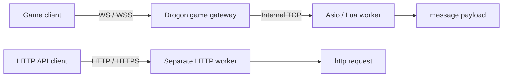

# Getting started

This guide runs the extracted framework for research and learning. It does not deploy the original game.

## Requirements

Linux x64, a C++20 compiler, CMake 3.25+, Ninja, Git, curl, zip/unzip, tar, pkg-config, Perl, Python 3.9+, and the OpenSSL command-line tool. Documentation also requires Node.js 22.12+ and the pnpm version pinned by package.json. Enable Corepack when using its pnpm shim.

## Prepare vcpkg

```bash
git clone https://github.com/microsoft/vcpkg.git "$HOME/vcpkg-mistlane"
git -C "$HOME/vcpkg-mistlane" checkout a5f736224e85b32e25a8ffc52562333180396642
"$HOME/vcpkg-mistlane/bootstrap-vcpkg.sh" -disableMetrics
export VCPKG_ROOT="$HOME/vcpkg-mistlane"
```

An existing vcpkg checkout can be reused if it includes the pinned baseline and the matching version database. CMake uses the toolchain at `VCPKG_ROOT`; machine-specific paths belong in an ignored `CMakeUserPresets.json`.

## Build and check

From the repository root:

```bash
cmake --preset linux-debug
cmake --build --preset linux-debug
ctest --preset linux-debug
```

Use `linux-release` for a Release build. Initial configuration installs the manifest dependencies; subsequent builds reuse vcpkg's binary cache. See [dependencies](./dependencies.md) for the exact versions.

## Generate an application starter

```bash
./build/debug/mistlane init ./my-service
```

The initializer refuses to overwrite a non-empty directory. It creates `config/instances/` with one trusted environment file per process, `scripts/` with Lua entrypoints, `ops/run-instance.sh` to resolve paths from the project root, `ops/cluster.sh` for local start/stop/restart/status/logs, and a systemd template under `ops/systemd/`. The generated config files are consumed by the shell launcher; Mistlane itself still takes CLI arguments and does not parse a native config file. See [architecture comparison](./architecture-comparison.md) for the old deployment layout and the reasoning behind the template.

## Run three processes

Open three terminals in the repository root:

```bash
./build/debug/mistlane --role worker --listen 127.0.0.1:7102 --script examples/echo.lua
./build/debug/mistlane --role router --listen 127.0.0.1:7101 --upstream 127.0.0.1:7102
./build/debug/mistlane --role gateway --listen 127.0.0.1:7100 --upstream 127.0.0.1:7101
```

Then send a request:

```bash
python3 tools/client.py 'hello mistlane'
```

Repeat `--upstream IP:PORT` to distribute new sessions across several workers. A session stays with its selected upstream. This is not routing by account or player ID.

## Game clients over WS / WSS

Game clients can connect directly to Mistlane's WebSocket listener. Drogon handles the upgrade and WebSocket protocol; subsequent game messages reach Lua `message(payload)` over a persistent connection. HTTP APIs call `http(request)`; `POST /message` is a separate HTTP payload adapter. Selecting WS/WSS does not invoke the HTTP Lua handler.

| Purpose | Role and options | Client URL | Lua entrypoint |
|---|---|---|---|
| Persistent game connections through a gateway | `gateway --transport ws/wss --upstream IP:PORT` | `ws://host:port/ws` or `wss://host:port/ws` | TCP worker's `message` |
| One-process game message service | `worker --transport ws/wss --script FILE` | Same URLs | Local worker's `message` |
| HTTP API | `worker --transport http/https --script FILE` | `http://host:port/path` or HTTPS | `http` and request hooks |

### WS gateway to a TCP game worker

Run these in separate terminals. This gateway connects straight to the worker; a TCP router can also sit between them:

```bash
./build/debug/mistlane --role worker --listen 127.0.0.1:7102 --script examples/echo.lua
./build/debug/mistlane --role gateway --listen 0.0.0.0:8080 \
  --transport ws --upstream 127.0.0.1:7102
```

Connect to `ws://127.0.0.1:8080/ws`. Remote clients replace `127.0.0.1` with the server address; `0.0.0.0` is a bind address, not a client destination. Both `/` and `/ws` accept WebSocket upgrades.



Each complete WS message is one payload. Clients omit the four-byte TCP length prefix; the gateway supplies internal framing. `--upstream` accepts the TCP service's `IP:PORT`, not a WS URL. Each client connection stays with its selected upstream.

### WSS game gateway

Use this gateway command while keeping the TCP worker above:

```bash
./build/debug/mistlane --role gateway --listen 0.0.0.0:7443 \
  --transport wss --cert /path/to/fullchain.pem --key /path/to/private-key.pem \
  --upstream 127.0.0.1:7102
```

Connect to `wss://game.example.com:7443/ws` with a matching hostname and a certificate chain trusted by the client. Keep certificates and private keys outside source control. WSS requires TLS 1.2 or newer; game clients on HTTPS pages should use WSS.

### Direct WS / WSS game worker

For development or a small message service, let a worker listen directly without a gateway or upstream:

```bash
./build/debug/mistlane --role worker --listen 0.0.0.0:8081 \
  --transport ws --script examples/echo.lua
```

Connect to `ws://127.0.0.1:8081/ws`. For WSS select `--transport wss` and add `--cert FILE --key FILE`; Lua still implements `message(payload) -> string`.

### Client example and current limits

Send one binary game message from browser developer tools:

```js
const socket = new WebSocket('ws://127.0.0.1:8080/ws')
socket.binaryType = 'arraybuffer'
socket.onmessage = ({ data }) => console.log(new TextDecoder().decode(data))
socket.onopen = () => socket.send(new TextEncoder().encode('hello mistlane'))
```

Native clients use any standard WS/WSS library. The server accepts text/binary messages, replies with binary messages, and limits each payload to 1 MiB. The application defines payload encoding and message IDs; this example only echoes bytes.

The current channel uses serial request/response: wait for the previous response before sending the next application message; sending ahead closes the connection. Lua APIs for unsolicited server push, broadcast and sending to a session are absent. This validates game connections and message flow; high-frequency full-duplex games still need bounded receive/send queues, session lifecycle and server push.

Each process currently listens using one transport. To expose TCP, WS, WSS and HTTP together, run separate instances on distinct ports. HTTP workers and game gateways can form part of the same application deployment.

### Generated project configuration

`mistlane init` generates optional `gateway-ws.env` and `gateway-wss.env` instances; the default cluster still starts a TCP gateway. The WS sample binds `127.0.0.1:8080`; change `LISTEN` in its instance file for remote access.

```bash
MISTLANE_BIN=/path/to/mistlane ./ops/cluster.sh start worker router gateway-ws
```

For WSS, set `CERT` and `KEY` in `config/instances/gateway-wss.env` to absolute paths or paths relative to the project root, then start `gateway-wss`. The launcher checks both files and forwards them as `--cert`/`--key`; it does not generate or commit a private key. The systemd instance is `mistlane@gateway-wss.service`.

## HTTP worker

Besides the Lua `message` mode over framed TCP/WS, a worker can serve HTTP directly. Run it with `--transport http` (or `https`) and an HTTP script such as `examples/http.lua`:

```bash
./build/debug/mistlane --role worker --listen 127.0.0.1:7500 \
  --transport http --script examples/http.lua
curl -s http://127.0.0.1:7500/healthz
```

For HTTPS add `--cert` and `--key`. The request table passed to Lua exposes method, path, query, headers and body; the response table sets status, headers and body. The request lifecycle hooks are `before_request`, `http`, `after_request` and `on_error`, in addition to the shared `init`/`start`/`tick`/`stop`/`shutdown` callbacks. HTTP workers require `http` and may omit `message`; framed workers require `message`. See the [HTTP reference](./http.md) and the [Lua lifecycle](./lua.md) for limits and hook contracts.

## Lua services

A script returns a table with `message(payload) -> string`. Optional callbacks are `init()`, `tick()`, and `shutdown()`. Tick runs every 100ms. All callbacks execute on the node's single event-loop thread and should return quickly.

SIGHUP constructs and initializes a replacement VM first. A failed load retains the previous VM; a successful load resets module state. No state migration is performed. SIGTERM and SIGINT stop listeners, cancel sessions, and invoke the current module's shutdown callback.

Scripts are trusted application extensions, not a security sandbox for untrusted code. The instruction hook can interrupt typical runaway callbacks but provides no complete CPU or memory isolation.

## MySQL pool

`include/mistlane/mysql_pool.hpp` configures the existing Boost.MySQL pool. Connections are acquired asynchronously and returned by the lifetime of `pooled_connection`. Query values use `with_params`, not string concatenation.

```bash
export MISTLANE_MYSQL_HOST=localhost
export MISTLANE_MYSQL_PORT=3306
export MISTLANE_MYSQL_USER=your_user
# Inject MISTLANE_MYSQL_PASSWORD from your environment.
./build/debug/mistlane-mysql-probe
```

TLS with CA and hostname verification is required by default. Set `SSL_CERT_FILE` for a private CA. `MISTLANE_MYSQL_TLS=disable` is an explicit option for disposable local tests. The example uses a pool of size one and three parameterized queries to verify acquisition and return.

With MariaDB tools installed, run the optional disposable-server integration check:

```bash
python3 tests/mysql_integration.py ./build/debug/mistlane-mysql-probe
```

It creates a temporary database directory, random credentials, a temporary port, and a temporary certificate, then stops the server and cleans up. To register it in CTest, configure with `-DMISTLANE_TEST_LOCAL_DATABASE=ON`.

The pool adapter is not yet wired to Lua message callbacks. Do not execute blocking SQL in the Lua event loop.

## Documentation

```bash
pnpm install --frozen-lockfile
pnpm docs:dev
pnpm docs:build
pnpm docs:preview
```

The site contains English and Chinese navigation, local search, and matching pages. Its default base is `/mistlane/`; set `DOCS_BASE=/` when building for a domain root. The build produces `docs/.vitepress/dist` and checks internal links. No hosting deployment is performed by these commands.

## Export source

```bash
python3 tools/export.py
```

The archive uses the explicit `release-files.txt` allowlist and includes SHA256 checksums. It contains no parent repository history, private configuration, original gameplay code, or prebuilt binaries.
