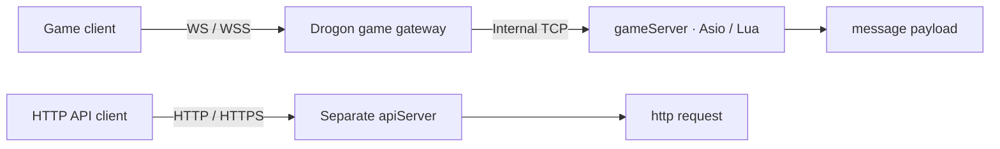

# Getting started

This guide runs the extracted framework for research and learning. It does not deploy the original game.

## Requirements

Linux x64, a C++20 compiler, CMake 3.25+, Ninja, Git, curl, zip/unzip, tar, pkg-config, Perl, Python 3.9+, and the OpenSSL command-line tool. Documentation also requires Node.js 22.12+ and the pnpm version pinned by package.json. Enable Corepack when using its pnpm shim.

## Prepare vcpkg

```bash
git clone https://github.com/microsoft/vcpkg.git "$HOME/vcpkg-mistlane"
git -C "$HOME/vcpkg-mistlane" checkout a5f736224e85b32e25a8ffc52562333180396642
"$HOME/vcpkg-mistlane/bootstrap-vcpkg.sh" -disableMetrics
export VCPKG_ROOT="$HOME/vcpkg-mistlane"
```

An existing vcpkg checkout can be reused if it includes the pinned baseline and the matching version database. CMake uses the toolchain at `VCPKG_ROOT`; machine-specific paths belong in an ignored `CMakeUserPresets.json`.

## Build and check

From the repository root:

```bash
cmake --preset linux-debug
cmake --build --preset linux-debug
ctest --preset linux-debug
```

Use `linux-release` for a Release build. Initial configuration installs the manifest dependencies; subsequent builds reuse vcpkg's binary cache. See [dependencies](./dependencies.md) for the exact versions.

## Generate an application starter

```bash
./build/debug/mistlane init ./my-service
```

The initializer refuses to overwrite a non-empty directory. It creates `config/instances/` with one trusted environment file per process, `scripts/` with Lua entrypoints, `ops/run-instance.sh` to resolve paths from the project root, `ops/cluster.sh` for local start/stop/restart/status/logs, and a systemd template under `ops/systemd/`. The generated config files are consumed by the shell launcher; the runtime also parses a native `--config FILE` format (below). See [architecture comparison](./architecture-comparison.md) for the old deployment layout and the reasoning behind the template.

## Run three processes

Open three terminals in the repository root:

```bash
./build/debug/mistlane --role gameServer --listen 127.0.0.1:7102 --script examples/echo.lua
./build/debug/mistlane --role gateway --listen 127.0.0.1:7100 --upstream 127.0.0.1:7102
```

Then send a request:

```bash
python3 tools/client.py 'hello mistlane'
```

Repeat `--upstream IP:PORT` to distribute new sessions across several workers. A session stays with its selected upstream. This is not routing by account or player ID.

## Game clients over WS / WSS

Game clients can connect directly to Mistlane's WebSocket listener. Drogon handles the upgrade and WebSocket protocol; subsequent game messages reach Lua `message(payload)` over a persistent connection. HTTP APIs call `http(request)`; `POST /message` is a separate HTTP payload adapter. Selecting WS/WSS does not invoke the HTTP Lua handler.

| Purpose | Role and options | Client URL | Lua entrypoint |
|---|---|---|---|
| Persistent game connections through a gateway | `gateway --transport ws/wss --upstream IP:PORT` | `ws://host:port/ws` or `wss://host:port/ws` | TCP gameServer's `message` |
| One-process game message service | `gameServer --transport ws/wss --script FILE` | Same URLs | Local gameServer's `message` |
| HTTP API | `apiServer --transport http/https --script FILE` | `http://host:port/path` or HTTPS | `http` and request hooks |

### WS gateway to a TCP game gameServer

Run these in separate terminals. This gateway connects straight to the gameServer; a additional gateway forwarding hop can also be configured:

```bash
./build/debug/mistlane --role gameServer --listen 127.0.0.1:7102 --script examples/echo.lua
./build/debug/mistlane --role gateway --listen 0.0.0.0:8080 \
  --transport ws --upstream 127.0.0.1:7102
```

Connect to `ws://127.0.0.1:8080/ws`. Remote clients replace `127.0.0.1` with the server address; `0.0.0.0` is a bind address, not a client destination. Both `/` and `/ws` accept WebSocket upgrades.



Each complete WS message is one payload. Clients omit the four-byte TCP length prefix; the gateway supplies internal framing. `--upstream` accepts the TCP service's `IP:PORT`, not a WS URL. Each client connection stays with its selected upstream.

### WSS game gateway

Use this gateway command while keeping the TCP gameServer above:

```bash
./build/debug/mistlane --role gateway --listen 0.0.0.0:7443 \
  --transport wss --cert /path/to/fullchain.pem --key /path/to/private-key.pem \
  --upstream 127.0.0.1:7102
```

Connect to `wss://game.example.com:7443/ws` with a matching hostname and a certificate chain trusted by the client. Keep certificates and private keys outside source control. WSS requires TLS 1.2 or newer; game clients on HTTPS pages should use WSS.

### Direct WS / WSS game gameServer

For development or a small message service, let a gameServer listen directly without a gateway or upstream:

```bash
./build/debug/mistlane --role gameServer --listen 0.0.0.0:8081 \
  --transport ws --script examples/echo.lua
```

Connect to `ws://127.0.0.1:8081/ws`. For WSS select `--transport wss` and add `--cert FILE --key FILE`; Lua still implements `message(payload) -> string or nil`.

### Client example and current limits

Send one binary game message from browser developer tools:

```js
const socket = new WebSocket('ws://127.0.0.1:8080/ws')
socket.binaryType = 'arraybuffer'
socket.onmessage = ({ data }) => console.log(new TextDecoder().decode(data))
socket.onopen = () => socket.send(new TextEncoder().encode('hello mistlane'))
```

Native clients use any standard WS/WSS library. The server accepts text/binary messages, replies with binary messages, and limits each payload to 1 MiB. The application defines payload encoding and message IDs; this example only echoes bytes.

A session is full duplex: client frames arrive independently of replies, so you may pipeline several requests, and each one may get no reply at all when the handler returns nil. Replies and server pushes travel through the same bounded channel — each session accepts up to about 2 MiB of queued output, and Lua reports the refusal instead of failing the handler. Server push, broadcast and send-to-session exist for game sessions as `mistlane.session.send` and `mistlane.session.broadcast`; the frame rate bucket and the output bound are the throughput limits. This validates game connections, message flow and push paths; player authentication, account binding and per-player routing are still absent.

A process can also serve several protocols at once: `--transport` stays single-select for the primary listener, and each `--listener PROTO://IP:PORT` flag adds an independent extra listener (plaintext and TLS side by side; `wss`/`https` entries may append `?cert=FILE&key=FILE` to bind their own certificate). WS/WSS listeners carry game sessions like before, so the same gameServer can expose framed TCP for native clients and WS/WSS for browsers on other ports. See [HTTP listeners and the WebSocket lifecycle](./http.md#multiple-listeners-and-websocket-lifecycle) for the HTTP side.

### Generated project configuration

`mistlane init` generates optional `gateway-ws.env` and `gateway-wss.env` instances; the default cluster still starts a TCP gateway. The WS sample binds `127.0.0.1:8080`; change `LISTEN` in its instance file for remote access. `gameServer-mixed.env` shows one gameServer serving framed TCP on 7102 plus a WS listener on 7082 through `LISTENERS`.

```bash
MISTLANE_BIN=/path/to/mistlane ./ops/cluster.sh start gameServer gateway-ws
```

For WSS, set `CERT` and `KEY` in `config/instances/gateway-wss.env` to absolute paths or paths relative to the project root, then start `gateway-wss`. The launcher checks both files and forwards them as `--cert`/`--key`; it does not generate or commit a private key. The systemd instance is `mistlane@gateway-wss.service`.

### Instance configuration fields

Each `config/instances/<name>.env` file is sourced as shell assignments by `ops/run-instance.sh`, so treat it as trusted deployment configuration written by the project owner, not as untrusted input. The launcher consumes exactly these fields; anything else in the file is ignored.

| Field | Required | Launcher behavior |
|---|---|---|
| `ROLE` | always | Passed as `--role`; `cluster.sh` also matches its readiness line (`ready <ROLE> <LISTEN>`) before reporting the instance started. |
| `LISTEN` | always | `IP:PORT` passed as `--listen`. |
| `TRANSPORT` | optional | `tcp` is the default and is omitted from the command line; `ws`, `wss`, `http` and `https` are passed through. `wss` and `https` refuse to start unless readable `CERT` and `KEY` are configured. |
| `SCRIPT` | optional | Lua entrypoint passed as `--script`; relative paths resolve against the project root. Gateway leaves it empty. |
| `UPSTREAMS` | optional | Comma-separated `IP:PORT` (or `IP:PORT:PROBE`, so cross nodes gate new joins on the peer's internal readiness probe) list; each entry becomes one `--upstream` flag. |
| `ROUTE_EPOCH` | optional | Cross/crossServer epoch passed as `--route-epoch`; an empty value omits the flag. |
| `LISTENERS` | optional | Comma-separated `PROTO://IP:PORT` entries; each becomes one `--listener` flag, so an instance can expose TCP, WS, WSS and HTTP side by side. `wss`/`https` entries may append `?cert=FILE&key=FILE`; those query paths are passed through verbatim, not root-resolved. |
| `CERT`, `KEY` | `wss`/`https` only | Certificate chain and private key, absolute or project-root relative; the launcher verifies both are readable. |

Keep secrets out of these files when they live in a version-controlled template: the initializer creates no certificate material, and `gateway-wss.env` only ships placeholder `certs/` paths. Provision key files outside the repository or under a deployment-managed `certs/` directory, and inject any other credentials through the installed systemd unit (`Environment=`, `LoadCredential=`) or your deployment tooling instead of committing them to `config/instances/`.

### Native config file

The binary also reads a native config format directly, without the shell launcher:

```bash
cat > gameServer.native.env <<'EOF'
# mistlane-config 1
ROLE=gameServer
LISTEN=127.0.0.1:7102
SCRIPT=examples/echo.lua
EOF
./build/debug/mistlane --config gameServer.native.env --max-connections 512
```

- The first non-empty line must be the version marker `# mistlane-config 1`; a file without it is rejected, so a random shell env file (including the `config/instances/*.env` templates, which omit the marker) is never consumed silently.
- Remaining lines are `KEY=VALUE`. Blank lines and `#` comments are ignored, empty values are skipped, and a repeated key is an error. Unknown keys are rejected with the file and line number.
- Keys are the uppercase forms of the CLI options (`ROLE`, `LISTEN`, `TRANSPORT`, `SCRIPT`, `UPSTREAMS` comma-separated, `ROUTE_EPOCH`, `CERT`, `KEY`, `LISTENERS` comma-separated, `REDIS`, `METRICS_LISTEN`, `PROBE_LISTEN`, `OVERLOAD_RATIO`, `READY_HYSTERESIS`, `MAX_CONNECTIONS`, `MEMORY_BUDGET_MIB`, `MAX_ROOM_SESSIONS`, `MAX_GROUP_SESSIONS`, `MAX_SHARD_SESSIONS`, `CRASHPAD_HANDLER`, `CRASHPAD_DATABASE`) plus `ROOT`.
- Precedence inside one run: file value, then a non-empty `MISTLANE_<KEY>` environment variable, then any explicit flag given after `--config`.
- `SCRIPT`, `CERT`, `KEY`, `CRASHPAD_HANDLER` and `CRASHPAD_DATABASE` resolve relative paths against the config file's directory, or against `ROOT` when that key is set (itself relative to the config file's directory). This differs from the shell launcher, which resolves against the project root. To run a generated `config/instances/*.env` template through `--config`, prepend the version marker line and add `ROOT=../..`; its `SCRIPT` and `CERT` paths then resolve as the launcher would.
- Secrets still belong in deployment-managed environment (`MISTLANE_*` or systemd `LoadCredential=`), not in a committed file.


## apiServer

Besides the Lua `message` mode over framed TCP/WS, a gameServer can serve HTTP directly. Run it with `--transport http` (or `https`) and an HTTP script such as `examples/http.lua`:

```bash
./build/debug/mistlane --role gameServer --listen 127.0.0.1:7500 \
  --transport http --script examples/http.lua
curl -s http://127.0.0.1:7500/healthz
```

For HTTPS add `--cert` and `--key`. The request table passed to Lua exposes method, path, query, headers and body; the response table sets status, headers and body. The request lifecycle hooks are `before_request`, `http`, `after_request` and `on_error`, in addition to the shared `init`/`start`/`tick`/`stop`/`shutdown` callbacks. HTTP workers require `http` and may omit `message`; framed workers require `message`. See the [HTTP reference](./http.md) and the [Lua lifecycle](./lua.md) for limits and hook contracts.

## Lua services

A script returns a table with `message(payload) -> string or nil`. Optional callbacks are `init()`, `tick()`, and `shutdown()`. Tick runs every 100ms. All callbacks execute on the node's single event-loop thread and should return quickly.

SIGHUP constructs and initializes a replacement VM first. A failed load retains the previous VM; a successful load resets module state. No state migration is performed. SIGTERM and SIGINT stop listeners, cancel sessions, and invoke the current module's shutdown callback.

Scripts are trusted application extensions, not a security sandbox for untrusted code. The instruction hook can interrupt typical runaway callbacks but provides no complete CPU or memory isolation.

## MySQL pool

`include/mistlane/mysql_pool.hpp` configures the existing Boost.MySQL pool. Connections are acquired asynchronously and returned by the lifetime of `pooled_connection`. Query values use `with_params`, not string concatenation.

```bash
export MISTLANE_MYSQL_HOST=localhost
export MISTLANE_MYSQL_PORT=3306
export MISTLANE_MYSQL_USER=your_user
# Inject MISTLANE_MYSQL_PASSWORD from your environment.
./build/debug/mistlane-mysql-probe
```

TLS with CA and hostname verification is required by default. Set `SSL_CERT_FILE` for a private CA. `MISTLANE_MYSQL_TLS=disable` is an explicit option for disposable local tests. The example uses a pool of size one and three parameterized queries to verify acquisition and return.

With MariaDB tools installed, run the optional disposable-server integration check:

```bash
python3 tests/mysql_integration.py ./build/debug/mistlane-mysql-probe
```

It creates a temporary database directory, random credentials, a temporary port, and a temporary certificate, then stops the server and cleans up. To register it in CTest, configure with `-DMISTLANE_TEST_LOCAL_DATABASE=ON`.

The pool adapter is not yet wired to Lua message callbacks. Do not execute blocking SQL in the Lua event loop.

## Documentation

```bash
pnpm install --frozen-lockfile
pnpm docs:dev
pnpm docs:build
pnpm docs:check
pnpm docs:preview
```

`docs:check` renders the built site in a headless browser and asserts every Mermaid diagram renders, that labels are not clipped, and that both locales render at desktop and mobile widths in light and dark themes. It needs a Playwright chromium binary (`npx playwright install chromium`, or `PLAYWRIGHT_CHROMIUM_EXECUTABLE=/path/to/chromium` to reuse an existing one); CI runs it after `docs:build`.

The site contains English and Chinese navigation, local search, and matching pages. Its default base is `/mistlane/`; set `DOCS_BASE=/` when building for a domain root. The build produces `docs/.vitepress/dist` and checks internal links. No hosting deployment is performed by these commands.

## Export source

```bash
python3 tools/export.py
```

The archive uses the explicit `release-files.txt` allowlist and includes SHA256 checksums. It contains no parent repository history, private configuration, original gameplay code, or prebuilt binaries.

## Crashpad handler deployment

`cmake --install <build-dir> --prefix PREFIX` installs `mistlane` and the Crashpad `crashpad_handler` side by side under `PREFIX/bin`; the handler is copied from the vcpkg tool directory when present. Both binaries need only the system runtime (glibc, `libstdc++`, `libgcc_s`, `libm`) because all third-party dependencies are linked statically.

Deployment conventions for the optional dump pipeline:

- Keep the handler on the same filesystem as the server and pass it explicitly: `--crashpad-handler PREFIX/bin/crashpad_handler --crashpad-database /var/lib/mistlane/crashes`. Point the database at a local directory sized by your retention policy; uploads stay disabled and nothing leaves the machine.
- Linux crash generation requires `ptrace` (the handler inspects the crashed process). Container runtimes must allow it: Docker's default seccomp profile permits `ptrace` on supported kernels, but hardened, unprivileged, or custom AppArmor/seccomp profiles may not. If `ptrace` is denied the node still starts and serves, but no minidump is written — verify the pair with a controlled crash before relying on dumps in that environment.
- A drill binary exists for that check: `mistlane-crash-sample` (built and installed next to `mistlane`) wires the same local-only pipeline with `--crashpad-handler FILE --crashpad-database DIR` and then dereferences a null pointer. The native `crashpad.minidump` test case asserts the database receives a real minidump (`MDMP` magic) while the sample exits from `SIGSEGV`.

### Symbol archives and stack walks

Every build embeds an ELF `NT_GNU_BUILD_ID` note and every minidump module record carries the same id, so a dump names its binary without a symbol server. Archive the **unstripped** copy of whichever binary you deploy (the `linux-debug` and `linux-release` presets both qualify; stripping deletes the symbols a stack walk needs):

```bash
id=$(python3 tools/crash_symbols.py build-id build/debug/mistlane)
cp build/debug/mistlane /var/lib/mistlane/symbols/mistlane-$id
# later, for any dump under the crash database:
python3 tools/crash_symbols.py match /var/lib/mistlane/crashes/pending/xxx.dmp /var/lib/mistlane/symbols/mistlane-$id
python3 tools/crash_symbols.py modules /var/lib/mistlane/crashes/pending/xxx.dmp
```

`match` exits nonzero when the dump belongs to a different build — never walk such a dump with the wrong symbols. For a full stack walk, obtain `minidump_stackwalk` from upstream Crashpad builds (the vcpkg crashpad port ships only `crashpad_handler`) and point it at the archive directory; frames resolve per module by build id.
