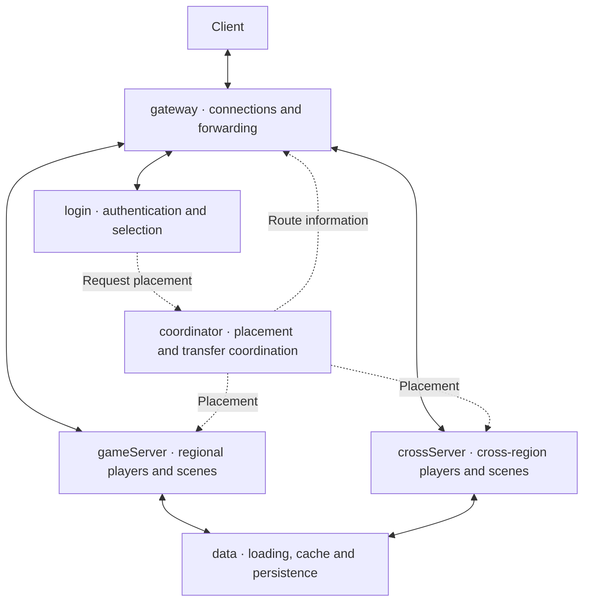

  

# Mistlane

Mistlane is a C++20 / Lua framework extracted and reorganized from a **legacy game backend**. It is published for **research and learning**: studying service separation, asynchronous networking, Lua integration, and the modernization of an existing codebase.

It is an educational framework candidate, not a recommendation for production deployment. The extraction removes the original game's gameplay, content tables, account integration, payment code, channel SDKs, production configuration, and repository history.

The current code is a communication and Lua runtime prototype, not a complete extraction of legacy coordination, characters, maps or instances. Target responsibilities are gateway, login, coordinator, gameServer, crossServer, data and optional apiServer; see [process responsibilities](./process-roles.md).

## What you can study

| Area | Implementation |
|---|---|
| Asynchronous I/O | Boost.Asio TCP, timers, signals, coroutines |
| WS and WSS | Drogon, with OpenSSL TLS |
| Database integration | Boost.MySQL's existing connection_pool and parameter binding |
| Application scripting | Single-threaded Lua module lifecycle and transactional VM replacement |
| Reproducible dependencies | CMake Presets and a pinned vcpkg manifest baseline |

### Target responsibilities — planned

The database adapter is a separate C++ integration, not yet a Lua database bridge. Current routing is per connection; player migration, shared connection multiplexing, and distributed recovery are outside this version.

Start with the [guide](./guide.md), read the [architecture and limitations](./architecture.md), and check the [validation record](./validation.md).

## Origin and licensing

The framework was derived from FOGS. The original meaning of that project name is unconfirmed. Mistlane is licensed under Apache License 2.0. Source provenance and third-party licenses are documented in [NOTICE](https://github.com/cuihairu/mistlane/blob/main/NOTICE) and [third-party information](https://github.com/cuihairu/mistlane/blob/main/THIRD_PARTY.md).
