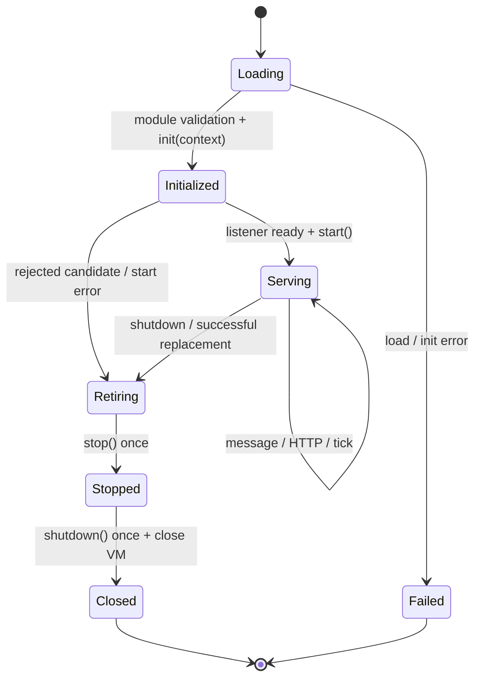
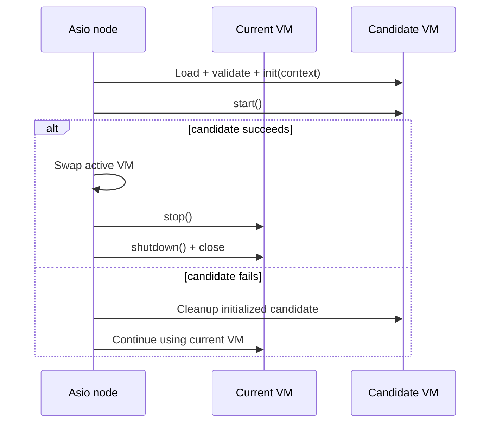

# Lua services and the complete lifecycle

C++ owns networking/scheduling; Lua owns application logic. Each gameServer/crossServer has one VM, invoked serially on its Asio thread. Drogon/Trantor parses HTTP/TLS/WS and submits bounded work without entering Lua concurrently.

## Module contract

Return a table from the script. The required hooks follow the listener mix, not the role: any tcp/ws/wss entry requires message, and any http/https listener requires http. A gameServer or apiServer serving both kinds of listener therefore provides both. Hooks are plain functions without an implicit self argument: use dot definitions rather than colon methods.

```sh
build/debug/mistlane --role apiServer --listen 127.0.0.1:8080 --transport http --script examples/http.lua
curl http://127.0.0.1:8080/healthz
curl --data-binary 'hello' http://127.0.0.1:8080/echo
```

For HTTPS use --transport https --cert FILE --key FILE. This example demonstrates contracts, not a real authentication provider.

## Node lifecycle



| Hook | Arguments / result | Timing |
|---|---|---|
| Script top level | None / module table | Startup and reload; validate required handler for the transport |
| init | context / ignored | Once after validation; context has role, transport, epoch |
| start | None / ignored | Listener ready, before ready is published; failure aborts startup/reload |
| message | payload, context / string or nil | Non-HTTP messages; context carries the numeric session identity on framed listeners, and crossServer joins add realm/group/room/epoch; correlation mode (first frame `MLC2`) adds `request` with the client's id; a nil return sends no reply frame |
| before_request | req / nil or response | Before HTTP handler; a response short-circuits http |
| http | req / response table | Main HTTP handler |
| after_request | req, response / nil or response | After successful handler or short circuit; mutate response or return a replacement |
| on_error | req, error string / response | Callback/validation failure; failure again falls back to generic 500 |
| tick | None / ignored | After start; approximately 100ms after the last tick completes |
| stop | None / ignored | Once on normal stop or VM retirement |
| shutdown | None / ignored | Once after stop, before VM destruction |
| websocket_open | id, path / ignored | WebSocket upgrade on a script-role HTTP/HTTPS listener; a Lua error closes the session without websocket_close |
| websocket_message | id, payload / ignored | One call per client frame (≤ 1 MiB); a Lua error closes the session without websocket_close |
| websocket_close | id / ignored | Disconnect or node shutdown |

`mistlane.websocket.send(id, payload)` pushes to one websocket session and returns true, or false plus a reason. See [HTTP listeners and the WebSocket lifecycle](./http.md#multiple-listeners-and-websocket-lifecycle).

Framed game sessions expose `mistlane.session.send(id, payload)` and `mistlane.session.broadcast(payload)` when the listener mix carries tcp/ws/wss. `send` returns true, or false plus a reason (`unknown session id`, `payload exceeds 1 MiB`, `session backlogged` when the session's ~2 MiB output bound is full); `broadcast` queues the payload for every live framed session and returns how many accepted it. The `id` is the session identity passed in the message context. A reply-less handler (nil return) and a handler that pushes compose freely: writes queue per channel, so reply order after pushes is preserved. In correlation mode (`MLC2`) pushed frames carry request id 0 while replies echo `context.request`.

All hooks except the message/http a listener mix requires are optional. Nil means absent; other non-function fields fail when called. There are no player connect/disconnect hooks. Legacy Timer, SQLService, C_* globals and gameplay protocols are not migrated.

On SIGINT/SIGTERM, close the listener, call stop, cancel active sessions, call shutdown and drain cancellation callbacks. This cancels work; it does not drain business requests or flush transactions. A failing stop still permits shutdown. Flags are set before calling hooks to avoid duplicate invocation. A rejected candidate whose init completed also gets best-effort stop/shutdown. Top-level/init failure only destroys that VM; cleanup hooks are not promised for partial initialization. Crashes, SIGKILL and power loss cannot guarantee cleanup.

## HTTP contract

```lua
local M = {}
function M.init(context) end
function M.start() end
function M.before_request(req)
  req.received = true
  if req.path == "/private" then
    return { status = 401, body = "Unauthorized" }
  end
end
function M.http(req)
  if req.method == "POST" and req.path == "/echo" then
    return { status = 200,
      headers = { ["content-type"] = "application/octet-stream" },
      body = req.body }
  end
  return { status = 404, body = "Not Found" }
end
function M.after_request(req, response)
  response.headers = response.headers or {}
  response.headers["x-service"] = "mistlane"
end
function M.on_error(req, error_message)
  return { status = 500, body = "Internal Server Error" }
end
function M.tick() end
function M.stop() end
function M.shutdown() end
return M
```

Each request table has method, path, query (raw query string without ?), headers (lowercase names to strings), and a binary-safe body string. Hooks share this table, so before_request can attach request-scoped fields. It is not persistent player state; avoid retaining requests indefinitely.

Responses have status (integer 200–599, default 200), body (string, default empty, at most 1 MiB), and optional string-to-string headers with a combined name/value limit of 16 KiB. Content-Type defaults to text/plain and can be overridden. Duplicate headers such as multiple Set-Cookie values are not represented. Framing headers Content-Length, Transfer-Encoding, Connection and Upgrade are managed by Drogon; returning them, invalid names or newline-bearing values triggers error handling.

Flow: before_request → http unless short-circuited → after_request → response. Short circuits still run after_request. Any callback/validation error jumps to on_error without another after_request call. Missing/failing/invalid on_error produces a generic 500 without traceback disclosure; details go to logs. Transport/admission failures can occur before Lua runs.

Lua HTTP workers receive generic paths and select routes in http, explicitly returning 404/405 as needed. GET/POST/PUT/DELETE/PATCH/OPTIONS/HEAD are forwarded; HEAD body handling belongs to HTTP. Raw sockets, streaming and coroutine yields are not exposed. On a script-role HTTP/HTTPS listener, a WebSocket upgrade at `/` or `/ws` does not reach the http handler: Drogon delivers it to the websocket lifecycle callbacks instead. HTTP gateway mode remains a POST /message body-forwarding adapter; use an apiServer directly or extend the gateway protocol for full HTTP semantics.

## SIGHUP replacement



A candidate executes top level, init and start before activation. Existing connections use the replacement for subsequent messages. Success retires the old VM through stop/shutdown. Failed candidate start leaves the current VM serving without retirement hooks; initialized candidates are cleaned up. Old cleanup errors are logged and do not roll back an activated replacement.

Reload resets module state. It does not migrate rooms, export state or roll back external side effects of lifecycle callbacks. Candidate and old VMs briefly coexist; avoid claiming exclusive external resources during initialization. Drain stateful rooms or design versioned snapshots/recovery first.

## Errors and resource boundaries

message errors close that session; a nil result sends no reply frame. Tick errors are logged and subsequent ticks continue. Long callbacks delay networking, other rooms and deadlines; timers cannot preempt synchronous native calls.

Protected calls install an instruction-count hook at about one million Lua instructions to catch common runaway loops. Only base/string/table/math are opened; package/io/os/debug are absent. Base still exposes load/dofile, so scripts must be trusted: this is **not a sandbox**. No Lua memory quota or unbypassable CPU isolation is provided. Process/cgroup isolation, controlled bindings and load tests remain necessary.

## Redis Streams queue API

Start a gameServer with `--redis 127.0.0.1:6379` to enable the asynchronous `mistlane.stream` Lua API. Optional ACL credentials come from `MISTLANE_REDIS_USERNAME` and `MISTLANE_REDIS_PASSWORD`; do not put passwords on the command line. Set `MISTLANE_REDIS_TLS=on` to connect over TLS; the server certificate chain and the dialed name (DNS name or IP) are always verified. `MISTLANE_REDIS_CA=FILE` pins the trust anchor (falls back to system default verify paths when unset). Without `MISTLANE_REDIS_TLS=on` the connection is plaintext Redis TCP and must stay on a trusted private network. Stream keys are isolated under `mistlane:stream:<name>`. Redis requests and callbacks run on the node's Asio thread, so a callback can safely use the same Lua VM. These calls do not block or yield the current Lua handler.

```lua
mistlane.stream.create_group("mail", "workers", function(err)
  if err then error(err) end
end)

mistlane.stream.publish("mail", { kind = "reward", player = "p-17" }, function(err, id)
  if err then return print(err) end
  print("published", id)
end)

mistlane.stream.read("mail", "workers", "gameServer-1", 20, function(err, entries)
  if err then return print(err) end
  for _, entry in ipairs(entries) do
    print(entry.id, entry.fields.kind, entry.fields.player)
    mistlane.stream.ack("mail", "workers", entry.id, function(ack_err, count)
      if ack_err then print(ack_err) end
    end)
  end
end)
```

`read` fetches up to 100 new entries without `BLOCK`, avoiding head-of-line blocking on the shared Redis connection. Call it from `tick` for polling. `claim(stream, group, consumer, min_idle_ms, start_id, count, callback)` reclaims abandoned pending entries using `XAUTOCLAIM` (Redis 6.2+); pass the previous result's `next` cursor to continue scanning. `ack` removes a processed ID from the pending list. This provides at-least-once delivery: handlers must tolerate duplicates and acknowledge only after their work is durable. `create_group` is idempotent. Entries accept string fields, up to 64 KiB total across at most 256 field/value pairs (each value up to 64 KiB); reads and claims cap at 100 entries per call.

**Idempotency, retention, retry and dead letters.** Delivery is at-least-once, so consumers deduplicate on `stream + entry.id` after their processing is durable and before `ack`; the framework injects no idempotency key of its own. Nothing trims streams automatically: `publish` uses a plain `XADD` with no `MAXLEN`, and a stream grows until the application decides otherwise — trimming below a group's pending entries would strand them, so trim only after `ack` and treat any future `MAXLEN` option as opt-in with an explicit capacity rationale. Retries stay application-driven through `claim` scanning (`min_idle_ms` plus cursor pagination); there is no automatic retry loop. There is no built-in dead-letter queue: an application that exhausts its retries republishes the entry to a dead-letter stream it names (for example `mistlane:stream:<name>.dead`) and acks the original only after that publish succeeds.

Redis without `MISTLANE_REDIS_TLS=on` uses plaintext TCP on a trusted/private network; TLS mode verifies the chain and the dialed name with no verification-bypass option. Boost.MySQL and blocking libcurl remain C++ interfaces without Lua bindings. Cross context is routing metadata, not identity. See [HTTP](./http) and [cross-server design](./cross-server).

## Redis leaderboard API

The same optional connection exposes `mistlane.leaderboard`; board keys use `mistlane:leaderboard:<name>`. Score changes and rank reads in `add`/`get` use Redis-side scripts so score and rank are read atomically. Scores are returned as decimal strings to preserve Redis double precision; ranks are one-based. `top` returns descending score order, with equal scores ordered by Redis's reverse lexicographic member ordering.

```lua
mistlane.leaderboard.add("season-12", "player-17", 25, function(err, result)
  if not err then print(result.score, result.rank) end
end)

mistlane.leaderboard.get("season-12", "player-17", function(err, result)
  -- result is nil when the member is absent
end)

mistlane.leaderboard.top("season-12", 0, 20, function(err, rows)
  -- each row has member, score (decimal string), and one-based rank
end)

mistlane.leaderboard.remove("season-12", "player-17", function(err, removed)
  -- removed is 1 if the member existed, otherwise 0
end)
```

`top` allows offsets from 0 to 1,000,000,000 and limits each page to 100 rows. Keep board names and member IDs stable and avoid embedding player-visible/private data in them.
