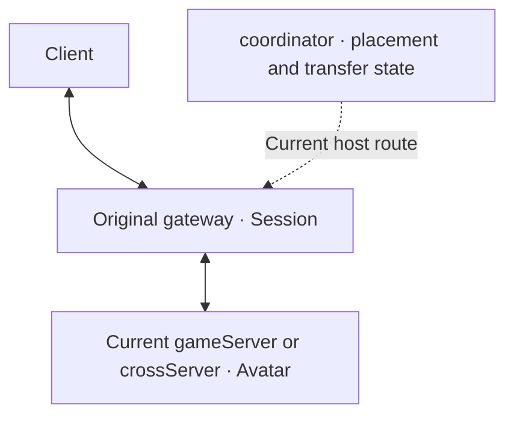
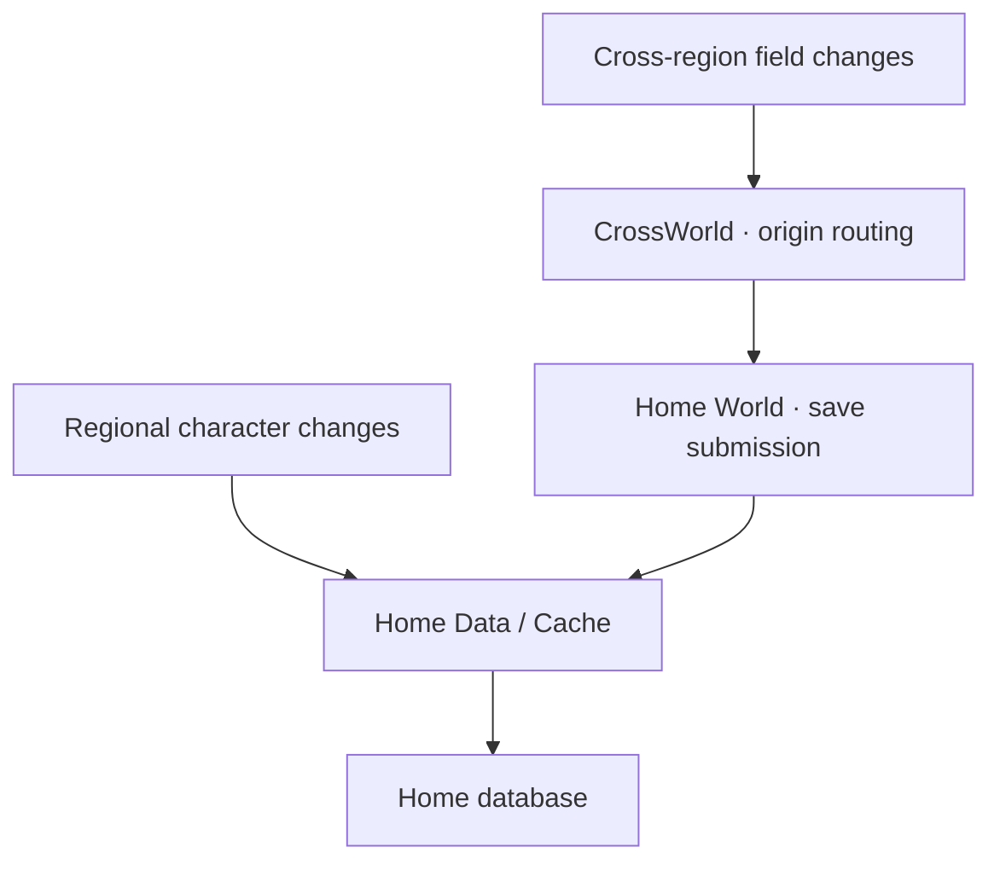
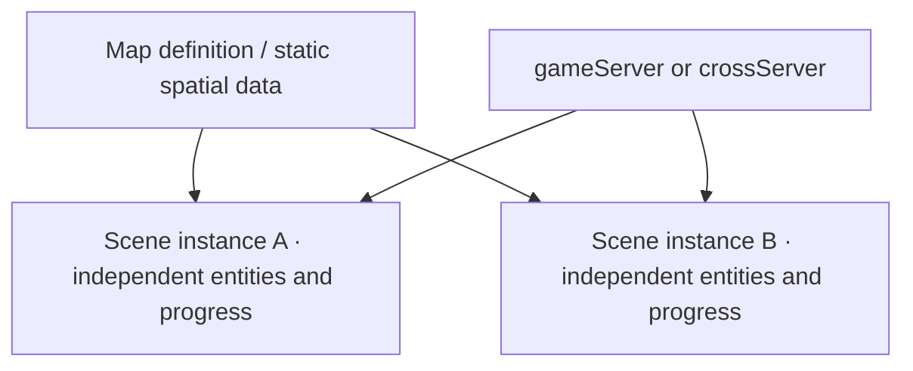

# Players, scenes and cross-region execution

This page separates game-fogs source observations, Mistlane's target contracts and current gaps. It does not import the old game's code or assets. Process names follow the [responsibility contract](./process-roles.md).

## Session, Avatar and data ownership

A Session owns the client connection, connection state and current-host route in gateway. Avatar denotes the player data/behavior object in the active gameServer or crossServer. The old type is Lua Charactor; Mistlane does not yet implement a corresponding C++ Avatar type.

Cross-region entry retains the Session and changes Avatar execution placement, not account/character identity or the home data domain. The target permits one active writable Avatar. Snapshots, caches and temporary object copies may exist without becoming another gameplay authority. The old send/delete/recreate sequence does not prove this property under faults.

Long-term character behavior and scene behavior remain combined in the game execution service. Base/Cell are not split. data is persistence and coordinator is coordination; neither is the character business object.

## Observed transfer and target contract

The old Hegel requests placement from CrossWorld, leaves its scene, submits a save and sends complete charData. requesthegel2hegel actually sends through Gate, which updates hid before forwarding. CrossHegel recreates the character and enters the scene; the source executes leaveHegel. Returning uses a similar mechanism with the previous host and origin context.

Local set/setDirty tracks dirty fields for CacheRow. Cross-region calls send C_SyncDataFromCross. CrossWorld uses the player's wid route to find the home World, which submits changes to home Data/Cache. This is the verified main field-update path, not a guarantee that every custom mutation is automatically durable.

This is an observed legacy path, not an already connected Mistlane service chain. The target retains movable execution and home-owned permanent data: cross-region changes return through home-side services. Orders/durable records do not pin execution addresses. Connections, durable acknowledgement, generation/idempotency, retries/reordering, disconnect/offline behavior and failed return still need protocol design. Calling save or sending a message is not a database commit.

Legacy locations: `game/Hegel/Scene/SceneLogic.lua::doSwitchHegel`, `game/Data/RPC.lua::requesthegel2hegel`, `game/Common/CService/Server/GateService.lua::handleSwitchHegel`, `game/Hegel/Charactor/Charactor.lua::set/setDirty/save`, `game/World/Charactor/CharactorManager.lua::syncDataFromCross/onSyncDataFromCross`.

## C++ mechanisms and Lua business behavior

| Capability | Legacy implementation | Mistlane target boundary |
|---|---|---|
| Connections, framing, asynchronous I/O and event bridges | C++ | Shared C++ runtime |
| Player routes, transfer orchestration, object lifecycle and dirty updates | Substantial Lua code | Common state machines, identity and load/save contracts in C++; interfaces/field format still need design |
| Character behavior, entry conditions, combat/rewards and instance rules | Lua | Lua business behavior and lifecycle hooks |
| Map/scene runtime | Lua SceneManager/Scene plus C++ spatial-data code | C++ common lifecycle/spatial/synchronization mechanisms; Lua gameplay rules; resource interfaces specified separately |

Lua may request entry into cross-region gameplay. The framework handles placement, transfer, acknowledgement, route publication and old-host release. Hooks need thread/error/reentrancy/timeout contracts and rules during transfer. These are extraction targets, not capabilities supplied by the existing message/http module.

## Protocol and method contracts before abstraction

The proposed generic Entity contract, XML definitions, JavaScript/C# generation, replication, persistence and server updates without a rebuild are specified in [Entity contracts and code generation](./entity-contract.md). This supersedes the earlier Avatar-only scope; it remains a proposal.

sproto also declares RPC interfaces: protocol names, IDs and request/response types. Application code supplies Lua implementations and handler bindings. The legacy repository includes examples in `3rd/sproto/testrpc.lua` and the grammar in `game/lib/sprotoparser.lua`. Its host layer customizes aid/tag/cid handling; upstream default session behavior must not be assumed for this game. Contract recovery must include RPC declarations and their data types. See the [official sproto RPC API and schema documentation](https://github.com/cloudwu/sproto#rpc-api).

The verified game-fogs client path uses **sproto**. `game/Data/Data.lua` loads `game/proto/sproto.spb`; `game/lib/sp.lua` performs encoding/decoding, and generated `game/proto/Protocol.lua` maps names to IDs. Bundled Protobuf dependencies do not establish its use on this path.

Client requests are explicitly registered as `PacketHandler[Protocol.X] = LuaFunction`. `HegelService.handleClientMsg` resolves a handler by ID, finds the character by aid and calls it with `(h, p, c)`. Defining an ordinary `Charactor:method` does not expose it to clients. Gate supplies the connected character route; notifications return through the original Gate. Client and internal StatePacketHandler registrations are separate, but authorization still requires an entry-by-entry audit.

Field notifications use `SC_CharDataUpdate=4005`. Legacy set conditionally notifies clients and records local dirty fields or cross-region updates; setDirty alone does not notify clients, and direct self.data writes are not automatically tracked. Online characters call save every 300000ms. save clears dirty before submitting CacheRow; submission does not establish durable database acknowledgement.

Original business schema text, generation scripts, production client bindings and the complete compatibility workflow have not been located. Generated artifacts alone do not establish a reproducible frontend/backend contract. Mistlane currently invokes message/http callbacks on a returned Lua service table; it has no complete business protocol generator, Avatar method bindings or automatic property framework.

The earlier `self:sync()` proposal is withdrawn. A forced-save API name, namespace and collision protection remain undecided. Client property synchronization, periodic saving and forced durable acknowledgement require separate contracts. Recover or define the protocol source, message IDs/types, directions, handlers, identity/authorization, errors and compatibility before choosing C++/Lua abstractions. Do not add runtime APIs merely to make documentation appear complete.

Legacy evidence: `game/Hegel/Rpc/PacketHandler.lua`, `game/Common/CService/Server/HegelService.lua::handleClientMsg`, `GateService.lua::onlineMsg`, `game/Hegel/Charactor/Charactor.lua::set/setDirty/save/callClient`, and `CharactorManager.lua::refreshChars/saveOnlinePeriodically`.

## Map data management

| Layer | Contents | Loading and lifetime |
|---|---|---|
| Map definition | Template ID, type, spawn points, rules and resource references | Configuration registration; multiple scenes may reference one definition |
| Static spatial data | Read-only obstacles, walkability and navigation | Target process-local shared cache with readiness, loading/failure, references and release rules; chunk streaming requires separate design |
| Scene instance | Instance ID, players, monsters, timers, revival and progress | Create/run/enter/leave/close; persistent scenes and temporary instances use different policies |

This is the target sharing model: static data shared, mutable scene state isolated. One game process can host multiple scenes; an instance is not a process. Entering an existing scene should not reload the entire map. Avatar transfer does not carry static map resources. A destination that is not ready must not publish successful entry; readiness, failure and timeout need explicit handling.

The old newScene shallow-copies a definition and separates tid/id; createCloneScene allocates dynamic instances and SceneManager.init creates persistent scenes. MapMgr caches read-only MapData by mapId, but key navigator calls in CAPI are commented out, so neither active navigation nor streaming is established. GameSceneIndex creates instances and handles activity closure/player evacuation; Scene.destory remains a TODO, requiring per-gameplay cleanup review.

Synchronized scenes use UPDATE_INTERVAL=1000 to collect/send dirty positions to other scene members. Client position reports do not establish strict server movement simulation. The enable9Grid configuration field alone does not prove an active spatial AOI implementation.

Legacy locations: `game/Common/Template/TScene.lua`, `game/Hegel/Scene/SceneLogic.lua::newScene/createCloneScene`, `SceneManager.lua`, `Scene.lua`, `game/Hegel/GameScene/GameSceneIndex.lua`, `d_hegel/Navigate/MapMgr.cpp`, `d_hegel/CAPI.cpp`.

## Large maps and seamless partitioning

- **Large resources:** manage client models/textures separately from server obstacles/navigation; use chunking, asynchronous prefetch and unloading where needed. Sharing static data does not establish streaming.
- **Many active entities:** AOI limits synchronization, while activation/simulation still require budgets. Capacity evidence should guide channels, separate instances or spatial partitions. Area alone does not determine compute load.
- **One seamless map across processes:** requires neighbor interactions/state and authority handoff. Complete-Avatar transfer and asset chunks do not by themselves provide seamless spatial partitions.

Combined Base/Cell responsibilities do not rule out large maps. The observed legacy model hosts complete scenes per process and transfers players across scenes/processes. Mature streaming, spatial AOI and seamless partitions are not established by this repository, nor can client resource loading be inferred from server code. [UE World Partition](https://dev.epicgames.com/documentation/en-us/unreal-engine/world-partition-in-unreal-engine) is only a reference for chunk streaming, not an integrated feature here.

## Implementation status and follow-up

Mistlane has network channels, serial message/http execution and gateway cross routing/crossServer routing/admission prototypes. Complete Avatar hosting/transfer, map/scene runtime, the home-save chain and seamless partitioning are not implemented. SIGHUP replaces the Lua VM and resets module state; it is not Avatar/scene migration.

The root `todo.md` tracks C++ contracts/Lua hooks, map/scene lifetimes, cross-region home updates and single-writer ownership, followed by implementation/verification. Renaming a role alone cannot complete these tasks.
