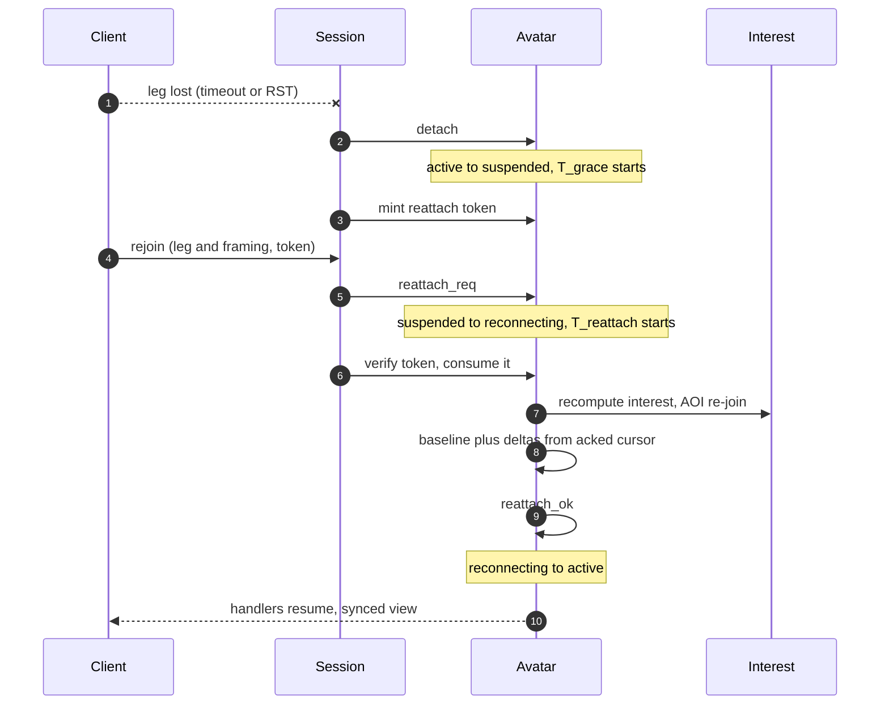
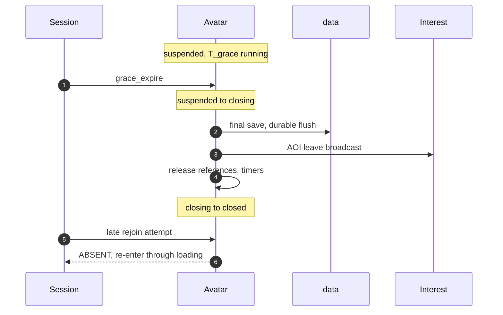
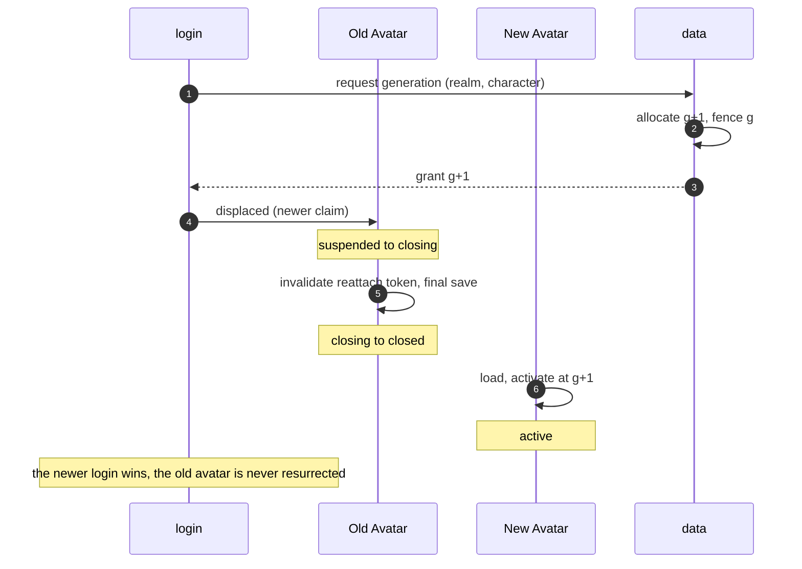

# Reconnect and daily reset: the suspension window and the day boundary

Status: design note (2026-11-22). This page fixes the two remaining slices the [avatar lifecycle oracle](./avatar-lifecycle.md) frames but does not detail: the disconnect-and-reattach window (detection, the grace period, the reattach token, the state catch-up, the displacement race) and the server-wide daily reset (trigger surface, the three-layer touch order, the write barrier, failure compensation, the two reset hooks). Both are refinements of the oracle, never a competing machine: every timer, token and hook below binds to an oracle state or edge, and the oracle's transition table is unchanged. Nothing on this page changes CLI behavior; the framework today has no Avatar type, so no runtime below is implemented or validated. The baseline states are the [avatar lifecycle oracle's](./avatar-lifecycle.md); the catch-up pipeline (baseline plus delta, gapless per-property sequences, atomic batches) is the [entity contract chain's](./entity-contract.md) and the [property synchronization comparison's](./entity-sync-persistence.md).

## Reconnect

### Detection: two sources, one event

The session layer classifies a lost leg; the lifecycle does not re-derive it. Both classifications raise the same `detach` event and the same oracle edge, and differ only in what the leg allows afterwards:

| Detection | What it means | Effect on the leg |
|---|---|---|
| Heartbeat timeout | The client stopped answering the server heartbeat inside its budget; soft loss, possibly transient | The leg object stays registered; a returning heartbeat on it can complete the reattach without re-establishing framing |
| TCP RST / EOF | The leg is closed at the transport; hard loss | The leg is torn down; a reattach must re-establish the leg and its framing first |

The distinction is deliberately not a state: `suspended` is entered either way, and the grace window starts at `detach` either way. What is recorded is a flag on the avatar (leg still probeable or not), used only to pick the reattach path, never to extend the window.

### The grace window and its timers

The suspension window is the oracle's `suspended`/`reconnecting` region, made explicit with three timers. All are configuration, measured at implementation, never named here:

| Timer | Binds to | Starts | Ends |
|---|---|---|---|
| `T_grace` | `suspended` | `detach` | `grace_expire` → `closing` |
| `T_reattach` | `reconnecting` | `reattach_req` | `reattach_ok` or `reattach_fail` (overrun = `reattach_fail`) |
| `T_flush` | `suspended`, `reconnecting` | A pending save obligation starts | Its completion or its per-hook budget |

The rules are the oracle's, restated so no timer is invisible: a failed reattach returns to `suspended` without extending `T_grace`; only one reattach is in flight at a time (`reconnecting`); `T_reattach` overruns into `reattach_fail`, never into a half-applied catch-up.

### Reattach authentication: a token, not a re-run

A reattach is not a fresh login. The framework mints a short-lived reattach token at `detach`, bound to `(realm, character, hosting generation, avatar incarnation, expiry)`, signed by the hosting node itself with a node-local key. The returning session presents it; the same node verifies it; a successful verdict admits the reattach. The token is single-flight: it is consumed on first acceptance, so a second concurrent reattach is refused `DETACHED`/`IN_FLIGHT`.

Re-running SRP is *not* a reattach — it is a new login, and for the same character a new login is the displacement path below. So the token reuse-versus-SRP question resolves to: token reuse for a reattach, SRP only for a fresh entry. A missing, expired, or generation-mismatched token answers the reattach `DETACHED` and leaves the window running; the client can present a fresh token or accept the new-login path.

### State catch-up: baseline plus delta, never an oplog replay

The returning client's property view is stale: it missed every delta since `detach` and every AOI change (observers entered and left). The catch-up is two stages, both aligned to the entity contract chain:

1. **AOI re-join.** The interest set is recomputed at `reattach_ok`; `onEnterAOI` fires for newly visible entities and `onLeaveAOI` for ones no longer visible, with each visible entity's baseline.
2. **Property resync.** A fresh baseline of the avatar's own visible properties, plus the gapless per-property deltas from the client's last acknowledged sequence, delivered as atomic batches that roll back on any refusal — the entity contract's property-sync rules.

There is no oplog replay across a suspension: the tick oplog is bounded and a suspension can outlive it, so a resync is always a fresh baseline plus incremental deltas from the acked cursor. The oplog is the *in-window* mechanism (same-tick loss); a suspension crosses it and therefore re-baselines.

### Path 1 — reconnect succeeds inside the grace window

### Path 2 — the grace window expires

### Path 3 — a newer login displaces the suspended avatar

The displacement race resolves by single-writer grant, not by arrival order: the side that first commits the newer generation wins; the loser observes `displaced` (its avatar closes, its token is invalidated) or `ABSENT` (it was already gone and must re-enter through `loading`). A simultaneous reattach and new login are settled the same way — first grant wins, the other path is refused, and there is no path where two writable avatars coexist, exactly the return protocol's single-writer rule.

## Daily reset

### Trigger surface: per-process self-trigger, no global order

There is no scheduler process in this architecture, and the coordinator is a registry, not a gameplay authority. The reset therefore self-triggers: each process crosses a locally configured boundary — `daily-reset-hour` in a configured timezone (never local OS time), read from config — and runs its own reset. Two consequences are explicit rather than hidden:

- **There is no global order.** Two processes may cross the boundary a clock-spread apart, and nothing in the design depends on their relative order, because the reset touches per-process-local state only.
- **A single authority would be wrong here.** A coordinator-published reset would add a wire protocol and a coordinator that is not a gameplay authority, and it would not make the three layers (below) globally ordered — the layers are per-process anyway.

The one cross-process surface is a visiting avatar: its durable state belongs to the home domain, so the *home* record's daily reset is the authoritative one, and the cross host applies only cross-local reset (scene progress, ephemeral results) while the visit runs. The visit's durable daily reset is applied when it returns home — a reset is never submitted over MLD1 as a change-set (the return protocol's rule that cross-local state is not submitted, restated).

### The three layers and the touch order

The reset touches three layers inside one process, in this order, and the order is guaranteed:

1. **Barrier opens.** Durable writes to resettable entities answer `NOT_READY` until the barrier closes; the periodic save cadence is deferred, not dropped.
2. **`onDailyReset`** — process level, once, strictly first. It may touch process-shared state (a day-scoped cache), never a specific avatar.
3. **`onAvatarDailyReset`** — object level, for every avatar in a resettable state, one call per avatar, in the VM's serial order (the VM is serial, so no two hook calls interleave — the same exclusion that makes reentrancy impossible by construction).
4. **Barrier closes.** The deferred periodic save runs once, post-reset, so the saved record is the post-reset state.

`onDailyReset` is guaranteed to run before any `onAvatarDailyReset`, and every `onAvatarDailyReset` before the barrier closes. A hook error aborts that hook's call, never the reset.

### Which avatars are touched, by oracle state

| Oracle state | Reset delivery |
|---|---|
| `active`, `visiting` | `onAvatarDailyReset` now (at the cross host: cross-local only, per above) |
| `suspended`, `reconnecting` | Deferred: the avatar is touched when it leaves the suspension window, and the deferred reset is *new* (a reset is not re-fired into a mid-transition state, and it is not lost — the deferral is queued) |
| `loading`, `transferring`, `closing`, `closed`, `purged` | Not delivered. A reset that arrives during these states is applied on the next boundary if still applicable, or skipped if the avatar is gone |

### The guard that makes a reset decidable

A reset is idempotent per `(day, target)`: the node records `daily_reset_applied(day)` and each avatar records `avatar_reset_applied(day)`, both set only on successful application. A re-trigger for the same day — a node restart, a boundary re-crossing under a clock wobble — is refused as already-applied, so a reset cannot double-run. The guard is the mechanical test: two resets for the same `(day, avatar)` are the second a no-op, and there is no "partial reset" state — an avatar either has the day's reset recorded or has a pending deferral.

### Failure compensation

| Failure | Compensation | Testable assertion |
|---|---|---|
| `onDailyReset` errors | The node-level reset for the day is recorded as attempted; the node is marked needing a manual re-run, and no avatar is touched | A node-level hook failure leaves every avatar untouched and the day recorded |
| `onAvatarDailyReset` errors or overruns its budget | That avatar's reset is skipped and `avatar_reset_pending(day)` is set; the compensating deferred reset runs after the barrier closes, never inside it | A failed avatar reset does not double-run inside the barrier; the deferred run is a single later run |
| Node crashes mid-barrier | On restart, the per-day guard makes a re-run a no-op for already-applied avatars; unapplied avatars run their reset on the next boundary, and the barrier is closed by the restart | No avatar is reset twice for one day, and none is skipped silently |
| A visiting avatar is mid-return | Its reset is applied at the home record on return; the cross host's cross-local reset is independent | The home record and the cross-local state each reset exactly once |

### Hook signatures

These are the two reset hooks, named per the contract and landed in the hook registry with the rest of the surface. Their arguments and ordering are the contract; the names are provisional until implementation lands them in code, exactly as the avatar runtime page says.

| Hook | Level | Called when | Arguments → result | Ordering guarantee | On error |
|---|---|---|---|---|---|
| `onDailyReset` | Process | The process crosses its configured day boundary, once per day | `(context, day)` → nothing | Strictly before every `onAvatarDailyReset` in the process | Aborts the node-level reset for the day; avatars untouched |
| `onAvatarDailyReset` | Object | The avatar is in a resettable state at the boundary (or at the end of its suspension window) | `(context, day)` → nothing | One call per avatar, serial in the VM, before the barrier closes | That avatar's reset is deferred to after the barrier; never double-run |

## Relationship and errata

| Concept here | Baseline page and section | Relation |
|---|---|---|
| `suspended`/`reconnecting` states, `reattach_*`/`grace_expire`/`displaced` edges | [avatar lifecycle oracle](./avatar-lifecycle.md) | Refined with timers and the token; the transition table is unchanged |
| Baseline plus delta, gapless sequences, atomic batches | [entity contract, property replication](./entity-contract.md), [property sync comparison](./entity-sync-persistence.md) | Cited; catch-up is that pipeline, never a parallel one |
| One writable avatar; single-writer grant | [cross return protocol, single-writer authority](./cross-return-protocol.md) | The displacement race settles by that grant |
| Cross-local state is not submitted over MLD1 | [cross return protocol, MLD1](./cross-return-protocol.md) | A visit's durable daily reset is home-side; only cross-local reset runs at the cross host |
| Hook reentrancy excluded by construction (serial VM) | [avatar runtime, errors and reentrancy](./avatar-runtime.md) | The reset hooks inherit the same exclusion |
| Save cadence, single forced-save entry | [avatar runtime, migration and transfer](./avatar-runtime.md) | The barrier defers the cadence, never adds a save entry |

No conflict was found: this page refines the oracle's suspension region and adds the daily-reset event, and every refinement binds to an oracle edge without changing one.

## Deliberately not decided here

- The reattach token's signing key material, the node-local key lifecycle and rotation: measured and configured at implementation.
- `T_grace`, `T_reattach`, `T_flush`, heartbeat budgets and the reset clock spread: measured at implementation, never named here.
- The periodic save cadence itself, and the entity-contract property-sync details: the entity contract chain.
- Cross-server lease renewal during a suspension of a visiting avatar (does the lease outlive the grace window?): the cross-server lifecycle slice.
- Per-day reset content (what a reset changes, business-side): application Lua, not this page.

## Verification

None today: no Avatar type exists, so this page has no test and no runtime acceptance, and validation records must not claim reconnect or reset behavior. Page-level acceptance is documentary: the three reconnect paths (grace-inside success, grace timeout, displacement by a newer login) are each drawn, every timer and the token bind to an oracle edge, the daily reset has its trigger surface, three-layer order, write barrier, guard, compensation table and hook signatures, and every mermaid diagram renders with every relative link resolving. When implemented, acceptance is per-row: each compensation assertion is a named test, and the displacement race is settled by a single-writer grant test, not by an arrival-order test.

Related: [avatar lifecycle and oracle](./avatar-lifecycle.md), [avatar runtime](./avatar-runtime.md), [entity contracts and generation](./entity-contract.md), [property synchronization and persistence](./entity-sync-persistence.md), [cross return and single-writer protocol](./cross-return-protocol.md), [login, data and apiServer contracts](./service-contracts.md).
