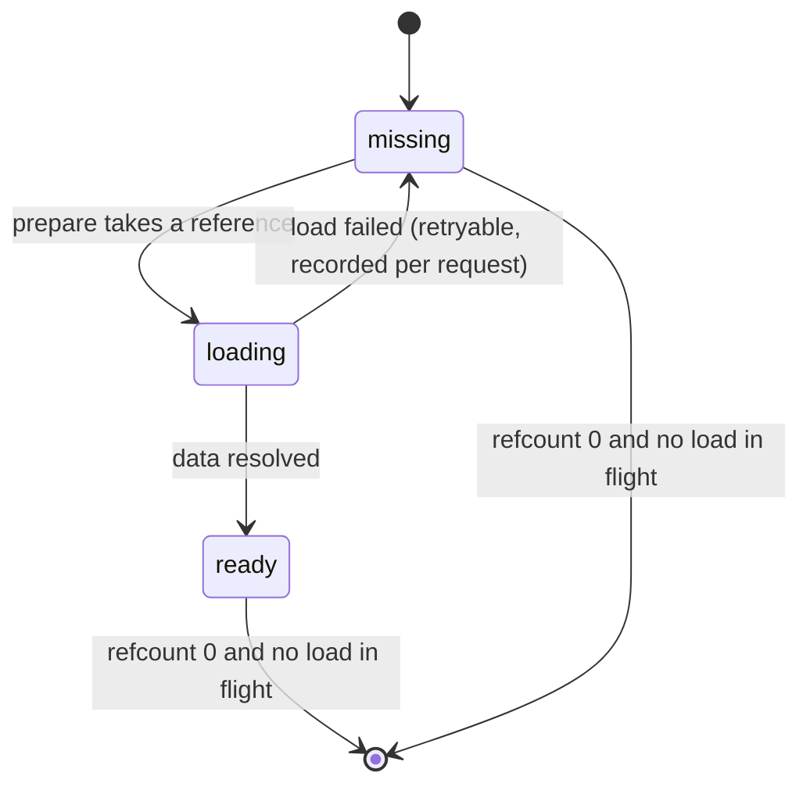
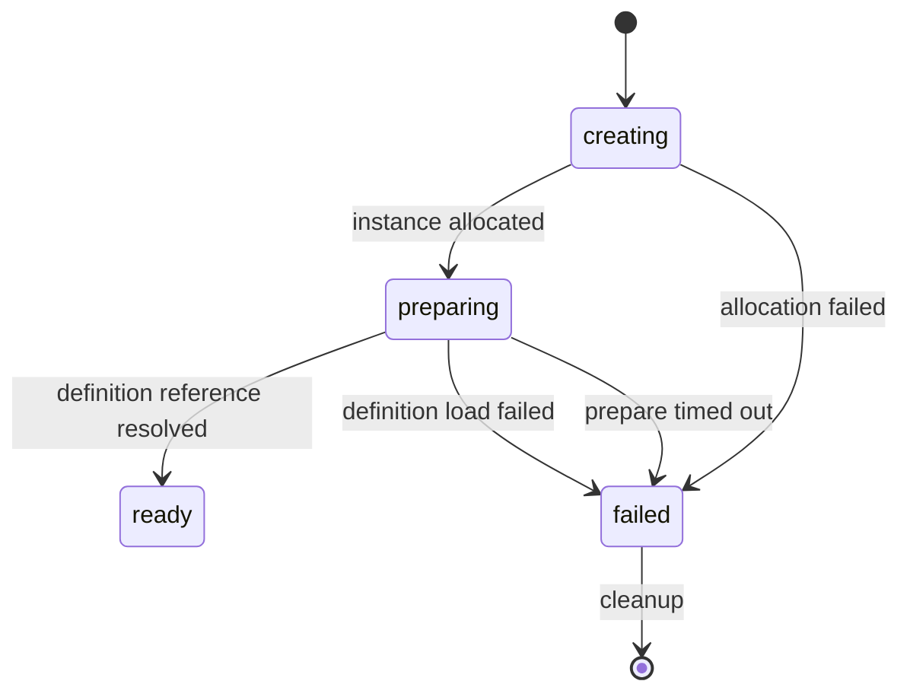

# Scene lifecycle: map definitions, spatial cache and instances

Status: decided design (2026-10-19). The framework today has sessions, framing and Lua message execution, and no scene, map or entity objects — nothing on this page changes CLI behavior, and no runtime behaviour described below is implemented or validated. It closes the design question the [model page](./player-scene-model.md) left open ("a target process-local shared cache with readiness, loading/failure, references and release rules"), feeds the remaining coordinator/gameServer migration slices, and stays inside the responsibilities on the [process roles](./process-roles.md) page. Ownership and single-writer authority for cross participation remain the [cross return protocol's](./cross-return-protocol.md); legacy evidence and its gaps are on the [capability assessment](./gameserver-capabilities.md) and the model page.

## Three layers, one rule each

| Layer | What it is | Who owns it | Lifetime |
|---|---|---|---|
| Map definition | Authored static content: bounds and layout, obstacles and walkability, spawn points and routes, rule and resource references | Registered at startup, per process | Lives for the process; changed only by registering a new digest |
| Static spatial data | The server-visible subset of a definition, read-only, cached per process | The process's spatial cache | Shared by every instance of the same definition; released by references |
| Scene instance | Variable state: participants, timers, progress | Exactly one process | Prepared, then resident or temporary |

The rule that keeps the three apart: **an instance references a definition and never owns a map.** Nothing below makes an instance copy static data into itself, and no process owns another process's cache.

## Map definition

| Aspect | Rule |
|---|---|
| Identity | `definition id` + `digest`. An instance pins the digest it was prepared with, so a definition cannot change underneath a running instance |
| Contents | Bounds and layout, obstacle and walkability data, navigation data, spawn points and routes, rule references, and references to resources. Client-only material is referenced, not duplicated here |
| Registration | Registered at startup from configuration or a repository. A definition no instance references is not loaded into the spatial cache |
| Change | A changed definition is a new digest and therefore a new key. Registered definitions are never mutated in place |
| Transfer | Definitions are never sent between processes. Each process loads from its own registered source |
| Excluded | The file format, the digest algorithm and the authoring tooling: bound to implementation |

## Process-local read-only spatial cache

Key: `(definition id, digest)`. Value: server-visible static data, immutable once ready.

| Aspect | Rule |
|---|---|
| Reference | Taking a reference is what makes an entry eligible to load, and the reference lives exactly as long as the instance that took it |
| Immutability | A ready entry is never rewritten. A definition change is a new digest, hence a new key |
| Release | An entry may be evicted only when its reference count is zero **and** no load is in flight for the same key. Release is two-phase so a late reference cannot resurrect freed memory |
| Failure | A failed load is recorded for the request that asked, never for the key. The same key stays retryable by another instance's prepare, and a failure can never poison a ready entry |
| Retention | Retention is reference-driven. No memory threshold, timer or idle rule evicts an entry that an instance still references |
| Sharing scope | Process-local. Cross-process sharing of one load is not part of this design; it is a requirement on the [big map](./big-map.md) page and is not implemented |

## Scene instance states

An instance's preparation is a state machine, and the only state that may accept entry is `ready`.

| State | Rule |
|---|---|
| `creating` | Instance allocated, no participants may enter |
| `preparing` | Resolving the definition reference, which may trigger a spatial-cache load |
| `ready` | The only state that accepts entry. There is no "ready with missing data" state |
| `failed` | The definition load failed or the prepare did not finish inside its budget |

1. **A timeout is a failure, not a success with holes.** A prepare that does not complete inside its budget is `failed` and its instance is cleaned up. No path publishes a ready scene with data it does not have.
2. **A not-ready destination refuses entry with an explicit failure.** It never reports success and never accepts a participant and waits.
3. **A failed prepare must not leave a half-created instance registered.** Cleanup (below) runs on the failure path too.
4. **One writer per instance.** The owning process is the only writer of that instance's state. Cross participation, provisional write leases and single-writer authority are the return protocol's rules and are unchanged here.
5. **Prepare budgets are configuration, not this page.** Any duration number is named at implementation time and justified by measurement.

## Cleanup and reference release

Resident instances are created at startup and are never closed by idleness. Temporary instances close on an explicit decision. Both use the same ordered cleanup, and the order is mandatory:

1. Stop accepting entry.
2. Stop scene-local timers and synchronization.
3. Evacuate or return every participant.
4. Free instance state.
5. Release the definition reference; the spatial cache decides whether the entry can be evicted.

- A temporary close is attempted only when the instance is empty or after an explicit evacuation moved every participant out. The legacy evacuation-then-close path is observation, not a framework rule.
- **Idle and old are not the same thing.** Neither triggers cleanup by itself: closing a temporary instance is an explicit application or operator decision, and resident instances are excluded from it.
- **Static data release is reference-driven only.** A timer, a memory threshold or an "old instance" observation may never free data that an instance still references.
- A failed prepare runs the same order minus steps 1 to 3, because no participant entered.

## Entering without moving the map

- **Entering an existing instance on a process that already holds the definition as `ready`**: no map data is transferred and no map is loaded. The instance is ready, or the entry is refused.
- **Preparing on a process that does not hold the definition**: that process loads it from its own registered source. Another process's cache is not a data source.
- **Migrating a participant** — same process or cross-process: instance-scoped state and the participant context travel. The map does not. The destination prepares its own instance from its own cache and refuses entry until it is ready; the participant context and single-writer rule come from the return protocol.
- **No path in this design transmits a whole map definition or a whole instance's static data between processes.**

## Deliberately not decided here

- The map definition file format, schema and digest algorithm: bound to implementation.
- The scene tick, entity simulation and interest synchronization: the deferred entity-contract chain and later gameServer slices. Legacy evidence shows the scene tick and navigator are commented out in the old code.
- Spatial partitioning and chunk streaming: the [big map](./big-map.md) page.
- Persistence of instance state across a restart: the entity-contract chain.
- Cadence, size and timeout numbers: measurement, not this page.
- A cross-process cache-sharing protocol: a requirement on the big map page, not implemented.

## Verification

None today. There are no scene, map or entity objects in the framework, so this page has no test and no runtime acceptance. Validation records point at this design only and must not claim scene behaviour.

Related: [players, scenes and cross-region execution](./player-scene-model.md), [gameServer capability assessment](./gameserver-capabilities.md), [cross return and single-writer protocol](./cross-return-protocol.md), [process responsibilities](./process-roles.md).
