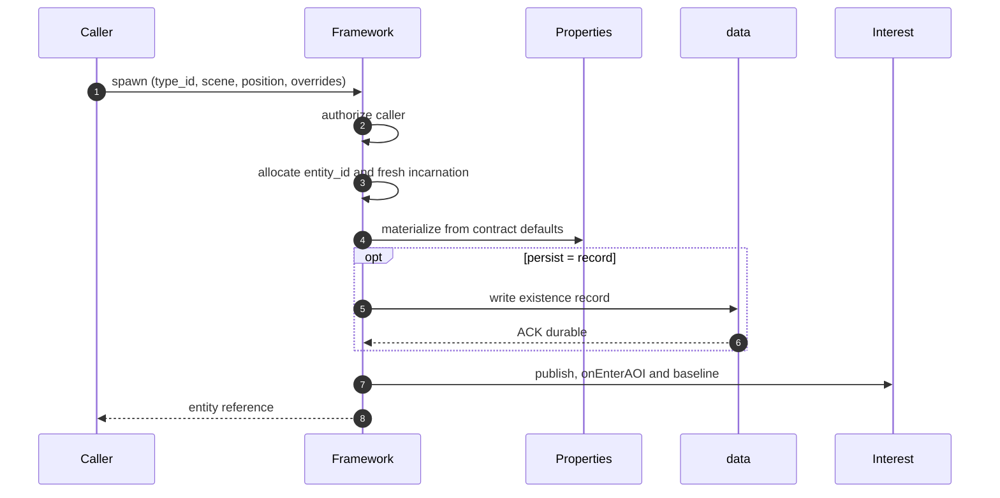
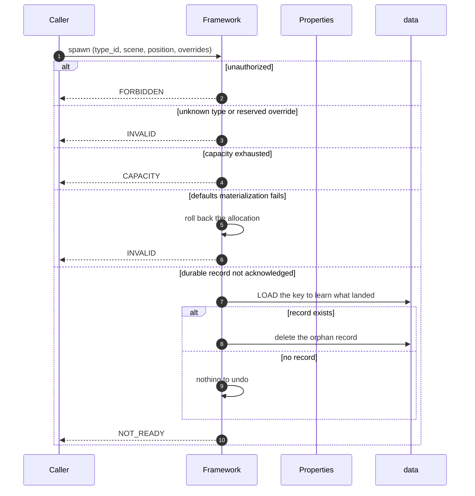
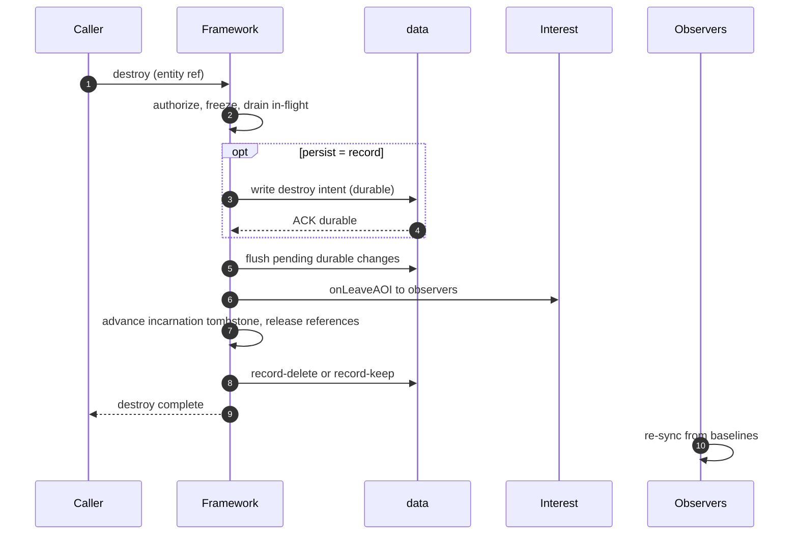
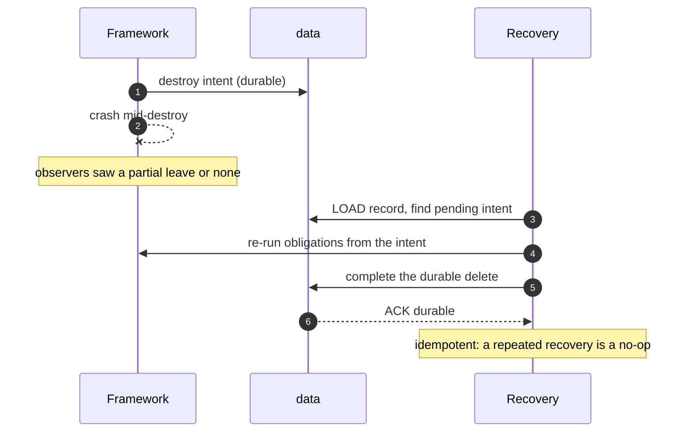

# Spawn and destroy: the runtime object lifecycle contract

Status: design note (2026-11-22). This page fixes the runtime contract for creating and destroying objects mid-lifecycle — who may create, what a spawn must carry and where its defaults come from, when existence becomes durable, when observers hear about it, and the ordered obligations of a destroy with its per-step failure compensation. Its machine-consumable form is `contracts/lifecycle.xml`, an authored contract in the [entity contract chain's](./entity-contract.md) XML idiom (explicit ids, closed vocabularies, unknown elements are errors). The lifecycle position of every state this page touches is the [avatar lifecycle oracle's](./avatar-lifecycle.md); the property schema, dirty tracking and incarnation addressing are the entity contract chain's. Nothing here changes CLI behavior; the in-process runtime already models spawn, route, destroy and stale-incarnation answers (`EntityRuntime`, `include/mistlane/entity_runtime.hpp`), and no production runtime of this contract exists.

## Create

### Authority

A runtime spawn is always a server-side act; a client leg can never create an entity — the entity facade a client holds is created *for* it by the framework after login, and the invocation layer answers every client-originated server method with `FORBIDDEN` until owner attribution ships. The declared spawn callers are:

| Caller | Who | Examples |
|---|---|---|
| `framework` | The framework itself | Scene prepare populating resident content, transfer materialization, the load path |
| `script` | Application Lua on the hosting node | GM generation, business spawn (a drop summoning a pickup), room assembly |
| `service` | An authorized internal service on an MLS1-identified leg | A matchmaker placing a room entity, a cross host materializing a visit |

`load`-sourced entities (the Avatar) declare no caller: they are materialized by the load path only, and a runtime spawn request for one is a contract violation, not a permission failure — it is refused `INVALID` before any allocation.

### Required fields and default sources

A spawn request carries the entity `type_id` (from the contract lock, never a name) and, for spatial entities, a scene binding and position. The framework allocates `entity_id` and `incarnation` — never the caller: a caller-chosen id would let a request impersonate an existing identity, and the incarnation must be fresh so late references to a previous same-id object answer `STALE` rather than misdeliver. Everything else defaults from the contract: declared properties take their `.def` defaults (explicit defaults over type rules — zero/false/empty — exactly the entity contract's rule), and the caller may override only declared, non-reserved properties. A record-sourced field (an Avatar's durable state) never comes from a spawn caller: it comes from the load path or not at all.

### Persistence semantics

| Policy | When existence becomes durable | Crash consequence | Used for |
|---|---|---|---|
| `record` | The existence record is written and acknowledged durable *before* the entity publishes | A crash before publish leaves a durable record with no live instance; recovery re-materializes it through the load path | Load-sourced entities; durable world objects whose silent loss would be player-visible damage |
| `first-dirty` | The first dirty flush or the final save carries the record | A crash loses the object; observers re-sync from baselines and nothing durable needs cleaning up | Business entities whose loss is acceptable by declaration |
| `none` | Never | Nothing to lose | Pure ephemera (a transient effect anchor) |

"Sending is not committing" stays the rule: a spawn that returns a reference has *not* established durability unless the policy is `record` and the `ACK durable` arrived. The durable acknowledgement machinery is the [cross return protocol's](./cross-return-protocol.md) MLD1 chain; this page only names when a spawn waits for it.

### Sync edge

An entity becomes observable in exactly one place: after identity, defaults and (for `record`) the durable acknowledgement are all complete, the framework publishes it to the interest layer — `onEnterWorld` on the entity, `onEnterAOI` on every observer within interest, and a baseline of its visible properties to each. There is no publish-then-fix: an observer never sees a half-materialized entity, and a failed materialization therefore publishes nothing at all (the baseline rule, restated from the avatar lifecycle). The publish is the last create step; it cannot fail *and leave a visible wrong state* — the failure paths below run before it or roll the whole spawn back.

### Path 1 — create succeeds

### Path 2 — create fails and rolls back

Every failed spawn leaves no visible trace: no route entry, no interest presence, no durable record (the ambiguous-ACK branch cleans up by loading the key and deleting an orphan — at-least-once with an idempotent cleanup, the same discipline as the return protocol's replay). The compensation table below is the testable form.

## Destroy

A destroy is one of two declared modes, matching the oracle's two absent terminals:

| Mode | Oracle terminal | Flush | Durable record |
|---|---|---|---|
| `ordered` | `closed` | `final-save` — the full flush, waiting for durable acknowledgement where the return protocol requires it | Kept (`record-keep`) for a load-sourced entity, deleted (`record-delete`) where the application declares it |
| `forced` | `purged` | `bounded-flush` — best-effort inside a budget, surfaced on failure, never retried inside the destroy | Deleted or tombstoned (`record-delete`) |

Every destroy, ordered or forced, runs the same obligation order; the modes differ in flush strictness and record fate, not in ordering:

1. **Authorize.** Same authority surface as spawn, plus the owner-driven paths (logout is an ordered destroy of the session's avatar; a kick is forced). Unauthorized — `FORBIDDEN`, nothing moves.
2. **Freeze.** Stop admitting handlers and ticks; in-flight work drains first. A destroy arriving during a transfer aborts the transfer first (the oracle's `transferring → purged` edge), then proceeds.
3. **Flush unflushed durable changes.** Ordered: the final save and its acknowledgement. Forced: best-effort inside the budget; a failed flush is reported, and unacknowledged lease writes are lost by the return protocol's rules — never silently claimed durable.
4. **AOI leave.** `onLeaveAOI` to every observer within interest and `onLeaveWorld` on the entity. After this step the entity is unobservable; nothing may resurrect it in place.
5. **Release references.** The incarnation tombstone advances so any late `EntityRef` answers `STALE` — the runtime already models exactly this (`EntityRuntime::destroy` drops the address and its correlation tombstones; the fence answers `STALE` for a known id with a stale incarnation, `UNROUTED` for no such id).
6. **Record fate.** `record-keep` (reloadable), `record-delete` (durable delete, optionally deferred into a recycle bin with a retention window; recovery inside the window re-spawns from the bin, never resurrects in place), or `runtime` (nothing durable existed).

### Path 3 — destroy completes

### Mid-lifecycle destroy

The interesting case is destroying an object that is live in gameplay — a monster cleared mid-fight, a player kicked mid-session, a room dissolved with members inside. The destroy does not consult the object's convenience: freeze happens where the object is, and every obligation is compensated on failure. The members of a dissolved room are *not* destroyed with it: each participant's own entity follows its own path (the room entity's forced destroy triggers each member's leave, and an avatar member goes through its oracle states, never a piggybacked delete).

Per-step failure compensation — each row is independently testable:

| Step | Failure | Compensation | Testable assertion |
|---|---|---|---|
| Authorize | Caller lacks authority | `FORBIDDEN`; no allocation, no freeze, no broadcast | A denied caller observes zero observable change |
| Freeze | In-flight handler overruns its budget | The budget aborts the handler (the avatar runtime's rule); the destroy proceeds | Destroy latency is bounded by the handler budget, not handler length |
| Flush (ordered) | Durable acknowledgement never arrives | The close waits inside its budget, then surfaces the failure to the operator; the record is kept or the destroy is retried by recovery — never a silent loss claim | A failed ordered flush yields an operator-visible record and a retryable destroy intent |
| Flush (forced) | Budget exhausted with dirty state unflushed | The destroy proceeds; unflushed changes are lost and *reported as lost* | The completion report names unflushed obligations; no path reports "saved" without an acknowledgement |
| AOI leave | An observer's channel is dead | The leave is recorded against the interest layer; the dead observer re-syncs on reconnect, stale references answer `STALE` | A dead observer never blocks or corrupts another observer's leave |
| References | A late `EntityRef` arrives after release | Answers `STALE` (incarnation tombstone) | No late reference can reach a re-spawned same-id object |
| Record delete | The durable delete fails | The destroy intent stays pending; recovery retries the delete before resuming | A record cannot be half-deleted: LOAD after a failed delete returns the record plus a pending intent |

### Path 4 — destroy interrupted and recovered

For `record`-persisted entities the durable destroy intent (path 3, step 3) is what makes interruption recoverable: the intent lands before any in-memory obligation runs, so a crash anywhere afterwards leaves a deterministic recovery job.

For `first-dirty` and `none` entities there is no durable existence record, so an interrupted destroy needs no recovery: the object is gone from memory, observers re-sync from baselines on their next tick, and no durable trace remains to clean. A recovery pass that finds an intent whose record is already gone treats it as complete — destroy recovery is idempotent by construction, and a repeated recovery pass is a no-op.

## The contract artifact

`contracts/lifecycle.xml` declares the vocabulary above for the entities the repository fixtures define: `Avatar` id=1 (`examples/contracts/avatar.def`) and `Player` id=2 (`examples/contracts/business.def`). It follows the entity contract chain's authored-contract idiom so the same tooling path can consume it: explicit entity ids that must match the contract lock (a mismatch is a refused load, never a silent rename), closed value vocabularies where a value outside the set is an error rather than a default, and cross-attribute rules stated in the file header for the checker to enforce (`source=load` implies no caller and `record` persistence; `recycle=bin` implies a deferred `record-delete` and a non-`none` flush; `mode=ordered` implies `final-save`; `mode=forced` implies a bounded or absent flush). Wiring the checker to validate this file is deliberately not done here — this page fixes the contract and its form; the tooling slice that consumes it stays separate, and until then the file is the reference statement, not a build input.

## Relationship and errata

| Concept here | Baseline page and section | Relation |
|---|---|---|
| Incarnation addressing, `STALE` for a stale ref, `UNROUTED` for no route | [entity contract, invocation envelope](./entity-contract.md), `EntityRuntime` fence | Cited, unchanged; release and recovery build on it, never around it |
| Caller identity from the trusted transport; plain client legs `FORBIDDEN` | [entity contract, invocation envelope](./entity-contract.md) | Cited; the spawn authority table is that rule applied to creation |
| Property defaults and override rules | [entity contract, one contract](./entity-contract.md) | Cited; a spawn overrides only declared non-reserved properties |
| Durable acknowledgement, at-least-once with idempotent replay | [cross return protocol, MLD1](./cross-return-protocol.md) | Cited; `record` spawns and ordered flushes wait on that chain |
| `purged` vs `closed` terminals | [avatar lifecycle oracle](./avatar-lifecycle.md) | The two destroy modes are those terminals' contract form; zero state conflict |
| Fixture entities and ids | `examples/contracts/avatar.def`, `examples/contracts/business.def` | Referenced by id; the artifact refuses a lock mismatch |
| Authored-contract file layout (`contracts/entities/…`) | [entity contract, generated artifacts](./entity-contract.md) | This page places a lifecycle contract at `contracts/lifecycle.xml`; the layout suggestion there predates lifecycle contracts and is not contradicted — the file is one artifact, not an entity definition |

No conflict was found: every mechanism this page builds on is cited, and the two modes map onto the oracle's terminals without touching any baseline transition.

## Deliberately not decided here

- Interest-layer internals — radius computation, baseline scheduling, observer set maintenance: the entity contract chain and the AOI requirements on the [big map](./big-map.md) page.
- Recycle-bin retention numbers, flush budgets, per-node entity caps: measured at implementation, never named here.
- The checker wiring for `lifecycle.xml`, and any generated output from it: a separate tooling slice; this page fixes vocabulary and rules, not tool code.
- Cross-server destroy of a visiting entity, and lease release ordering during a visit teardown: the cross-server lifecycle slice.
- Owner attribution for client-invoked destroy paths (a player deleting their own mailbox item): stays with the entity contract chain's open owner-attribution slice.

## Verification

None today: the runtime models spawn/route/destroy/stale-incarnation answers as in-process fixtures only, so this page has no test and no runtime acceptance, and validation records must not claim spawn or destroy behavior. Page-level acceptance is documentary: the four paths above (create success, create-fail rollback, destroy complete, destroy-interrupted recovery) are each drawn and every compensation row names its testable assertion; the contract artifact's vocabulary is closed and its cross-attribute rules are stated; every mermaid diagram renders and every relative link resolves. When implemented, acceptance is per-row: each compensation assertion is a named test, and the recovery path is exercised by a crash between intent and delete.

Related: [avatar lifecycle and oracle](./avatar-lifecycle.md), [entity contracts and generation](./entity-contract.md), [cross return and single-writer protocol](./cross-return-protocol.md), [scene lifecycle](./scene-lifecycle.md), [big maps](./big-map.md).
