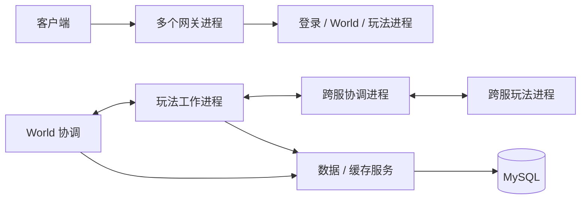

# 老 MMO 后端与现代服务端架构对比

## 项目定位

是的，这套源码属于 MMO 风格后端：有长期运行的区服世界、网关、登录与数据服务、Lua 玩法进程和跨区玩法。它不是只负责创建对局的 match-only 后端。

需要区分产品类型和架构成熟度。“MMO 后端”说明游戏服务形态，不代表系统已经具备现代分布式状态归属、故障恢复和水平扩展能力。旧实现是较早一代的多进程服务架构，配置和路由与共享部署环境耦合较深。

## 旧架构实际做法

仓库能看到 gateway、World、玩法、跨服和支撑服务各自的原生进程与 Lua 入口。部署脚本会生成共享及各服务的 Lua 配置、计算端口范围和进程数量，并按固定顺序启动。运行脚本依赖特定当前目录，再由目录推导二进制、配置、Lua、日志和 pid 路径。旧命令行支持显式指定服务配置、实例序号和日志配置。

按职责拆进程仍然合理：网关、逻辑、存储和控制服务有不同的资源曲线与故障边界。主要薄弱点是共享协调链路：即使增加跨服逻辑工作进程，如果它们仍依赖单个协调节点处理全局路由、广播或状态，该节点仍可能成为热点。旧容量策略在节点满时仍可能回退选择满载进程，且至少一个队列追加入口没有本地条数/字节上限。这些是明确的过载风险，但不能据此断言历史崩溃就是由它们造成。

## 与现代常见模式的差异

| 方面 | 旧项目证据 | 现代常见模式 | Mistlane 当前状态 |
|---|---|---|---|
| 进程打包 | 多个专用二进制，各有 Lua/config 入口 | 少量通用角色，以统一方式构建和部署 | 单二进制提供 `gateway`、`gameServer`、`crossServer`、`apiServer` 角色 |
| 配置 | 共享 Lua 全局配置及逐守护进程生成文件；脚本依赖当前工作目录 | 每个实例显式配置、配置版本化、密钥独立注入 | `mistlane init` 会生成逐实例 shell 赋值文件和相对项目根目录的路径；启动器将其转换为 CLI 参数，运行时也可经 `--config` 解析原生 `KEY=VALUE` 配置文件 |
| 游戏状态归属 | World、玩法和跨服服务通过应用级路由/RPC 协作 | 世界、区域、房间或对局有明确且有界的单一权威 owner | 对配置 crossServer 列表做静态 room hash、本地硬准入；没有租约或状态迁移 |
| 跨服扩展 | 增加玩法进程时，共享 Cross 协调仍可能成为热点 | 按独立状态域分片，控制面与高频玩法数据路径分离 | cross 转发到 crossServer，但入口和上游列表仍是静态配置 |
| 过载控制 | 满载后仍可能选择满节点；队列上限需继续追踪 | 准入、队列字节和任务预算均有界；卡住主循环前拒绝或延后 | 有连接、帧、速率和房间上限，另有本地就绪门控；缺全局队列预算和容量实测 |
| 故障恢复 | 注册、重连和持久化策略与旧框架耦合 | 明确健康/就绪、排空、fencing/epoch、幂等、快照和恢复语义 | 超时和 epoch 不匹配；PROBE1 就绪状态挡住 cross 新加入；没有发现、排空、重放或迁移 |
| 运维 | Shell 脚本生成配置、启停、查 pid/日志 | systemd 或编排器管理进程生命周期、重启、资源限制和发布 | `mistlane init` 会生成本地集群脚本和 systemd unit 模板；生产加固与部署验证仍待完成 |
| 可观测性 | 日志和 Lua 长调用中断 hook | 指标、追踪、性能剖析和崩溃转储各解决不同问题 | 已接入可选 Prometheus 抓取端点、Crashpad 本地采集（转储演练已验证）与内部 PROBE1 监听器；外部采样器剖析和部署流程仍待完成 |

“现代化”不等于必须引入 Kubernetes、微服务或 Actor 框架。关键是明确状态归属、资源边界、节点放置、健康状态、部署和恢复契约。一个边界清楚的单进程有时比通过无界队列连接的许多服务更可靠。

## 两类现代游戏服务形态

Session 型游戏通常按一场比赛/会话分配专用进程。Agones 提供从 ready fleet 原子分配游戏服务器以及 fleet 自动扩缩，适合可回收的短局实例；它不直接等同于长期共享世界的 MMO 架构。[Agones 分配](https://agones.dev/site/docs/reference/gameserverallocation/) · [Agones 自动扩缩](https://agones.dev/site/docs/reference/fleetautoscaler/)。

持久世界游戏更常按区域、分区、实例或房间切分。每个分区只有一个活动状态 owner，网关、账号、匹配和持久化服务提供支撑。权威对局架构也通常让单个节点持有一场对局状态以维持一致性，再把独立对局分布到多个节点；Nakama 文档描述了这种模式和 tick 驱动生命周期。[Nakama 权威多人游戏](https://heroiclabs.com/docs/nakama/concepts/multiplayer/authoritative/)。

旧项目更接近持久世界模型。没有先测量房间生命周期、跨房间交互、世界持久化和玩家迁移成本之前，不应直接改成“每房间一个容器”。

## 建议的现代化路径

1. 保留单房间单 owner 和硬准入；先测 Lua tick 延迟、请求延迟、CPU/RSS、会话数、房间人数及队列字节，再定容量参数。
2. 将控制面（服务注册、放置、部署）与玩法流量分开。本地就绪门控已落地；租约/fencing 与集群放置仍须先于自动选择归属。健康探测失败不能静默把活动状态转给别的 crossServer。
3. 把热点全局玩法拆为互相独立的房间/区域；广播使用订阅/AOI、合批和有界异步持久化。若状态仍由同一个 owner 管理，单纯增加工作进程无法解决单房间过载。
4. 分层补可观测性：Prometheus 观察趋势和饱和度，Crashpad 保存 native 崩溃现场，采样 profiler 定位 CPU 热点，内部探测判断进程/事件循环是否响应。Lua 超时 hook 只是中断保护。
5. 单机先用逐实例配置和 systemd。只有确实需要 fleet 放置、预热容量、滚动更新或多主机分配时，再引入游戏服务器编排器。

## 对 Mistlane 的判断

Mistlane 更新依赖并抽取通用进程角色，但目前还不是现代 MMO 运行时。gateway cross routing/crossServer 是用于研究的固定房间亲和和本地过载拒绝实现；cross 节点已按 crossServer 的 PROBE1 就绪状态挡住新加入。仍缺少动态服务发现、路由租约、房间迁移、全局配额、可靠请求处理和容量测试。可选 Prometheus 端点和 Crashpad 采集属于初步诊断，还不是完整运维平台。上游 crossServer 顺序变更会导致确定性 hash 重映射，因此变更拓扑必须先排空或由应用实现状态迁移。

项目初始化器已能生成逐实例配置、前台启动器、本地启停/状态/日志工具和 systemd unit 模板。内部存活/就绪端点已交付，profiler 路线已定为外部采样器（进程内不随包采样）。接下来应做目标环境演练（崩溃、指标抓取、探测过载、压力剖析）、补密钥与部署权限说明、目标发行版上的 unit 验证；在尝试跨 crossServer 自动恢复前，先实现租约/fencing 和房间排空/迁移。

## 未决决策：协调面如何生长

采用哪个选项仍由目标环境压力演练门控（账本条目）；此处先固化选项对比，让演练量出能区分各行优劣的数字。

| 选项 | 新增什么 | 解决什么 | 代价 | 何时选择 |
|---|---|---|---|---|
| 静态列表 + MLR1 成员 + 路由记录（今天） | 无新增 | 服务发现、承载查询、重连路由到当前宿主 | 无归属交接：宿主死亡只是掉路由，重连回到 `MLR1 ROUTE EMPTY` → 进入流程 | 现在——这是演练的基线 |
| 路由记录上的租约/fencing | 续约/过期协议 + MLD1 写入带 fence 令牌 | 被分区的宿主在租约死亡后无法继续写入 | 计时器机制加上两种新故障模式（续约丢失、时钟偏移）；接管需要显式 fencing 裁决 | 演练表明宿主可比控制连接活得更久，或容量工作需要活跃接管时 |
| 房间排空/迁移 | 跨节点参与者搬移 + 目标侧按真实状态准入 | 拓扑变更不丢玩法 | `MLC1` 上下文今天按 join 计；必须先有整条 Avatar/移交链 | 只在 Avatar 运行时落地之后——绝不提前 |
| 容器编排 | 集群承载、暖容量、滚动更新 | 集群规模的运维 | 编排器看不见房间；没有排空就会驱逐活跃状态归属者 | 多宿主集群运维真实存在时 |

因此演练应记录的数字：控制面故障切换时间（成员退役 → 注册表反映）、重连路由的过期程度（杀宿主后的 `MLR1 ROUTE` 裁决）、抖动下的加入拒绝率、以及是否观察到分区让宿主继续接受写入——这四个数字选中对应行。
