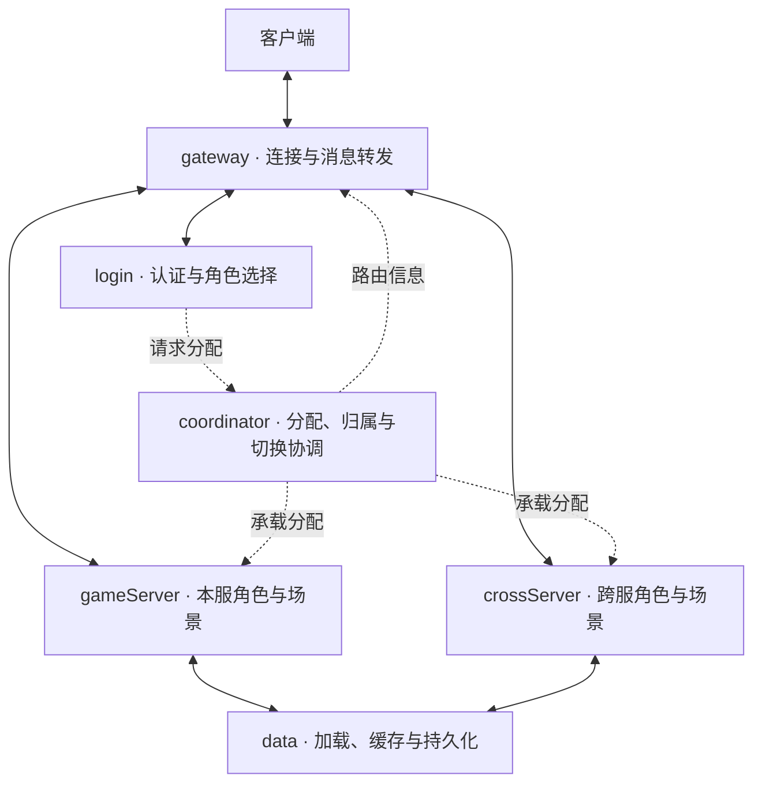
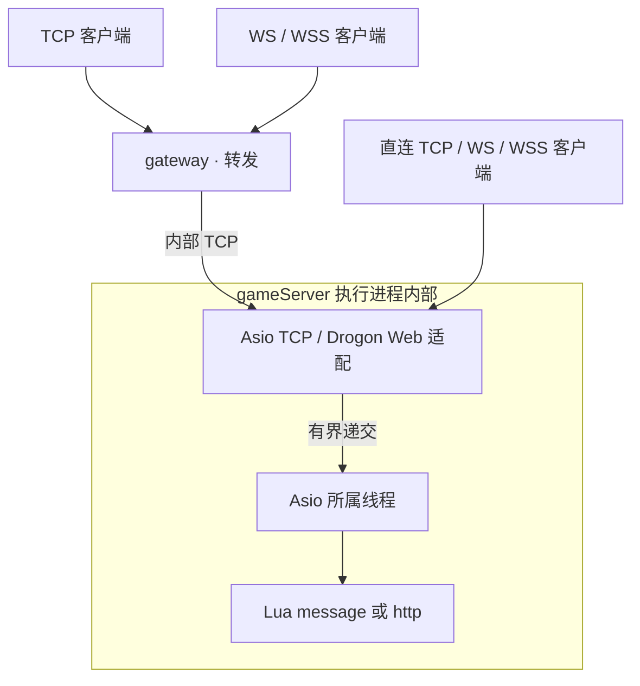

# 架构与实现边界

## 目标游戏服务架构

以下是职责设计，**尚未完整实现**。每个方框表示服务职责；具体可用一个二进制按角色启动。实线表示目标消息/数据路径，虚线表示分配和路由信息；各边不代表具体事务已实现。完整边界见[进程职责与命名](./process-roles.md)。coordinator 分别服务区服或跨服组，不是所有游戏消息的中转站。

data 表示按角色数据归属寻址的服务职责，不是一台所有区服共享的数据库。crossServer 的长期变更回传原区服 data；具体协议与确认语义待实现，图中的访问边不授予双写权限。apiServer 是可选外部系统接入职责，完整回调链见[HTTP 与 WebSocket](./http.md)。

## 当前可运行原型

当前提供通用转发、Lua 执行和 gateway cross routing/crossServer 路由实验，未完整抽取老游戏的 World 协调、角色与场景运行能力。现有跨服静态路由不等于 World 协调能力。

图中单列执行进程内部的库、线程和回调，避免把 Drogon 当成独立游戏服务。直接连接 gameServer 与经过 gateway 均可。`--transport` 选择主监听，每个额外的 `--listener PROTO://IP:PORT` 再追加一个独立监听，因此同一进程可以同时提供 TCP、WS/WSS 与 HTTP/HTTPS（明文与 TLS 并存）。脚本角色的 HTTP 请求走 Lua http，游戏 WS/WSS 走 Lua message，HTTP/HTTPS 监听上的 WebSocket 升级走 Lua websocket 生命周期。MySQL、curl 目前是 C++ 接口；Redis Lua API 已提供部分有界异步能力。

## 代码组织

| 路径 | 作用 |
|---|---|
| `include/mistlane/transport.hpp` | 字节消息通道接口；TCP 与 WS/WSS 统一为 payload |
| `src/node.cpp` | TCP 分帧、会话、限流、超时、转发、路由、生命周期 |
| `src/web.cpp` | Drogon 的 WS/WSS 适配，无手写握手 / 掩码 / 控制帧解析 |
| `src/lua_service.cpp` | Lua table 模块、registry 引用、受保护调用、栈恢复 |
| `src/lua_service.cpp` | Boost.Redis 连接生命周期及 Lua Streams/排行榜回调 |
| `include/mistlane/mysql_pool.hpp` | Boost.MySQL pool_params 配置，不实现连接池 |
| `include/mistlane/token_bucket.hpp` | 从原网络限流器改造，使用单调时钟累积令牌 |
| `lua/mistlane/min_heap.lua` | 从原通用 Lua 工具提取，改为局部模块 |
| `examples` | 不含游戏协议的 echo 和 MySQL 参数化 SELECT |
| `tools` | 示例客户端与白名单导出；集成验证在 tests |

`mistlane::core` 提供 Lua 运行层，`mistlane::net` 提供节点，`mistlane::mysql` 提供成熟连接池的配置接入。可通过 CMake add_subdirectory 后链接相应 target。C++ MySQL API 当前尚未绑定 Lua；不要在 message 回调中调用阻塞 SQL。

## 执行与连接模型

每个节点有一个 Asio 线程，执行内部 TCP、计时、信号和 Lua 回调。Web 接入另由 Drogon/Trantor 事件循环处理 HTTP/TLS/WS；每会话最多递交一条待处理消息至 Asio，禁止两套循环并发访问 Lua VM。会话全双工：客户端帧不依赖响应到达，handler 可以不回复，上游主动帧也无需对应请求即可到达客户端。

gateway 的当前运行机制为：新连接按 upstream 列表轮询；默认一个下游会话对应一个上游 TCP 连接，`--upstream-multiplex on` 时 gateway 改为让同一 upstream 的全部会话共享一条连接（见下文服务身份段）。会话按帧到达节奏读取，向每个对端方向一次只在途一帧，慢下游因此对上游形成背压而非无限缓冲。每通道发送按序排队且有界：内部帧约 2 MiB 积压上限、越界拒绝，WS 侧由 Trantor 2 MiB 高水位约束。WS/WSS 由 Drogon 解析完整消息再转为内部 TCP 帧。连接固定到某个上游；重新连接可能选到另一上游，不具备按玩家 ID 路由的保证。

TCP：`u32 big-endian length | payload`。WS：一条消息即一个 payload，允许二进制与文本输入，输出为二进制消息。payload 上限为 1 MiB。请求 / 响应顺序一致，基础协议里没有业务消息 ID、账号 ID 或服务注册数据。可选关联模式补充请求 ID：首帧 `MLC2` 将会话切换为帧内携带 4 字节 big-endian 请求 ID（`id | payload`），响应回显该 ID，主动推送携带 ID 0；`MLC2` 仅首帧生效，与 cross 路由（`MLC1`）互斥并被拒绝。未握手的会话保持原帧格式。

内部链路可要求服务身份：会话角色节点配置 `--service-token TOKEN` 后，仅接受首帧为 `MLS1 <role> <instance> <token>` 的连接并回复 `MLS1 OK`；缺秘钥或秘钥错误返回 `MLS1 ERR TOKEN`，格式错误返回 `MLS1 ERR INVALID`，不要求身份的普通节点返回 `MLS1 ERR UNEXPECTED`——拒绝后一律关闭连接。gateway 配置 `--upstream-token TOKEN --service-name NAME` 时，在任何业务帧之前先向上游呈递该握手并自行消费裁决，客户端全程不可见；已接受的会话上可继续叠加 `MLC2`。`--upstream-multiplex on`（要求令牌、仅限会话路由的 gateway）时，gateway 进一步用 `MLM1` 升级这条唯一上游链路：服务端回复 `MLM1 OK`，此后每帧变为 `u32 id | payload`（big-endian），每个客户端会话拥有一个 id，未知 id 由服务端在准入上限内生成逻辑会话，id 0 承载 `CLOSE <id>` 文本控制、任一侧均可用其关闭一条逻辑链路。关联仍是每逻辑会话独立的——`MLC2` 握手只走在单个 id 的载荷内，与专用连接完全一致；客户端发来的 `MLM1` 会被 `MLM1 ERR UNEXPECTED` 拒绝。这是用于暴露配置错误的明文令牌比对，不是 mTLS；两令牌参数作用于 cross 路由时直接拒绝启动，cross 以 `MLC1` 为身份。

- 连接上限由 --max-connections 和 --memory-budget-mib 共同决定，默认有效上限 42；详见跨服文档的内存估算边界。
- 每会话令牌桶容量 200、补充速度 100 条消息/秒。
- 握手期限 10 秒；任一方向空闲 60 秒关闭；cross join 判定期限 10 秒。
- 每会话输出积压约 2 MiB：Lua 推送越界返回 `session backlogged` 拒绝，转发帧越界关闭会话。
- 任一协议、限流、超时、Lua 回调或上游错误关闭受影响会话；不会擅自重放可能已执行的请求。
- SIGTERM/SIGINT 取消全部会话和监听器并排空取消回调。当前不是业务请求排空、事务刷盘或 WebSocket 优雅关闭握手。
- SIGHUP 是 VM 级替换：新模块加载及 init 成功才替换，失败保留旧 VM。状态重置，不进行玩家状态迁移。

## 迁移来源

完整的保留、替换、待评估和排除项见[迁移状态清单](./migration-status)。

| 原组件 | 处理结果 |
|---|---|
| FogsProcess / FogsServer / LuaCallHandler | 保留进程职责和生命周期设计，重新实现为 Node / LuaService |
| TcpConn / SendBuffer / WebSocket / WebSocketSecure | 新 TCP 帧；WS/WSS 全部交由 Drogon；旧协议不兼容 |
| ServerConnBase | 共享连接多路复用已以 `MLM1` 迁移；注册握手与自动重连未迁移 |
| d_gateway / d_world / d_hegel | 只实现通用转发与执行；World 协调和 Hegel 角色/场景能力没有完整迁入；目标职责见进程职责页 |
| TokenBucket | 重写为单调时钟累积令牌，修正旧实现覆盖已有令牌等问题 |
| game/Util/MinHeap.lua | 保留排序算法，改为模块导出；满容量时保留较大元素的原语义不变 |
| SQL / 手工连接管理 | 用 Boost.MySQL 的连接池与参数绑定替代；未迁移旧表结构或脏写逻辑 |
| 业务和交付环境 | 旧 game、etc、支付、SDK、运维、数据库表结构及二进制不进入发布包 |

这次主要是保留架构思路并重做核心接口，不是对旧 C++ 目录整体换依赖后兼容构建。已经提取的原源码只有限流器的设计和 MinHeap 工具，其余新核心有明确的新协议及 API。

## 当前缺口

本版本适合验证框架与开发应用原型。原游戏已有的登录、账号绑定、迁服、跨服玩法、寻路、数据库缓存和运营能力均不在核心中。也尚未提供：服务发现、基于服务发现的健康路由（cross 节点已按静态配置上游的 PROBE1 就绪状态挡住新加入）、自动重连、持久化重放、分布式一致性、全局背压、生产指标采集与压力容量证据。

Lua 脚本属于可信应用代码；指令 hook 仅辅助定位典型死循环，不提供不可绕过的资源控制或内存配额。DB 接入的示例拥有独立 pool，尚无通用 Lua 异步 DB 桥接。网络传输成功也不代表事务已持久化。

## 后续优先顺序

1. 在真实小应用中验证部署、会话恢复、回调契约和错误语义。
2. 按需求补充服务注册 / 认证、请求 ID、负载策略和重连；保持网络协议、存储池交给成熟库。
3. 用应用扩展实现异步数据库调用，把连接获取、参数化 SQL、超时、事务与错误统一传回应用，不向 Lua 暴露裸指针。
4. 定义应用状态迁移与退出排空策略，再迁移原游戏。
5. 用容量、长期运行和故障演练数据界定生产适用范围。

## 专题文档

[Lua 生命周期](./lua)描述钩子和重载；[跨服与过载保护](./cross-server)描述原生 gateway cross routing/crossServer、固定房间路由与硬准入；[HTTP 接入](./http)描述 Drogon 与 libcurl。

角色转移、归属保存与地图加载边界见[玩家、场景与跨服模型](./player-scene-model.md)。
