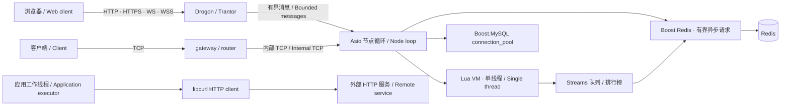

# 架构与迁移边界

## 总体架构

MySQL 与 curl 仍为 C++ 应用扩展。Redis 为可选能力，worker Lua 可调用有界异步 Streams 队列和 sorted-set 排行榜 API。

## 代码组织

| 路径 | 作用 |
|---|---|
| `include/mistlane/transport.hpp` | 字节消息通道接口；TCP 与 WS/WSS 统一为 payload |
| `src/node.cpp` | TCP 分帧、会话、限流、超时、转发、路由、生命周期 |
| `src/web.cpp` | Drogon 的 WS/WSS 适配，无手写握手 / 掩码 / 控制帧解析 |
| `src/lua_service.cpp` | Lua table 模块、registry 引用、受保护调用、栈恢复 |
| `src/lua_service.cpp` | Boost.Redis 连接生命周期及 Lua Streams/排行榜回调 |
| `include/mistlane/mysql_pool.hpp` | Boost.MySQL pool_params 配置，不实现连接池 |
| `include/mistlane/token_bucket.hpp` | 从原网络限流器改造，使用单调时钟累积令牌 |
| `lua/mistlane/min_heap.lua` | 从原通用 Lua 工具提取，改为局部模块 |
| `examples` | 不含游戏协议的 echo 和 MySQL 参数化 SELECT |
| `tools` | 示例客户端与白名单导出；集成验证在 tests |

`mistlane::core` 提供 Lua 运行层，`mistlane::net` 提供节点，`mistlane::mysql` 提供成熟连接池的配置接入。可通过 CMake add_subdirectory 后链接相应 target。C++ MySQL API 当前尚未绑定 Lua；不要在 message 回调中调用阻塞 SQL。

## 执行与连接模型

每个节点有一个 Asio 线程，执行内部 TCP、计时、信号和 Lua 回调。Web 接入另由 Drogon/Trantor 事件循环处理 HTTP/TLS/WS；每会话最多递交一条待处理消息至 Asio，禁止两套循环并发访问 Lua VM。WS 请求必须逐条等待响应，抢发请求会关闭会话。

gateway 与 router 的差别是部署角色及拓扑位置，当前运行机制相同：新连接按 upstream 列表轮询；一个下游会话对应一个上游 TCP 连接。每次完整请求获得完整响应后才继续读取下一个请求，因此没有无限发送队列。WS/WSS 由 Drogon 解析完整消息再转为内部 TCP 帧。连接固定到某个上游；重新连接可能选到另一上游，不具备按玩家 ID 路由的保证。

TCP：`u32 big-endian length | payload`。WS：一条消息即一个 payload，允许二进制与文本输入，输出为二进制消息。payload 上限为 1 MiB。请求 / 响应顺序一致，协议里没有业务消息 ID、账号 ID 或服务注册数据。

- 连接上限由 --max-connections 和 --memory-budget-mib 共同决定，默认有效上限 42；详见跨服文档的内存估算边界。
- 每会话令牌桶容量 200、补充速度 100 条消息/秒。
- 握手期限 10 秒；等待下一完整请求最多 60 秒；处理及转发一个完整请求到响应最多 10 秒。
- 任一协议、限流、超时、Lua 回调或上游错误关闭受影响会话；不会擅自重放可能已执行的请求。
- SIGTERM/SIGINT 取消全部会话和监听器并排空取消回调。当前不是业务请求排空、事务刷盘或 WebSocket 优雅关闭握手。
- SIGHUP 是 VM 级替换：新模块加载及 init 成功才替换，失败保留旧 VM。状态重置，不进行玩家状态迁移。

## 迁移来源

完整的保留、替换、待评估和排除项见[迁移状态清单](./migration-status)。

| 原组件 | 处理结果 |
|---|---|
| FogsProcess / FogsServer / LuaCallHandler | 保留进程职责和生命周期设计，重新实现为 Node / LuaService |
| TcpConn / SendBuffer / WebSocket / WebSocketSecure | 新 TCP 帧；WS/WSS 全部交由 Drogon；旧协议不兼容 |
| ServerConnBase | 当前为会话级上游连接；未迁移共享连接、注册握手或自动重连 |
| d_gateway / d_world / d_hegel | 通用 gateway / router / worker 三角色；剥离玩家、场景和全局业务 |
| TokenBucket | 重写为单调时钟累积令牌，修正旧实现覆盖已有令牌等问题 |
| game/Util/MinHeap.lua | 保留排序算法，改为模块导出；满容量时保留较大元素的原语义不变 |
| SQL / 手工连接管理 | 用 Boost.MySQL 的连接池与参数绑定替代；未迁移旧表结构或脏写逻辑 |
| 业务和交付环境 | 旧 game、etc、支付、SDK、运维、数据库表结构及二进制不进入发布包 |

这次主要是保留架构思路并重做核心接口，不是对旧 C++ 目录整体换依赖后兼容构建。已经提取的原源码只有限流器的设计和 MinHeap 工具，其余新核心有明确的新协议及 API。

## 当前缺口

本版本适合验证框架与开发应用原型。原游戏已有的登录、账号绑定、迁服、跨服玩法、寻路、数据库缓存和运营能力均不在核心中。也尚未提供：服务发现、基于服务发现的健康路由（cross 节点已按静态配置上游的 PROBE1 就绪状态挡住新加入）、连接多路复用、请求关联、自动重连、持久化重放、分布式一致性、全局背压、生产指标采集与压力容量证据。

Lua 脚本属于可信应用代码；指令 hook 仅辅助定位典型死循环，不提供不可绕过的资源控制或内存配额。DB 接入的示例拥有独立 pool，尚无通用 Lua 异步 DB 桥接。网络传输成功也不代表事务已持久化。

## 后续优先顺序

1. 在真实小应用中验证部署、会话恢复、回调契约和错误语义。
2. 按需求补充服务注册 / 认证、请求 ID、多路复用、负载策略和重连；保持网络协议、存储池交给成熟库。
3. 用应用扩展实现异步数据库调用，把连接获取、参数化 SQL、超时、事务与错误统一传回应用，不向 Lua 暴露裸指针。
4. 定义应用状态迁移与退出排空策略，再迁移原游戏。
5. 用容量、长期运行和故障演练数据界定生产适用范围。

## 专题文档

[Lua 生命周期](./lua)描述钩子和重载；[跨服与过载保护](./cross-server)描述原生 cross/shard、固定房间路由与硬准入；[HTTP 接入](./http)描述 Drogon 与 libcurl。
