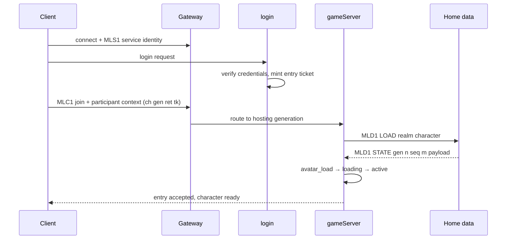
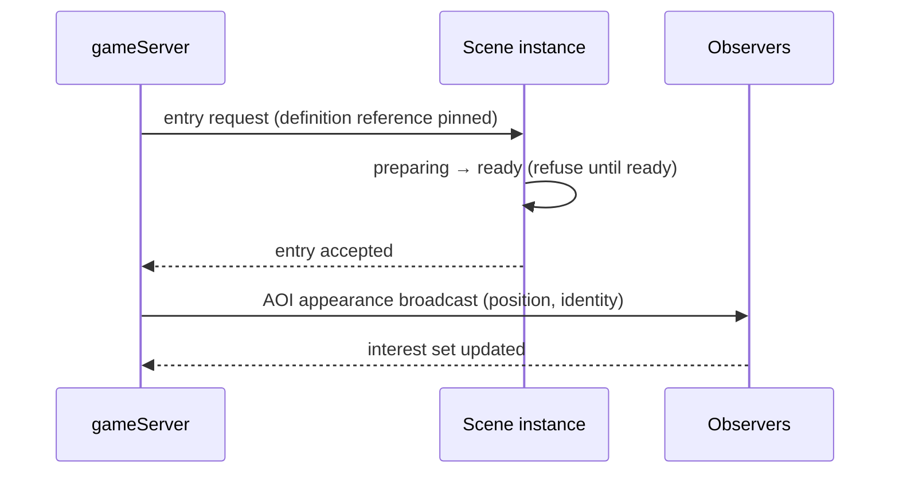
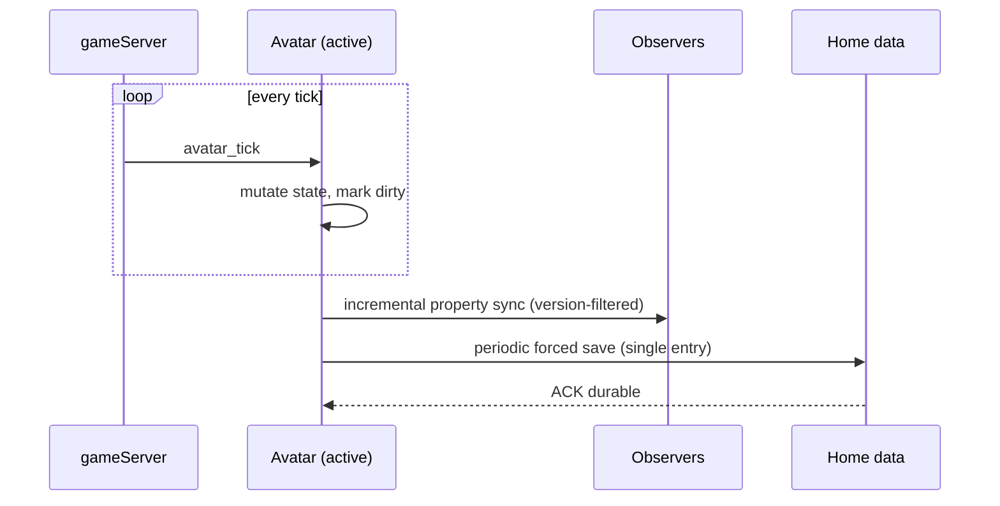
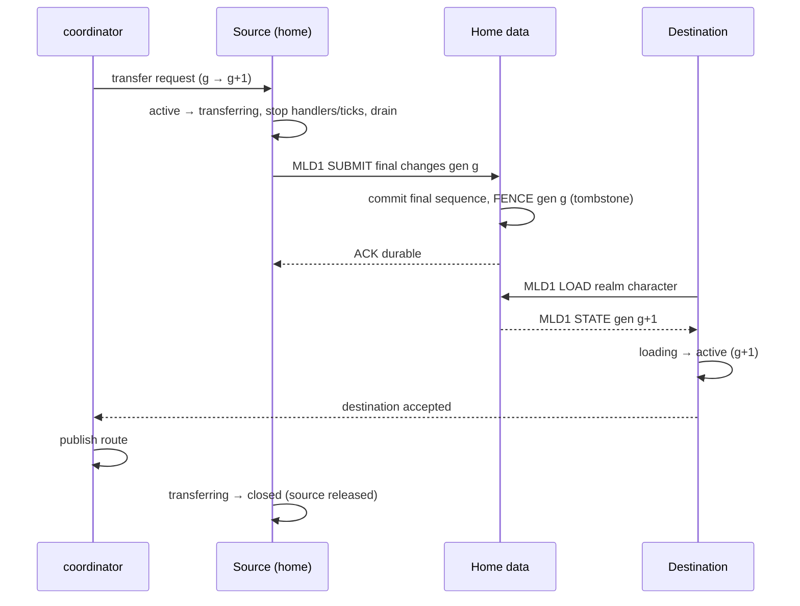
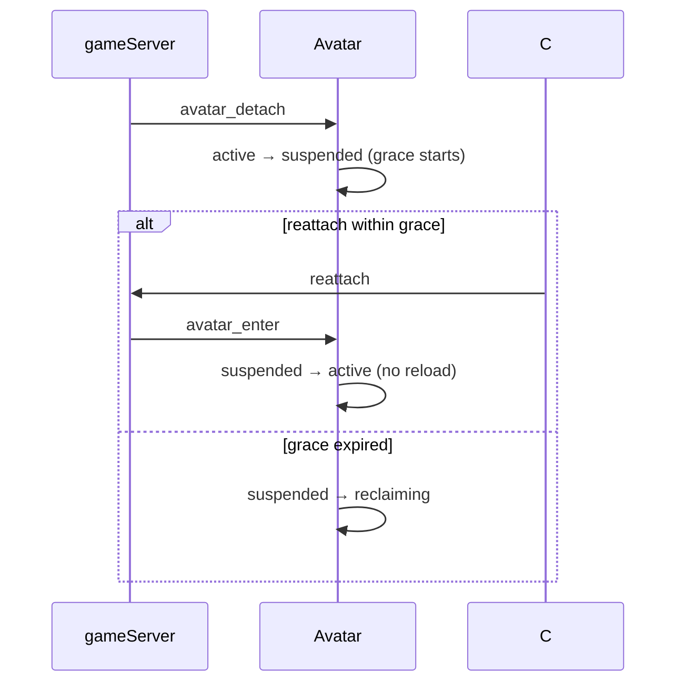
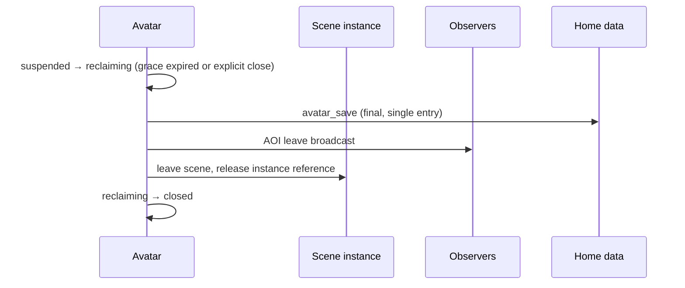
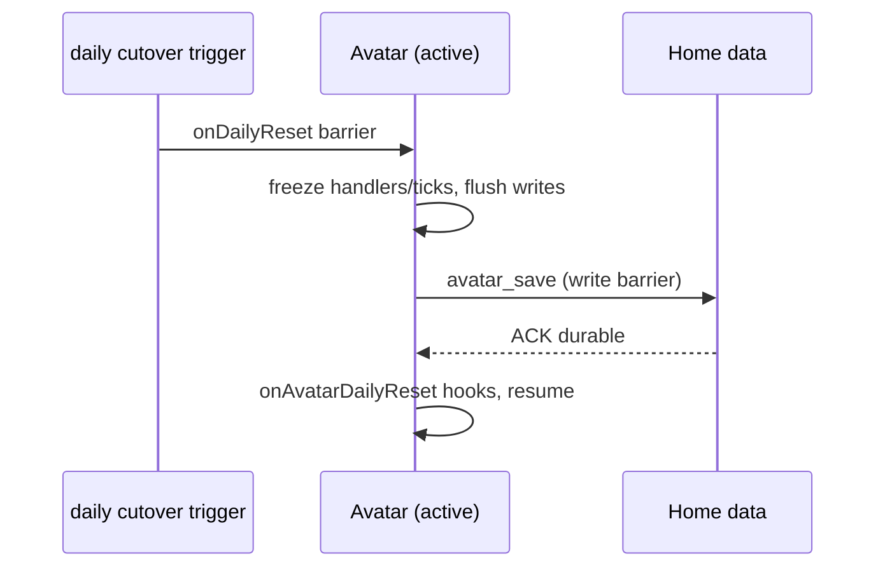
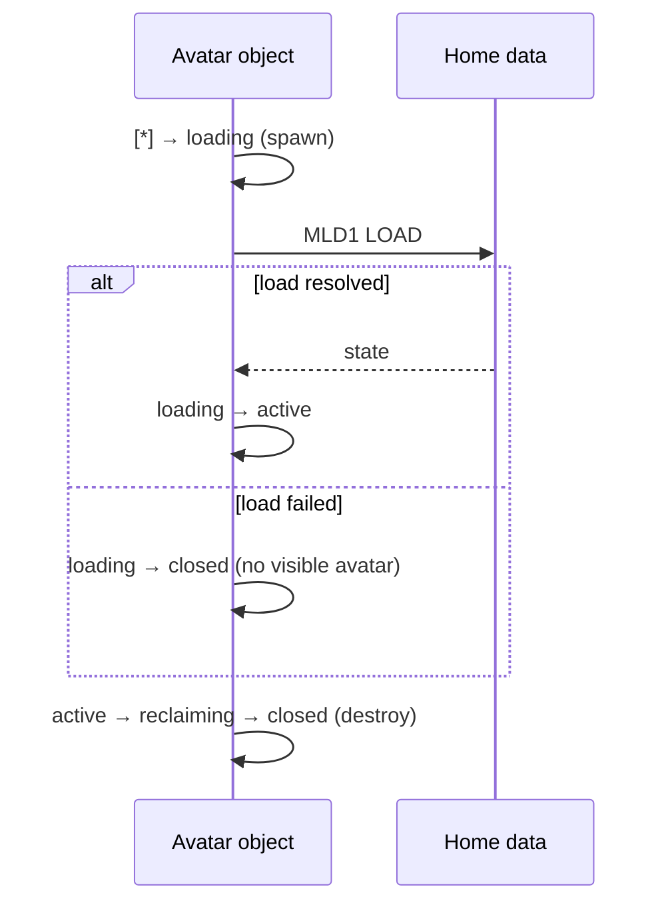
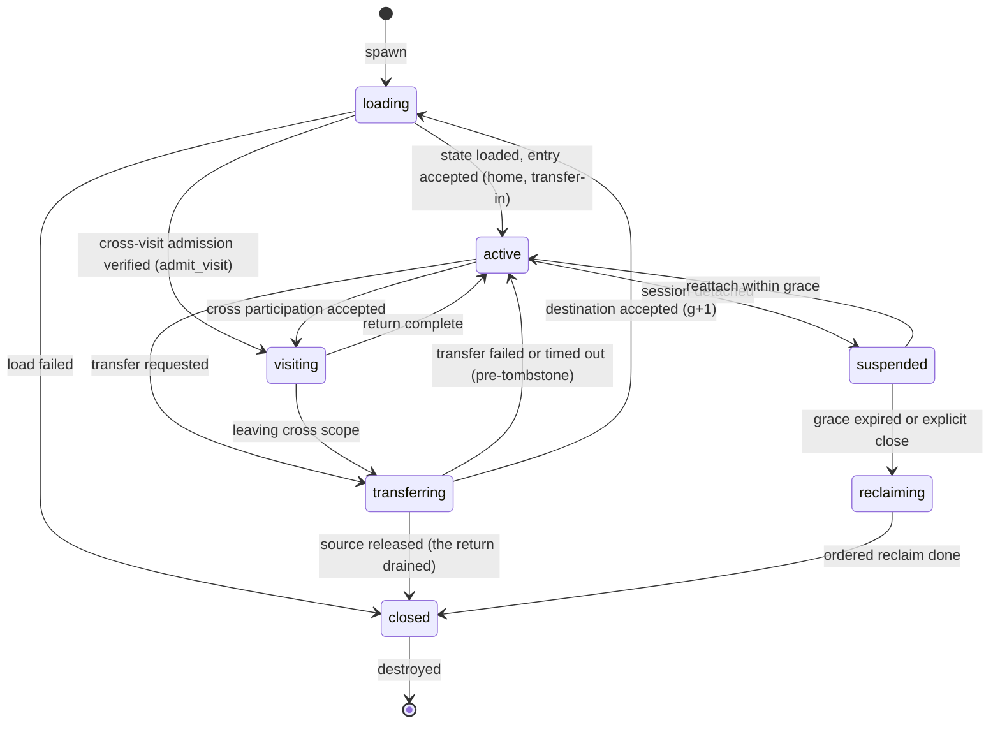

# Avatar 全生命周期：分段、预言机状态机与关系

状态：已定设计（2026-11-22）。框架当前没有端到端 Avatar 运行时——七态预言机模型已实现并由 avatar.lifecycle 模型测试钉住，其 Lua 钩子面已接入服务 VM 并由 avatar.lua 测试钉住，跨服进入边（`admit_visit`、`close_visit` 与节点退役面）已实现并由 avatar.session 测试钉住，故 crossServer 加入现在真的创建 `visiting` Avatar，归属登录路径也已接线——加入自己的区服（realm == return_realm）创建 `active` Avatar（avatar_load→avatar_enter），断开把它 `suspended`（宽限窗口开），宽限内重连直接回 `active` 不重载，宽限到后节点 tick 走有序回收（最终保存→`closed`），由 avatar.home 测试钉住；源侧的优雅回服也已接线——带 `--data` 端点的 crossServer 上断开的访问者离开跨服作用域，并在回传队列排空的那一刻释放其 Avatar（`cross_leave` 后 `release`，不做尽力保存），由 avatar.return 测试钉住，而不带 `--data` 的 crossServer 保留异常的 `close_visit`（文件名见 [Avatar 运行时页](./avatar-runtime.md)）；移交链已接线——源侧生产调用方与目标侧接管均已实现（avatar.transfer.source / avatar.transfer.destination），组合链由 avatar.transfer.full 端到端钉住（两侧真实节点、零 raw 帧驱动）——而场景与运行时验收仍为后续切片——本页不改变任何 CLI 行为，下面描述的运行行为仍未端到端实现、未经验证。本页是[Avatar 运行时](./avatar-runtime.md)的五态、[跨服回传协议](./cross-return-protocol.md)的租约态与[场景生命周期](./scene-lifecycle.md)的实例态各自覆盖一部分的**统一**生命周期契约；它记录三者哪里一致、哪里分歧，以及一个可机械判定的预言机长什么样。本页**不改**那三页——冲突以勘误表（下文）记录，交由维护者处置。英文页：[English](../avatar-lifecycle.md)。

## 为什么需要一页

三份契约从三个角度描述同一个对象，且已对"状态意味着什么"存在分歧：

| 契约 | 主体 | 它命名的态 | 本页补齐的缺口 |
|---|---|---|---|
| [Avatar 运行时](./avatar-runtime.md) | 宿主上的 Avatar 对象 | `loading` `active` `suspended` `transferring` `closing` `closed` | 无跨服参与态；`suspended → closing` 把回收与运维关闭并成一类 |
| [跨服回传协议](./cross-return-protocol.md) | **租约**，不是 Avatar | `active(g)` `requested(g+1)` `relinquished/tombstoned(g)` `active(g+1)` | 租约态 ≠ Avatar 态；跨服 Avatar 是租约，不是归属权威 |
| [场景生命周期](./scene-lifecycle.md) | **场景实例**，不是 Avatar | `creating` `preparing` `ready` `failed` | 实例清理顺序须与 Avatar 回收对齐 |

唯一写入权不变量是并集存在的理由：[跨服回传协议](./cross-return-protocol.md#唯一写入权)允许**每个角色至多一个可写 Avatar**、只给跨服一个*临时有界写租约*，而[Avatar 运行时](./avatar-runtime.md#avatar-状态)的 `active` 意为"允许持久写"。若跨服宿主的 Avatar 标成 `active`，状态机无法判定"持久写是否允许"——这正是整条契约链要保护的那一个性质。本页因此把 Avatar 态扩到七个，并给出使该判定机械化的迁移表与转移函数。

## 八个生命周期分段

每段是 Avatar 生命周期上的一个序列。它们就是账本所点验收的形态（正常登录、双向消息、同进程切场景、跨进程与跨服移交带回传、回调、多监听），这里按段拆解，而非一条笼统的运行时声明。

### 1. 登录与选角

选角把**会话**绑定到**Avatar**：会话是连接的，Avatar 是角色的，两者生命周期刻意不同（[对象拆分](./avatar-runtime.md#对象拆分-session-与-avatar)）。

### 2. 进图与 AOI 出现

实例是 `ready` 否则拒绝进入（场景生命周期："未就绪目标以显式失败拒绝进入"）。地图不随人走；只传输参与者上下文与实例作用域状态。

### 3. 同步心跳

`avatar_save` 是唯一强制保存入口（avatar-runtime 性质 1）。旧在线保存节拍（300000 ms）与场景同步节拍（UPDATE_INTERVAL=1000）是观察；目标节拍是测量，不是本页。

### 4. 传送

墓碑前中止回到源 `active`；墓碑后只有更新一代可续。这就是[租约交接](./cross-return-protocol.md#写入租约交接)序列，画在 Avatar 对象而非租约上；源侧已实现（avatar.transfer.source），目标侧在同一宿主上已实现（节点轮询协调器的 `MLR1 MIG DESTINED` 枚举取它目标租约等待的已栅栏缺口，加载冻结记录，经 `avatar_load` + `avatar_transfer_in` 构建并落 active 未绑定，确认 READY，协调器发布目的地路由——avatar.transfer.destination）。组合链由 avatar.transfer.full 端到端钉住，两侧真实节点、零 raw 帧驱动——来源的 `mistlane.transfer` 交给目标侧的轮询，目标的 READY 正是解锁来源 COMMIT 的时机。

### 5. 断线与重连

`suspended` 从不接受新参与；它只用于完成义务，不承载玩法（avatar-runtime 规则 3）。宽限期内重连回 `active` 且不重载。

### 6. 下线回收

回收顺序是场景生命周期清理顺序（停止进入、停止计时器、疏散、释放实例态、释放定义引用）应用于该参与者；失败路径也执行。

### 7. 日切

日切是**屏障，不是态**：作用于 `active`（与 `visiting`），强制一次持久保存，运行日切钩子，回到原态。这正是"五态够用"直觉唯一正确的地方——为它加态只会让预言机更大而不增加判定。

### 8. 运行时对象 spawn 与 destroy

加载失败不产生可见 Avatar；移交失败把 Avatar 留在原 `active`（avatar-runtime 规则 2）。spawn 与 destroy 是 Avatar 对象自身的边，与任何会话无关。

## 预言机状态机

七个态。相对五态页的扩态理由直接见下图之下。

### 为什么五态不够

| 理由 | 五态缺口 | 不扩态的后果 |
|---|---|---|
| 跨服参与是**租约**，不是权威 | 无跨服 Avatar 态；会被标成 `active` | 无法判定"持久写是否允许"——唯一写入权不变量不可表示 |
| 回收与运维关闭是不同序列 | `suspended → closing` 合并两者 | 有序回收（最终保存、场景释放、AOI 离场、引用释放）无法按路径钉死 |
| 加载来源不同 | `loading` 把归属加载与移交进入等同 | 无法判定墓碑后新代可否续写 |

扩态是 **`visiting`**（跨服参与、临时租约、持久变更经 MLD1 回传）与 **`reclaiming`**（`closed` 前的有序回收，取代 `closing` 标签）。`loading` 保持单态但获得**加载来源**属性（`home` | `transfer-in` | `cross-visit`），供转移函数读取：前二者经进入边解析为 `active`，跨服进入解析为 `visiting`（租约面——框架的已验证准入，而非 `avatar_enter`，是 crossServer 的进入门）。日切刻意**不**设态（第 7 段）。

## 权威迁移表

每态：进入门槛（进入须为真）、退出触发、可调钩子、拒绝码、持久义务、同步可见性。

| 态 | 进入门槛 | 退出 | 可调钩子 | 拒绝码 | 持久义务 | 同步可见性 |
|---|---|---|---|---|---|---|
| `loading` | 已发数据请求；无 handler 可指向此角色 | 加载成功 → `active`（home、transfer-in）；跨服进入 → `visiting`；失败 → `closed` | `avatar_load` | `AVATAR_LOADING` | 无（未发布 Avatar） | 无 |
| `active` | 归属域；宿主代当前；进入被接受 | 断线 → `suspended`；传送 → `transferring`；跨服接受 → `visiting`；销毁 → `reclaiming` | `avatar_enter` `avatar_tick` `avatar_save` | `AVATAR_ALREADY_ATTACHED`（重复进入） | 允许持久写；`avatar_save` 唯一入口 | 全量（AOI） |
| `suspended` | 会话已断；宽限开启；待存义务仍在跑 | 重连 → `active`；宽限到 → `reclaiming` | `avatar_detach` | `AVATAR_SUSPENDED` | 待存义务仍在跑 | 仅离场广播 |
| `visiting` | 跨服准入已验证（入场票）；临时租约已授 | 离开 → `transferring`；回传完成 → `active` | `avatar_tick`（跨服本地） | `AVATAR_VISITING`（持久写） | 仅跨服本地；持久变更经 MLD1 回传 | 跨服作用域 AOI |
| `transferring` | 传送在途；无 handler、无 tick；在途工作已排空 | 墓碑前中止 → `active`；目标接受 → `loading`；源释放（回传排空）→ `closed` | `avatar_transfer_out` `avatar_transfer_in` | `AVATAR_TRANSFERRING` | 源在墓碑前冲刷最终有序变更；跨服回传在释放前排空其队列 | 冻结 |
| `reclaiming` | 宽限到或显式关闭；清理必须执行 | 回收完成 → `closed` | `avatar_save`（最终） | `AVATAR_RECLAIMING` | 最终保存在 `closed` 前已确认 | AOI 离场广播 |
| `closed` | 有序清理完成 | 销毁 → `[*]` | `avatar_fail` | `AVATAR_CLOSED` | 无 | 无 |

## 转移函数（机械可判定）

事件字母表：`E_ATTACH, E_DETACH, E_REATTACH, E_GRACE_EXPIRED, E_ENTER, E_TRANSFER_REQ,
E_CROSS_ACCEPT, E_CROSS_LEAVE, E_TRANSFER_ABORT, E_TOMBSTONE_ACCEPT, E_RETURN_COMPLETE,
E_RETURN_RELEASE, E_SPAWN, E_DESTROY, E_DAILY_CUTOVER, E_SAVE_FAIL, E_LOAD_FAIL, E_OPERATOR_CLOSE`。预言机是
`δ(态, 事件) → 下一态 | 拒绝(码)`，由下规则保证全定义：

> **凡某态未列出的事件，一律以该态拒绝码拒绝。**

| 态 | 接受的事件（→ 下一态或拒绝） |
|---|---|
| `loading` | `E_LOAD_FAIL → closed` · `E_ATTACH/E_ENTER → 拒绝(AVATAR_LOADING)` · 加载解析 → `active`（home、transfer-in） · 加载解析（来源 cross-visit）→ `visiting` |
| `active` | `E_DETACH → suspended` · `E_TRANSFER_REQ → transferring` · `E_CROSS_ACCEPT → visiting` · `E_DESTROY → reclaiming` · `E_ATTACH → 拒绝(AVATAR_ALREADY_ATTACHED)` · `E_DAILY_CUTOVER → active`（屏障） |
| `suspended` | `E_REATTACH → active` · `E_GRACE_EXPIRED → reclaiming` · `E_OPERATOR_CLOSE → reclaiming` · `E_ATTACH → 拒绝(AVATAR_SUSPENDED)` |
| `visiting` | `E_CROSS_LEAVE → transferring` · `E_RETURN_COMPLETE → active` · `E_DAILY_CUTOVER → visiting`（屏障） · 持久写 → `拒绝(AVATAR_VISITING)` |
| `transferring` | `E_TRANSFER_ABORT → active` · `E_TOMBSTONE_ACCEPT → loading`（加载来源 transfer-in） · `E_RETURN_RELEASE → closed` · `E_ATTACH/E_ENTER → 拒绝(AVATAR_TRANSFERRING)` |
| `reclaiming` | 回收完成 → `closed` · `E_SAVE_FAIL → reclaiming`（重试或上报） |
| `closed` | `E_SPAWN → loading` · 其余 → `拒绝(AVATAR_CLOSED)` |

所有转移由框架驱动（只有框架在态间移动 Avatar；钩子在转移边沿运行，绝不在转移内部）。函数按拒绝规则全定义，故任意事件序列可机械判定：逐事件套 `δ`；`拒绝` 以码停止且不改态。

## 各态钩子面

[avatar-runtime 钩子表](./avatar-runtime.md#lua-钩子面)的签名与失败语义不变；本页只分配每个钩子合法所在的态。

| 钩子 | 合法态 | 说明 |
|---|---|---|
| `avatar_load` | `loading` | 成功才入 `active`（home、transfer-in）或 `visiting`（跨服进入）；失败 → `closed`，无可见 Avatar |
| `avatar_enter` | `loading → active` 边沿 | 以显式原因拒绝进入 |
| `avatar_leave` | `active → suspended`、`visiting → transferring` | 永不阻塞断离。仅会话断离：回传自身的 `cross_leave`（已无绑定会话）不跑钩子 |
| `avatar_tick` | `active`、`visiting` | `visiting` 时仅跨服本地 |
| `avatar_save` | `active`、`suspended`、`visiting`、`reclaiming` | 唯一强制保存入口；`reclaiming` 的保存在 `closed` 前须持久。回传的释放绝不保存（其变更已经 MLD1 落盘）；只有异常的跨服关闭做尽力保存 |
| `avatar_transfer_out` | `active → transferring` 边沿 | 中止回 `active` |
| `avatar_transfer_in` | `loading`（transfer-in） | 失败在本宿主关闭；源保留 Avatar |
| `avatar_detach` | `active → suspended` 边沿 | 记日志；Avatar 无论如何进 `suspended` |
| `avatar_fail` | 任意态 | 尽力而为；原失败后果成立 |

## 与四份契约的关系

| 页 | 贡献 | 本页新增 |
|---|---|---|
| [Avatar 运行时](./avatar-runtime.md) | 对象拆分、钩子面、迁移规则、错误/重入规则 | 使五态机械可判定的预言机；`visiting`/`reclaiming` 扩态 |
| [玩家、场景与跨服模型](./player-scene-model.md) | 会话与 Avatar 归属、旧链路观察、目标边界 | 把"无 Avatar 类型"状态拆成逐段验收的分段 |
| [场景生命周期](./scene-lifecycle.md) | 实例准备态、清理顺序、引用驱动释放 | 把 Avatar 回收与实例清理对齐：回收先于实例可空关闭 |
| [跨服回传协议](./cross-return-protocol.md) | 参与者上下文、唯一写入权、MLD1、租约交接 | 把租约的 `requested/relinquished/tombstoned` 映射到 Avatar `transferring`；`visiting` 是租约的 `active` 面 |

## 勘误表（记录，未改）

以下是并集过程中发现的冲突；均未改动源页，交由维护者处置。

| # | 来源 | 冲突 | 处置 |
|---|---|---|---|
| C1 | [Avatar 运行时](./avatar-runtime.md#avatar-状态) :41 | `suspended --> closing : grace expired or explicit close` 把回收与运维关闭并成一条边 | 拆成 `suspended → reclaiming`（双触发）；`closing` 被 `reclaiming` 取代 |
| C2 | [Avatar 运行时](./avatar-runtime.md#avatar-状态) | 无跨服参与态；跨服 Avatar 被隐含为 `active` | 加 `visiting`；`active` 仅指归属权威 |
| C3 | [跨服回传协议](./cross-return-protocol.md#写入租约交接) | 租约态 `requested(g+1)/relinquished(g)/tombstoned(g)` 是租约级而非 Avatar 级；两个不同名状态机 | 租约 → Avatar 映射：`requested`=已请求传送、`relinquished`=`transferring` 墓碑前、`tombstoned`=loading(g+1) |
| C4 | [场景生命周期](./scene-lifecycle.md#清理与引用释放) :87 | 实例关闭"仅当实例为空或显式疏散后" | Avatar 回收是该参与者的疏散；须先于实例空检查 |

## 本页刻意未定

- 属性 schema、脏追踪与增量同步：实体契约链（不变）。
- 拒绝码数值、宽限期、tick/保存节拍与预算：测量，不是本页。
- AOI 实现：旧 `enable9Grid` 观察不证明活跃空间 AOI；上面同步可见性是契约，不是实现。
- `visiting`/`reclaiming` 的精确钩子名与签名：实现落码时定；上面态语义是契约。

## 验证

- **机械可判定：**转移函数按拒绝规则全定义——任意事件序列终止于某态或具名拒绝。可检视验证，即账本验收（"状态机可机械判定任意事件序列"）。
- **Mermaid：**九个图（八段 + 状态机）全渲染；`docs:check` 覆盖可渲染、桌面/移动、明暗与展开。
- **运行时验收：**今天无——无端到端 Avatar 运行时；七态预言机模型已实现并经模型测试（avatar.lifecycle），归属加入与跨服访问的会话/Lua/传输接线已实现并钉住（avatar.home、avatar.session），且优雅跨服回传已在源侧接线并钉住（avatar.return：`cross_leave` 后恰在队列排空时 `release`，不做尽力保存），但移交链仍是后续切片。验证记录不得声称完整 avatar 行为（与 avatar-runtime 页一致）。

相关：[Avatar 运行时](./avatar-runtime.md)、[跨服回传与唯一写入权协议](./cross-return-protocol.md)、[场景生命周期](./scene-lifecycle.md)、[玩家、场景与跨服模型](./player-scene-model.md)。
