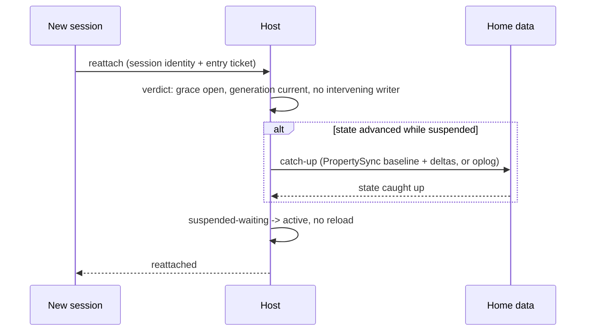
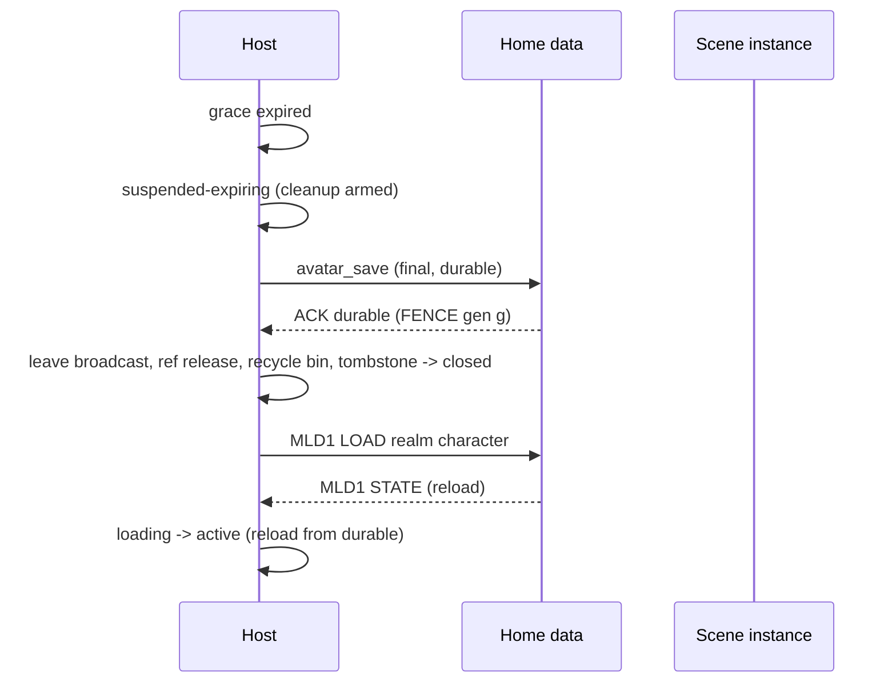
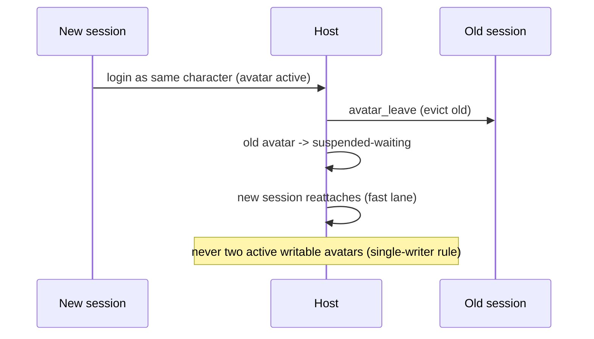
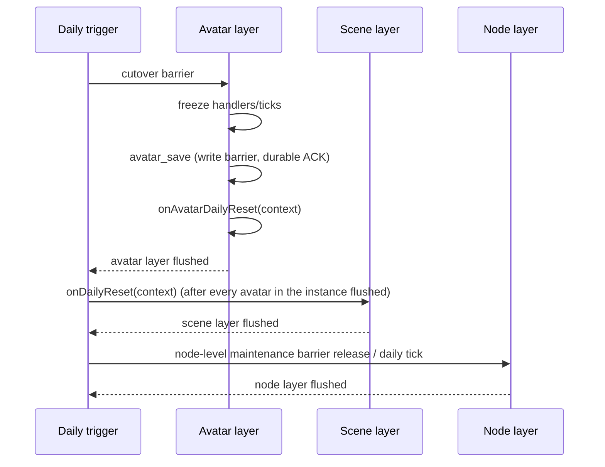

# Avatar 重连与日切契约

状态：已定设计（2026-11-22）。无 Avatar 类型，本页不改变任何 CLI 行为，下面描述的运行行为均未实现、未经验证。本页是账本的 PL-3：重连双泳道（检测判定/宽限期/reattach 鉴权/状态追平/超时清理链/顶号）、`suspended` 子态显式化，以及日切（触发面/三层触碰顺序/写入屏障/失败补偿/`onDailyReset`+`onAvatarDailyReset` 签名与顺序保证）。它是对[生命周期预言机](./avatar-lifecycle.md)的细化——PL-1 的 `suspended` 展开为两个显式子态，日切屏障获得钩子。机器可读形态：`contracts/avatar-reconnect-cutover.json`。英文页：[English](../avatar-reconnect-cutover.md)。

## 重连双泳道

两条泳道、一个判定。检测判定选择泳道，绝不单独由超时推断。

| 泳道 | 判定条件 | 结果 |
|---|---|---|
| **快** | 宽限期内重连 且 代仍当前 且 无介入写者 且 内存态保留 | `suspended-waiting → active`，无重载、无墓碑 |
| **慢** | 宽限到 或 代已变 或 内存态丢失 | `suspended-waiting → suspended-expiring → reclaiming → closed → loading → active`（从持久记录重载） |

**状态追平**（快泳道子步）：若挂起期间持久游标前进过（保存或计时器跑过），Avatar 恢复前先追平——`PropertySync` 基线 + 无缝隙属性增量，或重放有序变更日志（[实体链](./entity-contract.md)的机制）。分歧的内存态绝不原样恢复。

**顶号：**同一角色的会话在 Avatar 为 `active`/`visiting` 时登录，逐出旧会话（`avatar_leave`）并经快泳道重接该 Avatar——绝不出现第二个可写 Avatar（唯一写入权规则）。旧 Avatar 在移交中则新会话以移交拒绝码拒绝，待移交落定后重试。

**超时清理链**（慢泳道，宽限到后）：停止接受重连 → 最终保存持久 → AOI 离场广播 → 释放场景实例引用 → 回收站 → 该代墓碑 → `closed`。即[销毁义务清单](./avatar-spawn-destroy.md#销毁义务清单-按序)顺序。

**绝不：**重连不复活已关闭的 Avatar；重入一律走 `loading`（avatar-runtime）。无已验证参与者上下文的会话不能重接持久可写 Avatar。

## suspended 子态（显式）

PL-1 的 `suspended` 是单态；本页把它隐藏的两相显式化。二者之并即 PL-1 的 `suspended`；转移函数的 `suspended` 行相应展开。

| 子态 | 规则 | 退出 |
|---|---|---|
| `suspended-waiting` | 宽限开启；内存态保留；快泳道合格 | 重连（快）→ `active`；宽限到 → `suspended-expiring` |
| `suspended-expiring` | 清理已武装；只剩慢泳道；冲刷进行中 | 冲刷持久 → `reclaiming`；清理完成 → `closed` |

`suspended-expiring` 期间重连以 `AVATAR_SUSPENDED` 拒绝。

## 三条重连路径

### 1. 快泳道重连

### 2. 慢泳道重载

### 3. 顶号

## 日切

### 触发面

日切由日界、配置排程、运维命令或维护窗口触发。触发向每个 `active`/`visiting` Avatar 发 `E_DAILY_CUTOVER`，并持节点级屏障直到每层冲刷完成。

### 三层触碰顺序（自底向上）

触碰顺序有保证：Avatar 层先于场景层先于节点层；每层写屏障完成才开始下一层；层内按身份确定性排序。

### 写屏障与钩子顺序

- **冲刷即屏障。** `avatar_save` 确认持久才使该层完成；冲刷之后运行的钩子不再把已冲刷状态弄脏。
- **单 Avatar 内顺序：**`avatar_save`（持久）然后 `onAvatarDailyReset(context)`。钩子观察已冲刷状态。
- **跨层顺序：**Avatar → 场景 → 节点。

### 钩子签名与失败语义

| 钩子 | 签名 | 调用时机 | 失败 |
|---|---|---|---|
| `onAvatarDailyReset` | `(context) → nothing` | 每个 `active`/`visiting` Avatar，其 `avatar_save` 持久后 | 记日志；冲刷成立（即屏障）；日切继续 |
| `onDailyReset` | `(context) → nothing` | 每个场景实例，其内所有 Avatar 冲刷后 | 记日志；屏障内重试；该层冲刷持久前屏障不释放 |

### 失败补偿

| 中断 | 屏障态 | 补偿 |
|---|---|---|
| Avatar 层保存失败 | 保持 | 预算内重试；不发布部分日切；上报运维 |
| Avatar 层钩子失败 | 保持（冲刷已持久） | 记日志；冲刷权威，日切继续 |
| 节点层屏障未释放 | 保持 | 无层推进；绝不发布部分日切；恢复续屏障 |

## 钩子进预言机

重连/日切事件扩展 PL-1 转移函数。[生命周期预言机钩子表](./avatar-lifecycle.md#各态钩子面)增两行，`suspended` 转移行展开：

| 钩子 | 合法态 | 说明 |
|---|---|---|
| `onAvatarDailyReset` | `active`、`visiting` | 冲刷后，观察已冲刷状态 |
| `onDailyReset` | 场景实例（非 Avatar 态） | Avatar 冲刷后，按实例 |

| 态 | 新增/展开的事件 |
|---|---|
| `suspended`（现为 `suspended-waiting` + `suspended-expiring`） | `E_REATTACH → active`（快泳道，waiting） · `E_GRACE_EXPIRED → suspended-expiring` · `suspended-expiring` 中重连 → `拒绝(AVATAR_SUSPENDED)` |
| `active`、`visiting` | `E_DAILY_CUTOVER → 原态`（屏障；补入预言机） |

## 本页刻意未定

- 追平编码（oplog vs 快照+增量）：实体契约链的 `PropertySync` 与变更日志，仍延后。
- 重连路由的 `MLR1 ROUTE` 绑定：avatar-runtime 注明 wire 动词已在但尚无 Lua 绑定。
- 宽限时长、追平预算与日切节拍：测量，不是本页。

## 验证

- **可机器校验：** `contracts/avatar-reconnect-cutover.json` 钉住子态、双泳道判定、三条重连路径、三层触碰顺序与失败补偿；夹具断言不变量，漂移即测试失败。
- **Mermaid：** 四张验收图（三重连路径 + 日切）渲染；`docs:check` 覆盖可渲染、桌面/移动、明暗与展开。
- **运行时验收：** 今天无——无 Avatar 类型。

相关：[Avatar 生命周期](./avatar-lifecycle.md)、[Avatar 创建/回收契约](./avatar-spawn-destroy.md)、[Avatar 运行时](./avatar-runtime.md)、[跨服回传与唯一写入权协议](./cross-return-protocol.md)、[实体契约与代码生成](./entity-contract.md)。
