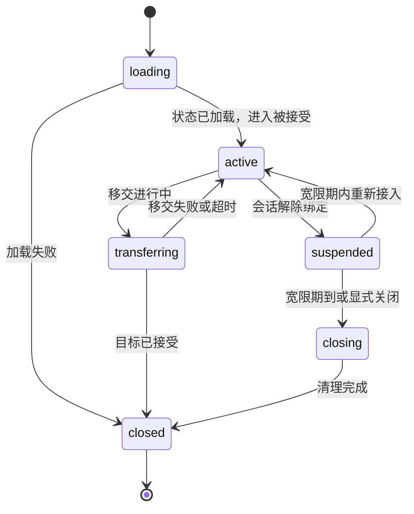

# Avatar 运行时：会话、生命周期钩子、迁移与加载保存

状态：已定设计（2026-10-19）。当前框架有会话、帧协议、握手层与每个 gameServer/crossServer 一个串行调用的 Lua VM，但没有 Avatar 类型（`grep -rniE "\b(struct|class)\s+(Scene|Map|Entity|Avatar|Chunk)" include/ src/` 排除测试零命中）——本页不改变任何 CLI 行为，下面描述的运行行为均未实现、未经验证。本页把[模型页](./player-scene-model.md)列为抽取目标的内容（"钩子需要线程/错误/重入/超时契约与迁移期间的规则"）落成契约，为 coordinator 协调的移交切片提供前置设计；职责边界仍是[进程职责页](./process-roles.md)。持久归属与唯一写入权归[跨服回传协议](./cross-return-protocol.md)；实例准备状态归[场景生命周期](./scene-lifecycle.md)；属性 schema、脏追踪与增量同步归[实体契约链](./entity-contract.md)且继续延后。任何新 Avatar API 的实现被客户端协议契约恢复（账本 88-91）门控。

## 基线：框架现在有什么

| 面 | 当前状态 |
|---|---|
| 会话身份 | `message` 上下文里的帧式会话数字 id；crossServer 加入带 realm/group/room/epoch，参与者加入带 `character`、`generation` 与嵌套 `route` 表 |
| 出向 | 有界 `mistlane.session.send`/`broadcast`（每通道 ~2 MiB、显式原因），推送保持回复顺序，关联（`MLC2`）回显 |
| 身份层 | `MLS1` 服务身份、`MLM1` 上游复用——各自独立的可选层 |
| Lua 执行 | 每节点一个 VM，在 Asio 线程串行调用；保护调用带指令数预算（约 100 万条）拦截失控循环；`message` 出错关会话，`tick` 出错记日志 |
| 节点钩子 | `init`/`start`/`message`/`http`/`tick`/`stop`/`shutdown` 与 websocket 三件套；**没有玩家连接/断开钩子** |
| 重载 | SIGHUP 装载候选 VM、切换、经 `stop`/`shutdown` 退役旧 VM；重载重置模块状态且不导出任何东西 |
| 承载 | `mistlane.place(role, scope?, callback)` 查询 coordinator 注册表 |
| Avatar | 不存在。没有角色对象、没有加载路径、没有保存入口、没有迁移 |

只有 `message` 的节点拥有的是请求处理，不是角色运行时。这个空白正是本页存在的原因：生命周期、状态所有权与迁移需要各自的契约。

## 对象拆分：Session 与 Avatar

| | Session | Avatar |
|---|---|---|
| 拥有 | 客户端连接、其帧式身份、网关上的当前承载路由 | 承载进程上角色的数据与行为 |
| 身份 | 帧式会话数字 id（每链路） | `(来源区服, 角色标识, 承载版本)`——与[参与者上下文](./cross-return-protocol.md)同一元组 |
| 生命周期 | 绑定在连接或逻辑链路上 | 不依赖任何单个连接：断开只解除会话绑定，不解除持久义务 |
| 数量 | 每网关多个；每客户端链路一个 | 每角色至多一个**active**（唯一写入者）；每会话在每宿主至多绑定一个 |
| 携带 | 不自带角色身份 | 永不携带客户端地址 |

Avatar 身份刻意复用参与者上下文元组，让同一形状穿过 `MLC1` 握手、路由记录与 `MLD1` 提交而无需转换。

## Avatar 状态

| 状态 | 规则 |
|---|---|
| `loading` | 已向归属侧请求数据；任何处理器不得瞄准该角色；请求以显式失败拒绝，绝不隐形排队 |
| `active` | 唯一运行 `message` 处理器与 `avatar_tick` 的状态；承载版本为当前值时允许持久写 |
| `suspended` | 会话已断开；不运行处理器；未完成的保存义务仍会执行；宽限期内重新接入直接回 `active`，不重新加载 |
| `transferring` | 移交进行中；无处理器、无 tick；在途工作在移交开始前完成（VM 是串行的） |
| `closing` / `closed` | 顺序清理完成；该角色在本宿主不存在 |

1. 只有框架在状态之间移动 Avatar；钩子在转移的边缘被调用，绝不在转移内部。
2. 钩子失败绝不半发布：加载失败不产生可见 Avatar；移交出失败让 Avatar 留在原地 `active`。
3. `suspended` 绝不接受新参与；它存在是为了完成义务，不是为了承载游玩。
4. 所有宽限期与预算都是实现时命名的配置项，默认值靠实测。

## Lua 钩子面

这些钩子是现有模块契约的补充；`message`/`http` 职责不变。钩子名在实现落地前是暂定的——本页固定的是参数、顺序与失败语义。

| 钩子 | 何时调用 | 参数 → 返回 | 出错或超时 |
|---|---|---|---|
| `avatar_load` | 本宿主从加载的记录创建 Avatar | `(context, state)` → avatar 表 | 加载失败：不发布 Avatar，带原因拒绝进入 |
| `avatar_enter` | 会话绑定到 active Avatar | `(context)` → 无 | 带显式原因拒绝进入 |
| `avatar_leave` | 会话解除绑定（登出、迁出） | `(context)` → 无 | 记日志；绝不阻塞解除绑定 |
| `avatar_tick` | 节点 tick，仅 active Avatar | `(context)` → 无 | 记日志；Avatar 保留（与 `tick` 一致） |
| `avatar_save` | 唯一的强制保存入口 | `(context)` → state 表 | 保存失败：上报运维；重试属于发送队列而非钩子 |
| `avatar_transfer_out` | 本宿主停止承载 | `(context)` → 状态快照 | 移交中止；Avatar 回到 `active` |
| `avatar_transfer_in` | 本宿主接管承载 | `(context, state)` → 无 | 到达的 Avatar 在本宿主关闭；来源保留其 Avatar |
| `avatar_detach` | 会话断开 | `(context)` → 无 | 记日志；Avatar 无论如何进入 `suspended` |
| `avatar_fail` | 任一 Avatar 钩子失败或超时 | `(context, reason)` → 无 | 尽力而为：VM 替换期间可能不运行 |

这张表面有三个要点：

1. **`avatar_save` 是唯一的强制保存入口。** 钩子做的任何事——发消息、推送、进场景——都不清脏状态、不通过副作用触发保存。状态内部什么算脏是实体契约链的问题；单一入口规则是本页的。
2. **状态只经 `avatar_load`/`avatar_save`/`avatar_transfer_out`/`avatar_transfer_in` 进出。** 钩子放在模块全局或 upvalue 里的任何东西都是易失的，按既有重载规则在 SIGHUP 替换时丢失；框架不会导出模块状态。Avatar 不得把模块状态当存储。
3. **每个失败都有命名后果。** 没有钩子失败会悄悄退化成"应该没事"。

## 迁移与移交规则

| 移动 | 发生什么 | 什么随行 |
|---|---|---|
| 同进程切场景 | Avatar 保持 `active`；只有其实例引用变化。不保存、不做状态往返 | 什么都不随行——场景生命周期的"不重复加载"规则同样适用于 Avatar |
| 跨进程移交（同区服） | 来源 `avatar_transfer_out` → 传输 → 目标 `avatar_load` + `avatar_transfer_in` → 来源释放。来源保持 `transferring` 直到目标应答；失败或超时则来源 Avatar 回 `active` | 参与者上下文 + 状态快照。地图不随行 |
| 跨服参与 | 跨进程规则加返回路由；离开只在最终变更集被持久确认后完成，按回传协议 | 参与者上下文 + 快照 + 有界发送队列的义务 |

- 已在执行的处理器在移交开始前结束；`transferring`/`loading`/`suspended` 期间到达的处理器以显式失败拒绝。有界队列留在今天所在的位置：会话与传输层。
- Avatar 拥有的计时器在移交开始时停止，且只在快照声明了它们时重新装填；未声明的计时器不随行。
- 重新连接绝不复活已关闭的 Avatar。本设计中 coordinator 持有按角色的路由记录，把新会话送到当前宿主——`MLR1` 目前只有 `REGISTER`/`QUERY`/`PLACE`，是成员承载而非角色路由；移交失败让路由留在来源，重入一律走 `loading`。
- VM 替换（SIGHUP）是节点级退役，不是 Avatar 迁移：旧 VM 里的每个 Avatar 获得一次尽力而为的 `avatar_save` 然后关闭；会话在切换后经 `loading` 重入。这保持既有的诚实规则——重载不迁移状态。

## 错误、超时与重入

| 事件 | 后果 |
|---|---|
| 钩子出错 | 上表逐钩子后果；带 Avatar 身份记日志 |
| 钩子超出预算 | 指令数预算中止调用，后果与钩子出错相同。预算数字在实现时实测，不由本页给定 |
| `transferring` 期间断开 | 移交继续；来源/目标的判定不依赖连接 |
| `active` 期间断开 | 运行 `avatar_detach`；Avatar 进入 `suspended`，未完成保存义务仍会执行 |
| SIGINT/SIGTERM | 现有关机顺序运行；Avatar 获得尽力保存。崩溃、SIGKILL 与断电不保证任何事——不变 |
| `avatar_fail` 自身失败 | 记日志；原失败后果不变 |

重入是被构造排除的，不是靠自觉：VM 串行，所以任何两个钩子永不交错；框架绝不在一个钩子运行时调用第二个 Avatar 钩子；message 处理器也不能同步触发生命周期转移——转移被排到处理器边界，风格与 `mistlane.place` 的"返回后回调"一致。这消除的是整类重入问题，而不是要求脚本小心。

## 本页故意未决定

- 属性 schema、脏追踪、增量同步与快照编码：实体契约链，其取代了更早的 Avatar-only 范围并继续延后。
- 客户端协议、绑定与方法暴露：被协议契约恢复（账本 88-91）门控；game-fogs 没有 `.sproto` 文本源，只有编译产物 `sproto.spb` 与 `Protocol.lua` 名字表。
- 确切钩子名与签名：在代码实现时固定；上面的参数、顺序与失败语义才是契约。
- 宽限期、tick 预算与保存节奏：实现时实测。
- crossServer 发送侧的有界重试队列与只读转换：回传协议切片，等持久化链。

## 验证

目前无验证：没有 Avatar 类型，因此本页没有测试，也没有运行验收。验证记录不得据此声称任何 Avatar 行为。实现后的验收是账本点名的运行时验证：正常登录、有界双向消息、同进程切场景、跨进程/跨服移交与回传、回调与多监听——整条链，不是子集。

相关：[玩家、场景与跨服模型](./player-scene-model.md)、[跨服回传与唯一写入权协议](./cross-return-protocol.md)、[场景生命周期](./scene-lifecycle.md)、[实体契约与代码生成](./entity-contract.md)、[Lua 与生命周期](./lua.md)。
