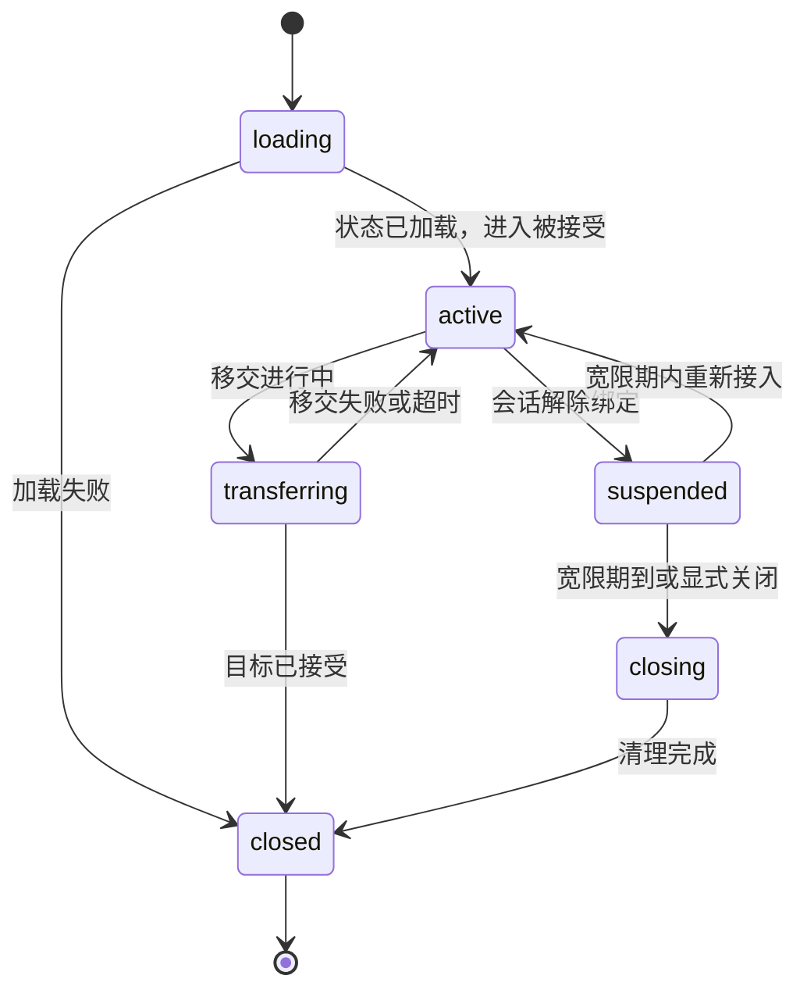

# Avatar 运行时：会话、生命周期钩子、迁移与加载保存

状态：已端到端实现并钉住（设计 2026-10-19 已定；接线于 2026-10-20 → 2026-11-26 落地）。框架有会话、帧协议、握手层与每个 gameServer/crossServer 一个串行调用的 Lua VM，Avatar 运行时已在其上端到端接线——七态预言机模型已实现（include/mistlane/avatar_runtime.hpp，由 avatar.lifecycle 模型测试钉住）并采用[生命周期页](./avatar-lifecycle.md)的扩态集（其勘误 C1–C2），其 Lua 钩子面已接入服务 VM（LuaService 实现钩子桥；avatar.lua 测试钉住参数封送与失败即拒），crossServer 会话接线已实现——跨服加入创建 visiting Avatar（admit_visit）、会话停止把它回服（cross_leave，然后一旦发送队列排空即 release；带数据端点的宿主如此，无端点者保留异常的 close_visit）、重载退役 VM 拥有的全部 Avatar（retire_all），均由 avatar.session 与 avatar.return 测试钉住；归属登录路径也已接线——加入自己区服的加入（realm == return_realm）经 avatar_load→avatar_enter 落 `active`（绑定会话），断开把它 `suspended`（宽限窗口开），宽限内重连不重载直接回 `active`，宽限到后节点 tick 走有序回收（最终保存→`closed`），由 avatar.home 测试钉住——加入的记录来自归属数据端点的一次性 `MLD1 LOAD`（回复延后到它应答之后），由 avatar.home.record 测试钉住——移交链已接线（源侧：脚本经 mistlane.transfer 请求，节点驱动 OWNER → PREPARE → transfer_out → MLD1 SUBMIT/FENCE → MLR1 MIG EVENT DRAINED/FENCE → COMMIT → release，由 avatar.transfer.source 钉住；目标侧：节点轮询协调器的 MLR1 MIG DESTINED 枚举取它目标租约等待的已栅栏缺口，加载冻结快照，经 load(TransferIn) + avatar_transfer_in 构建并落 active 未绑定，确认 READY，协调器发布目的地路由，由 avatar.transfer.destination 钉住；组合链由 avatar.transfer.full 端到端钉住——两侧均真实节点、零 raw 帧驱动），而目标侧 transfer-in 现已播种落地的场景：协调器的 MLR1 MIG DESTINED 应答每条目携带 `<scene>` 字段（`DESTINED <count> [<realm> <character> <id> <generation> <scene>]...`），目标侧把它传给 load(TransferIn)，Avatar 抵达时即持有其移交命名的场景，由场景生命周期模型（scene.lifecycle）与移交钉住测试钉住；Avatar 现已持有其场景引用，脚本经 `mistlane.scene.switch` 移动它（Avatar 保持 `active`、只有其实例引用变化、不保存、不做状态往返；非 `active` 态以该态拒绝码拒、无 `avatar_load` 的节点回答 disabled），由 avatar.scene.switch 测试钉住；而场景生命周期的节点接线已落地（scene.serving：`--scene-def NAME=FILE` / `--scene NAME=DEF` 的定义与常驻实例、摘要校验的真实加载器、按 tick 与持有场景的 Avatar 对齐成员关系，引用名字在宿主上即真实常驻实例）；正常登录链（认证、经新面 `mistlane.data.load` 的角色列表、组合 place/grant/ticket 的入场）也已由 login.entry 端到端钉住；apiServer 归属事实腿也已接线（带签名的 `OWNER` 查询经一条只读 `MLD1 OWNERSHIP` 读取归属数据端点的真实租约/栅栏事实，缺席或不可达来源一律对 NOT_FOUND 失败关闭，由 api.ownership.source 钉住）；apiServer 面的回调类与多监听验收也已钉住（api.callback：一个 apiServer 在两个 http 监听上承载同一脚本、返回后 `mistlane.data.load` 回调记入供跨监听后续读取、带签名的 `/mla1` 拦截与 Lua 路由在每个监听上应答且共享同一受理去重表）；结算（2026-11-26）也已钉住：租约让出后同一 `avatar_save` 钩子被捕获，字符串返回成为回传队列的尾部变更（排在已入队的每个变更之后，未补种的参与者自动补种），而由排空门控的释放如今还等该账目的耐久 ACK；空结算或拒绝的保存不结算任何东西、保持尽力而为（`avatar.settle`，`avatar.return` 另钉释放本身无保存）；场景开关列于[指南](./guide.md)。本页把[模型页](./player-scene-model.md)列为抽取目标的内容（"钩子需要线程/错误/重入/超时契约与迁移期间的规则"）落成契约，为 coordinator 协调的移交切片提供前置设计；职责边界仍是[进程职责页](./process-roles.md)。持久归属与唯一写入权归[跨服回传协议](./cross-return-protocol.md)；实例准备状态归[场景生命周期](./scene-lifecycle.md)；属性 schema、脏追踪与增量同步归[实体契约链](./entity-contract.md)且继续延后。任何新 Avatar API 的实现被客户端协议契约恢复（账本中的协议契约恢复条目）门控。

## 基线：框架现在有什么

| 面 | 当前状态 |
|---|---|
| 会话身份 | `message` 上下文里的帧式会话数字 id；crossServer 加入带 realm/group/room/epoch，参与者加入带 `character`、`generation` 与嵌套 `route` 表 |
| 出向 | 有界 `mistlane.session.send`/`broadcast`（每通道 ~2 MiB、显式原因），推送保持回复顺序，关联（`MLC2`）回显 |
| 身份层 | `MLS1` 服务身份、`MLM1` 上游复用——各自独立的可选层 |
| Lua 执行 | 每节点一个 VM，在 Asio 线程串行调用；保护调用带指令数预算（约 100 万条）拦截失控循环；`message` 出错关会话，`tick` 出错记日志 |
| 节点钩子 | `init`/`start`/`message`/`http`/`tick`/`stop`/`shutdown` 与 websocket 三件套；跨服访问现已触发 `onCrossVisitAdmit`/`Start`/`End`（`End` 在优雅释放时同样触发，与异常关闭一样），归属加入现已驱动 `avatar_load`+`avatar_enter`（断开时 `avatar_leave`+`avatar_detach`），但**尚无专门的归属玩家连接/断开钩子名**——Avatar 生命周期钩子就是该表面 |
| 重载 | SIGHUP 装载候选 VM、切换、经 `stop`/`shutdown` 退役旧 VM；重载重置模块状态且不导出任何东西 |
| 承载 | `mistlane.place(role, namespace?, scope?, callback)` 查询 coordinator 注册表 |
| Avatar | 框架侧运行时已存在：七态、`avatar_load`/`avatar_enter`/`avatar_save`/`avatar_leave`/`avatar_tick`/`avatar_detach`/`avatar_fail`/`avatar_transfer_*` 钩子，以及跨服面（`admit_visit`、`cross_leave`、`release`、`close_visit`、`retire_all`）。无脚本可见 Avatar 对象；归属加入路径已接线（加入→load+enter 落 active、断开→detach 落 suspended、tick→有序回收）；源侧移交调用方已接线（mistlane.transfer → OWNER/PREPARE/SUBMIT/FENCE/COMMIT → release）、目标侧接管已接线（节点轮询 MLR1 MIG DESTINED、加载冻结记录、跑 avatar_load + avatar_transfer_in、从应答播种场景、确认 READY） |

只有 `message` 的节点拥有的是请求处理，不是角色运行时。这个空白正是本页存在的原因：生命周期、状态所有权与迁移需要各自的契约。

## 对象拆分：Session 与 Avatar

| | Session | Avatar |
|---|---|---|
| 拥有 | 客户端连接、其帧式身份、网关上的当前承载路由 | 承载进程上角色的数据与行为 |
| 身份 | 帧式会话数字 id（每链路） | `(来源区服, 角色标识, 承载版本)`——与[参与者上下文](./cross-return-protocol.md)同一元组 |
| 生命周期 | 绑定在连接或逻辑链路上 | 不依赖任何单个连接：断开只解除会话绑定，不解除持久义务 |
| 数量 | 每网关多个；每客户端链路一个 | 每角色至多一个**active**（唯一写入者）；每会话在每宿主至多绑定一个 |
| 携带 | 不自带角色身份 | 永不携带客户端地址 |

Avatar 身份刻意复用参与者上下文元组，让同一形状穿过 `MLC1` 握手、路由记录与 `MLD1` 提交而无需转换。

## Avatar 状态

| 状态 | 规则 |
|---|---|
| `loading` | 已向归属侧请求数据；任何处理器不得瞄准该角色；请求以显式失败拒绝，绝不隐形排队 |
| `active` | 唯一运行 `message` 处理器与 `avatar_tick` 的状态；承载版本为当前值时允许持久写 |
| `suspended` | 会话已断开；不运行处理器；未完成的保存义务仍会执行；宽限期内重新接入直接回 `active`，不重新加载 |
| `transferring` | 移交进行中；无处理器、无 tick；在途工作在移交开始前完成（VM 是串行的） |
| `closing` / `closed` | 顺序清理完成；该角色在本宿主不存在 |

1. 只有框架在状态之间移动 Avatar；钩子在转移的边缘被调用，绝不在转移内部。
2. 钩子失败绝不半发布：加载失败不产生可见 Avatar；移交出失败让 Avatar 留在原地 `active`。
3. `suspended` 绝不接受新参与；它存在是为了完成义务，不是为了承载游玩。
4. 所有宽限期与预算都是实现时命名的配置项，默认值靠实测。

## Lua 钩子面

这些钩子是现有模块契约的补充；`message`/`http` 职责不变。钩子名与签名已在代码中固定：LuaService 实现本钩子面，avatar.lua 模型测试钉住参数封送、avatar 句柄回传与失败即拒。`avatar_load` 是准入开关——脚本未声明它则不承载任何 Avatar，节点也不驱动生命周期。脚本未声明的钩子不是错误：该步骤无事可做；格式错误或抛错的钩子失败即拒。框架把 `avatar_load` 返回的表作为 `avatar` 参数传给后续每个钩子，因此同一个脚本侧 Avatar 到达每一个钩子。

每个钩子的 `context` 携带 `realm`、`character`、`generation`——以及 `session`，运行时已绑定到该 Avatar 的可信会话 id，绝不是客户端自报的字段。未绑定时为 0（归属路径上的 `avatar_load`、刚落地的 transfer-in、断开后的悬挂）；从归属路径的 `avatar_enter` 起它就是加入的那个会话——运行时在入口钩子运行前完成绑定，这使 `avatar_enter` 成为 login/home 绑定时刻：承载合约实体的脚本在 `avatar_load` 里生成其按角色的实体、并在此处归属会话（`mistlane.entity.set_owner(scope, type, incarnation, entity_id, context.session)`），于是加入会话的第一个 owner 调用——先于任何其它业务帧——即按 `caller="owner"` 分派（由 entity.owner.home 钉住）。宽限内重连不驱动任何钩子，故重连会话从旧绑定出发；tick 是刷新点（重复的 `set_owner` 幂等）。

| 钩子 | 何时调用 | 参数 → 返回 | 出错或超时 |
|---|---|---|---|
| `avatar_load` | 本宿主从加载的记录创建 Avatar | `(context, state)` → avatar 表；`state` 是归属加入从其数据端点取到的加载记录（`MLD1 STATE` 载荷，不透明字节串），首次登录（`MLD1 EMPTY`）为 nil | 加载失败：不发布 Avatar，带原因拒绝进入 |
| `avatar_enter` | 会话绑定到 active Avatar | `(context, avatar)` → `true`，或 `false, reason` | 以该原因拒绝进入 |
| `avatar_leave` | 会话解除绑定（登出、迁出） | `(context, avatar)` → 无 | 记日志；绝不阻塞解除绑定 |
| `avatar_tick` | 节点 tick，仅 active Avatar | `(context, avatar)` → 无 | 记日志；Avatar 保留（与 `tick` 一致） |
| `avatar_save` | 唯一的强制保存入口；优雅回传的结算边上其字符串返回即本次访问的最终账目（不透明字节） | `(context, avatar)` → `true`，或 state 字符串（非字符串仅作通知） | 保存失败：上报运维；重试属于发送队列而非钩子。结算边上抛出或拒绝的保存不结算任何东西——尽力而为，释放仍等排空 |
| `avatar_transfer_out` | 本宿主停止承载 | `(context, avatar)` → 状态快照 | 移交中止；Avatar 回到 `active` |
| `avatar_transfer_in` | 本宿主接管承载（已接线：接管轮询加载冻结记录，并在该钩子前落 active 未绑定） | `(context, avatar)` → 无；到达的 `state` 随移交接线到达 | 到达的 Avatar 在本宿主关闭；来源保留其 Avatar |
| `avatar_detach` | 会话断开 | `(context, avatar)` → 无 | 记日志；Avatar 无论如何进入 `suspended` |
| `avatar_fail` | 任一 Avatar 钩子失败或超时 | `(context, avatar, reason)` → 无 | 尽力而为：VM 替换期间可能不运行 |

这张表面有三个要点：

1. **`avatar_save` 是唯一的强制保存入口。** 钩子做的任何事——发消息、推送、进场景——都不清脏状态、不通过副作用触发保存。状态内部什么算脏是实体契约链的问题；单一入口规则是本页的。在优雅回传的结算边上同一钩子会再跑一次并捕获其返回：字符串即最终账目（不透明字节），回传汇点按需补种参与者并把账目排在它已持有的每个变更之后——因此 `release` 仍由排空门控，如今还等账目的耐久 ACK。真值但非字符串的返回、拒绝或没有钩子都是空结算：已入队的变更就是账目，不再额外落一条。`avatar.settle` 钉住尾部序号、自动补种与空结算/拒绝两类面；`avatar.return` 钉住释放本身不跑保存。
2. **状态只经 `avatar_load`/`avatar_save`/`avatar_transfer_out`/`avatar_transfer_in` 进出。** 钩子放在模块全局或 upvalue 里的任何东西都是易失的，按既有重载规则在 SIGHUP 替换时丢失；框架不会导出模块状态。Avatar 不得把模块状态当存储。
3. **每个失败都有命名后果。** 没有钩子失败会悄悄退化成"应该没事"。

## 迁移与移交规则

| 移动 | 发生什么 | 什么随行 |
|---|---|---|
| 同进程切场景 | Avatar 保持 `active`；只有其实例引用变化。不保存、不做状态往返。已接线：脚本调 `mistlane.scene.switch`（其当前引用为 `mistlane.scene.current`），节点从运行时解析该角色的 Avatar 并只改引用——引用是运行时数据、不是预言机转移，故不跑任何钩子、不做保存；非 `active` 态以该态拒绝码拒（avatar.scene.switch） | 什么都不随行——场景生命周期的"不重复加载"规则同样适用于 Avatar |
| 跨进程移交（同区服） | 来源 `avatar_transfer_out` → 传输 → 目标 `avatar_load` + `avatar_transfer_in` → 来源释放。来源保持 `transferring` 直到目标应答；失败或超时则来源 Avatar 回 `active`。两侧均已接线：源侧由 `mistlane.transfer` 驱动（avatar.transfer.source），目标侧轮询协调器的 `MLR1 MIG DESTINED` 枚举取它等待的已栅栏缺口、从应答的 `<scene>` 字段播种落地 Avatar 的场景，并在 `avatar_transfer_in` 后确认 READY（avatar.transfer.destination） | 参与者上下文 + 状态快照 + 场景名。地图不随行 |
| 跨服参与 | 跨进程规则加返回路由；离开只在最终变更集被持久确认后完成，按回传协议 | 参与者上下文 + 快照 + 有界发送队列的义务 |

- 已在执行的处理器在移交开始前结束；`transferring`/`loading`/`suspended` 期间到达的处理器以显式失败拒绝。有界队列留在今天所在的位置：会话与传输层。
- Avatar 拥有的计时器在移交开始时停止，且只在快照声明了它们时重新装填；未声明的计时器不随行。
- 重新连接绝不复活已关闭的 Avatar。本设计中 coordinator 持有按角色的路由记录，把新会话送到当前宿主——线上动词已存在，即 `MLR1 ROUTE SET NS <namespace>`/`MLR1 ROUTE GET NS <namespace>`（`NS` 组必填，路由随成员存亡，GET 回答实时状态），但尚无 Lua 绑定，宿主须经帧式 TCP 使用它们；移交失败让路由留在来源，重入一律走 `loading`。
- VM 替换（SIGHUP）是节点级退役，不是 Avatar 迁移：旧 VM 里的每个 Avatar 获得一次尽力而为的 `avatar_save` 然后关闭；会话在切换后经 `loading` 重入。这保持既有的诚实规则——重载不迁移状态。

## 错误、超时与重入

| 事件 | 后果 |
|---|---|
| 钩子出错 | 上表逐钩子后果；带 Avatar 身份记日志 |
| 钩子超出预算 | 指令数预算中止调用，后果与钩子出错相同。预算数字在实现时实测，不由本页给定 |
| `transferring` 期间断开 | 移交继续；来源/目标的判定不依赖连接 |
| `active` 期间断开 | 运行 `avatar_detach`；Avatar 进入 `suspended`，未完成保存义务仍会执行 |
| SIGINT/SIGTERM | 现有关机顺序运行；Avatar 获得尽力保存。崩溃、SIGKILL 与断电不保证任何事——不变 |
| `avatar_fail` 自身失败 | 记日志；原失败后果不变 |

重入是被构造排除的，不是靠自觉：VM 串行，所以任何两个钩子永不交错；框架绝不在一个钩子运行时调用第二个 Avatar 钩子；message 处理器也不能同步触发生命周期转移——转移被排到处理器边界，风格与 `mistlane.place` 的"返回后回调"一致。这消除的是整类重入问题，而不是要求脚本小心。

## 本页故意未决定

- 属性 schema、脏追踪、增量同步与快照编码：实体契约链，其取代了更早的 Avatar-only 范围并继续延后。
- 客户端协议、绑定与方法暴露：被协议契约恢复（账本中的协议契约恢复条目）门控。原始 `.sproto` 文本源仍未定位，但其字节等价再生物已入库（`contracts/fogs-sproto.sproto`，2026-11-28，probe 的 regen 模式——重编译与已提交 `.spb` 逐字节相等）；原 sprotodump 构建步骤与正式客户端绑定仍缺。服务端脚本/运行时 API 不属本门控范围——未实现的是对客户端的方法暴露。
- 钩子名与签名：随服务 VM 钩子桥在代码中固定（上表记录的是已实现形态）。`avatar_load` 的 `state` 参数已为归属加入接线：带 `--data` 端点的 crossServer 把加入回复延后到对归属数据端点的一次性 `MLD1` `LOAD` 之后，并把记录的不透明负载传给 `avatar_load`，`MLD1 EMPTY`（首次登录）到达为 nil，无法应答的数据端点则拒绝加入。仍开放的是 `avatar_transfer_in` 的 `state`——两侧均已接线：源侧 `avatar_transfer_out` 快照是 MLD1 SUBMIT 的最终载荷（由 mistlane.transfer 驱动），目标侧 `load(TransferIn)` 把冻结记录传给 `avatar_load` 并落 active 未绑定，之后 `avatar_transfer_in` 收到构建好的 Avatar。
- 宽限期、tick 预算与保存节奏：实现时实测。
- crossServer 发送侧的有界重试队列与只读转换：回传协议切片，等持久化链。

## 验证

七态预言机模型已实现并有模型测试（avatar.lifecycle），归属加入、跨服访问、归属加入的延迟记录读取与源侧跨服回传的会话/Lua/传输接线已实现并钉住（avatar.home、avatar.home.record、avatar.session、avatar.return）。正常登录的运行时验收也已钉住：一个脚本经有界双向消息走完认证、角色列表与入场（login.entry）——角色列表腿是新面 `mistlane.data.load`，以一次 `MLD1 LOAD` 读取归属记录（login.data）——放置的宿主按所授权的 generation 准入进入的 Avatar 并承载它。移交链已接线（avatar.transfer.source、avatar.transfer.destination、avatar.transfer.full），同进程切场景已接线并钉住（avatar.scene.switch），移交落地的场景播种也已钉住——DESTINED 应答携带场景、落地 Avatar 持有它（avatar.transfer.destination、avatar.transfer.full，外加 scene.lifecycle 模型）——场景生命周期的节点接线也已落地（scene.serving），Avatar 的场景引用即宿主上的真实常驻实例。归属事实腿也已接线：apiServer 上带签名的 `OWNER` 查询经一条只读 `MLD1 OWNERSHIP` 读取归属数据端点的租约/栅栏事实（api.ownership.source），归属应答因此点名被授权的宿主，而不再只是模型面。apiServer 面的回调类与多监听验收也已钉住（api.callback）：一个 apiServer 在两个 http 监听上承载同一脚本，HTTP 处理器经 `mistlane.data.load` 询问归属数据腿并在应答存在前先答 202，返回后回调把答案记入供后续请求（自另一监听）读取，带签名的 `/mla1` 拦截与 Lua 路由在每个监听上应答且共享同一受理去重表。结算也已被钉住：优雅回传在离开边捕获 `avatar_save`，字符串返回作为最终的顺序变更回传归属，因此由排空门控的释放——本身不跑保存——等该账目的耐久 ACK；空结算或拒绝的保存不结算任何东西、保持尽力而为（`avatar.settle`）。本页点名的运行时验收至此全部钉住。

相关：[玩家、场景与跨服模型](./player-scene-model.md)、[跨服回传与唯一写入权协议](./cross-return-protocol.md)、[场景生命周期](./scene-lifecycle.md)、[实体契约与代码生成](./entity-contract.md)、[Lua 与生命周期](./lua.md)。
