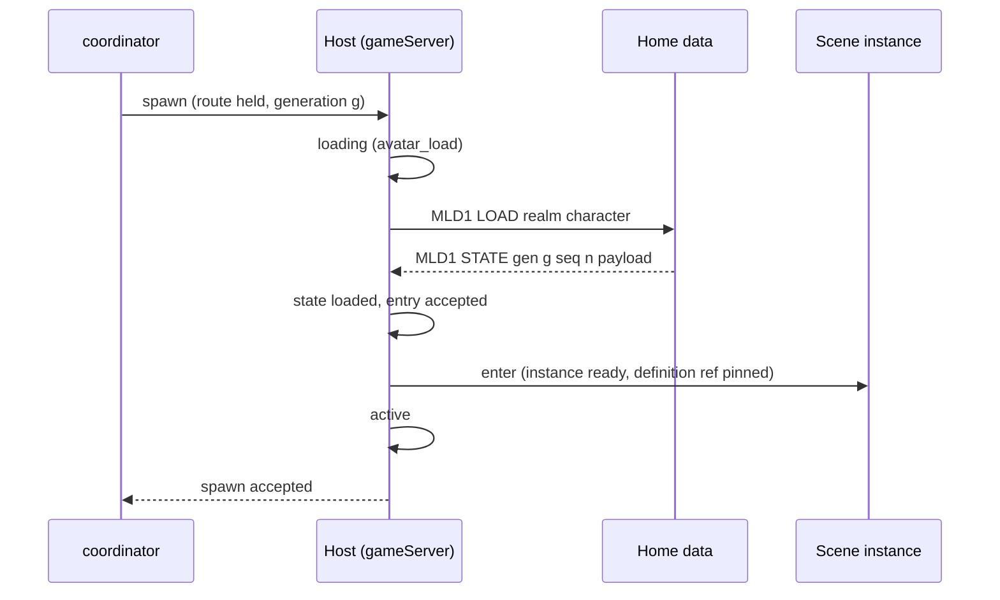
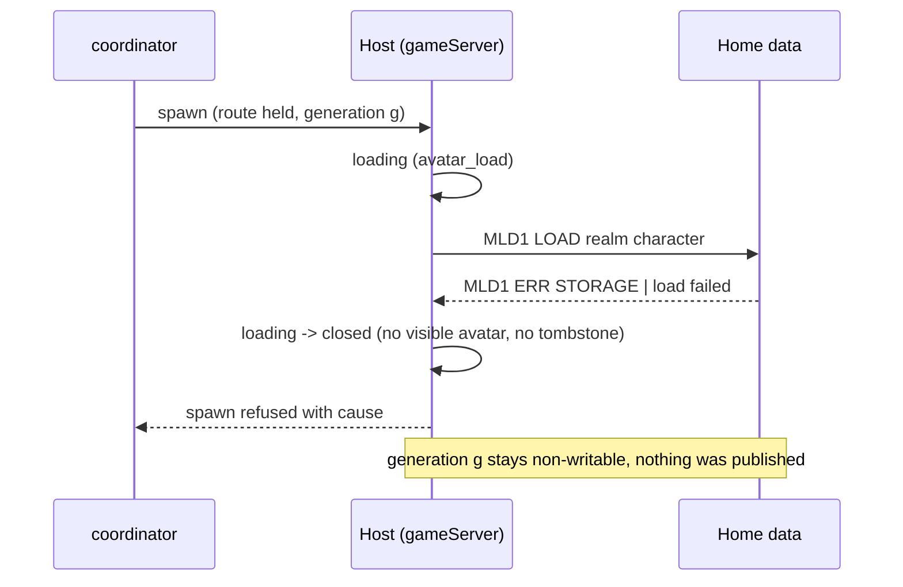
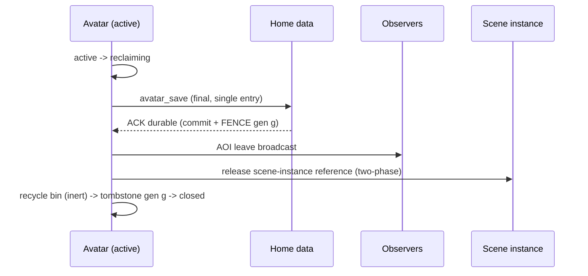
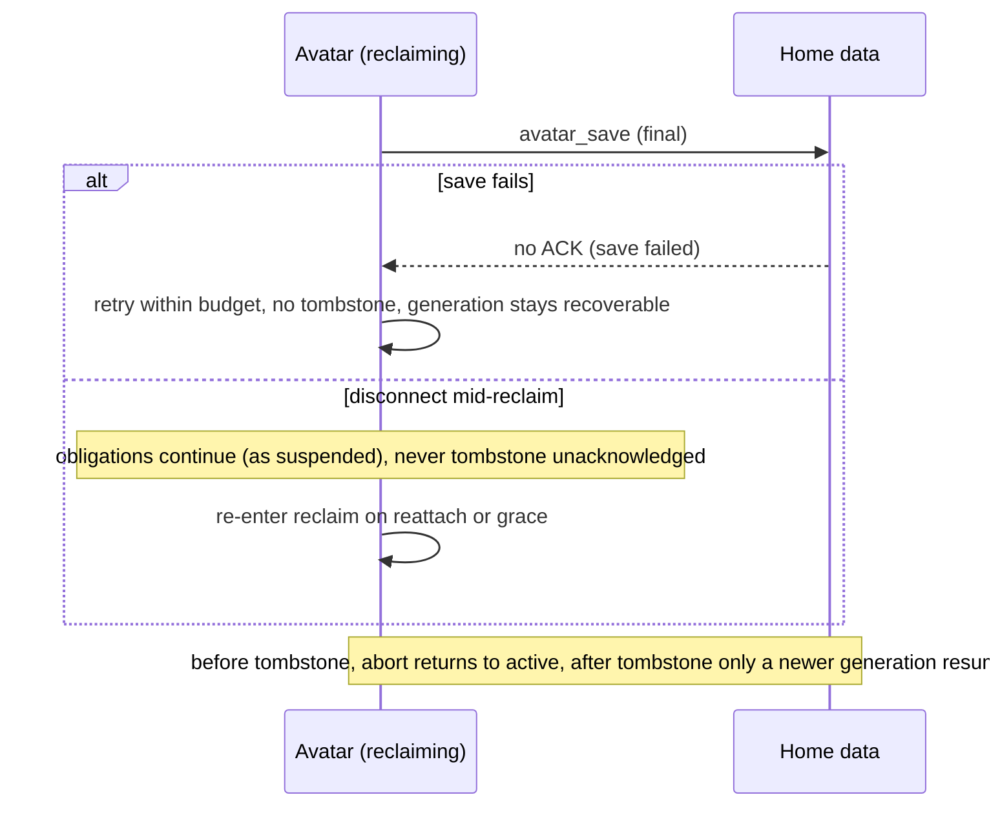

# Avatar 创建/回收运行时契约

状态：已定设计（2026-11-22）。无端到端 Avatar 运行时（七态预言机模型已实现并经模型测试；会话与传输接线为后续切片），本页不改变任何 CLI 行为，下面描述的运行行为仍未端到端实现、未经验证。本页是账本所点（PL-2）的对象创建/回收契约：创建者权限、必填字段与默认值、持久化语义、AOI 广播边沿、销毁义务清单、中途回收与四路径验收。它是[生命周期预言机](./avatar-lifecycle.md)的义务对应页——那页定*状态*，本页定创建与回收*必须做什么*。机器可读形态：`contracts/avatar-spawn-destroy.json`。英文页：[English](../avatar-spawn-destroy.md)。

## 创建者权限

- **只有框架创建 Avatar。** coordinator 发布宿主代；宿主只可为其在当前代持有的路由 spawn。脚本不可调用 spawn。
- **无路由的 spawn**，或对同一 `(realm, character, generation)` 已有 `loading`/`active`/`visiting` Avatar 的重复 spawn，以 `AVATAR_ALREADY_ATTACHED` 拒绝。
- **创建者是宿主，身份是角色。** 对象拆分不变：会话拥有连接，Avatar 拥有角色（[对象拆分](./avatar-runtime.md#对象拆分-session-与-avatar)）。

## 必填字段与默认值

| 字段 | 类型 | 必填 | 默认 | 规则 |
|---|---|---|---|---|
| `origin_realm` | realm | 是 | — | 命名数据域，绝不命名进程地址（跨服回传） |
| `character_id` | id | 是 | — | 在归属域内唯一 |
| `hosting_generation` | generation | 是 | — | 当前宿主分配版本；每次回传提交携带 |
| `load_source` | enum | 是 | `home` | `home`（从归属域加载）或 `transfer-in`（移交目标，续写 `g+1`） |
| `declared_timers` | list | 否 | `[]` | 只有声明的计时器随移交走；未声明者不重臂 |

可调数值（宽限期、tick 预算、保存节拍）是配置，实现时定名并用测量给默认——不是本页。

## 持久化语义

- **spawn 本身不持久化。** spawn 加载记录（`MLD1 LOAD` 或归属域）；绝无副作用写入。
- **spawn 仅在 `avatar_load` 成功后可见。** 加载失败不产生可见 Avatar（avatar-runtime 规则 2）。无"已 spawn 但半加载"态。
- **唯一强制保存入口是 `avatar_save`。** 钩子的任何作为不清脏态、不触发保存（avatar-runtime 性质 1）。

## AOI 广播边沿

| 边沿 | 广播 | 时机 |
|---|---|---|
| `spawn → active` | 出现（位置、身份） | 进入被接受；场景实例已 `ready` |
| `reclaiming → closed` | 离场 | 最终保存已持久，实例引用释放前 |

旧 `enable9Grid` 观察不证明活跃空间 AOI；这些是契约边沿，不是实现声明。

## 销毁义务清单（按序）

顺序是强制的，即[场景生命周期清理](./scene-lifecycle.md#清理与引用释放)顺序应用于该参与者，末尾追加[写入租约交接](./cross-return-protocol.md#写入租约交接)的 `FENCE`：

1. **冲刷** —— 最终 `avatar_save`（唯一入口）确认持久（`ACK durable`，即 MLD1 提交 + 该代 `FENCE`）。
2. **离场广播** —— 对场景观察者 AOI 离场。
3. **引用释放** —— 释放场景实例引用；空间缓存决定是否可逐出（两阶段，晚到的引用不能复活已释放内存）。
4. **回收站** —— 对象保持可寻址但惰性，直到义务完成；绝不在回收中途释放。
5. **墓碑** —— 钉住宿主代；只有严格更新的一代可续（唯一写入权规则）。冲刷未持久前不提交墓碑。

**在途 handler：** 已执行的 handler 跑完；`transferring`/`loading`/`suspended`/`reclaiming` 期间到达的 handler 以该态拒绝码拒绝。handler 不能同步触发生命周期转移——转移调度到 handler 边界。

## 中途回收（`active` 中 destroy）

回收一个 `active`（非 `suspended`）的 Avatar 是独立路径，必须：

1. **排空或拒绝**在途 handler、停止 tick（VM 串行；无两钩子交错）。
2. **跑完整销毁义务清单** —— 冲刷持久、离场广播、引用释放、回收站、墓碑。
3. **仅在最终保存持久后墓碑** —— 唯一写入权规则从不为"稍后保存"放松。

它绝不半发布可见 Avatar、不为未确认变更墓碑、不中途释放对象。

## 四路径验收

### 1. 创建成功

### 2. 失败回滚

### 3. 回收完成

### 4. 回收中断恢复

## 失败补偿

| 中断点 | 保持的态 | 补偿 |
|---|---|---|
| 回收中保存失败 | `reclaiming` | 预算内重试；无墓碑；该代保持可恢复；向运维/应用上报 |
| 回收中断线 | `reclaiming` | 义务继续（如同 `suspended`）；绝不为未确认变更墓碑——只有 `ACK durable` 才成立持久声明 |
| 回收中宿主崩溃 | `closed`（猝然） | 崩溃不保证任何（avatar-runtime）；coordinator 恢复签发严格更新一代 |
| 引用释放被中断 | `reclaiming` | 两阶段释放防复活；重入回收；冲刷未持久前不提交墓碑 |

## 本页刻意未定

- 属性 schema、脏追踪与快照编码：实体契约链。
- 宽限期、tick/保存节拍、重试预算与回收站保留窗口：测量。
- 空间 AOI 实现：广播边沿是契约，不是实现。
- `contracts/entities/Avatar.def` 与 `contracts/types/*.xml`：实体契约链的建议来源，仍延后。

## 验证

- **可机器校验：** `contracts/avatar-spawn-destroy.json` 钉住义务顺序、必填字段与默认值、四路径与失败补偿；夹具 `tests/test_avatar_contract.py`（ctest `mistlane_avatar_contract`）断言不变量（义务顺序、四路径、补偿覆盖、中途回收 never 规则），意外漂移即测试失败。
- **Mermaid：** 四张验收图渲染；`docs:check` 覆盖可渲染、桌面/移动、明暗与展开。
- **运行时验收：** 今天无——组合的出生路径未端到端驱动；模型（avatar.lifecycle）及其接线（会话、移交与场景面）已实现并钉住（avatar.home、avatar.session、avatar.transfer.*、scene.serving）。

相关：[Avatar 生命周期](./avatar-lifecycle.md)、[Avatar 运行时](./avatar-runtime.md)、[场景生命周期](./scene-lifecycle.md)、[跨服回传与唯一写入权协议](./cross-return-protocol.md)。
