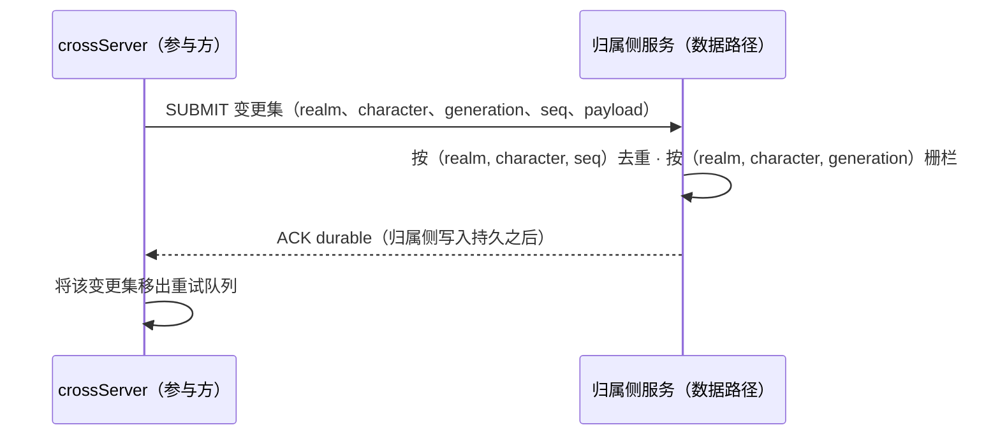

# 跨服回传与唯一写入权协议

状态：MLD1 语法、发送端 ACK 处理和确定性租约状态机已实现（2026-10-19）；持久存储与运行时租约权威尚未实现。参与者上下文、端点和有序队列边界已实现，端点仍只回易失性回执。目标职责见[进程职责](./process-roles.md)；旧路径的观察与缺口在[模型页](./player-scene-model.md)。

## 参与者与返回上下文

进入 crossServer 改变运行位置，不改变账号、角色身份或归属数据域。因此跨服准入必须携带参与者上下文；没有它，crossServer 只承载匿名会话，不得改动持久角色状态。

| 字段 | 含义 | 规则 |
|---|---|---|
| 来源区服 | 角色归属的区服/组 | 必填；命名一个数据域，绝不是 gameServer 地址 |
| 角色标识 | 归属域内的稳定角色 id | 必填；在来源区服内唯一 |
| 承载版本 | 当前承载分配的版本号 | 必填；随每次回传提交携带，由归属侧比对 |
| 返回路由 | 角色如何返回（区服/组/房间或场景引用） | 入场时必填；持久记录不得固化进程地址 |
| 入场凭据 | 进入该跨服作用域的授权 | 已定：login 以区服密钥签发短时效 HMAC-SHA256 凭据；签发/验证未实现，当前上下文仍未获持久写授权 |

`MLC1` 选择扩宽而非追加后续帧：路由字段之后可携带可选尾缀 `ch <角色标识> gen <承载版本> ret <区服> <组> <房间>`，承载参与者上下文，三部分齐备或全部缺省（线格式见[跨服设计](./cross-server.md)）。Lua 随会话收到参与者字段（`character`、`generation` 与嵌套 `route`）；匿名五字段握手保持可用且仍为匿名。签发方已定为 login；C++ 签发/验证原语与凭据传输尚未实现（见[服务契约](./service-contracts.md#login)），当前没有会话拥有验证通过的凭据。**没有通过验证的参与者上下文的会话不能提交持久角色变更**；应用仍可为匿名会话运行玩法。填写 `ch`/`gen`/`ret` 或仅通过 MLS1 都不会授予写租约。

## 唯一写入权

1. 任一时刻每个角色最多存在一个可写 Avatar。归属数据域是持久的记录写入方；crossServer 只持有限定在本次跨服参与内的临时、有界写租约。
2. 租约以承载版本标识。归属侧拒绝任何承载版本不是该角色最新已发版本的提交——迟到或重复的写者不可能靠"最后到达"覆盖更新的状态。
3. 租约过期、心跳缺失或进程崩溃本身绝不产生第二个可写归属。收回租约需要归属侧显式的接管步骤（发新版本、旧版本进墓碑），而不是超时推断。这与职责页"不因心跳超时直接创造第二个权威实例"的规则一致。
4. 断连结束参与，但不结束持久化义务：只有获得 `ACK durable` 的变更具备持久保证。当前 `RECEIVED` 不提供持久保证；未确认的变更只具备下述协议所赋予的持久性。

## 回传与持久化确认（MLD1）

旧路径（跨服字段变更 → `C_SyncDataFromCross` → CrossWorld 按 `wid` 找归属 → 归属 World 提交给归属 Data/Cache）是观察结果而非契约：没有持久确认、没有幂等键，发送不等于提交。crossServer 与归属侧服务之间的目标协议为：



- **提交：**变更集携带参与者上下文、每个 `(realm, character)` 单调递增的序号和载荷。跨服本地状态（场景进度、战斗瞬时结果）不由框架提交——什么算持久角色变更，由应用以 Lua API 的形式声明。
- **确认：**归属侧仅在自身写入持久之后确认。收到但未持久的帧与丢失的帧不可区分，因此发送方把它保留在有界重试队列里。
- **送达：**at-least-once 加归属侧幂等去重。发送方在配置的重试预算内带退避重试；队列满时该参与者对持久写转为只读，并把该状态报告给应用，而不是丢弃或悄悄溢出。
- **顺序：**归属侧对每个 `(realm, character)` 只接受下一序号（`stored + 1`）。发送方按参与者串行提交，后续条目等缺失序号到达后再发；已提交条目在配置预算内重试，耗尽则暴露为回传失败，不静默丢数据。不同 realm 可独立使用相同角色 ID。
- **返回：**角色的最终变更集获得持久确认之前，离开跨服作用域不算完成；在此之前角色仍是登记在册的跨服参与者。确认前的强制路由变更是回传失败（见下）。

线格式沿用共享的 u32 BE 长度分帧，没有每条消息前缀。LOAD/SUBMIT/RECEIVED 已在 `data` 角色实现（见[服务契约](./service-contracts.md)）；ACK durable 目前只有编解码和发送端契约：

```text
MLD1 LOAD <realm> <character>
MLD1 SUBMIT <realm> <character> gen <n> seq <m> [<payload>]

MLD1 EMPTY
MLD1 STATE gen <n> seq <m> [<payload>]
MLD1 RECEIVED gen <n> seq <m>
MLD1 ACK durable <realm> <character> gen <n> seq <m>
MLD1 ERR INVALID | MLD1 ERR STALE gen <n> | MLD1 ERR SEQ seq <n> | MLD1 ERR FULL
```

`ACK durable` 回显精确 `(realm, character)`、generation 与已接受序号。归属 data 仅在同一事务持久提交 payload 和序号后才能发送。发送端匹配当前租约 generation 与下一个持久游标后才删除队列项；`RECEIVED` 只释放传输槽，不清重试队列。畸形字段为 `ERR INVALID`；旧 generation、序号缺口、容量耗尽分别为 `ERR STALE`、`ERR SEQ`、`ERR FULL`。编解码已实现，但持久存储落地前端点不会虚报持久确认。

**键迁移与兼容：**MLD1 已携带 `realm`，当前端点记录只在内存中、重启即清空，因此将内存查找键改为 `(realm, character)` 不需要在线数据迁移。未来若持久表仍只按 `character` 建键，恢复写入前必须回填 realm，并拒绝或显式处理冲突。现有帧语法不变。

端点以 `(realm, character)` 为栅栏和序号键，执行 generation 栅栏和严格连续序号。发送队列每键最多一个在途提交；`RECEIVED` 释放传输槽，但条目保留到 generation 匹配的 durable ACK。当前记录只在 data 进程内，重启后答 `EMPTY`；队列尚未接入 crossServer，持久化、队列满转只读和回服完成仍未实现。

## 写入租约交接

归属 data 是 generation 唯一权威。顺序为 `active(g) → requested(g+1) → relinquished/tombstoned(g) → active(g+1)`：coordinator 请求迁移；源端停止新处理器/tick，等已执行处理完成并冲刷最终有序变更；data 持久提交最终序号并栅栏旧 generation；目标端加载持久游标并起租；目标确认后 coordinator 才发布新路由。重复请求/授权拒绝；墓碑后源端晚到写得 `STALE`。在途处理先完成，迁移期间新请求拒绝，Avatar 计时器停止且只有显式序列化者由目标恢复。C++ 状态机已覆盖栅栏时序，尚未接入 coordinator、持久 data 或 Avatar 运行时。

## 故障处理

| 故障 | 规则 |
|---|---|
| 归属侧不可达 | 在有界队列内重试；参与者对跨服本地状态仍可写，但无法完成返回。任何超时都不得把未确认变更变成已确认。 |
| 发送方提交后、确认前崩溃 | 当前内存发送队列丢失，无自动重放或恢复保证。仅当应用可重建原提交、同一 data 进程仍持有该 generation 与最新序号时，重放才得到重复 `RECEIVED`；data 重启不保留此能力。持久恢复须原子持久化 payload、去重游标及 generation/墓碑，并有可恢复的发送端重放来源；当前两者均无。 |
| 应答丢失（已送达、应答丢失） | 当前重放相同 generation 和最新已存序号只返回易失性 `RECEIVED`，重试条目保留；更旧序号返回 `ERR SEQ`。未来丢失持久 ACK 后须以原幂等键重放并返回已提交的 ACK，通过跨 data 重启测试后才能承诺恢复。 |
| data 进程重启 | 当前 payload、序号与 generation 全丢失，LOAD 返回 `EMPTY`；不承诺去重或写栅栏恢复。 |
| 提交时承载版本不匹配 | 归属侧拒绝并应答当前版本；旧写者停止，结果向运营/应用暴露。不覆盖。 |
| 返回被拒或入场凭据无效 | 角色在该作用域从不成为持久写者；只有已持久确认的变更保留，其余按应用选择保留在队列或丢弃。 |
| 参与期间离线 | 有界队列在 crossServer 进程内活得比连接久；玩家离开不清空它。"有界"意味着最老的条目可以把参与者压成只读——内存安全优先于送达完整性，且该状态可观测。 |
| crossServer 崩溃 | 进程内队列中未确认的提交按设计丢失。只有实际收到 `ACK durable` 才可声明持久，当前端点不会发出它。 |

## 已定决策与剩余工作

- MLD1 的线格式与分帧：随端点实现一并定稿——语法与应答词表见上节；分帧沿用共享的 u32 BE 长度帧。
- 结算、奖励与排行业务规则、跨服场景模板、实际的 Avatar/场景运行时：归后续 crossServer 切片与实体契约链。Avatar/会话运行时契约已在 [Avatar 运行时契约](./avatar-runtime.md) 页定稿；实体属性运行时仍归实体契约链。
- 租约时长、队列界与重试预算：实现时以测量依据给出默认值的配置项，不由本页拍数字。
- 入场凭据签名与签发方已在 login 契约决定：HMAC-SHA256、login、区服密钥。C++ 签发/验证原语、规范凭据编码与传输仍待实现；初始 generation 及推进生命周期见[服务契约](./service-contracts.md#login)。

参与者上下文、端点键、有序队列、ACK 编解码/门控和租约状态模型均已有测试。持久存储链及 crossServer/coordinator/Avatar 运行时接线仍未完成。
