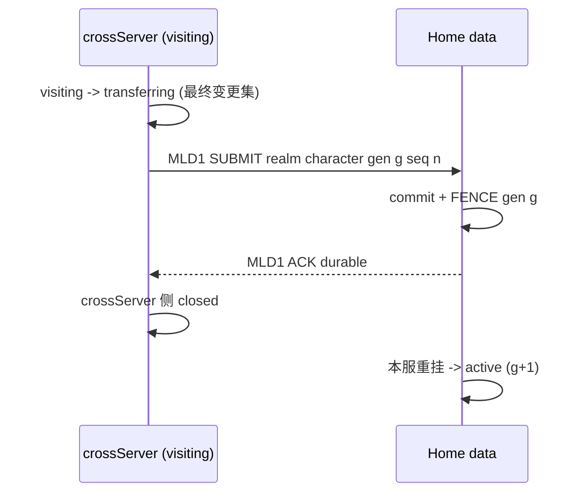
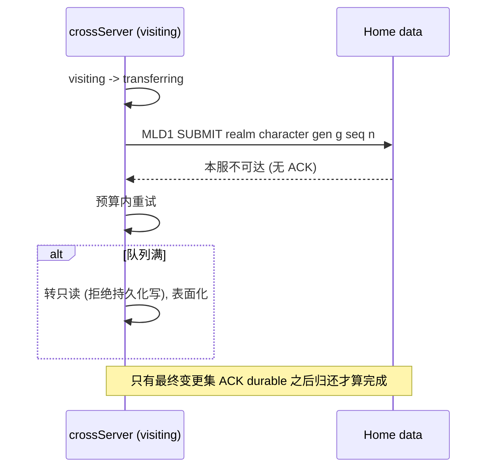
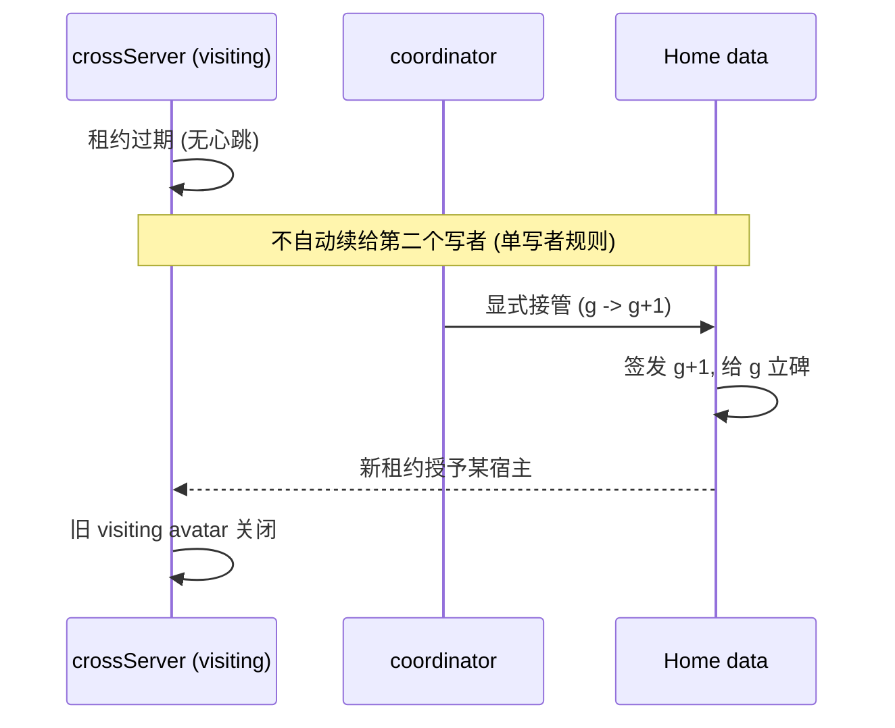
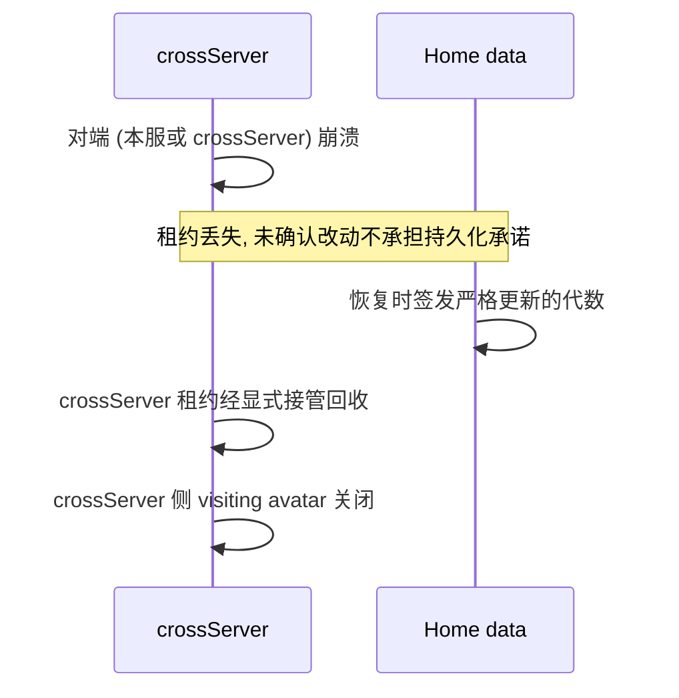

# 跨服会话与租约生命周期

状态：已定设计（2026-11-22）。crossServer 角色、MLC1 握手、准入配额与 PROBE1 就绪探测已存在；MLD1 记录/ACK 通路与发送端队列已实现；协调器协调的移交租约路径已端到端接线（avatar.transfer.source/.destination/.full、coordinator.migration.client），Avatar 场景运行时已在节点上承载 Avatar（scene.serving）。除上述之外，本文内容均未实现、未验证（离线接管/恢复场景与组合的正常登录验收仍为后续切片）。本文是台账 PL-4：跨服会话对象生命周期（创建/活跃/归还/异常终止，`transferring` 落定为 `visiting` 态面）/writer 租约管理面（租约表/心跳/接管/过期回收）/准入控制钩子（`onCrossVisitAdmit`）与过载降级序/事件钩子（`onCrossVisitStart`/`End`、`onLeaseTaken`/`Lost`）。必须与 MLD1 零冲突。机器可读形式：`contracts/cross-server-lifecycle.json`。
跨语言页面：[English](../cross-server-lifecycle.md)。

## 它调和什么

| 层 | 页面 | 已有内容 | 本页补充 |
|---|---|---|---|
| 网络准入 | [跨服与过载保护](./cross-server.md) | MLC1 握手、room/group/shard 配额、PROBE1 就绪、内存包络 | 应用层 `onCrossVisitAdmit` 闸门与过载降级序 |
| 持久化 | [跨服回传与唯一写入权协议](./cross-return-protocol.md) | MLD1 SUBMIT/ACK durable/FENCE、单写者、租约交接 | 运行时租约面与持有租约的 `visiting` 会话对象 |
| 状态 | [Avatar 全生命周期](./avatar-lifecycle.md) | `visiting`（跨服参与、临时租约） | `transferring` 的 crossServer 端落定为 `visiting` 而非 `active` |

## visiting 生命周期

crossServer 托管的 Avatar 是**租约，不是本服权威**（跨服回传单写者规则）。它在 crossServer 侧的生命周期是[迁移路径](./avatar-lifecycle.md#预言机状态机)的 `visiting` 态面：

| 阶段 | 规则 |
|---|---|
| 创建 | 跨服准入通过（`MLC1 OK` + 校验过的入场票据）→ 在 crossServer 创建 visiting avatar |
| 活跃 | `visiting`：临时有界写租约；允许跨服本地写；持久化改动经 MLD1 回传 |
| 归还 | `visiting → transferring`（最终 SUBMIT）→ MLD1 `ACK durable` + `FENCE` → crossServer 侧 `closed`；本服重挂 → `active` |
| 异常终止 | 对端宕机 / 租约丢失 / 准入撤销 / 租约过期接管 → crossServer 侧 `closed`；未确认改动不承担持久化承诺 |

**transferring 展开为 visiting 态面：** PL-1 的 `transferring` 是在途状态；它的 crossServer 目的端落定为 `visiting`（而非 `active`），因为目的端只持有临时租约。同一次迁移的本服源端保持 `transferring` 直到目的端应答。

## writer 租约管理面

| 面 | 规则 |
|---|---|
| 租约表 | 按 `(origin realm, character id, hosting generation)` → 租约记录 `{granted_at, heartbeat, scope, state}` |
| 心跳 | crossServer 以本地定时器续约其临时租约；超过阈值仍无心跳的租约进入过期中 |
| 接管 | 协调者显式接管：本服签发严格更新的代数（`g+1`），给 `g` 立碑，授新租约。**绝不因超时自动续给第二写者**（漏一次心跳不能授权第二个活跃持有者） |
| 过期回收 | 租约过期 → crossServer 冲刷已提交改动、关闭 visiting avatar、不授第二个写者；本服以更新代数恢复 |

## 准入控制与过载降级

**`onCrossVisitAdmit(context)`** 在租约授出之前、网络配额（`ROOM_FULL`/`GROUP_FULL`/`SHARD_FULL`）与票据校验之后运行。它是配额表达不了的应用层闸门（重复登录、realm/组/房授权、业务准入规则）。

**过载降级序**（crossServer 饱和时，依 PROBE1 就绪）：

1. 拒绝新加入（`MLC1 ERR NOT_READY`）。
2. 只放行已校验的重连。
3. 停止授予新租约。
4. 排空并归还既有 visiting avatar。
5. 发送端队列满时拒绝持久化写（转只读，并表面化）。

该序是网络就绪规则（跨服与过载保护）与队列满转只读规则（跨服回传）的并集；先降**准入**，后降**持久化**。

## 事件钩子

| 钩子 | 签名 | 调用时机 |
|---|---|---|
| `onCrossVisitStart` | `(context) → 无返回` | visiting avatar 创建 |
| `onCrossVisitEnd` | `(context) → 无返回` | visiting avatar 关闭（归还或终止） |
| `onLeaseTaken` | `(context) → 无返回` | 本宿主持有租约 |
| `onLeaseLost` | `(context) → 无返回` | 租约过期或被接管 |

## 四路径验收

### 1. 正常归还

### 2. 中断归还

### 3. 租约过期接管

### 4. 对端宕机

## 与 MLD1 零冲突

- 租约面是**进程内的、与 MLD1 线路分离**的；不引入新的线上帧。
- MLD1 仍是**唯一持久化回传通道**（SUBMIT / `ACK durable` / `FENCE` / 序列纪律）。
- 租约的代数就是 **MLD1 已携带的 hosting generation**——无需翻译。
- 心跳是本地定时器；接管经协调者走既有租约闸门态（`requested` / `relinquished` / `tombstoned`）。

## 本文刻意不决定

- 租约时长、心跳间隔与回收阈值：待测量。
- 跨进程租约表或分布式租约存储：超出范围（租约在 crossServer 进程内；持久化是 MLD1 的事）。
- 归还时的业务结算（奖励、排名）：游戏侧的后续 crossServer 切片。框架自身的结算面——访问的最终账目在释放前带回归属——已接线：结算边捕获 `avatar_save` 的字符串返回作为回传队列的尾部变更（见 [Avatar 运行时契约](./avatar-runtime.md)）。
- 重挂路由的 `MLR1 ROUTE` 绑定：仍缺失（avatar-runtime）。

## 验证

- **机器可查：** `contracts/cross-server-lifecycle.json` 钉住 visiting 阶段、租约面、降级序、事件钩子、四路径与 MLD1 零冲突规则；fixture 断言这些不变量，漂移即测试失败。
- **Mermaid：** 四张验收图可渲染；`docs:check` 覆盖可渲染性、桌面/移动、亮/暗与展开。
- **运行时验收：** 部分——crossServer 角色、准入、PROBE1 与 MLD1 记录/ACK 通路已实现并验证（验证记录）；Avatar 事件钩子在 VM 中运行（avatar.lua、avatar.session），协调器协调的移交租约路径端到端驱动（avatar.transfer.source/.destination/.full、coordinator.migration.client），场景运行时在节点上承载 Avatar（scene.serving）——组合的正常登录验收已钉住（`login.entry`），恢复面也已钉住（`entity.migrate.recover`、`coordinator.migration.recover`、`coordinator.migration.journal.recovery`）——仍开放：宿主在移交中途死亡时的离线接管与更广的崩溃面。

相关：[跨服回传与唯一写入权协议](./cross-return-protocol.md)、[跨服与过载保护](./cross-server.md)、[Avatar 全生命周期](./avatar-lifecycle.md)、[进程职责与命名](./process-roles.md)。
