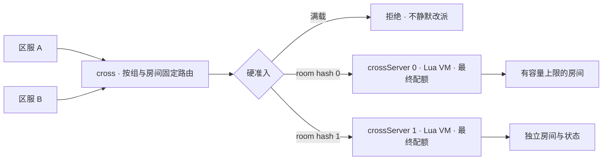

# 原生跨服与过载保护

目标服务名称与职责见[进程职责](./process-roles.md)。本页命令使用当前实际 CLI，不能把 gateway cross routing/crossServer 或 gameServer 视为已经完成的 coordinator/crossServer/gameServer。


## 旧游戏的设计与风险

原始代码显示：区服 World、Gate 与 CrossWorld 协调，多个 CrossHegel 执行跨服玩法。CrossHegel 支持分布式索引，但都连接 serverList 第一项对应的 CrossWorld。跨服 RPC 通过 CrossWorld 转发，并存在 JSON 二次编码；全区服广播及全局业务也在该层执行。增加 CrossHegel 不会自动扩展集中协调层。

特别值得修正的是 ServerManager.pickupCrossHegel：先寻找未达到 HegelLimit 的在线节点；如果都达到上限，仍从在线节点随机挑选继续分配。这个限制属于软偏好，不是硬准入。ServerConnBase.pushQueue 使用 deque 追加，在该入口没有条数/字节上限，也应结合调用路径检查积压。

这些是源码证据，不能直接认定为历史事故根因。需要事故时的 core、内核 OOM 日志、RSS、CPU、连接数、队列字节数、Lua tick 延迟及房间人数来区分崩溃、内存耗尽和处理饱和。开源包仅保留此分析，不携带旧业务源码或生产配置。

## 当前实现



cross 和 crossServer 是 mistlane 的原生角色，使用内部 TCP 帧。相同 group/room 无论来自哪个 realm 都映射到同一 crossServer；不同房间可分布到多个进程。使用固定 FNV-1a 64 位哈希和上游列表取模，不使用实现相关的 std::hash。

每个已准入会话独占一条上游 TCP 连接，两个方向全双工且受每会话输出上限约束，没有共享连接复用、无限应用发送队列或失败自动重放。热点房间满时拒绝加入，不把同一个有状态房间静默拆到其他进程。

### 启动示例

```sh
build/debug/mistlane --role crossServer --listen 127.0.0.1:7201 --script examples/cross.lua --route-epoch 1 --max-room-sessions 16
build/debug/mistlane --role crossServer --listen 127.0.0.1:7202 --script examples/cross.lua --route-epoch 1 --max-room-sessions 16
build/debug/mistlane --role gateway --routing cross --listen 127.0.0.1:7300 --upstream 127.0.0.1:7201 --upstream 127.0.0.1:7202 --route-epoch 1 --max-room-sessions 16
```

上述命令分三个终端运行，均为学习用容量示例，不代表实测承载能力。

### 跨服握手

连接 cross 后，第一个 TCP payload 必须是以下 ASCII 文本，外层仍有四字节大端长度：

```text
MLC1 1 realm-a group-1 room-42
```

房间之后可携带可选的参与者上下文，例如：

```text
MLC1 1 realm-a group-1 room-42 ch hero-7 gen 12 ret home arena r1
```

字段依次是版本标识、route epoch、来源区服、跨服组、房间；尾缀依次为角色标识、承载版本与返回路由（区服/组/房间）。标识符为 1–64 个 ASCII 字母、数字、下划线或连字符，握手最多 1200 字节，够容纳带入场凭据的参与者尾缀。epoch 与承载版本为 1–1000000000 的十进制正整数。参与者三部分要么齐备、要么全部缺省，任何部分声明都按 INVALID 拒绝；匿名五字段握手保持可用。可选最后一组 `tk <hex>` 携带入场凭据：`MLT1` 规范字节加原始 32 字节签名的十六进制，最多 1024 个十六进制字符。凭据必须与尾缀声明的 character 与承载版本一致；匿名握手不得携带凭据；解码失败或超长一律整次握手按 INVALID，绝不从声称持有凭据的参与者身上剥离凭据。cross 先准入、选择 crossServer，再转发握手；crossServer 再执行最终准入并返回 MLC1 OK 1。之后才发送普通应用 payload，Lua message 的第二个参数包含这些路由字段——参与者握手另含 `character`、`generation` 与嵌套 `route` 表（见[Lua 生命周期](./lua)）。参与者字段是路由元数据；配置 `MISTLANE_TICKET_SECRETS` 的 crossServer 会额外验证凭据并在上下文中给出 `verified`；持久角色变更另需[跨服回传协议](./cross-return-protocol)。

失败响应是 MLC1 ERR INVALID、EPOCH、TICKET（所携凭据未通过宿主验证）、ROOM_FULL、GROUP_FULL 或 SHARD_FULL（下游握手不兼容时为 UPSTREAM），然后关闭连接。网络连接、上游错误或节点全局连接上限可能直接关闭，不保证返回错误帧。没有验证通过凭据的成功准入既不是账号认证也不是持久化成功。

### 配额与内存

| 参数 | 默认值 | 含义 |
|---|---|---|
| --max-room-sessions | 64 | 同一 group/room 的连接上限 |
| --max-group-sessions | 128 | 同一 group 的连接上限 |
| --max-shard-sessions | 256 | 单个目标 crossServer 的连接上限 |
| --max-connections | 1024 | 节点连接上限，还受内存准入预算收紧 |
| --memory-budget-mib | 256 | 按每会话 6 MiB + 64 KiB 估算网络缓冲的保守准入预算，默认有效连接上限为 42 |
| --route-epoch | 1 | cross 与 crossServer 必须一致的配置代号 |

cross 的配额按入口进程计算；crossServer 的准入按其全部入口连接统一计算，因此多个 cross 无法绕过该 crossServer 的房间上限。跨 crossServer 的 group 总量目前不是全局一致配额。会话断开、失败和超时均释放本地配额，空房间记录会删除。

配额数的是**连接，不是去重后的玩家**。应用仍需限制重复登录、校验 realm/group/room 授权。该端口仅供可信内网；当前没有 mTLS；入场凭据是已签名的 `MLT1` 令牌，配置 `MISTLANE_TICKET_SECRETS` 的宿主会在握手上验证它。

内存预算在会话创建前限制数量；消息上限 1 MiB，在 TCP 分配正文前检查，Drogon 也配置正文及 WS 消息上限。预算是估算，不是进程 RSS 硬限制，不覆盖 Lua 状态、TLS、分配器和所有第三方缓冲；生产还需实测并配置 cgroup。Lua 生成响应可能在网络大小检查之前分配，不能宣称内存已完全受控。

### 扩缩容、故障与恢复

上游顺序和数量属于路由配置；改变它们会重映射房间。必须先停止新加入、排空受影响房间或做状态迁移，再同时升级 route epoch 和各节点配置。epoch 只能拒绝代号不一致的握手，无法自动验证列表内容一致。

crossServer 不可用时关闭受影响会话，不自动转移或重放。其他 crossServer 继续服务。恢复需要应用提供快照、幂等 request ID、玩家重连及补偿策略。跨节点原子事务、租约、服务发现、持久路由表和在线房间迁移未实现。当前原生支持的是通用路由与准入，不包含旧游戏跨服玩法。

## 如何避免再次因人数集中而失稳

1. 先用真实消息大小与玩法负载测单房间容量，以 tick 延迟、P99 响应时间、CPU/RSS 和发送积压确定硬上限，给 OS/进程保留余量。
2. 热门活动拆成多个独立房间、战场或比赛实例；每个实例只有一个状态所有者。增加 crossServer 可以容纳更多房间，不能让单个超大房间无限扩展。
3. 广播采用 AOI/订阅、合帧、频率上限；避免向全区服逐消息广播。结算与写库通过有界异步流程处理。
4. 在场景入口做硬拒绝或外部有界等待队列，返回重试时间并加抖动，禁止满载后随机塞入和无限重连。
5. 故障演练覆盖 crossServer 宕机、下游变慢、慢读客户端、突发加入、频繁断连、房间满后恢复；持续观察拒绝数、活跃会话、请求字节、tick 漂移、超时及重连速率。

现有自动化验证只证明路由、配额、释放和错误契约，没有持续压测与线上容量结论。内置 `mistlane bot` 可为功能验证提供并发请求负载（见下方运行手册），但持续的生产级压测，以及私有 `/metrics` 之外的运营指标管线，仍待补齐。

## 内部诊断能力现状

可选的内部探测监听器（`--probe-listen IP:PORT`，默认关闭）在 Asio 事件循环上内联应答存活与就绪查询，任何应答本身就证明事件循环仍在推进；TCP 连接和操作系统 keepalive 只能说明传输层可达。旧代码有 Lua 调用超时 hook（`C_monitorDeadLoop`），但没有 CPU/内存 profiler。该 hook 能中断一部分失控 Lua 调用，却不能定位热点函数，也解释不了 native 线程卡顿。

| 信号 | 用途 | 设计边界 |
|---|---|---|
| Prometheus 指标 | 观测活动会话、准入拒绝、收发字节和延迟、Lua 回调/tick 耗时、事件循环定时器延迟，以及可用时的 RSS/CPU | 从私有 metrics 监听端口抓取；标签保持低基数（role/crossServer/result），不使用玩家或房间 ID。 |
| 内部探测 | 报告进程响应性和就绪/容量状态 | 以 `--probe-listen` 提供 PROBE1 协议（见下节）。未就绪时拒绝新加入，但保留现有房间归属。 |
| Crashpad | native 崩溃后保留本地 minidump | 启动独立 handler，使用有界本地数据库；默认不配置上传端点。每个构建归档对应符号。 |
| Profiler | 把 CPU 和内存分配成本归因到代码路径 | 只用外部采样器作用于运行中的进程；不做进程内采样器：自我采样消耗的正是它要测量的 CPU 预算。见下方操作手册。 |

### 内部探测协议（PROBE1）

`--probe-listen IP:PORT` 开启独立的内部监听器，协议为单行文本。应答在事件循环上产生，任何应答都等价于存活证明；编排系统与负载均衡可轮询独立端口，不占用玩家流量。

```
PROBE1 <nonce> liveness    -> PROBE1 <nonce> ok alive
PROBE1 <nonce> readiness   -> PROBE1 <nonce> ok ready|notready active=N capacity=N lag_ms=F
                           -> PROBE1 <nonce> err version|auth|command|malformed
```

- 每个连接一个请求，LF 结尾；应答后服务器关闭连接，空闲连接 2 秒后断开。`<nonce>` 取 `[A-Za-z0-9._:-]{1,64}` 并原样回显，用于丢弃过期应答。
- `liveness` 证明事件循环仍在推进。`readiness` 额外报告是否接纳新会话：`active` 为已建立会话数，`capacity` 为 `--max-connections` 经内存预算封顶后的值（启动日志 `session admission limit`），`lag_ms` 为最近一次 100ms tick 的调度延迟。
- 就绪状态带滞回：当 `active >= --overload-ratio * capacity` 视为饱和，且只有连续 `--ready-hysteresis` 个 100ms tick 才在 ready/notready 之间翻转。默认 ratio 0.9、hysteresis 3。
- 节点环境设置 `MISTLANE_PROBE_TOKEN` 后，请求必须以第四字段携带令牌（`PROBE1 <nonce> <token> readiness`），否则应答 `err auth`；令牌不经过面向玩家的监听器。
- 该监听器按内部用途设上限：请求行超过 256 字节，或并发探测连接超过 64 个，直接关闭且不作答应答。探测连接不占用玩家流量，也不进入 Lua。

cross 节点的上游写作 `IP:PORT[:PROBE]`。带探测端口时，cross 会话仅在转发首个房间加入前询问一次 crossServer：明确 `notready` 以 `MLC1 ERR NOT_READY` 拒绝客户端；连接失败或应答非法以 `MLC1 ERR UPSTREAM` 拒绝。已建立房间不会重复探测，crossServer 未就绪期间继续转发；未带探测端口的上游不做门控。

### 剖析与压测运行手册

Profiler 路线决策（2026-10-18）：采用作用于运行进程的外部采样器。不做进程内采样器：Asio 循环内的采样器消耗的正是它要测量的 CPU 预算，无法说明自身开销。gperftools 虽是 vcpkg port，但基于同样理由不进链接清单；仅当目标主机也封锁外部采样时，才以可选诊断构建重新评估。

本仓库不声称任何采样开销数字：当前开发沙箱无法采集。`perf` 7.0.14 已安装，但 `kernel.perf_event_paranoid=4` 且无 `CAP_PERFMON` 时打不开任何事件（"Failure to open any events for recording"）；`strace -c -p` 报 `ptrace(PTRACE_SEIZE): Operation not permitted`；`eu-stack`/`pprof` 未安装。在目标主机上采集采样开销属于环境演练的一部分：届时在 `CAP_PERFMON` 与 `kernel.perf_event_paranoid<=1` 下执行 `perf record -F 99 -g -p PID -- sleep 30`（若 DWARF 展栈代价过高则回退 `--call-graph fp`），再用 build id 与归档符号匹配做符号化。

可复现的压测不依赖外部工具：起一个 crossServer 加一个带 `--metrics-listen` 的 cross 节点，用内置压测器驱动，并在压测前、中、后抓取 `/metrics`：

```
mistlane bot --url tcp://127.0.0.1:<cross-port> --join "MLC1 1 realm g bench" --clients 32 --count 500
```

`--join` 每条连接先执行一次 MLC1 握手并期待 `MLC1 OK 1`；不带它时 cross 节点会拒绝所有请求。bot 连接同样占用节点的准入配额（`--max-connections` 经内存预算封顶，启动日志打印），因此 `--clients` 要低于该上限，或先调高节点的 `--max-connections`。从同一次抓取读取 `mistlane_request_seconds`、`mistlane_messages_total`、`mistlane_event_loop_lag_seconds`、RSS 与准入拒绝数。只有场景脚本、房间布局、上游列表与压测器参数完全一致时数字才可比；否则只是噪声。

当前可选 `/metrics` 端点导出就绪状态、活动会话、准入拒绝、Lua 回调耗时、RSS、按方向的收发消息数与字节数（`mistlane_messages_total`、`mistlane_payload_bytes_total`）、客户端请求耗时（`mistlane_request_seconds`）、上游错误与截止超时计数（`mistlane_upstream_errors_total`、`mistlane_upstream_timeouts_total`），以及事件循环 tick 调度延迟（`mistlane_event_loop_lag_seconds` 及运行期最大值）。`mistlane_ready` 与探测应答使用同一个滞回准入状态，`mistlane_admission_rejections_total` 同时统计连接上限与 cross 准入拒绝。全部指标只带 role 标签，桶边界固定。Crashpad 可显式启用，并将报告保存在关闭上传的本地数据库。崩溃转储保留限制、CPU/内存 profiler 评估和目标环境过载演练仍待补齐。不会因节点暂时未就绪就自动把有状态房间转移到别的 crossServer。这些诊断能提供过载证据，但仍需目标环境压测才能得出容量结论。


角色转移、归属保存与地图加载边界见[玩家、场景与跨服模型](./player-scene-model.md)；已定的回传与唯一写入权设计见[跨服回传与唯一写入权协议](./cross-return-protocol.md)。
