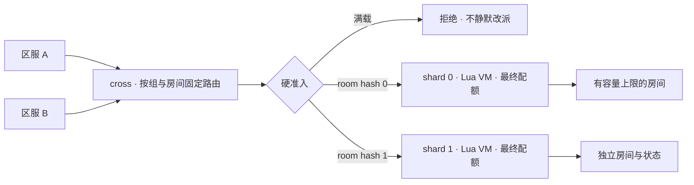

# 原生跨服与过载保护

## 旧游戏的设计与风险

原始代码显示：区服 World、Gate 与 CrossWorld 协调，多个 CrossHegel 执行跨服玩法。CrossHegel 支持分布式索引，但都连接 serverList 第一项对应的 CrossWorld。跨服 RPC 通过 CrossWorld 转发，并存在 JSON 二次编码；全区服广播及全局业务也在该层执行。增加 CrossHegel 不会自动扩展集中协调层。

特别值得修正的是 ServerManager.pickupCrossHegel：先寻找未达到 HegelLimit 的在线节点；如果都达到上限，仍从在线节点随机挑选继续分配。这个限制属于软偏好，不是硬准入。ServerConnBase.pushQueue 使用 deque 追加，在该入口没有条数/字节上限，也应结合调用路径检查积压。

这些是源码证据，不能直接认定为历史事故根因。需要事故时的 core、内核 OOM 日志、RSS、CPU、连接数、队列字节数、Lua tick 延迟及房间人数来区分崩溃、内存耗尽和处理饱和。开源包仅保留此分析，不携带旧业务源码或生产配置。

## 当前实现



cross 和 shard 是 mistlane 的原生角色，使用内部 TCP 帧。相同 group/room 无论来自哪个 realm 都映射到同一 shard；不同房间可分布到多个进程。使用固定 FNV-1a 64 位哈希和上游列表取模，不使用实现相关的 std::hash。

每个已准入会话独占一条上游 TCP 连接，串行请求响应，没有共享连接复用、无限应用发送队列或失败自动重放。热点房间满时拒绝加入，不把同一个有状态房间静默拆到其他进程。

### 启动示例

```sh
build/debug/mistlane --role shard --listen 127.0.0.1:7201 --script examples/cross.lua --route-epoch 1 --max-room-sessions 16
build/debug/mistlane --role shard --listen 127.0.0.1:7202 --script examples/cross.lua --route-epoch 1 --max-room-sessions 16
build/debug/mistlane --role cross --listen 127.0.0.1:7300 --upstream 127.0.0.1:7201 --upstream 127.0.0.1:7202 --route-epoch 1 --max-room-sessions 16
```

上述命令分三个终端运行，均为学习用容量示例，不代表实测承载能力。

### 跨服握手

连接 cross 后，第一个 TCP payload 必须是以下 ASCII 文本，外层仍有四字节大端长度：

```text
MLC1 1 realm-a group-1 room-42
```

字段依次是版本标识、route epoch、来源区服、跨服组、房间。标识符为 1–64 个 ASCII 字母、数字、下划线或连字符，握手最多 256 字节。epoch 为 1–1000000000 的十进制正整数。cross 先准入、选择 shard，再转发握手；shard 再执行最终准入并返回 MLC1 OK 1。之后才发送普通应用 payload，Lua message 的第二个参数包含这些路由字段。

失败响应是 MLC1 ERR INVALID、EPOCH、ROOM_FULL、GROUP_FULL 或 SHARD_FULL（下游握手不兼容时为 UPSTREAM），然后关闭连接。网络连接、上游错误或节点全局连接上限可能直接关闭，不保证返回错误帧。不要把握手成功当成账号认证或持久化成功。

### 配额与内存

| 参数 | 默认值 | 含义 |
|---|---|---|
| --max-room-sessions | 64 | 同一 group/room 的连接上限 |
| --max-group-sessions | 128 | 同一 group 的连接上限 |
| --max-shard-sessions | 256 | 单个目标 shard 的连接上限 |
| --max-connections | 1024 | 节点连接上限，还受内存准入预算收紧 |
| --memory-budget-mib | 256 | 按每会话 6 MiB + 64 KiB 估算网络缓冲的保守准入预算，默认有效连接上限为 42 |
| --route-epoch | 1 | cross 与 shard 必须一致的配置代号 |

cross 的配额按入口进程计算；shard 的准入按其全部入口连接统一计算，因此多个 cross 无法绕过该 shard 的房间上限。跨 shard 的 group 总量目前不是全局一致配额。会话断开、失败和超时均释放本地配额，空房间记录会删除。

配额数的是**连接，不是去重后的玩家**。应用仍需验证玩家票据、限制重复登录、校验 realm/group/room 授权。该端口仅供可信内网；当前没有 mTLS、签名票据或外部身份验证。

内存预算在会话创建前限制数量；消息上限 1 MiB，在 TCP 分配正文前检查，Drogon 也配置正文及 WS 消息上限。预算是估算，不是进程 RSS 硬限制，不覆盖 Lua 状态、TLS、分配器和所有第三方缓冲；生产还需实测并配置 cgroup。Lua 生成响应可能在网络大小检查之前分配，不能宣称内存已完全受控。

### 扩缩容、故障与恢复

上游顺序和数量属于路由配置；改变它们会重映射房间。必须先停止新加入、排空受影响房间或做状态迁移，再同时升级 route epoch 和各节点配置。epoch 只能拒绝代号不一致的握手，无法自动验证列表内容一致。

shard 不可用时关闭受影响会话，不自动转移或重放。其他 shard 继续服务。恢复需要应用提供快照、幂等 request ID、玩家重连及补偿策略。跨节点原子事务、租约、服务发现、持久路由表和在线房间迁移未实现。当前原生支持的是通用路由与准入，不包含旧游戏跨服玩法。

## 如何避免再次因人数集中而失稳

1. 先用真实消息大小与玩法负载测单房间容量，以 tick 延迟、P99 响应时间、CPU/RSS 和发送积压确定硬上限，给 OS/进程保留余量。
2. 热门活动拆成多个独立房间、战场或比赛实例；每个实例只有一个状态所有者。增加 shard 可以容纳更多房间，不能让单个超大房间无限扩展。
3. 广播采用 AOI/订阅、合帧、频率上限；避免向全区服逐消息广播。结算与写库通过有界异步流程处理。
4. 在场景入口做硬拒绝或外部有界等待队列，返回重试时间并加抖动，禁止满载后随机塞入和无限重连。
5. 故障演练覆盖 shard 宕机、下游变慢、慢读客户端、突发加入、频繁断连、房间满后恢复；持续观察拒绝数、活跃会话、请求字节、tick 漂移、超时及重连速率。

现有自动化验证只证明路由、配额、释放和错误契约，没有持续压测与线上容量结论。生产指标采集与压力驱动器尚未集成。

## 内部诊断能力现状

目前 cross/shard 没有进程存活或就绪探测。TCP 连接和操作系统 keepalive 只能说明传输层可达，不能证明 Asio/Lua 事件循环仍在推进。旧代码有 Lua 调用超时 hook（`C_monitorDeadLoop`），但没有 CPU/内存 profiler 或服务间健康协议。该 hook 能中断一部分失控 Lua 调用，却不能定位热点函数，也解释不了 native 线程卡顿。

| 信号 | 用途 | 设计边界 |
|---|---|---|
| Prometheus 指标 | 观测活动会话、准入拒绝、收发字节和延迟、Lua 回调/tick 耗时、事件循环定时器延迟，以及可用时的 RSS/CPU | 从私有 metrics 监听端口抓取；标签保持低基数（role/shard/result），不使用玩家或房间 ID。 |
| 内部探测 | 报告进程响应性和就绪/容量状态 | 使用独立控制监听器、nonce 和截止时间；测量探测往返及事件循环延迟。未就绪时拒绝新加入，但保留现有房间归属。 |
| Crashpad | native 崩溃后保留本地 minidump | 启动独立 handler，使用有界本地数据库；默认不配置上传端点。每个构建归档对应符号。 |
| Profiler | 把 CPU 和内存分配成本归因到代码路径 | 等指标与可复现负载建立后，再提供可选剖析模式；剖析输出不是健康信号。 |

当前可选 `/metrics` 端点导出就绪状态、活动会话、准入拒绝、Lua 回调耗时和 RSS。Crashpad 可显式启用，并将报告保存在关闭上传的本地数据库。内部存活探测、流量/tick 指标、转储生成测试、保留限制和符号工作流仍待补齐。不会因节点暂时未就绪就自动把有状态房间转移到别的 shard。这些诊断能提供过载证据，但仍需目标环境压测才能得出容量结论。
