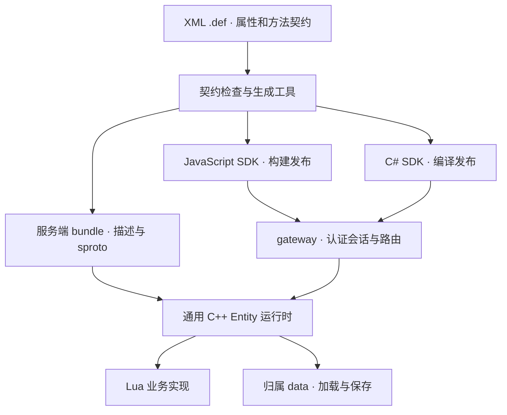

# 实体契约与代码生成设计

> 研究设计笔记。构建期契约校验器、确定性 sproto schema/按字段 C++ 参数结构体生成器、上游 sproto 解码到分发 fixture、进程内实体路由及 RPC 生命周期 harness 已实现；网络运行时和属性同步仍不在当前范围。

状态：构建期实现生成项目 XSD、发布锁、摘要、确定性 sproto schema、C++ 描述符/参数绑定、JavaScript JSDoc 类型与无依赖标量编码器，以及 C# record 类型与标量编码器，客户端受众 JS/C# 绑定（服务器内部方法与 SERVER_ONLY 属性已剔除），以及由 `contract load` 全有或全无校验的逐工件 SHA-256 bundle 清单；复用结构体经 `<TypesSource path>` 引入、由工具解析路径。上游 Lua sproto 请求解码结果传给 `EntityDispatcher`；`EntityRuntime` 提供 fixture 驱动 spawn/route/destroy、重复投递和过期 incarnation 行为。`RpcHarness` 用注入的单调时钟验证关联配对、超时、迟到/重复响应和断连结果。`PropertyStore` 把单个实体的描述解释为受控的类型化属性存储（缺省值、客户端受众视图、只读保留代理、有界路径写入+有序变更日志+结构失效容器句柄），`push_entity_properties` 经同一校验面把该存储绑进 Lua。这些均为进程内 harness；`PersistentStore`（`include/mistlane/entity_persist.hpp`）补充建模持久化闸门——仅当写入落在持久化属性上才推进的 revision、单个在途强制保存、按 hosting generation/观测 revision 的条件保存与提交确认、对未知或非持久化快照键的整体拒绝加载。不代表已有网络实体运行时或存储后端。其余类型映射为 `BOOL`→`boolean`、整数及 `EntityRef`→`integer`、`STRING`→`string`、`BYTES`→`binary`、结构按名称引用、数组使用 `*`。RPC 名采用 `E{entityId}_{Server|Client}_{methodId}`；cloudwu/sproto parser tag 使用 `entityId * 512 + side * 256 + methodId`，entity id ≤63、method id ≤254、tag ≤32766。Avatar fixture 已通过上游 parser 和标准字节向量。JS/C# 输出是最小 SDK 接口，不是完整客户端运行库——现已照原样携带 envelope/应答编解码与直连 Avatar 门面（生成方法表之上的 `EntityClient`/`EntityRpcQueue`：有界类型化准入、超时墓碑、仅幂等换新代号重试、类型化返回与入站通知），由两侧 SDK golden 锁定。详见[路线及验收证据](./bigworld-like-protocol.md#已实现状态与证据)。仍缺网络运行时加载/路由、deadline/cancel 传输传播、hosting-generation 栅栏、生产级 JS/C# codec 及自动属性同步。适用 Mistlane，不调整 Apollo 架构或进程命名。客户端目标为 JavaScript 和 C#；客户端随契约重新生成、构建和发布，服务器的业务契约更新不重新编译 C++ 二进制。

## 设计选择

使用 XML `.def` 作为唯一手写的实体契约，参考 BigWorld/KBEngine 的实体定义组织方式；不是兼容其文件格式或协议的承诺。sproto 是生成的编解码描述，不要求开发者再维护一份 `.sproto`。Lua 实现业务，通用 C++ Entity 运行时加载描述、注册绑定、定位对象、同步属性和提交持久化。

XML 相比直接手写 sproto，能够在同一文件表达实体类型、属性默认值、持久化、同步范围、方法方向和调用权限。使用标准 XML 工具和随工具链提供的 XSD 检查结构；编号、类型引用、兼容性和实现函数存在性由契约编译器/加载器进一步检查。不执行 XML 内容，不展开外部实体，不加载外部 DTD。

通用对象叫 Entity；Avatar、Monster、NPC 等是具体实体类型。Entity RPC 不要求 Base/Cell 分离，不改变 gameServer/crossServer 承载完整游戏对象的边界。服务端方法分组为 `ServerMethods`，客户端方法为 `ClientMethods`。不使用没有对应承载层的 BaseMethods/CellMethods。

参考依据：[KBEngine Avatar.def](https://github.com/kbengine/kbengine_demos_assets/blob/master/scripts/entity_defs/Avatar.def) 展示属性、持久化和按执行侧组织的方法；[sproto RPC 与 schema](https://github.com/cloudwu/sproto#rpc-api)提供请求/响应声明和可在运行时加载的编解码描述。实体归属、同步策略、数据库映射和版本发布由 Mistlane 设计实现。

## 一份契约示例

以下为提议的 Mistlane XML 格式，不是现成的 KBEngine 文件，也不表示已完成解析器。

```xml
<Entity name="Avatar" id="1">
  <Properties>
    <level id="1" type="UINT16"
              default="1" flags="OWN_CLIENT" persistent="true" />
    <hp id="2" type="UINT32"
              default="100" flags="ALL_CLIENTS" persistent="false" />
    <gold id="3" type="INT64"
              default="0" flags="OWN_CLIENT" persistent="true" />
    <inventory id="4" type="Inventory"
               flags="OWN_CLIENT" persistent="true" />
  </Properties>

  <ServerMethods>
    <Method name="attack" id="1" mode="notify" caller="owner">
      <Arg name="target" id="0" type="EntityRef" />
    </Method>
    <Method name="getProfile" id="2" mode="request" caller="owner">
      <Returns>
        <Field name="level" id="0" type="UINT16" />
      </Returns>
    </Method>
    <Method name="applyDamage" id="3" mode="notify" caller="server">
      <Arg name="amount" id="0" type="UINT32" />
    </Method>
  </ServerMethods>

  <ClientMethods>
    <Method name="onReward" id="1" mode="notify" audience="owner">
      <Arg name="itemId" id="0" type="UINT32" />
      <Arg name="count" id="1" type="UINT32" />
    </Method>
  </ClientMethods>
</Entity>
```

- `OWN_CLIENT` 只复制给绑定该实体的客户端；`ALL_CLIENTS` 给拥有者及当前有观察权的客户端，不是全服广播；`SERVER_ONLY` 不下发客户端。没有绑定客户端的实体也可以有属性和服务端 RPC。
- `caller="owner"` 表示仅拥有该实体的认证客户端；`server` 表示仅已授权内部服务。后续允许的其他调用策略须显式定义，默认拒绝。服务端内部调用 owner 方法是否允许也必须在策略中显式声明，不隐式绕过。
- `notify` 为不等待业务返回的一向调用，不代表可靠结算；`request` 有类型化返回、请求关联、期限和错误。客户端方法第一阶段只允许 notify。
- `persistent` 与同步范围互相独立。示例 hp 不持久化只是示例选择；非持久化属性仍可能需要在跨进程迁移快照中携带。
- 初期基础类型支持 BOOL、INT32、UINT16、UINT32、INT64、STRING、BYTES，以及具名 Struct、Array。`EntityRef` 为引擎内置结构，不是数据库主键；包含作用域、运行时实体 ID 和生命周期代号。暂不支持任意 Lua 值、函数、循环引用；新类型必须明确编码和客户端映射。
- JavaScript 的 INT64 使用 `bigint`，C# 使用 `long`；UINT32 等数值有范围检查。JSON 调试/清单不以 JS number 承载 64 位 ID，使用十进制字符串。sproto 整数上限按有符号 64 位处理，不声称支持完整 UINT64。

具名 Struct/Array 和复用定义放在 XML 类型文件中，由构建清单显式列入；同一类型定义只写一次。初期不做实体继承、多重继承或任意可执行表达式，以降低生成、版本兼容和绑定复杂度。随后若需要继承，必须先定义编号与属性冲突规则。*已于 2026-10-20 实现*：`<Contracts>` 内可写 `<TypesSource path="..."/>` 引入同目录 `<Types>` 文档；路径由工具解析——XML reader 自身从不开文件，越界或缺失路径被拒——合入时拒绝重名类型，且文档顺序不再影响校验（类型/缺省检查收拢到 finalize 阶段），被引入类型与内联类型一样进入模型、XSD、锁文件、摘要与各绑定。

## XML 校验与独立库边界

XML 是唯一手写定义格式，实体和复杂类型都直接用 XML；不再为同一属性手写第二份 schema。属性名作为标签，例如 `<level id="1" type="UINT16" flags="OWN_CLIENT" />`。复杂类型在 types.xml 中定义，实体按名称引用。内层字段默认继承顶层属性的同步/持久化策略，不重复声明分发范围。

```xml
<Types>
  <Item>
    <itemId id="0" type="UINT32" />
    <count id="1" type="UINT32" default="1" />
  </Item>
  <Inventory>
    <capacity id="0" type="UINT16" default="20" />
    <items id="1" type="ARRAY" of="Item" />
  </Inventory>
</Types>
```

上述 id 是显式稳定编号，不因使用标签名而省略。类型文件中的具名结构和成员名也要校验；持久化/同步规则由实体顶层属性声明。属性 default 未填写时，按类型定义的统一规则初始化：标量零/false/空串、数组空容器、结构逐字段初始化；显式 default 覆盖对应规则。flags 默认 SERVER_ONLY、persistent 默认 false；未知标记不能默默回落默认值。

已退役编号显式写入而非靠推断：实体下的 `Reserved` 组列出某个含义已退役的确切编号，后续契约不可能静默复用。

```xml
<Entity name="Avatar" id="1">
  <!-- …… Properties / ServerMethods / ClientMethods …… -->
  <Reserved>
    <Property id="5" />        <!-- 旧属性编号，永久退出流通 -->
    <ServerMethod id="9" />    <!-- 已退役的服务端方法编号 -->
    <ClientMethod id="7" />
  </Reserved>
</Entity>
```

保留编号在同一契约中不得仍是活编号、同一种类内不得重复、只允许带 `id` 属性，由此把「该编号已退役」与「该编号空闲」区分开。原型对此全部强制，并把保留编号带入转储、XSD 和锁，使其像存活成员一样参与兼容性检查。

采用 [XML Schema/XSD](https://www.w3.org/TR/xmlschema-0/) 校验结构、必填信息、布尔/数值词法、枚举范围和适用作用域内的唯一键/引用约束；编辑器在装有相应 XML/XSD 支持并正确关联 schema 时提供补全和即时错误。XSD 不会因为文件使用 XML 就自动生效，生成工具与 CI 都必须显式执行校验。

“字段名直接作为标签”意味着通用 XSD 不能预先枚举项目所有成员名。使用宽松 wildcard 仅能保证扩展点存在，不能宣称已经检查未知字段的全部属性。库的契约检查器必须统一校验这些动态标签的合法属性；工具可从解析后的类型模型生成项目专用 XSD，供编辑器及严格校验使用。XSD 是库/工具产物，不让业务手写第二份定义。

原型已实现该生成器（`EntityContract::xsd()`）：枚举已声明类型、实体及其成员，把每个成员的 id 与声明类型钉成枚举约束（重编号或改类型的成员直接通不过 schema），复述封闭词表，并把自身输出回送格式检查，杜绝畸形 schema 发布。

| 检查阶段 | 检查内容 |
|---|---|
| XML/XSD | 文档结构、可用节点/属性、必填字段、枚举和基本值格式；项目专用 schema 补充具体成员定义 |
| 契约语义 | 复杂类型引用、默认值是否符合业务类型、跨文件编号冲突、循环类型/所有权约束、JS/C# 成员名冲突 |
| 发布兼容 | 与已发布锁文件比较，检查保留编号、字段含义/类型变化、客户端兼容和数据迁移需求 |
| 服务加载 | Lua 方法实现存在、描述格式与引擎版本一致，所有绑定就绪后才接入玩家 |

这套机制适合形成独立库和工具链，先在 Mistlane 仓库内以模块边界实现，再按真实复用需求独立发布；本提案不预先创建新项目或起新的库名。

| 可复用模块 | 接入方提供的适配 |
|---|---|
| XML 契约加载、XSD/语义校验、稳定描述模型 | 项目文件清单、已发布版本与兼容策略 |
| 编解码生成与描述、JS/C# SDK 生成 | 选定编解码后端；sproto 为当前首选后端，核心类型模型不依赖它 |
| 类型化 Entity 属性存储、嵌套变更追踪、复制基线与增量应用 | Entity 身份/生命周期、接收者集合、发送调度与连接 |
| 方法绑定与 RPC 编解码/分发 | 认证调用上下文、当前实体路由、消息传输与期限 |
| 持久化快照编解码、默认初始化和版本转换接口 | 归属 data、数据库读写/事务、写入权与提交确认 |

可复用的是契约、属性、绑定与序列化机制；部署、玩家登录及具体玩法仍由接入项目组合。网络消息使用二进制编解码，XML 只在定义/构建/加载阶段解析；不是每次属性变化发送 XML。运行时读取新描述不生成 C++ 业务类，所以已支持能力范围内仍不需要重编服务器。客户端依约生成并重新构建 JS/C#。

## 编号与文件名

实体类型 ID 全局唯一。属性 ID 在实体类型内唯一；方法 ID 在“实体类型 + 方法执行侧”内唯一。参数和结构字段编号在各自结构内唯一。文件名仅用于组织，不参与网络身份；移动或重命名文件不会改变协议。

编号显式写入源文件。契约编译器不得按文件遍历、声明顺序或哈希自动重排。已发布编号不能换含义、改类型或被复用；删除项加入编译器读取的保留编号清单。属性、业务实现方法与引擎保留成员发生名字冲突时构建失败。ServerMethods 与 ClientMethods 的 ID 可相同，但第一阶段实体成员名跨分组不得重复，以避免脚本和生成接口歧义。

生成 sproto 时使用内部唯一名字，例如 `E1_Server_1`，并为该 bundle 内每个 RPC 分配有记录、不可随意变化的 sproto 协议编号。已有映射随发布锁文件保留，编译器只追加分配，不因增加文件而重编号。外层 Entity RPC 的类型/方法编号与内部 sproto 协议编号分别校验映射一致性；业务代码不接触它们。

原型已把这份锁输出为文本（`EntityContract::lock()`）：按声明顺序列出每个存活与退役分配外加模型摘要，仅凭源文档即可复现。已发布版本随包附锁；下一版本对照锁进行比较，不得对任何已列出的项重编号或改类型。

## 生成什么

建议目录：`contracts/entities/Avatar.def`、`contracts/types/*.xml`、`contracts/manifest.xml`；`game/entities/Avatar.lua` 是手写业务实现；`generated/` 只放生成物。构建工具不覆盖已有业务文件，可按需另行导出未实现方法清单或新文件模板。

| 产物 | 用途 |
|---|---|
| 服务端 bundle | XML 规范化后的实体/类型/权限/持久化描述、生成的 sproto schema、Lua 绑定描述、文件摘要及兼容信息 |
| JavaScript SDK | ESM 代理、方法分发、属性访问、类型/范围检查和 `.d.ts`；业务可用 JS，无须改用 TS |
| C# SDK | 强类型实体代理、参数/返回结构、通知处理接口与序列化描述；结合通用客户端运行库构建 |
| 检查报告 | 未实现方法、冲突、保留 ID、契约差异、客户端兼容和数据迁移需求 |
| 数据操作描述 | 持久化快照编码/解码描述和显式迁移计划；不在服务启动时自动执行破坏性 DDL |

拟增加 `mistlane contract check`、`mistlane contract build` 子命令。它们调用离线工具链；生成契约不运行在线游戏进程，也不编译 C++。首期引擎仍需一次开发编译以接入 Entity 运行时和 sproto；此后的受支持业务定义不再生成/编译 C++ 类型。

服务器以通用描述解释器动态建立 C++↔Lua 绑定。加载时验证每个方法实现存在、实现表没有未知/保留入口、默认值合法、依赖齐全；在监听和发布就绪之前失败，而不是首个玩家调用时才发现缺失。

客户端 SDK 依赖一个通用 JS/C# 运行库。sproto 的 JS/C# 实现或生成器必须先通过统一二进制样本验证，不预设任何第三方绑定已经可靠可用。第一阶段类型集合与双端编解码先做最小原型，再实现完整实体功能。

## 开发者实际写什么

服务端 Lua 只实现声明的方法和生命周期钩子。方法所在实现文件由发布清单绑定，文件名不作为在线路由地址。

```lua
local Avatar = {}

function Avatar:attack(ctx, target)
    -- 还需验证距离、冷却、目标存在及场景关系。
    -- ctx 是引擎提供的只读调用上下文，不取自客户端参数。
end

function Avatar:getProfile(ctx)
    return { level = self.level }
end

function Avatar:applyDamage(ctx, amount)
    self.hp = math.max(0, self.hp - amount)
end

return Avatar
```

`self` 是受控 Entity userdata，不是任意可写业务 table；声明的属性可按类型赋值，引擎记录变化。`self.client` 等代理只读，不能被属性或脚本替换。业务函数存于独立实现表，由引擎绑定，不允许客户端按任意字符串访问 Lua 表。

客户端的主要交互入口就是登录完成后取得的 Avatar 对象。引擎创建并绑定该对象，业务直接调用它的方法、读取它的同步属性、接收它的通知；不暴露 `.server`/`.client` 两层代理。客户端的 Avatar 与服务端的 Avatar 通过同一份契约对应，并非客户端持有服务端 Lua 对象的内存引用。

- `avatar.attack(...)`：生成的方法自动发起服务端 RPC。
- `avatar.level`：读取引擎维护的本地同步属性，不为每次读取发 RPC；修改由服务器决定。
- `avatar.onReward`：客户端接收契约中的通知，通知到达时由引擎调用。

默认只有自己的 Avatar 暴露面向玩家的 RPC 方法。观察到的 Monster、NPC 或其他玩家以可见状态呈现，不因存在客户端副本就允许任意调用其服务端方法；操作请求仍从自己的 Avatar 发起。服务端的通用 Entity RPC 保留，权限由引擎处理。

拟生成的业务调用外观：

```javascript
// JavaScript：当前玩家的实体代理由已认证会话取得。
avatar.attack(monster.ref);
const profile = await avatar.getProfile();
const level = avatar.level; // 本地同步属性
avatar.onReward = (itemId, count) => showReward(itemId, count);
```

```csharp
// C#：SDK 异步形式在首期确定为 Task，调用支持超时/取消。
avatar.Attack(monster.Ref);
var profile = await avatar.GetProfileAsync();
var level = avatar.Level; // 本地同步属性
avatar.OnReward += (itemId, count) => ShowReward(itemId, count);
```

```lua
-- 服务端通知；引擎经当前玩家的原 gateway 路由发送。
self.client:onReward(itemId, count)
-- 内部实体引用的调用遵循同样的契约、权限与期限规则。
target:applyDamage(amount)
```

上述均为拟实现接口。JS 以订阅回调、C# 以事件/处理接口接收通知；客户端复制属性只读，由服务器更改。服务端的 self.client 表示反向通知客户端，与客户端直接使用 Avatar 的入口不同。不是每个 Entity 都有绑定客户端；没有绑定或已离线时返回明确投递状态，不自动加载玩家或排队无限缓存通知。

### 绑定如何产生

工具先把 XML 解析为同一份类型描述模型，完成引用解析、编号和兼容检查，再分别输出服务端描述及客户端代码。以 attack 为例，模型记录实体类型 1、服务端方法 1、允许 owner、一个 EntityRef 参数。生成的 Avatar 类把 JavaScript attack 和 C# Attack 直接作为对象方法，它们内部调用通用 RPC 运行库；它们根据生成的描述编码，而不是各自再维护消息编号。

服务器加载同一描述，按发布清单加载 Avatar.lua 返回的实现表，找到 attack 函数并登记到 `(类型 ID, 执行侧, 方法 ID)` 分发表。收到调用后先校验，再以目标 Entity userdata 和只读 ctx 调用该函数。属性通过通用 userdata 的索引/赋值入口访问描述指定的类型化存储。新增业务属性和方法只改变描述、Lua 实现与客户端生成代码，不要求 C++ 增加成员或函数。

客户端生成器还必须检查各语言的保留字、大小写转换和 Async 后缀冲突；服务端名称合法不代表生成的 C# 成员名一定无冲突。生成器与三个运行库的格式版本也进入 bundle 清单，旧引擎遇到不支持的描述格式必须拒绝加载。

## Entity RPC 的运行链路



调用包携带作用域、目标实体 ID/生命周期代号、类型与方法 ID；request 另有请求 ID、期限，内部路由带承载代号。契约摘要放在客户端握手与内部服务身份里、不放进每个调用：gateway 路由本就把会话过滤到兼容宿主，逐次重复 64 位摘要只增带宽而无安全收益。认证主体来自连接与内部认证，不能相信包内自报的 owner/caller。接收端验证实体类型、方法暴露、拥有关系和参数；业务仍校验玩法条件。

实体引用不向业务暴露固定 IP 或承载进程。跨进程调用需要可更新的当前承载路由；迁移期间通过有界队列/重试或明确错误处理，旧承载代号不能继续写入。相同进程也走一致的权限和调度入口，避免同步重入。第一阶段不承诺 RPC 恰好一次：超时结果不明，禁止对非幂等玩法静默重试，结算使用业务操作 ID 去重。每连接/实体队列、请求数、包大小和执行时间均需上限。

## 调用 envelope 与错误协议（已代决；规范进程内编解码已实现）

下面的 envelope 固定目标网络调用字段。进程内 `EntityRuntime` 与 `RpcHarness` 夹具已实现寻址及部分生命周期结果；有界 `RpcQueue`（`include/mistlane/entity_runtime.hpp`）为内部调用设闸——容量溢出是类型化 `CAPACITY` 拒绝、期限与取消分别显式为 `TIMEOUT`/`CANCELLED`、迟到应答丢弃，非幂等超时绝不静默重试（重试须显式声明幂等且换新代号，投递层对被烧代号回 `CONFLICT`）。规范 envelope 字节与序列化错误应答已实现为进程内编解码（`include/mistlane/entity_envelope.hpp`），并照原样生成进 JS/C# 绑定（两侧 SDK golden 锁定），但尚无线上动词在真实传输上承载它们。字段语义已定，真实传输绑定尚未实现。

实体调用是现有传输分帧（MLC1/MLC2/MLM1 帧或客户端会话通道）内的一种载荷，不是新的 TCP 协议，仍在 1 MiB 有界帧内。字段顺序：

- `scope` u32 —— 由配置里的 realm/scope 列表解析出的作用域 id，不传字符串。
- `type_id` u32 —— 契约锁中的实体类型 id，不传字符串。
- `entity_id` i64 —— 运行时实体 id（INT64 映射为 JS `bigint` / C# `long`）。
- `incarnation` u32 —— 该实体实例的代号；路由与快照都携带它，对已知实体 id 但未知代号应答 `STALE`，绝不错投。
- `side` u8 —— `server` 或 `client`；决定用哪套方法 id 空间查描述。
- `method_id` u16 —— 各自空间内编号；notify 还是 request 由描述决定。
- `correlation_id` u64 —— 调用方分配，应答原样带回；`0` 表示 notify（无应答）。有界：SDK 不得猜测，也不得在未有应答时复用。
- `hosting_generation` u32 —— 仅内部路由；接收宿主断言它等于自己的当前持有代号。客户端发起的调用为 0。
- `deadline_ms` u32 —— 调用方剩余预算毫秒数；单调、不是墙上时钟承诺。会超期的 request 应答 `TIMEOUT`，即使操作已完成，因为迟到的应答不可用。notify 也带预算，使过载宿主能拒绝任务。
- payload —— sproto 编码的参数；request 应答携带类型化返回。

内层实体 `correlation_id` 与外层传输关联 id 刻意独立：gateway 用自己的有界表把客户端外层关联映射到内层实体 request 再映射回来，因此一条客户端通道可以复用多个实体 request，而不消耗传输关联 id。

规范进程内编解码固定字节形态（`entity.envelope` 用例）：按上述字段顺序的 39 字节定长大端头，其后剩余字节即 payload（`side` 字节 `0`=client、`1`=server；envelope 不携带调用方身份）。一个 request 只应答类型化返回（`0x00` + payload）或封闭 `EntityError` 之一（`0x01` + 错误码字节，仅 `INVALID` 追加长度前缀的 `reason`）。`EntityRuntime` 执行栅栏：内部调用的 `hosting_generation` 不等于实体当前持有代号即应答 `STALE` 且不占用关联槽位，与 MLD1 持久栅栏一致；`0` 表示客户端发起的调用，不做代号断言。

**错误是一个封闭、随契约摘要版本化的集合**（`EntityError`），不是业务自定义的自由体。一个 request 只可能应答其中之一：类型化返回，或单个 `EntityError`。二者不并存，不允许部分返回，该错误就是这个关联 id 的终答。

| 编码 | 含义 |
|---|---|
| `INVALID` | envelope 形态错误、编码错误或 schema 拒绝的字段组合；唯一允许带 `reason` 字符串的错误，用于诊断 |
| `UNROUTED` | 当前没有 `(type_id, entity_id)` 的路由或持有者 |
| `STALE` | 实体 id 已知，但不是这个代号 |
| `FORBIDDEN` | 调用权限拒绝该方法：不是拥有者、不是已授权服务，或从服务端调用客户端方法 |
| `TIMEOUT` | 期限在完成前到期 |
| `CANCELLED` | 调用方取消 |
| `NO_IMPLEMENTATION` | 描述声明了该方法，但加载的实现表没有绑定 |
| `NOT_READY` | 宿主在排空、未就绪，或此处并不持有该实体 |
| `CAPACITY` | 有界队列或准入控制拒绝该请求 |
| `CONFLICT` | 业务级冲突，例如写入代号丢失或操作 id 重复 |

接收端按此顺序校验，取首个失败即应答：envelope 形态 → 描述查找（`type_id`、`side`、`method_id`）→ 权限 → 实现绑定 → 代号/持有 → 参数解码 → 参数取值检查。权限在解码参数之前校验，未授权调用方不能从畸形载荷学到任何东西。未知错误编码由客户端视为 `INVALID`；编码随契约摘要版本化。

**决策与被拒方案**：自由形式逐方法错误载荷——没有封闭集合，客户端无法机械处理，拒；notify ACK——把单向调用变成第二个请求通道、流量翻倍，且与「notify 不代表持久结算」矛盾，拒；把传输关联 id 复用为实体关联 id——gateway 的外层关联在客户端跳已被消费，两级必须独立编号才能复用，拒；部分失败返回部分结果——对复制与持久化语义含糊，拒；把错误编码放进 sproto schema 而非宿主/SDK 的封闭枚举——错误集合是传输策略而非业务数据，逐契约重新定义会破坏共享客户端 SDK，拒。

## 自动属性同步

初次创建客户端实体、重连或进入观察范围时发送可见属性全量，后续发送变化的属性 ID/值与复制序号。退出观察范围撤销副本；再次进入重新发基线。数据包过期、缺少基线或出现序号缺口时重新同步，不能把增量当全量。持久化版本与复制序号分别管理。

Lua 属性赋值由引擎追踪；Struct/Array 必须是受控代理，嵌套赋值、增删和数组操作也记录变化，禁止通过 raw table 绕过。嵌套变更按下文的路径增量处理；全值替换仅作为明确的初始化/替换或重建基线机制。客户端同样生成只读属性视图及属性变化回调。

OWN_CLIENT 与 ALL_CLIENTS 先以已认证拥有关系和场景观察集合过滤；这不等于已经实现空间 AOI。普通属性按同步周期合并最后值，不能替代有顺序要求的业务事件。敏感属性即使在服务器完整描述中存在，也不得出现在未授权客户端快照中。

### BigWorld 与 KBEngine 的核实结果

BigWorld 原始 Server Programming Guide 的[属性回调章节（存档）](https://howarduong.github.io/github.io/doc/html/server_programming_guide/ch06.html)分别说明顶层替换、嵌套修改的 setNested 回调，以及数组增删的 setSlice 回调；不能把 BigWorld 描述为只检测顶层赋值。

对 KBEngine 当前公开 master 的静态追踪：实体[赋值入口](https://github.com/kbengine/kbengine/blob/master/kbe/src/lib/entitydef/entity_macro.h)调用 onDefDataChanged；[普通 FixedDict 下标赋值](https://github.com/kbengine/kbengine/blob/master/kbe/src/lib/entitydef/fixeddict.cpp)进行类型检查和容器更新，[数组 Sequence 修改](https://github.com/kbengine/kbengine/blob/master/kbe/src/lib/pyscript/sequence.cpp)进行元素/切片更新，未见这些路径向属性所属实体发送变更通知。因而不能把普通容器原地修改当作已自动触发客户端复制；EntityComponent 的属性通知是另一条机制。该结论限定所检查版本与路径，不代表所有分支或自定义实现。

没有找到“只处理顶层是为了性能/循环依赖”的作者说明。可推断顶层处理降低所有权链和增量协议的实现复杂度，但整个大容器重发可能增加带宽；这不是其原作者动机的证据。循环引用应由值类型和所有权规则约束，与是否支持嵌套增量分别设计。

### Mistlane 的目标行为

属性同步作为 Entity 核心模块，不交给业务手写 RPC 补齐。服务器业务直接修改受控属性：

```lua
self.hp = 90                         -- 标量变化
self.inventory.items[3].count = 5     -- 嵌套字段变化
self.inventory.items:append(item)    -- 数组插入
self.inventory.items:removeAt(3)     -- 数组删除
```

inventory 及其类型须先在契约中声明；上述为行为示意，不是当前可运行代码。引擎发现修改、按契约过滤接收者并发送变化；客户端直接从 avatar 属性读取结果，不重新请求整个背包。标量、固定结构、数组元素/增删都必须覆盖。不可变 STRING/BYTES 通过重新赋值追踪；不对其内部字节提供原地修改入口。

目标采用嵌套增量，不把“改一个物品字段就重发整个背包”作为正常同步方案。顶层全值替换保留给初始化、显式替换、重新建立基线或增量成本高于全值时的受控回退；即使最小原型先只实现标量，也不能据此宣称完整属性同步已完成。

1. **追踪**：C++ 持有属性存储，Lua userdata 为受控入口。嵌套容器记录所属实体、顶层属性与父节点；修改沿所有权链登记路径，不每帧深比较全部实体。业务无需再调用 setDirty 或把同一个容器重新赋回顶层。*核心已于 2026-10-20 落地*：`PropertyStore` 路径写入按序记日志并做子树吸收，结构代数使旧容器句柄失效；Lua 绑定对结构/数组属性返回活嵌套代理（Lua 1 基下标换算为存储 0 基路径，数组只经 `:insert`/`:append`/`:remove` 增删，日志对 Lua 写入与 C++ 一视同仁——见验证记录）。*进程内投递已于 2026-10-20 落地*：`PropertyChannel`/`SyncReceiver`（`include/mistlane/entity_sync.hpp`）进入即投可见基线、其后按逐观察者序列投过滤后的增量批次，整批原子应用、遇缺口整批拒绝并 resync；线上传输、重连与持久化仍开放。
2. **变更表示**：顶层属性 ID + 结构字段 ID/数组下标路径 + 操作 + 新值。结构字段 ID 来自契约；数组在线协议统一使用零基下标，Lua 一基由绑定转换。数组插入/删除以有序切片操作表达；接收者只在匹配的基线/序号上按顺序应用。
3. **合并与回调**：没有结构变化时，同一路径重复赋值可合并最后值；数组插删、父节点替换前后的子路径不能无条件合并。客户端先原子应用一批属性变化再触发生成的属性回调，避免 UI 读到半批数据。回调是属性机制提供的入口，无需手写 ClientMethods 通知。
4. **所有权与循环**：属性是有界的类型化值树，禁止循环引用；同一可变容器不能同时属于多个属性/实体，赋值采用校验后的值复制。被替换/移除的旧容器句柄失效，继续写入明确失败。跨实体关系用 EntityRef/数据库身份，不在属性树中嵌入另一个 Entity 对象。初期拒绝按值递归类型，并限制深度、元素数、值大小和每批变化量。
5. **同步与保存**：嵌套变更同时标记所属持久化属性，但客户端增量与数据库提交分开；网络按路径发增量，首期数据库仍可保存整个持久化快照。复制序号、数据 revision 各自确认。背压导致积压时有明确合并/重建基线策略，不能无限累积路径日志。*保存闸门模型已落地（2026-10-20）：*`PersistentStore`（`include/mistlane/entity_persist.hpp`）以仅持久化写入推进的 revision 自动标脏、按写入方 hosting generation 与观测 revision 为保存设闸、只确认在途回执——发送不清脏；数据库提交侧仍开放。

应验证嵌套赋值、嵌套数组、头尾插删、先删除再修改、先子修改再父替换、跨属性复制、循环拒绝、旧句柄、重复值、基线丢失、混合版本观察者和保存并发。性能测试比较“大背包只改一个物品”的实际发送字节、分配次数和 CPU；不能只统计赋值接口耗时，也不预设增量对所有大小都更优。

## 数据加载、序列化与保存

只有声明 persistent 的属性进入持久化快照；所有实体不强制拥有数据库记录。`EntityRef` 的临时运行时 ID 不作为永久外键，永久关系使用独立数据库身份及类型信息，加载时重新解析实体引用。Socket、Lua 函数、client 代理与 C++ 指针不序列化。

第一阶段建议以通用 MySQL 记录保存：`entity_type_id + db_id` 为逻辑主键，附带数据 schema 版本、提交 revision、写入权 generation 和 sproto payload。数据属于明确的 home 域；只有归属 data 持有数据库访问权限。需要查询/唯一约束的字段另做显式索引投影和迁移，不把所有属性默认映射为 SQL 列。

加载路径：data 读记录 → 按记录版本解码 → 执行显式数据迁移/补默认值 → 校验 → 在取得写入权的宿主创建 Entity → 调用加载钩子 → 发布就绪。新对象与加载已有对象分开，缺记录不能默默覆盖创建，损坏数据不能以默认值冒充成功。

保存路径：引擎收集持久化变更 → 归属 data 按 generation/revision 条件写入 → 数据库提交确认 → 确认该批 revision。写入期间的新变化继续保留，不在发出消息时清空；冲突/超时/失败须明确反馈。周期保存与迁移/退出保存共用该机制。*进程内保存闸门已落地（2026-10-20）：*捕获/栅栏/确认一半已建模并以 `entity.persist` 单测（整体拒绝加载、契约新增属性补默认值、generation 单调前进）；尚无存储后端。

业务只保留一个强制保存入口，不使用含糊的 sync。提议放在只读引擎命名空间：`mistlane.entities.writeToDB(entity, callback)`，避免占用业务实体的方法名；这是方案中的待实现 API。回调只确认调用时捕获的持久化 revision 已提交，之后的新修改不自动包含在该确认中。它不是客户端同步接口，也不是支付多表事务的替代品。

未知字段不能在旧进程重写快照时被无声丢弃：新数据 schema 写入后，旧宿主须拒绝加载/写入或使用已验证的保留转换路径。删除、重命名、类型变化和回滚均需数据迁移策略；数据库恢复不能只靠替换 XML。

## 服务器不重编的边界和两种更新

| 修改 | C++ 重编 | 发布方式 |
|---|---|---|
| Lua 业务实现，契约不变 | 不需要 | 同进程安全点切换实现，或新进程迁移 |
| 已支持类型的属性/方法/参数变更 | 不需要 | 生成新 bundle 与客户端 SDK，新客户端构建发布，服务端新进程加载 bundle 后迁移 |
| 数据字段升级 | 通常不需要 | 显式数据迁移、写入兼容与回退计划；不能仅换描述 |
| 新原生类型、底层传输、C++ 能力或原生插件 ABI | 可能需要 | 引擎二进制升级，不能靠契约产生不存在的能力 |

**代码更新方案**：契约摘要不变，加载新 Lua 实现到隔离环境，验证后在事件循环安全点原子替换方法表；实体状态由 C++ 运行时保存。钩子显式处理 Lua 私有状态和计时器，失败保留旧实现。当前 SIGHUP 重建 VM 并重置模块状态，尚不具备这个能力，不能作为此设计已实现的证据。

**支持协议更新的方案**：相同服务器二进制以新 bundle 启动新 gameServer/crossServer，data 和 gateway 先具备新旧版本协商能力；迁移实体与必要的非持久化运行状态，经数据转换、写入权交接和路由确认后释放旧对象。旧进程排空后停止，不原地替换正在服务的 schema。迁移失败必须保持或恢复一个明确宿主，不能创建两个可写副本；战斗瞬时状态、计时器与在途请求都有明确恢复/取消规则。

客户端握手携带构建使用的契约摘要和协议版本；gateway 仅把会话送到兼容宿主。新旧客户端共存期保留对应编码器和路由。一个 Avatar 同时面对不同版本的拥有者/观察者时，复制与通知按接收者版本编码；不能适配时拒绝混合或隔离版本，不能只按玩家登录版本判断兼容。未知方法不能因为 sproto 能忽略未知字段就当作兼容。

不兼容更新时，老客户端仍可能需要升级或重连；“服务器不重新编译”和“集群滚动更新”不等于任意协议修改都能让老客户端无感在线。当前 gateway 的通用串行转发原型也尚不支持这些版本与迁移能力。

## 发布与验收顺序

1. 固定 `.def` 的 XSD、类型规则、编号锁文件、兼容规则、协议 envelope 和错误结构。XSD、类型规则、types.xml 复合类型引用与编号锁已实现（types.xml 引用于 2026-10-20 落地，见上文类型一节）；envelope 字段与封闭错误词表已定。`mistlane contract compat OLD.lock NEW.lock` 已提供发布兼容检查：两侧锁文本解析进同一共享条目模型，新增保持兼容，删除、改号、含义变化、退役 id 复用与退役留位删除一律拒绝。envelope/error 规范编码已实现为进程内编解码（`entity.envelope` 用例断言），同一编解码照原样生成进 JS/C# 绑定（全部受众），跨语言黄金向量已锁定——套件内 `examples/sproto_sdk_golden.mjs` 与 owner 自跑 `examples/sproto_sdk_golden.cs` 锁定规范/极端向量、应答字节与畸形拒绝；仅真实传输绑定仍开放。见[实现证据与剩余闸门](./protocol-analysis.md#缺口)，缺口 7。
2. 做 C++/Lua、JS、C# 编解码原型；覆盖 INT64 边界、UTF-8、bytes、空值/空数组、嵌套结构、未知字段、截断和畸形输入；共享黄金字节样本。进展（2026-10-20）：INT64 边界向量（正负值超出 JS Number 安全域）、缺省字段、未知 tag 跳过与截断/畸形拒绝已在四语言锁定（上游 Lua、C++ probe 独立编解码、JS `bigint`、C# `long`），嵌套结构字段、整数数组（4/8 字节元素）与空数组也已锁定——JS/C# codec 升级为 schema 驱动（字段表携带 `kind`/`of`，decode 递归穿越结构与数组，C# 值模型扩到 `Dictionary<string,object>`）；上游 sproto `todword` 解码缺陷已复现、定位并在独立 codec 中规避（见验证记录）；UTF-8、bytes 与 BOOL 线形态（布尔 in-band 词、UTF-8 字符串与二进制标量、布尔/字符串/二进制数组及其空变体）也已在全语言锁定。
3. 实现 bundle 原子加载与生成工具；同一输入可复现相同输出，非法/冲突/缺实现不能发布就绪；客户端产物不包含服务器内部方法和私有属性描述。*已于 2026-10-20 实现*：`contract build` 生成逐工件 `bundle.manifest`；`contract load DIR` 在报告就绪前逐个校验摘要、清扫未列出文件并核对发布锁的摘要；客户端受众绑定剔除 `caller="server"` 方法与 SERVER_ONLY 属性。
4. 实现 Entity 身份、受控属性、RPC 分发与客户端代理；再接同步基线/增量和持久化，验证重连、离线、写冲突与损坏数据。*第一子片已于 2026-10-20 实现*：`PropertyStore`（`include/mistlane/entity_property.hpp`）纯由描述驱动缺省值、类型化写入、受众视图与只读保留代理；`push_entity_properties`（`src/entity_lua.cpp`）以表式代理把同一存储暴露给 Lua，拒绝语义一致。*嵌套半片已于 2026-10-20 实现*：绑定对结构/数组属性返回活嵌套代理，其写入直接落库并像 C++ 一样记日志。*投递半片已于 2026-10-20 实现（进程内）*：`PropertyChannel`/`SyncReceiver`（`include/mistlane/entity_sync.hpp`）投递基线与经观察者过滤的增量批次，逐观察者序列、原子应用或整批缺口拒绝（见验证记录）。身份/生命周期仍是进程内 `EntityRuntime` fixture；线上传输、重连与持久化仍开放。
5. 实现代码安全替换和协议版本进程迁移；在新旧 JS/C# 客户端矩阵下验证观察者同步、在途请求、失败恢复与回退。
6. 验证同一个服务器二进制摘要，先后加载两版契约，完成新属性与新方法调用；只有这项通过才能声称业务协议更新不需要重编服务器。

实现任务见根目录 todo.md。旧游戏的协议还原用于提供迁移证据，不阻止设计新框架，但不能把新设计说成旧游戏已有能力或宣称旧客户端二进制兼容。
