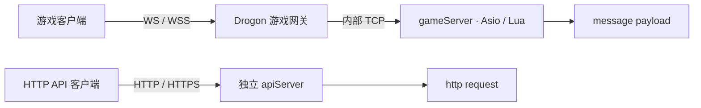

# 使用指南

本指南用于运行从老游戏中抽取的框架，供研究与学习，不部署原游戏。

## 环境要求

Linux x64、C++20 编译器、CMake 3.25+、Ninja、Git、curl、zip/unzip、tar、pkg-config、Perl、Python 3.9+ 和 OpenSSL 命令行工具。文档另需 Node.js 22.12+ 和 package.json 固定版本的 pnpm；使用 Corepack shim 时请先启用。

## 准备 vcpkg

```bash
git clone https://github.com/microsoft/vcpkg.git "$HOME/vcpkg-mistlane"
git -C "$HOME/vcpkg-mistlane" checkout a5f736224e85b32e25a8ffc52562333180396642
"$HOME/vcpkg-mistlane/bootstrap-vcpkg.sh" -disableMetrics
export VCPKG_ROOT="$HOME/vcpkg-mistlane"
```

已有安装可复用，但需包含固定 baseline 和对应版本数据库。CMake 从 VCPKG_ROOT 获取工具链；个人路径可放入已忽略的 CMakeUserPresets.json。

## 构建与检查

在仓库根目录运行：

```bash
cmake --preset linux-debug
cmake --build --preset linux-debug
ctest --preset linux-debug
```

Release 使用 linux-release。首次配置由 vcpkg 安装依赖，之后复用二进制缓存。具体版本见[依赖管理](./dependencies.md)。

## 初始化应用模板

```bash
./build/debug/mistlane init ./my-service
```

目标目录非空时会拒绝覆盖。生成内容包括逐进程配置 `config/instances/`——默认游戏集群外加 `coordinator`/`login`/`data` 注册表三件套（默认集群命令不启动它们；`login` 的样例在 `scripts/login.lua` 演示 `mistlane.place`，`data` 在脚本之外应答原生 `MLD1` 记录端点）、Lua 入口 `scripts/`、按项目根目录解析路径的 `ops/run-instance.sh`、支持本地启停/重启/状态/日志的 `ops/cluster.sh`，以及 `ops/systemd/` 下的 unit 模板。配置文件由启动脚本读取；运行时也可解析原生 `--config FILE` 格式（见下文）。旧项目部署结构和新模板设计依据见[架构对比](./architecture-comparison.md)。

## 启动三个进程

在仓库根目录的三个终端分别运行：

```bash
./build/debug/mistlane --role gameServer --listen 127.0.0.1:7102 --script examples/echo.lua
./build/debug/mistlane --role gateway --listen 127.0.0.1:7100 --upstream 127.0.0.1:7102
```

发送请求：

```bash
python3 tools/client.py 'hello mistlane'
```

--upstream IP:PORT 可重复指定，以连接为单位轮询分配。同一会话固定到同一上游，尚不按账号或玩家 ID 路由。

## 游戏客户端使用 WS / WSS

游戏客户端可以直接连接 Mistlane 的 WebSocket 服务。WS/WSS 由 Drogon 监听，升级握手完成后传递持续连接上的游戏消息，Lua 入口为 `message(payload)`。HTTP API 使用 `http(request)`；`POST /message` 是另一种 HTTP 消息适配入口。选择 WS/WSS 时不调用 HTTP Lua handler。

| 用途 | 角色与参数 | 客户端地址 | Lua 入口 |
|---|---|---|---|
| 游戏长连接，经网关转发 | `gateway --transport ws/wss --upstream IP:PORT` | `ws://host:port/ws` 或 `wss://host:port/ws` | TCP gameServer 的 `message` |
| 单进程游戏消息服务 | `gameServer --transport ws/wss --script FILE` | 同上 | 当前 gameServer 的 `message` |
| HTTP API | `apiServer --transport http/https --script FILE` | `http://host:port/path` 或 HTTPS | `http` 及请求钩子 |

### WS 网关连接 TCP 游戏 gameServer

在两个终端分别运行；这里网关直接连接 gameServer：

```bash
./build/debug/mistlane --role gameServer --listen 127.0.0.1:7102 --script examples/echo.lua
./build/debug/mistlane --role gateway --listen 0.0.0.0:8080 \
  --transport ws --upstream 127.0.0.1:7102
```

游戏客户端连接 `ws://127.0.0.1:8080/ws`。远程客户端将 `127.0.0.1` 换成服务器域名或 IP；`0.0.0.0` 是服务端绑定地址，不是客户端连接地址。`/` 和 `/ws` 都支持 WebSocket 升级。



一条完整 WS 消息对应一个 payload；客户端不加内部 TCP 的四字节长度头。网关负责转换为内部 TCP 帧。`--upstream` 填 `IP:PORT`，连接的是 TCP 服务，不填 WS URL。同一客户端连接固定到选定的上游。

### WSS 游戏网关

将游戏网关改为以下命令，内部 gameServer 仍使用上面的 TCP 配置：

```bash
./build/debug/mistlane --role gateway --listen 0.0.0.0:7443 \
  --transport wss --cert /path/to/fullchain.pem --key /path/to/private-key.pem \
  --upstream 127.0.0.1:7102
```

客户端连接 `wss://game.example.com:7443/ws`，域名必须匹配证书且证书链受客户端信任。证书和私钥保存在源码仓库之外。WSS 最低 TLS 1.2；HTTPS 网页中的游戏客户端应连接 WSS。

### 单进程直接处理游戏 WS / WSS

开发或小型消息服务可以让 gameServer 自己监听 WS，无须额外网关或上游：

```bash
./build/debug/mistlane --role gameServer --listen 0.0.0.0:8081 \
  --transport ws --script examples/echo.lua
```

连接 `ws://127.0.0.1:8081/ws`。启用 WSS 时改为 `--transport wss`，并添加 `--cert FILE --key FILE`；Lua 仍实现 `message(payload) -> string 或 nil`。

### 游戏客户端示例与当前限制

在浏览器开发者工具中发送一条二进制游戏消息：

```js
const socket = new WebSocket('ws://127.0.0.1:8080/ws')
socket.binaryType = 'arraybuffer'
socket.onmessage = ({ data }) => console.log(new TextDecoder().decode(data))
socket.onopen = () => socket.send(new TextEncoder().encode('hello mistlane'))
```

原生客户端同样使用标准 WS/WSS 库。服务端接受 text/binary 消息，响应统一为 binary，单消息最大 1 MiB。应用自己定义 payload 编码和消息 ID，当前示例只原样回显。

会话是全双工的：客户端帧不依赖响应到达，可以流水发送多条请求；handler 返回 nil 时该请求没有响应帧。响应与服务端推送共用同一条有界通道——每个会话最多积压约 2 MiB 输出，越界时 Lua 收到明确的拒绝而非 handler 报错。游戏会话的主动推送、广播与按会话发送通过 `mistlane.session.send` 与 `mistlane.session.broadcast` 提供；帧率令牌桶与输出上限共同约束吞吐。推送与响应交错导致归属不明时，可用可选关联模式：首帧 `MLC2` 将会话（直连或经 gateway，TCP 或 WS）切换为逐帧携带 4 字节请求 ID，响应回显、推送置 0——详见[架构说明](./architecture.md#执行与连接模型)。当前适合验证游戏连接、消息链路与推送路径；玩家鉴权、账号绑定与按玩家路由仍缺失。

一个进程也可以同时服务多种协议：`--transport` 仍为单一选择、作用于主监听；每个 `--listener PROTO://IP:PORT` 追加一个独立监听（明文与 TLS 可并存；`wss`/`https` 条目可追加 `?cert=FILE&key=FILE` 绑定自己的证书）。WS/WSS 监听照旧承载游戏会话，同一个 gameServer 可以在不同端口同时暴露原生客户端的帧式 TCP 和浏览器用的 WS/WSS。HTTP 侧见[HTTP 多监听与 WebSocket 生命周期](./http.md#多监听与-websocket-生命周期)。

### 内部服务身份（MLS1）

玩家连接保持匿名，但内部链路可以要求服务身份，让开放在可达网络上的 gameServer 端口不被无关方悄悄使用。给 gameServer 配置 `--service-token TOKEN`：此后每条连接的首帧必须为 `MLS1 <role> <instance> <token>`，收到 `MLS1 OK` 后会话恢复正常。gateway 一侧成对配置 `--upstream-token TOKEN`（同一秘钥）与 `--service-name NAME`（供对端日志识别的实例名，省略时用监听地址）——握手只发生在两个进程之间，客户端全程不可见。

失败是刻意且显式的：缺秘钥或秘钥错误回复 `MLS1 ERR TOKEN`，格式错误回复 `MLS1 ERR INVALID`，未配置令牌的普通服务端对携带令牌的 gateway 回复 `MLS1 ERR UNEXPECTED`。每次拒绝都关闭连接；自身握手被拒的 gateway 关闭客户端会话且不透传原因。两令牌参数作用于 cross 路由时直接拒绝启动（cross 以 `MLC1` 加入为身份）；已通过 `MLS1` 的会话仍可在下一帧切换 `MLC2` 关联模式。这是用于暴露配置错误的明文共享秘钥比对，不是 mTLS——传输层认证请使用 TLS 监听。

### 共享连接多路复用（MLM1）

默认每个 gateway 会话独占一条上游 TCP 连接；gateway 也可以让同一 upstream 的全部会话共享一条连接：在 `--upstream-token` 之外加 `--upstream-multiplex on`（该开关要求令牌，仅作用于会话路由的 gateway——cross 路由和其他角色带此参数直接拒绝启动）。`MLS1` 握手通过后 gateway 发送 `MLM1`，服务端回复 `MLM1 OK`，此后这条链路上的每帧变为 `u32 id | payload`（big-endian）：每个客户端会话拥有一个从 1 起的 id，未知 id 由服务端按正常准入上限生成逻辑会话，id 0 承载 `CLOSE <id>` 文本控制、任一侧均可用其关闭一条逻辑链路。payload 上限相应减少 4 个 id 字节。关联仍按逻辑会话独立——客户端发送 `MLC2` 时，握手只发生在自己 id 的载荷内，与专用连接完全一致。客户端永远不会自己发送 `MLM1`：作为首帧会得到 `MLM1 ERR UNEXPECTED` 并被关闭。

### 进程注册表（MLR1）

coordinator 是注册表，不是转发面。用 `--role coordinator --listen ADDR:PORT` 启动：仅 TCP（WS/WSS 监听直接拒绝），且带脚本或上游时拒绝启动。成员是配置了 `--coordinator ADDR:PORT [--namespace NAME] [--scope NAME]` 的 gameServer 或 crossServer 进程——`--scope`（默认 `main`）声明其服务的部署切片，一个区服或一个跨服组，`--namespace`（默认空）区分复用相同 scope、区服或跨服组名的部署组。同一命名空间内 scope 名可自由复用；不同命名空间的两个 coordinator 彼此看不到对方的成员、路由与事务。两个参数在其他角色上拒绝启动，且脱离 `--coordinator` 也拒绝启动。coordinator 可另配 `--journal FILE` 将迁移事务落 SQLite（仅该角色）；未配置则保持既定易失行为。

每个成员保持一条出站控制连接：先用 `MLR1 REGISTER <role> <instance> [<namespace>|NS <namespace>] <scope> <listen ADDR:PORT> <probe ADDR:PORT|0>` 注册（instance 取 `--service-name`，缺省时为监听地址；命名空间槽位中的 `-` 表示默认组），此后每 500 ms 心跳一次 `MLR1 <ready|notready> <active> <capacity>`。就绪状态来自成员自身的准入闸门（超载比例与滞回，基于在线会话数和 `--max-connections`）；coordinator 不可达时成员只是重试注册，不会导致进程失败。成员身份随连接存亡：断连即退役，coordinator 上的 `mistlane_registry_members` 指标记录存活成员数。

两条只读命令在各自的短连接上应答后即关闭：`MLR1 QUERY <role> [<namespace>] [<scope>]` 列出成员及其就绪与负载——role `-` 列出全部角色，命名空间过滤器在省略或写 `-` 时即默认组，因此裸 `MLR1 QUERY -` 只列自己组内的成员，绝不触达其他组的成员——`MLR1 PLACE <role> [<namespace>|NS <namespace>] <scope>` 挑选一个——就绪优先，再取 active/capacity 最低者，最后按实例名——应答 `MLR1 PLACE <instance> <listen> <probe> ready <active>/<capacity>` 或 `MLR1 EMPTY`。以 `--coordinator ADDR:PORT`（可选 `--namespace NAME`/`--scope NAME`，即默认查询命名空间与作用域）启动的 login 是注册表客户端而非成员：Lua 调用 `mistlane.place(role, namespace?, scope?, callback)`，每次查询独占一条连接，回调稍后以（`nil`, 被分配的监听地址）或（`reason`, `nil`）触发——没有就绪成员时为 `EMPTY`，呈递的身份被拒时为 `TOKEN`，传输故障为 `unreachable`/`timeout`。应答在 handler 返回之后才到达，脚本须在回调里经 `mistlane.session.send` 回答，而不是通过返回值。coordinator 上的任何非 MLR1 帧都会得到 `MLR1 ERR UNEXPECTED`；带 `--service-token` 的 coordinator 对未通过 `MLS1` 握手前的所有帧回复 `MLS1 ERR TOKEN`，成员侧 `--upstream-token` 的用法与任何内部链路一致。注册表只回答当前状态：不持有 home 归属权威、不搬运角色、也没有故障转移——配 `--journal FILE` 后重启可恢复未决迁移意图，但 home 写入证据仍不属本片——拿到 PLACE 地址之后做什么由调用方自己决定。

角色路由记录在成员关系之上增加按角色的记忆：`MLR1 ROUTE SET NS <namespace> <scope> <realm> <character> <role> <instance>` 把一个 `(namespace, realm, character)` 三元组指向当前已注册的成员，应答 `MLR1 ROUTE OK`；实例未注册应答 `MLR1 ERR UNKNOWN`，形状不完整——包括这里必填的 `NS` 组，使旧的两参数 GET 不会被误读成空命名空间——、标识符超出 `[A-Za-z0-9_-]`（至多 64 字符）或角色不是 gameServer/crossServer 应答 `MLR1 ERR INVALID`。`MLR1 ROUTE GET NS <namespace> <realm> <character>` 以成员的实时状态应答 `MLR1 ROUTE AT <scope> <role> <instance> <listen> <probe> <ready|notready> <active>/<capacity>`——带病的宿主如实显示 `notready`，绝不给出过期地址——无路由时应答 `MLR1 ROUTE EMPTY`。SET 与 GET 既可以在应答后即关闭的短连接上使用（与 QUERY/PLACE 一致），也可以在成员的控制连接上使用，控制连接此后保持打开并继续心跳。同一对角色的第二次 SET 覆盖前一次；路由随成员存亡：断连即退役成员并删掉指向它的全部路由，路由绝不比宿主活得更久。`mistlane_registry_routes` 指标记录条数。路由仍然只说明角色当前被谁承载，不说明角色归属哪里——没有任何东西会自行搬运角色。

迁移事务走同一注册表链路，冠以 `MLR1 MIG` 前缀，每个动词都可在动词后紧跟可选的 `NS <namespace>` 组——省略即默认组，这里拒绝裸位置参数命名空间，使旧的双作用域写法写出的帧仍指默认组。其后的每个地址都是 `(namespace, realm, character)` 三元组，每个 owner 读作 `<realm|cross> NS <namespace> <scope> <role> <instance> <scene>`（命名空间写 `-` 即默认组），带命名空间的 owner 不会与默认组的同名。`MLR1 MIG OWNER <realm> <character> <generation> <owner>` 声明 home 事实，每个 `(namespace, realm, character)` 只采纳一次——不一致的重申应答 `MLR1 ERR CONFLICT`；coordinator 记录事实，但从不充当 generation 权威。`MLR1 MIG PREPARE <realm> <character> <id> <generation> <预期 owner> <目标 owner>` 预留下一个 generation，按请求 ID 幂等：重放重复其判决（`MLR1 MIG PREPARED <id> <下一个 generation>`）而不重复预留；从未发布的预期路由应答 `MLR1 ERR STALE`，改动请求体或并发请求应答 `MLR1 ERR CONFLICT`。事件逐级推进——`MLR1 MIG EVENT <realm> <character> <id> <generation> <DRAINED|FENCE|READY|CLEANUP>` 应答 `MLR1 MIG STEP <id> <状态>`、栅栏后工作等待中应答 `MLR1 MIG PENDING <id>`、跳步应答 `MLR1 ERR ORDER`。`MLR1 MIG COMMIT <realm> <character> <id> <generation>` 把目标发布为新路由（`MLR1 MIG COMMITTED <id> <owner> <generation>`）；`MLR1 MIG ABORT ...` 先应答 `MLR1 MIG ABORTING <id>`，直到显式 `CLEANUP` 事件结束它（`MLR1 MIG ABORTED <id>`——已消耗的 generation 永不复用）。`MLR1 MIG RETIRE <realm> <character> <id> <generation> <member>` 做出与 `retire_member` 相同的裁定；成员从注册表断连即隐式退役，中止认领其 `(namespace, scope, role, instance)` 的在途事务。`MLR1 MIG STATUS <realm> <character>` 应答 `MLR1 MIG STATE <id> <状态> <drained|open> <fenced|unfenced> <ready|notready> <generation>`、有事实后的 `MLR1 MIG STATE idle <owner> <generation>`、或事实到来前的 `MLR1 EMPTY`。`MIG` 行上限 1024 字节，并与其他注册表帧一样位于 `--service-token` coordinator 的 `MLS1` 握手之后。配置 `--journal FILE` 时每个接受动作先写 SQLite 再答：重启恢复未决事务与已消费 generation（重放不重发），SQLite 失败回 `MLR1 ERR STORAGE`；未配置时状态仍易失。且 coordinator 仍不自行搬运任何东西：DRAINED 是源的断言，事件也不区分发送方。

### 记录端点（MLD1）

`data` 角色拥有跨服回传协议的归属侧记录端点，由框架而不是脚本应答：`MLD1 LOAD <realm> <character>` 应答 `MLD1 EMPTY` 或 `MLD1 STATE gen <n> seq <m> [<payload>]`，`MLD1 SUBMIT <realm> <character> gen <n> seq <m> [<payload>]` 应答 `MLD1 RECEIVED gen <n> seq <m>`。栅栏按承载版本判定——更低的版本得到 `MLD1 ERR STALE gen <当前版本>`；序号按角色标识单调且跨代连续——下一序号必须恰好比已存序号大一（否则得到 `MLD1 ERR SEQ seq <期望值>`），对已存序号的重发去重为第二次回执且不改动已存变更集。格式错误回复 `MLD1 ERR INVALID`，存满后的新记录回复 `MLD1 ERR FULL`；`mistlane_record_results_total{role="data",result=...}` 按闭集结果词（loaded/empty/accepted/duplicate/stale/seq/invalid/full）统计每次裁决。

`RECEIVED` 是回执而非持久性声明。带 `--journal FILE` 的 data 先持久化每个被接受的变更集再应答 `ACK durable`，重启即恢复，已存序号的重发回弹已提交 ACK 且不改写载荷；无存储时记录仅在进程内，重启后同样回复 `MLD1 EMPTY`。存储只保留每个角色标识最新被接受的变更集；把变更集合并入实体状态是暂缓的实体契约工作。同一连接上的任何非 `MLD1` 帧仍是脚本流量；带 `--service-token` 启动的 data 在任何记录帧之前仍要求 `MLS1` 握手（否则 `MLS1 ERR TOKEN`）。只有 data 角色解释 `MLD1`——其他角色看到的就是普通脚本 payload。

### 初始化模板中的配置

`mistlane init` 会生成可选的 `gateway-ws.env` 和 `gateway-wss.env`，默认集群仍启动 TCP 网关。WS 示例监听 `127.0.0.1:8080`；远程接入时修改对应文件中的 `LISTEN`。`gameServer-mixed.env` 演示同一个 gameServer 通过 `LISTENERS` 在 7102 提供帧式 TCP、在 7082 提供 WS 监听。

```bash
MISTLANE_BIN=/path/to/mistlane ./ops/cluster.sh start gameServer gateway-ws
```

WSS 在 `config/instances/gateway-wss.env` 中设置 `CERT` 和 `KEY`，可填绝对路径或相对项目根目录的路径，然后启动 `gateway-wss`。脚本会检查证书文件并传给 `--cert`/`--key`；不会生成或提交私钥。systemd 对应实例为 `mistlane@gateway-wss.service`。

### 实例配置字段

`config/instances/<name>.env` 由 `ops/run-instance.sh` 以 shell 赋值方式 source，属于项目所有者手写的受信部署配置，不是不受信输入。启动器只消费下列字段；文件中的其他变量一律忽略。

| 字段 | 必填 | 启动器行为 |
|---|---|---|
| `ROLE` | 必填 | 作为 `--role` 传入；`cluster.sh` 还用它匹配就绪行（`ready <ROLE> <LISTEN>`），匹配成功才报告实例已启动。 |
| `LISTEN` | 必填 | `IP:PORT` 作为 `--listen` 传入。 |
| `TRANSPORT` | 可选 | `tcp` 为默认值，不出现在命令行；`ws`、`wss`、`http`、`https` 原样传入。`wss`/`https` 在 `CERT` 和 `KEY` 不可读时拒绝启动。 |
| `SCRIPT` | 可选 | Lua 入口作为 `--script` 传入；相对路径按项目根目录解析。gateway 留空。 |
| `UPSTREAMS` | 可选 | 逗号分隔的 `IP:PORT`（或 `IP:PORT:PROBE`，使 cross 按对端内部就绪探测挡住新加入）列表；每个条目展开为一个 `--upstream` 参数。 |
| `ROUTE_EPOCH` | 可选 | gateway cross routing/crossServer 纪元作为 `--route-epoch` 传入；留空则省略该参数。 |
| `COORDINATOR` | 可选 | 注册表端点作为 `--coordinator` 传入；仅 gameServer、crossServer、login 可用。 |
| `SCOPE` | 可选 | 注册表作用域作为 `--scope` 传入；须与 `COORDINATOR` 同时设置。 |
| `LISTENERS` | 可选 | 逗号分隔的 `PROTO://IP:PORT` 条目；每个条目展开为一个 `--listener` 参数，一个实例即可同时暴露 TCP、WS、WSS 与 HTTP。`wss`/`https` 条目可追加 `?cert=FILE&key=FILE`；query 路径原样传递，不按项目根目录解析。 |
| `CERT`、`KEY` | 仅 wss/https | 证书链与私钥，绝对路径或项目根目录相对路径；启动器先确认两者可读。 |

实例文件随模板仓库一起提交时不要放任何机密：初始化器不生成证书材料，`gateway-wss.env` 只带 `certs/` 占位路径。私钥等文件应放在仓库之外或由部署方管理的 `certs/` 目录；其他凭据通过安装后的 systemd unit（`Environment=`、`LoadCredential=`）或部署工具注入，而不是写进 `config/instances/` 提交。

### 原生配置文件

二进制也能不经 shell 启动器直接读原生配置格式：

```bash
cat > gameServer.native.env <<'EOF'
# mistlane-config 1
ROLE=gameServer
LISTEN=127.0.0.1:7102
SCRIPT=examples/echo.lua
EOF
./build/debug/mistlane --config gameServer.native.env --max-connections 512
```

- 首个非空行必须是版本标记 `# mistlane-config 1`；缺失即拒绝，避免把任意 shell env 文件（包括缺少该标记的 `config/instances/*.env` 模板）悄悄当作配置。
- 其余行为 `KEY=VALUE`。空行与 `#` 注释忽略，空值跳过，重复键报错，未知键以「文件:行号」拒绝。
- 键为 CLI 选项的大写形式（`ROLE`、`LISTEN`、`TRANSPORT`、`SCRIPT`、逗号分隔的 `UPSTREAMS`、`ROUTE_EPOCH`、`SERVICE_TOKEN`、`UPSTREAM_TOKEN`、`SERVICE_NAME`、`UPSTREAM_MULTIPLEX`、逗号分隔的 `LISTENERS`、`CERT`、`KEY`、`REDIS`、`METRICS_LISTEN`、`PROBE_LISTEN`、`OVERLOAD_RATIO`、`READY_HYSTERESIS`、`MAX_CONNECTIONS`、`MEMORY_BUDGET_MIB`、`MAX_ROOM_SESSIONS`、`MAX_GROUP_SESSIONS`、`MAX_SHARD_SESSIONS`、`CRASHPAD_HANDLER`、`CRASHPAD_DATABASE`），另有 `ROOT`。
- 同一次运行的优先级：文件值 < 非空的 `MISTLANE_<KEY>` 环境变量 < `--config` 之后给出的显式参数。
- `SCRIPT`、`CERT`、`KEY`、`CRASHPAD_HANDLER`、`CRASHPAD_DATABASE` 的相对路径按配置文件所在目录解析；设置 `ROOT` 时改按 `ROOT`（其本身相对配置文件所在目录）。这与 shell 启动器按项目根目录解析不同。要让生成的 `config/instances/*.env` 模板直接走 `--config`，需先在文件首行补版本标记并加 `ROOT=../..`，其 `SCRIPT`/`CERT` 路径才会像启动器一样解析。
- 机密仍应放在部署方管理的环境（`MISTLANE_*` 或 systemd `LoadCredential=`），不提交到文件。


## apiServer

除了基于帧 TCP/WS 的 Lua `message` 模式，gameServer 还可以直接提供 HTTP 服务。用 `--transport http`（或 `https`）配合 HTTP 脚本（如 `examples/http.lua`）启动：

```bash
./build/debug/mistlane --role gameServer --listen 127.0.0.1:7500 \
  --transport http --script examples/http.lua
curl -s http://127.0.0.1:7500/healthz
```

HTTPS 需另加 `--cert` 和 `--key`。传给 Lua 的请求表包含 method、path、query、headers 和 body；响应表设置 status、headers 和 body。请求生命周期钩子为 `before_request`、`http`、`after_request`、`on_error`，以及通用的 `init`/`start`/`tick`/`stop`/`shutdown` 回调。apiServer 必须提供 `http`，可省略 `message`；帧 gameServer 必须提供 `message`。限制与钩子契约见 [HTTP 参考](./http.md) 和 [Lua 生命周期](./lua.md)。

## Lua 服务

脚本返回 table，必须提供 message(payload) -> string 或 nil，可选 init()、tick() 和 shutdown()。tick 间隔 100ms。所有回调在节点的单个事件循环线程上执行，应快速返回。

SIGHUP 先构造并初始化新 VM，失败保留旧 VM，成功替换并重置模块状态。目前不进行状态迁移。SIGTERM/SIGINT 停止监听、取消会话并调用当前模块的 shutdown。

脚本属于可信应用扩展，不是执行不可信代码的安全沙箱。指令 hook 可以中断典型死循环，但不提供完整 CPU 或内存隔离。

## MySQL 连接池

include/mistlane/mysql_pool.hpp 只配置已有的 Boost.MySQL 池。异步获取连接后通过 pooled_connection 的生命周期自动归还；查询值交给 with_params 绑定。

```bash
export MISTLANE_MYSQL_HOST=localhost
export MISTLANE_MYSQL_PORT=3306
export MISTLANE_MYSQL_USER=your_user
# 从你的环境注入 MISTLANE_MYSQL_PASSWORD。
./build/debug/mistlane-mysql-probe
```

默认要求 TLS，验证 CA 和主机名；私有 CA 可通过 SSL_CERT_FILE 指定。MISTLANE_MYSQL_TLS=disable 仅作为明确的临时本地测试选项。示例池上限为一，连续执行三次参数化查询来检查获取与归还。

安装 MariaDB 工具后，可运行临时数据库检查：

```bash
python3 tests/mysql_integration.py ./build/debug/mistlane-mysql-probe
```

脚本创建临时数据目录、随机凭据、临时端口和证书，结束时停止并清理服务。配置 -DMISTLANE_TEST_LOCAL_DATABASE=ON 可纳入 CTest。

池适配当前尚未接入 Lua 消息回调，请勿在 Lua 事件循环中执行阻塞 SQL。

## 文档站

```bash
pnpm install --frozen-lockfile
pnpm docs:dev
pnpm docs:build
pnpm docs:check
pnpm docs:preview
```

`docs:check` 用无头浏览器渲染构建产物，断言每个 Mermaid 图都渲染成功、标签没有被裁切，并在桌面/移动宽度、亮色/暗色主题下检查两种语言。它需要一个 Playwright chromium 二进制（`npx playwright install chromium`，或设 `PLAYWRIGHT_CHROMIUM_EXECUTABLE=/path/to/chromium` 复用现有浏览器）；CI 在 `docs:build` 之后运行它。

文档提供中英文导航、本地搜索和成对页面。默认 base 为 /mistlane/；部署到域名根目录时可设置 DOCS_BASE=/。构建会检查内部链接并生成 docs/.vitepress/dist，以上命令不执行托管发布。

## 导出源码

```bash
python3 tools/export.py
```

归档仅包含 release-files.txt 显式清单中的文件和 SHA256 校验值，不包含父仓库历史、私有配置、原游戏玩法和预编译二进制。

## Crashpad handler 部署

`cmake --install <build-dir> --prefix PREFIX` 会把 `mistlane` 和 Crashpad 的 `crashpad_handler` 并排安装到 `PREFIX/bin`；handler 在 vcpkg 工具目录存在时一并复制。两个二进制只需要系统运行库（glibc、`libstdc++`、`libgcc_s`、`libm`），第三方依赖全部静态链接。

可选 dump 管线的部署约定：

- handler 与服务端放在同一文件系统并显式传入：`--crashpad-handler PREFIX/bin/crashpad_handler --crashpad-database /var/lib/mistlane/crashes`。数据库指向按保留策略定容的本地目录；上传保持关闭，数据不出机器。
- Linux 崩溃抓取依赖 `ptrace`（handler 需要检查崩溃进程）。容器运行时必须允许它：Docker 默认 seccomp profile 在受支持的内核上放行 `ptrace`，但加固、无特权或自定义 AppArmor/seccomp profile 可能拒绝。`ptrace` 被拒时节点照常启动与服务，只是不会写 minidump——在该环境依赖 dump 前先用一次受控崩溃验证整条链路。
- 仓库自带演练二进制：`mistlane-crash-sample`（与 `mistlane` 一起构建安装）用 `--crashpad-handler FILE --crashpad-database DIR` 接好同一套本地管线后主动解引用空指针。原生 `crashpad.minidump` 用例断言数据库落出带 `MDMP` 魔数的真实 minidump、样例进程因 `SIGSEGV` 退出。

### 符号归档与栈回溯

每个构建都内嵌 ELF `NT_GNU_BUILD_ID` note，minidump 的每个模块记录也带同一 ID，因此 dump 无需符号服务器即可指认自己的二进制。对你实际部署的那个二进制归档**未剥离**副本（`linux-debug` 与 `linux-release` 两个 preset 同样适用；剥离会删掉栈回溯所需的符号）：

```bash
id=$(python3 tools/crash_symbols.py build-id build/debug/mistlane)
cp build/debug/mistlane /var/lib/mistlane/symbols/mistlane-$id
# 之后对崩溃数据库下的任意 dump：
python3 tools/crash_symbols.py match /var/lib/mistlane/crashes/pending/xxx.dmp /var/lib/mistlane/symbols/mistlane-$id
python3 tools/crash_symbols.py modules /var/lib/mistlane/crashes/pending/xxx.dmp
```

`match` 在 dump 属于其他构建时返回非零——不要用错误的符号去走栈。完整栈回溯需从 Crashpad 上游获取 `minidump_stackwalk`（vcpkg crashpad port 只带 `crashpad_handler`），指向归档目录运行；栈帧按模块 build id 逐个解析。
