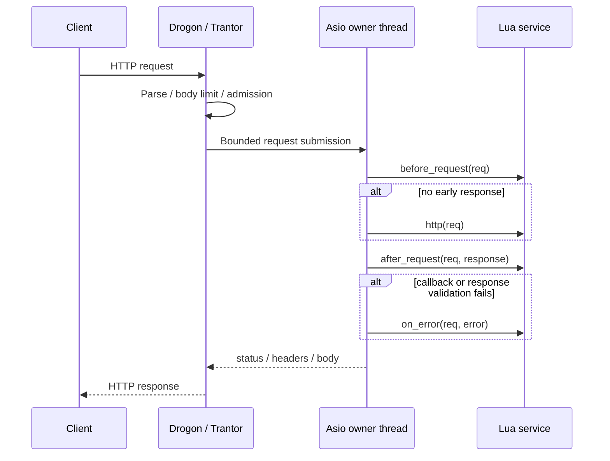
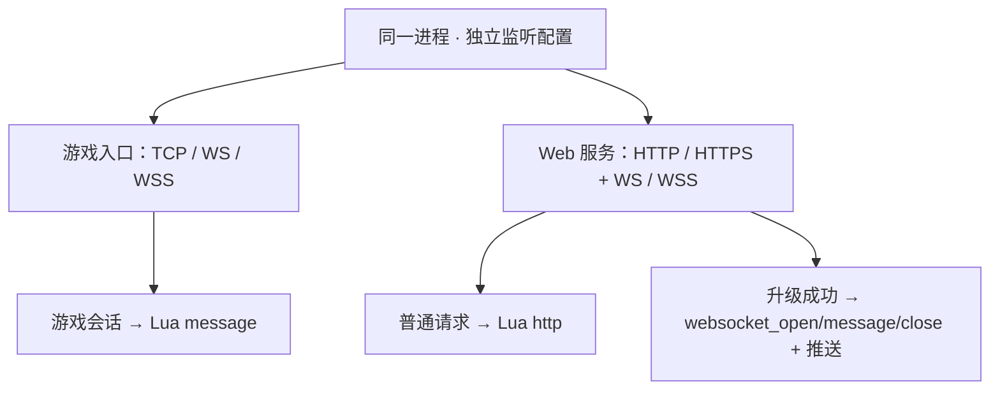

# HTTP 服务端与客户端

本页描述协议接入能力，不定义一个名为 http 的进程。旧 World 内嵌 HTTP，另有支付服务；目标独立接入职责如需部署，名称为可选 apiServer，见[职责说明](./process-roles.md)。


目标服务名称与职责见[进程职责](./process-roles.md)。本页命令使用当前实际 CLI，不能把 gateway cross routing/crossServer 或 gameServer 视为已经完成的 coordinator/crossServer/gameServer。


旧 World HTTP 服务端用了 Poco。Mistlane 使用 Drogon 处理 HTTP/HTTPS、WS/WSS 及协议解析；TCP 核心仍用 Boost.Asio。Drogon 基于独立的 Trantor 网络库，并非基于 Boost。选型理由是直接使用完整 Web 框架能力，不是未经验证的性能排名。

游戏客户端通过 `gateway --transport ws/wss --upstream IP:PORT` 连接 `/ws`，消息由 TCP gameServer 的 Lua `message(payload)` 处理；也可通过 `gameServer --transport ws/wss --script FILE` 直接处理。WebSocket 升级后的游戏消息不会调用 Lua HTTP handler。完整启动命令、客户端示例与模板配置见[游戏 WS/WSS 接入指南](./guide.md)。本页下面的 HTTP 示例使用独立的 HTTP 监听实例。

## 服务端

```sh
build/debug/mistlane --role gameServer --listen 127.0.0.1:7102 --script examples/echo.lua
build/debug/mistlane --role gateway --listen 127.0.0.1:8080 --transport http --upstream 127.0.0.1:7102
curl --data-binary 'hello' http://127.0.0.1:8080/message
```

gateway 的 HTTP/HTTPS 模式暴露 POST /message，body 作为 Lua payload，成功返回 200 与 application/octet-stream 正文；会话或上游失败返回 503，未知路径为 404，非允许方法由 Drogon 拒绝。HTTPS 使用 --transport https --cert FILE --key FILE。WS/WSS 支持 / 和 /ws；HTTP 与 WebSocket 也可同进程共存，见[多监听章节](#多监听与-websocket-生命周期)。

HTTP 每个请求创建独立内部会话，不提供按用户固定上游的保证。WS 连接保持同一上游，必须等上一响应再发下一请求；超前发送会关闭连接。Drogon 解析请求，在有界通道中递交至 Asio，Asio 执行业务并返回结果。没有把 curl 或 Lua 放在 Trantor 线程直接执行。

正文与 WS 消息最大 1 MiB，HTTP pipeline 配置上限为 1；Trantor 发送积压越过 2 MiB 高水位时关闭连接。高水位是越界后回调，不是严格内存分配器配额。另有连接准入和请求期限；TLS/HTTP 握手的前置阶段由 Drogon 管理，不能把内部会话的 10 秒处理超时当成所有网络阶段的总期限。上线前需对慢头部、慢正文与慢读进行压测，并按部署配置反向代理期限。

这是通用消息适配器；没有迁入旧运营 HTTP API，也不提供管理认证或跨域策略。需要在应用自己的 Drogon controller/filter 中显式定义路由、认证和权限。

## libcurl 客户端

CMake target 为 mistlane::http，头文件 include/mistlane/http_client.hpp。

```cpp
mistlane::HttpRequest request;
request.url = "https://example.org/api";
request.method = "POST";
request.body = "hello";
request.connect_timeout_ms = 2000;
request.timeout_ms = 10000;
request.max_response_bytes = 1024 * 1024;
auto response = mistlane::http_request(request);
```

当前支持 GET/POST，RAII 释放 easy handle。默认验证证书链和主机名，可通过 ca_file 指定 CA；只允许 HTTP/HTTPS，默认不跟随重定向，响应正文有字节上限。传输、TLS、超时和超限通过异常报告；HTTP 4xx/5xx 保留 status 与 body，不混同网络失败。目标地址必须由应用授权；只限制协议并不等于阻止内网地址访问。

接口是**同步阻塞**调用，应放入有界应用工作线程，再将结果异步回投；当前不提供后台线程池、Lua 绑定或异步 curl multi 封装。禁止在 Lua message/tick 或 Asio/Trantor 事件循环上直接调用。

## 依赖与性能验收

vcpkg 管理 Drogon 1.9.14、Trantor 1.5.28、curl 8.23.0 及 OpenSSL。Drogon 使用项目 overlay，版本和源码校验值固定。

吞吐需结合 TCP/WS/WSS、消息尺寸、连接寿命、TLS、Lua 工作量和线程数测量。观察 P50/P95/P99、CPU/RSS、事件循环延迟与过载拒绝，包含慢客户端及下游故障。框架跑分不能证明单一网络库优劣，也不能代替跨服热点压测。当前未发布性能对比或承载人数结论。

参考：[Drogon 官方仓库](https://github.com/drogonframework/drogon)、[Drogon 1.9.14](https://github.com/drogonframework/drogon/releases/tag/v1.9.14)、[libcurl 超时](https://curl.se/libcurl/c/CURLOPT_TIMEOUT_MS.html)、[响应回调](https://curl.se/libcurl/c/CURLOPT_WRITEFUNCTION.html)。

## HTTP 请求时序



## 使用 Lua 编写 HTTP handler

gameServer --transport http/https --script examples/http.lua 可直接用 Lua 处理完整请求和响应，支持 before_request/http/after_request/on_error，以及 init/start/tick/stop/shutdown。详见 [Lua 生命周期与 HTTP 契约](./lua)。


## 多监听与 WebSocket 生命周期

同一进程可任意混用独立配置的 TCP、HTTP、HTTPS、WS、WSS 监听，明文与 TLS 并存。`--listen`/`--transport` 配置主监听；每个 `--listener PROTO://IP:PORT` 增加一个独立监听。`wss`/`https` 监听默认使用全局 `--cert`/`--key`，也可以在地址后追加 `?cert=FILE&key=FILE` 只覆盖该监听的证书。监听端口在进程内必须唯一（upgrade 路由按连接的本地端口分发，端口重复会有歧义），冲突配置启动即失败。配置文件用 `LISTENERS=`（逗号分隔）承载同样的条目。

路由跟随监听而不是路径：

- WS/WSS 监听与 gateway 的 HTTP 监听承载帧式游戏会话 → Lua `message`；其上的普通请求不会进入 Lua HTTP 服务。
- 脚本角色（gameServer/apiServer）的 HTTP/HTTPS 监听服务 Lua HTTP；在 `/` 或 `/ws` 上的 WebSocket 升级改走下面的 Lua WebSocket 生命周期，而不是游戏会话。

Lua WebSocket 生命周期新增三个可选回调与一个推送 API：

```lua
local M = {}
function M.websocket_open(id, path) end      -- 会话建立，path 为升级路径
function M.websocket_message(id, payload) end -- 每个客户端帧一次（≤ 1 MiB）
function M.websocket_close(id) end           -- 断连或进程退出
function M.http(request) end                 -- 原有 HTTP 服务，与升级共用端口
return M
```

`mistlane.websocket.send(id, payload)` 定向推送，成功返回 `true`；失败返回 `false` 和原因（`unknown websocket id`、`payload exceeds 1 MiB`）。`websocket_open`/`websocket_message` 内的 Lua 错误会关闭该会话且不再触发 `websocket_close`，进程继续服务。单次推送上限 1 MiB；连接输出积压越过 2 MiB 高水位即强制关闭慢消费者，其 `websocket_close` 照常触发。WebSocket 会话与游戏会话共用 `--max-connections` 配额。SIGTERM 时进程先关闭 WebSocket 会话、让 VM 跑完各自的 close 回调再退出。只服务升级的脚本可以不提供 `message`；但监听组合里只要含 tcp/ws/wss 条目就仍要求提供。


