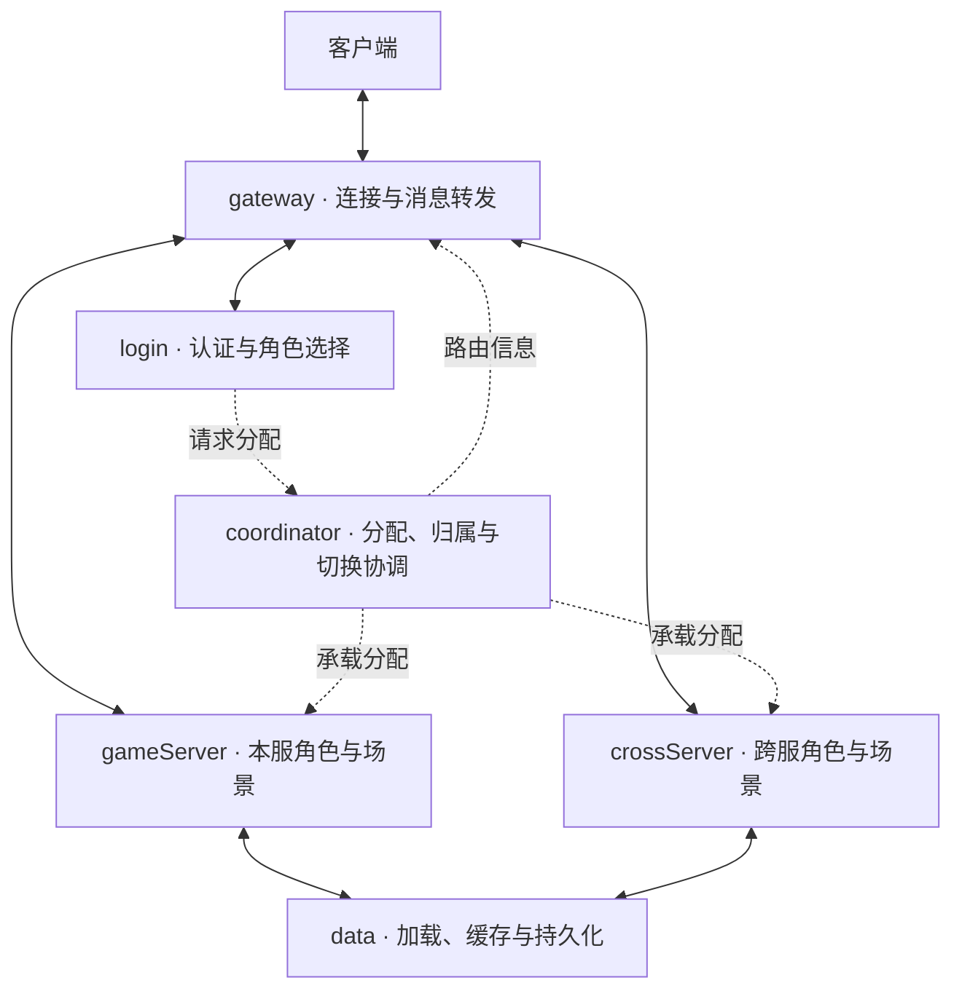

  

# Mistlane

Mistlane 是从**老游戏服务端抽取并整理**的 C++20 / Lua 框架，主要用于**研究与学习**：了解服务职责划分、异步网络、Lua 集成，以及历史代码的现代化改造。

当前版本是供学习参考的框架候选，不作为生产环境部署推荐。抽取范围排除了原游戏玩法、数值表、账号接入、支付、渠道 SDK、生产配置和原仓库历史。

当前实现是通用通信与 Lua 运行原型，并没有完整迁入老游戏的协调、角色、地图和副本系统。目标服务职责已经整理为 gateway、login、coordinator、gameServer、crossServer、data 和可选 apiServer，见[进程职责与命名](./process-roles.md)。

## 可以研究什么

| 领域 | 当前实现 |
|---|---|
| 异步 I/O | Boost.Asio 的 TCP、计时器、信号与协程 |
| WS 与 WSS | Drogon，配合 OpenSSL TLS |
| 数据库接入 | 直接使用 Boost.MySQL connection_pool 和参数绑定 |
| 应用脚本 | 单线程 Lua 模块生命周期和可回退的 VM 替换 |
| 依赖复现 | CMake Presets 和固定 baseline 的 vcpkg manifest |

### 目标职责图（待实现）

数据库适配目前属于独立 C++ 接入，尚未成为 Lua 数据库桥接。当前按连接路由；玩家迁服、共享连接多路复用和分布式恢复不在本版中。

从[使用指南](./guide.md)开始，再阅读[架构与能力边界](./architecture.md)和[验证记录](./validation.md)。

## 来源与许可证

框架源于 FOGS，原项目名的具体含义尚无明确资料。Mistlane 使用 Apache License 2.0。源码来源和第三方依赖授权见 [LICENSE](https://github.com/cuihairu/mistlane/blob/main/LICENSE)、[NOTICE](https://github.com/cuihairu/mistlane/blob/main/NOTICE) 和[第三方说明](https://github.com/cuihairu/mistlane/blob/main/THIRD_PARTY.md)。
