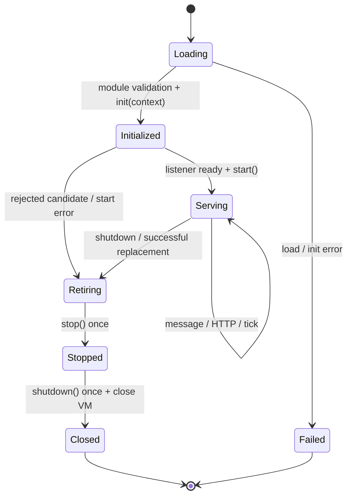
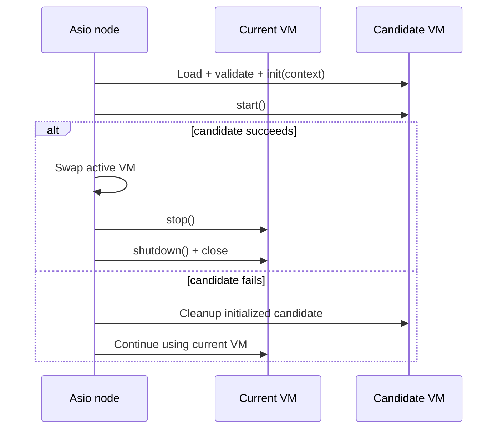

# Lua 脚本与完整生命周期

Mistlane 保留“C++ 管网络与调度，Lua 管应用”的分工。worker/shard 各持有一个 VM，所有钩子在所属 Asio 线程串行调用。Drogon/Trantor 解析 HTTP、TLS 和 WS，通过有界消息通道递交任务，不直接并发访问 Lua。

## 模块与运行方式

脚本顶层返回 table。TCP/WS/WSS worker 与 shard 必须提供 message；HTTP/HTTPS worker 必须提供 http，允许不提供 message。钩子用普通函数调用，不隐式传 self；使用 function M.http(req)，不要使用冒号方法定义。

```sh
build/debug/mistlane --role worker --listen 127.0.0.1:8080 --transport http --script examples/http.lua
curl http://127.0.0.1:8080/healthz
curl --data-binary 'hello' http://127.0.0.1:8080/echo
```

HTTPS 加 --transport https --cert FILE --key FILE。示例是框架契约演示，不包含真实认证提供方。

## 节点生命周期



| 钩子 | 参数 / 返回 | 时机和行为 |
|---|---|---|
| 顶层脚本 | 无 / 模块 table | 启动与每次重载执行；必须返回符合传输类型的模块 |
| init | context / 忽略返回 | VM 创建并验证后一次；context 含 role、transport、epoch |
| start | 无 / 忽略返回 | 监听就绪、正式发布 ready 前一次；失败则启动失败或拒绝重载 |
| message | payload、context / string | 非 HTTP 完整消息；context 在 shard 中含 realm/group/room/epoch，普通 worker 为 nil |
| before_request | req / nil 或响应 table | HTTP 前置处理；nil 继续 http，响应 table 短路主 handler |
| http | req / 响应 table | HTTP/HTTPS worker 的主请求处理器 |
| after_request | req、response / nil 或响应 table | 主处理器或前置短路成功后执行；可直接修改 response，或返回替换 table |
| on_error | req、error string / 响应 table | HTTP 回调或响应校验失败时执行；再次失败则返回通用 500 |
| tick | 无 / 忽略返回 | start 后，每次完成再等待约 100ms；不是严格实时帧率 |
| stop | 无 / 忽略返回 | 正常停止或旧 VM 退役时一次；停止应用接收新工作的机会 |
| shutdown | 无 / 忽略返回 | stop 后尽力清理一次，随后销毁 VM |

除当前传输所需的 message/http 外均可选；nil 表示缺省。字段存在但不是函数会在调用时失败。没有 on_connect/on_disconnect 玩家登录钩子；连接生命周期不等同于业务登录。原游戏全局 Timer、SQLService、C_* 和协议没有直接迁入。

正常 SIGTERM/SIGINT：关闭监听，调用 stop，取消活动会话，调用 shutdown，排空取消回调。当前是取消，不是业务请求排空或事务刷盘。stop 抛错仍尝试 shutdown；标记在调用前设置，避免重复调用。已完成 init 的失败候选也尽力执行 stop/shutdown；顶层或 init 本身失败只销毁 VM，不承诺对部分初始化调用清理钩子。崩溃、SIGKILL、断电不保证任何清理。

## HTTP 请求契约

```lua
local M = {}
function M.init(context) end
function M.start() end

function M.before_request(req)
  -- 可添加本次请求字段，后续钩子使用同一 Lua table。
  req.received = true
  if req.path == "/private" then
    return { status = 401, body = "Unauthorized" }
  end
end

function M.http(req)
  if req.method == "POST" and req.path == "/echo" then
    return {
      status = 200,
      headers = { ["content-type"] = "application/octet-stream" },
      body = req.body,
    }
  end
  return { status = 404, body = "Not Found" }
end

function M.after_request(req, response)
  response.headers = response.headers or {}
  response.headers["x-service"] = "mistlane"
end

function M.on_error(req, error_message)
  return { status = 500, body = "Internal Server Error" }
end
function M.tick() end
function M.stop() end
function M.shutdown() end
return M
```

req 是独立的请求 table，包含 method、path、query（原始查询串，不含问号）、headers（小写名称到 string 的映射）和 body（二进制 string）。前置处理可以添加应用字段，并传递给后续钩子。它不是持久玩家上下文；不要将请求表无限保存在全局集合。

响应 table 的 status 默认 200，必须为 200–599 的整数；body 默认为空，必须是 string，最大 1 MiB；headers 为 string 到 string 的 table，总名称和值最多 16 KiB。默认 Content-Type 为 text/plain；应用可覆盖。不支持通过这个映射输出同名多值 header（例如多个 Set-Cookie）。Content-Length、Transfer-Encoding、Connection、Upgrade 由 Drogon 管理，Lua 返回这些字段或非法名称/换行会触发错误处理。

请求过程为 before_request → http（如未短路）→ after_request → 响应。前置拒绝也执行 after_request。任何阶段报错会跳至 on_error，不再重复执行 after_request；on_error 缺省、报错或返回非法响应时，返回不暴露 traceback 的通用 500，详细错误写入服务端日志。网络失败或准入拒绝可能在 Lua 之前结束请求。

HTTP 模块匹配通用路径，应用在 http 中选择路径并明确返回 404/405。当前转交 GET/POST/PUT/DELETE/PATCH/OPTIONS/HEAD，HEAD 正文由 HTTP 实现处理；不暴露底层 socket、流式正文、异步 yield 或 WebSocket 升级权限。gateway/router 的 HTTP 模式仍是 POST /message 的正文转发适配器，需要完整 HTTP 语义时直接使用 HTTP worker 或自行扩展网关协议。

## 热重载：SIGHUP



候选 VM 重新执行顶层、init 和 start，成功才替换；已有连接后续消息使用新 VM。成功后旧 VM 运行 stop/shutdown 再销毁。候选 start 失败时，旧 VM 不运行退役钩子并继续服务，已初始化候选执行尽力清理。旧模块清理错误记日志，不回滚已发布的新 VM。

重载重置模块状态，不导出、迁移或恢复房间数据。它只保证 VM 激活的替换顺序，不回滚 init/start/stop 中外部副作用；新旧 VM 会短暂共存，应避免抢占不可共享资源。带状态的 shard 先排空房间，或另行设计快照、状态版本和恢复机制。

## 错误与资源边界

message 失败或返回非 string 关闭该会话；tick 错误记录后继续调度。长回调会延迟网络、其他房间和超时，定时器不能抢占同步 C++ 调用。

每次受保护调用设置约 100 万条 Lua 指令的计数钩子，用于捕获常见死循环。仅打开 base/string/table/math，不打开 package/io/os/debug；base 仍提供 load/dofile，因此脚本必须可信，**这不是沙箱**。没有 Lua 内存配额，也不保证 CPU 预算不可绕过。生产还需进程/cgroup 隔离、受控绑定和压测。

## Redis Streams 消息队列 API

使用 `--redis 127.0.0.1:6379` 启动 worker 后，可在 Lua 中使用异步 `mistlane.stream` API。ACL 凭据通过 `MISTLANE_REDIS_USERNAME` 和 `MISTLANE_REDIS_PASSWORD` 环境变量配置，不要把密码写入命令行。队列键统一隔离在 `mistlane:stream:<name>` 下。Redis 请求和回调运行在节点的 Asio 线程上，因此可以安全访问同一个 Lua VM；这些接口不会阻塞或让当前 Lua handler yield。

```lua
mistlane.stream.create_group("mail", "workers", function(err)
  if err then error(err) end
end)

mistlane.stream.publish("mail", { kind = "reward", player = "p-17" }, function(err, id)
  if err then return print(err) end
  print("published", id)
end)

mistlane.stream.read("mail", "workers", "worker-1", 20, function(err, entries)
  if err then return print(err) end
  for _, entry in ipairs(entries) do
    print(entry.id, entry.fields.kind, entry.fields.player)
    mistlane.stream.ack("mail", "workers", entry.id, function(ack_err, count)
      if ack_err then print(ack_err) end
    end)
  end
end)
```

`read` 非阻塞地拉取最多 100 条新消息，避免阻塞共享 Redis 连接；可从 `tick` 钩子轮询。`claim(stream, group, consumer, min_idle_ms, start_id, count, callback)` 使用 `XAUTOCLAIM`（Redis 6.2+）认领消费者异常退出后遗留的 pending 消息；后续分页使用上次返回的 `next` 游标。消息处理持久化成功后再调用 `ack`。这是至少一次投递，业务处理必须能容忍重复；`create_group` 可重复调用。每条消息最多 64 KiB、最多 64 组字段和值；每次 read/claim 最多 100 条。

当前 Redis 连接使用明文 TCP；TLS 配置完成前请仅连接可信的内网 Redis。Boost.MySQL 与阻塞式 libcurl 尚无 Lua 绑定。跨服 context 是路由元数据，不是身份凭证。参阅[HTTP 接入](./http)和[跨服设计](./cross-server)。

## Redis 排行榜 API

同一个可选 Redis 连接还提供 `mistlane.leaderboard`，榜单键位于 `mistlane:leaderboard:<name>`。`add` 和 `get` 使用 Redis 端脚本原子读取分数与名次。分数以十进制字符串返回，避免丢失 Redis double 精度；名次从 1 开始。`top` 按分数降序排列，分数相同时遵循 Redis 的成员名逆字典序。

```lua
mistlane.leaderboard.add("season-12", "player-17", 25, function(err, result)
  if not err then print(result.score, result.rank) end
end)

mistlane.leaderboard.get("season-12", "player-17", function(err, result)
  -- 成员不存在时 result 为 nil
end)

mistlane.leaderboard.top("season-12", 0, 20, function(err, rows)
  -- 每行包含 member、字符串 score 和从 1 开始的 rank
end)

mistlane.leaderboard.remove("season-12", "player-17", function(err, removed)
  -- 成员存在时 removed 为 1，否则为 0
end)
```

`top` 的 offset 范围为 0 到 1,000,000,000，每页最多 100 行。榜单名和成员 ID 应保持稳定，不要写入面向玩家的隐私数据。
