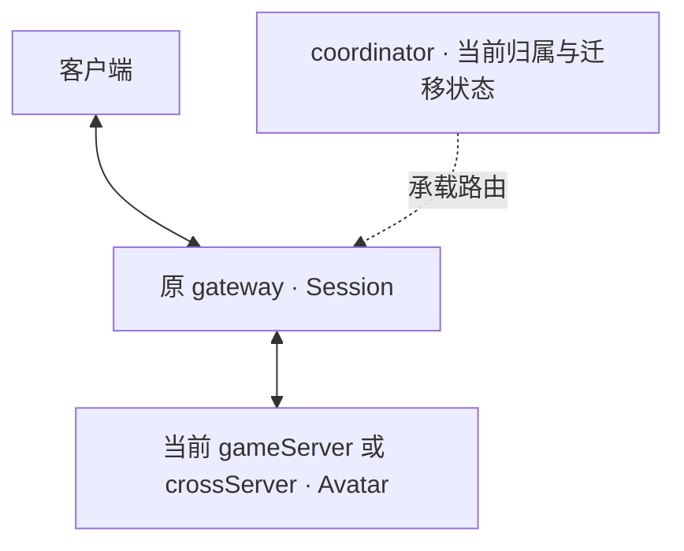
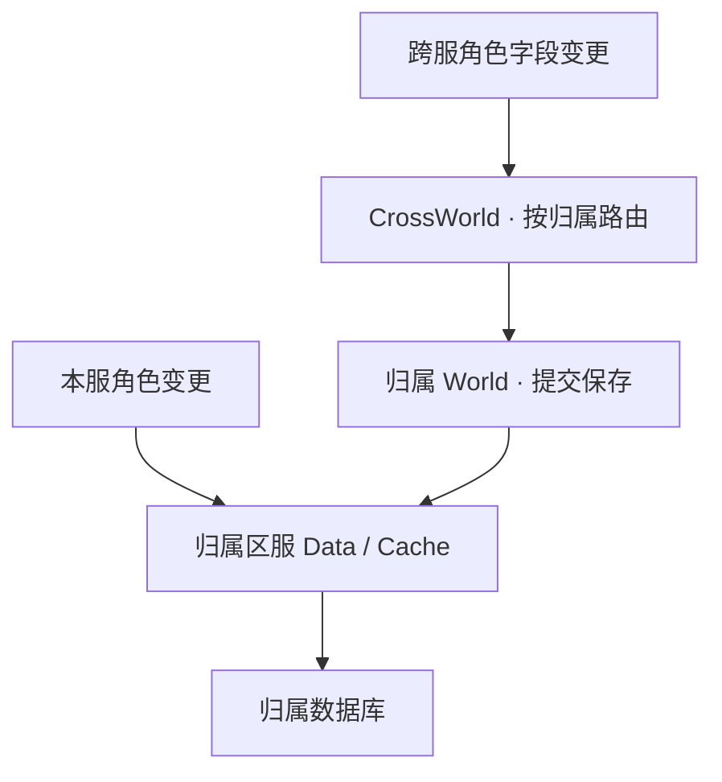
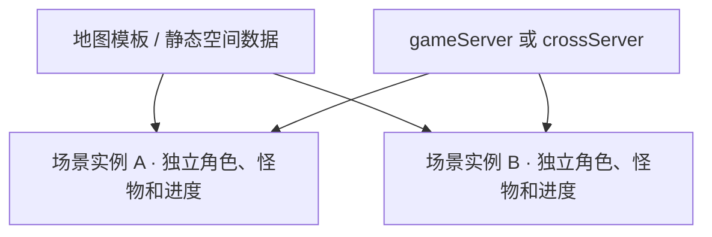

# 玩家、场景与跨服模型

本页汇总 game-fogs 源码分析及 Mistlane 的目标设计。旧实现证据、目标机制、当前缺口分别说明；原游戏代码和资源不随此页迁入。进程名称采用[职责约定](./process-roles.md)。

## Session、Avatar 与数据归属

Session 管理客户端连接、状态及当前承载路由，位于 gateway。Avatar 表示承载玩家数据与行为的游戏对象，位于当前 gameServer 或 crossServer；旧代码实际叫 Lua Charactor，尚无已实现的 Mistlane C++ Avatar 类型。

玩家进入跨服时保留原 Session，切换 Avatar 的执行位置；账号、角色 ID 和长期数据所属区服不因此改变。目标保证一个活跃且可写的 Avatar；序列化快照、缓存及短暂对象副本可以存在，但不能成为第二个同时执行玩法的权威对象。旧代码发送/删除/重建的顺序尚不能证明故障时也满足这一保证。

长期角色数据与场景行为目前仍由游戏执行侧共同承载，没有拆 Base/Cell。data 是持久化职责，coordinator 是协调职责，两者都不是角色业务对象。

## 旧跨服链路与目标契约

旧 Hegel 请求 CrossWorld 选择目标，离开场景并发起保存，然后发送完整 charData；requesthegel2hegel 实际经 Gate 更新 hid 后转发。目标 CrossHegel 创建角色、进入场景，旧进程执行 leaveHegel。回服复用相似机制，使用旧承载与来源信息。

本服 set/setDirty 记录 dirty 并提交 CacheRow；跨服对应接口发 C_SyncDataFromCross。CrossWorld 根据玩家路由中的 wid 转到归属 World，后者向原区服 Data/Cache 提交变更。以下是已核实的主要字段路径，不保证所有自定义写法都会自动持久化。

这是一条旧实现保存路径，不是 Mistlane 当前已接通的服务链。目标采用“运行位置可迁移，长期数据回到归属 data 保存”的原则；跨服执行进程通过归属侧服务回传变更，持久记录/订单不固化承载地址。具体接线、保存确认、版本和幂等、重试/乱序、断线/离线、回服失败仍待协议设计。调用 save 或发送消息不能当成数据库提交完成。

旧源码定位：`game/Hegel/Scene/SceneLogic.lua::doSwitchHegel`、`game/Data/RPC.lua::requesthegel2hegel`、`game/Common/CService/Server/GateService.lua::handleSwitchHegel`、`game/Hegel/Charactor/Charactor.lua::set/setDirty/save`、`game/World/Charactor/CharactorManager.lua::syncDataFromCross/onSyncDataFromCross`。

## C++ 基础机制与 Lua 业务

| 能力 | 旧实现 | Mistlane 目标边界 |
|---|---|---|
| 连接、分帧、异步收发与事件回调桥接 | C++ | C++ 通用运行层 |
| 玩家路由、转移时序、对象生命周期、脏字段回传 | 大量 Lua 代码 | 通用状态机与身份/加载/保存契约统一封装进 C++；接口与字段格式仍待设计 |
| 角色业务行为、进入条件、战斗奖励、活动与副本规则 | Lua | Lua 业务与生命周期钩子 |
| 地图/场景运行管理 | Lua SceneManager/Scene；C++ 有空间数据代码 | C++ 管理通用生命周期、空间/同步机制；Lua 提供玩法规则，资源加载接口另行定义 |

Lua 可以申请进入跨服玩法；基础层负责承载分配、状态传输、确认、路由切换和旧承载释放。钩子需明确线程、错误、重入、超时及迁移期间可执行的操作。这是抽取目标，不是当前 message/http 模块已具有的能力。

## 协议、方法定义与抽象前置条件

通用 Entity 的 XML 契约、JavaScript/C# 代码生成、属性同步、持久化及服务器不重编更新方案见[实体契约与代码生成](./entity-contract.md)。后续按通用 Entity 设计，Avatar 只是其中一种；该方案尚未实现。

sproto 同时支持 RPC 协议声明：协议名、编号及 request/response 类型；业务 Lua 函数体及其绑定由应用实现。旧仓库 `3rd/sproto/testrpc.lua` 提供示例，`game/lib/sprotoparser.lua` 支持相应语法。旧游戏 host 层另有 aid/tag/cid 定制，不能照搬上游默认会话行为。恢复契约时必须同时恢复 RPC 声明与消息类型。参见 [sproto 官方 RPC API 与协议语法](https://github.com/cloudwu/sproto#rpc-api)。

旧 game-fogs 已核实的客户端链路使用 **sproto**：`game/Data/Data.lua` 加载 `game/proto/sproto.spb`，`game/lib/sp.lua` 编解码，生成的 `game/proto/Protocol.lua` 提供名称与编号。第三方 Protobuf 依赖不能证明游戏客户端协议采用 Protobuf。

客户端请求由 `PacketHandler[Protocol.X] = Lua函数` 显式注册；`HegelService.handleClientMsg` 按编号选择处理器，按 aid 找到角色，以 `(h, p, c)` 调用。普通 `function Charactor:方法名(...)` 不会因为存在就自动向客户端开放。Gate 使用连接对应的角色路由，服务端通知经原 Gate 返回；客户端处理器与内部 StatePacketHandler 分别注册，其安全性还需逐入口审核。

属性变更通知使用 `SC_CharDataUpdate=4005`。旧 set 按条件通知客户端及记录 dirty/跨服回传；setDirty 本身不通知客户端，直接改 self.data 也不等于自动追踪。在线角色每 300000ms 调用 save；save 清空 dirty 后提交 CacheRow，不能解释为数据库持久化成功。

尚未定位原始业务协议文本、生成脚本、正式客户端绑定和完整版本兼容流程。已有生成物不足以证明前后端契约可复现。Mistlane 当前只由 C++ 调用脚本返回表中的 message/http 等回调，尚未实现业务协议生成、完整 Avatar 方法绑定或自动属性机制。

此前提出的 `self:sync()` 撤回，不作为已确定 API。强制保存方法名、命名空间和防覆盖机制待协议契约设计；客户端属性同步、周期保存与强制持久化确认必须分开定义。先恢复/明确协议来源，列清消息编号与字段类型、方向、处理器、身份与权限、错误和版本兼容，再决定 C++/Lua 抽象。不得为补齐文档直接新增这些运行时接口。

旧源码证据：`game/Hegel/Rpc/PacketHandler.lua`、`game/Common/CService/Server/HegelService.lua::handleClientMsg`、`GateService.lua::onlineMsg`、`game/Hegel/Charactor/Charactor.lua::set/setDirty/save/callClient`、`CharactorManager.lua::refreshChars/saveOnlinePeriodically`。

## 地图数据如何管理

| 数据层 | 内容 | 加载与生命周期 |
|---|---|---|
| 地图模板 | 模板 ID、类型、出生点、规则及资源引用 | 配置注册；多个场景可以引用同一模板 |
| 静态空间数据 | 障碍/通行网格、导航等只读数据 | 目标由进程内缓存共享；有准备、加载/失败、引用与释放规则；分块流式加载另行设计 |
| 场景实例 | 实例 ID、玩家、怪物、计时器、复活和玩法进度 | 随场景创建、运行、进入/离开及关闭释放；常驻场景与临时副本策略不同 |

图表示共享静态数据、隔离可变运行状态的目标组织方式。一个游戏进程可承载多个场景；实例不等于进程。玩家进入已有场景不应触发整张地图重新加载，Avatar 转移也不携带静态地图资源。目标场景未准备好时不能提前发布进入成功，应由准备完成、失败或超时路径处理。

旧代码 newScene 浅复制模板并区分 tid/id，createCloneScene 创建动态实例；常驻场景由 SceneManager.init 创建。MapMgr 设计为按 mapId 缓存只读 MapData，但 CAPI 关键导航调用已注释，不能宣称导航或流式加载实际生效。GameSceneIndex 有创建实例、活动关闭和传出玩家逻辑，而 Scene.destory 仍是 TODO，自动清理需要逐玩法核实。

旧同步场景使用 UPDATE_INTERVAL=1000 的计时器收集/发送脏位置，已见路径向场景内其他成员同步。客户端上报位置不是严格服务器移动模拟；配置 enable9Grid 也不是已启用完整 AOI 的证据。

旧源码定位：`game/Common/Template/TScene.lua`、`game/Hegel/Scene/SceneLogic.lua::newScene/createCloneScene`、`SceneManager.lua`、`Scene.lua`、`game/Hegel/GameScene/GameSceneIndex.lua`、`d_hegel/Navigate/MapMgr.cpp`、`d_hegel/CAPI.cpp`。

## 大地图与无缝的不同要求

- **资源量大**：分别管理客户端模型/贴图和服务端障碍/导航；按需分块、异步预加载与卸载。静态数据共享不等于流式加载已实现。
- **活跃对象多**：AOI 控制同步范围，实体激活和模拟仍需预算；容量评估后再选择分线、独立实例或空间分区。地图面积不直接等于服务器计算量。
- **单地图跨进程无缝**：需要邻区交互与状态、权威交接等额外机制。跨服移交完整 Avatar 或资源分块，本身都不能证明无缝空间分区。

未拆 Base/Cell 不能作为“不支持大地图”的结论。旧模型主要是单进程完整场景与跨场景/进程转移；仓库未证明成熟地图流式加载、空间 AOI 或跨进程无缝，也不能据服务端仓库确认客户端加载机制。[UE World Partition](https://dev.epicgames.com/documentation/en-us/unreal-engine/world-partition-in-unreal-engine)仅用作分块流式加载概念参考，不代表 Mistlane 或旧代码已集成。

## 当前实现与后续任务

Mistlane 当前有网络通道、串行 message/http 执行及 gateway cross routing/crossServer 路由/准入原型；尚无完整 Avatar 承载/迁移、地图/场景运行层、上述归属保存链或无缝空间分区。已有 SIGHUP 替换 Lua VM 会重置模块状态，不能当作 Avatar 或场景迁移。

后续任务在根目录 `todo.md`：先整理 C++ 基础契约和 Lua 钩子，再明确地图数据与场景生命周期、跨服变更回传与唯一写入权，最后实现并验证；不能只改运行角色名称就勾选完成。
