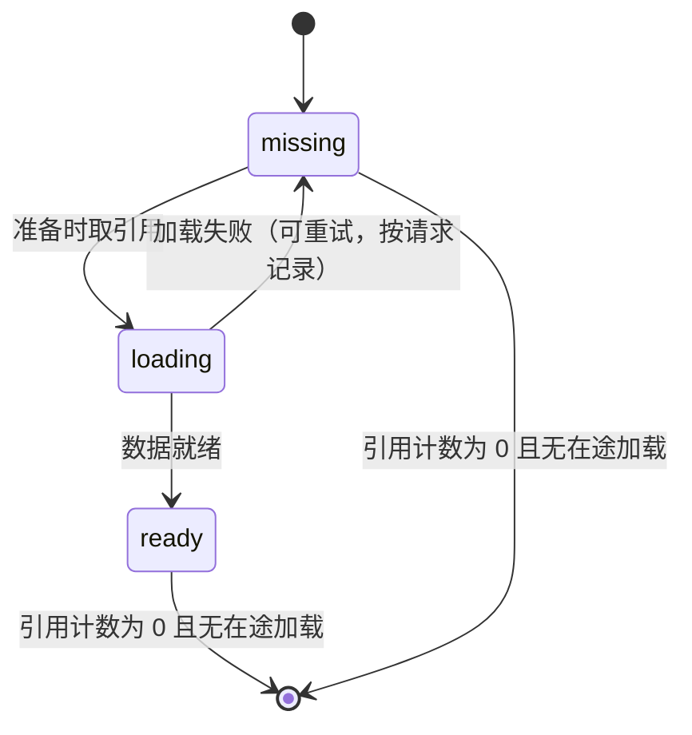
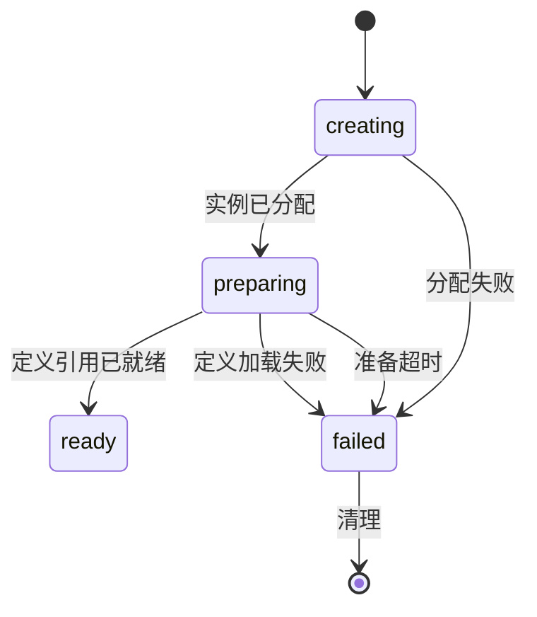

# 场景生命周期：地图定义、空间缓存与实例

状态：已定设计（2026-10-19）。当前框架只有连接、帧协议和 Lua 消息执行，没有场景、地图或实体对象——本页不改变任何 CLI 行为，下面描述的运行行为均未实现、未经验证。本页回答[模型页](./player-scene-model.md)留下的设计空白（"进程内共享缓存的准备、加载/失败、引用与释放规则"），并为后续 coordinator/gameServer 迁移切片提供前置项；职责边界仍是[进程职责页](./process-roles.md)。跨服参与的所有权与唯一写入权归[跨服回传与唯一写入权协议](./cross-return-protocol.md)；旧证据与缺口见[gameServer 能力评估](./gameserver-capabilities.md)与模型页。

## 三层，各一条规则

| 层 | 内容 | 所有者 | 生命周期 |
|---|---|---|---|
| 地图定义 | 已制作好的静态内容：边界与布局、障碍与通行、出生点与路径、规则与资源引用 | 启动时注册，每进程一份 | 与进程同生命周期；只能靠注册新 digest 变更 |
| 静态空间数据 | 定义的"服务端可见"子集，只读，按进程缓存 | 该进程的空间缓存 | 同一定义的多个实例共享；按引用计数释放 |
| 场景实例 | 可变状态：参与者、计时器、进度 | 有且仅有一个进程 | 先准备，然后常驻或临时 |

把三层分开的规则是：**实例引用定义，实例永远不拥有地图。** 下面没有任何一条让实例把静态数据复制给自己，也没有任何一个进程拥有另一个进程的缓存。

## 地图定义

| 方面 | 规则 |
|---|---|
| 标识 | `定义 ID` + `digest`。实例锁定它准备时的那个 digest，因此定义不会在实例运行期间被换掉 |
| 内容 | 边界与布局、障碍与通行数据、导航数据、出生点与路径、规则引用、资源引用。仅客户端可见的材质只被引用，不在此复制 |
| 注册 | 启动时从配置或仓库注册。没有任何实例引用的定义不会被加载进空间缓存 |
| 变更 | 变更后的定义是新 digest，因此是新 key。已注册的定义不原地修改 |
| 传输 | 定义不跨进程发送。每个进程从自己的注册来源加载 |
| 排除 | 文件格式、digest 算法、制作工具链：绑定到实现 |

## 进程内只读空间缓存

Key 为 `(定义 ID, digest)`，Value 为服务端可见的静态数据，一旦 ready 即不可变。

| 方面 | 规则 |
|---|---|
| 取引用 | 取引用是条目可以被加载的前提；引用的存活期与被取引用的实例一致 |
| 不可变 | ready 条目从不被重写。定义变更是新 digest，因此是新 key |
| 释放 | 只有当引用计数为零**且**同一 key 没有在途加载时才可淘汰。释放是两阶段的，晚到的引用不能复活已释放内存 |
| 失败 | 加载失败只记录在发起加载的那个请求上，不记在 key 上。同一 key 仍可被另一个实例的准备重新尝试，失败也永远不能污染一个 ready 条目 |
| 驻留 | 驻留只由引用决定。任何内存阈值、定时器或空闲规则都不得淘汰仍被实例引用的条目 |
| 共享范围 | 仅进程内。"一次加载多进程共享"不属于本设计；它是[大地图](./big-map.md)页的需求，且未实现 |

## 场景实例状态

实例的准备是一个状态机，唯一可以接受进入的是 `ready`。

| 状态 | 规则 |
|---|---|
| `creating` | 实例已分配，任何参与者不得进入 |
| `preparing` | 解析定义引用，可能触发空间缓存加载 |
| `ready` | 唯一接受进入的状态。不存在"数据不全但已就绪"的状态 |
| `failed` | 定义加载失败，或准备没有在预算内完成 |

1. **超时是失败，不是"带缺口的成功"。** 准备没有在预算内完成就是 `failed`，其实例会被清理。任何路径都不能发布一个数据不全的"就绪"场景。
2. **未就绪的目标必须以显式失败拒绝进入。** 不能报成功，也不能先收下参与者再等。
3. **准备失败不得留下半创建的注册实例。** 失败路径同样执行下面的清理。
4. **一个实例一个写入者。** 只有所属进程能写该实例的状态。跨服参与、临时写租约与唯一写入权是回传协议的责任，本页不改动。
5. **准备预算是配置项，不是本页结论。** 任何时长数字在实现时命名，并用实测数据支撑。

## 清理与引用释放

常驻实例在启动时创建，不因为空闲而关闭；临时实例由显式决定关闭。两者使用同一套顺序清理，顺序不可变：

1. 停止接受进入。
2. 停止场景内计时器与同步。
3. 迁出或回传所有参与者。
4. 释放实例状态。
5. 释放定义引用；空间缓存自行判断该条目是否可淘汰。

- 临时关闭只在实例已空、或已经过显式迁出让所有参与者离开后才尝试。旧的"迁出玩家后关闭"路径是观察到的行为，不是框架规则。
- **空闲与陈旧不是一回事。** 两者本身都不触发清理：关闭临时实例是应用或运维的显式决定，常驻实例不参与。
- **静态数据释放只由引用决定。** 定时器、内存阈值或"实例已陈旧"的观察都不得释放仍被实例引用的数据。
- 准备失败执行同样的顺序，只是省掉第 1 到 3 步——因为没有任何参与者进入过。

## 进入场景与迁移不搬地图

- **进程已把该定义持有为 `ready` 时进入已有实例**：不传输任何地图数据，也不重新加载地图。要么实例就绪，要么进入被拒。
- **在尚未持有该定义的进程上准备**：该进程从自己的注册来源加载。别的进程的缓存不是数据来源。
- **迁移参与者**（同进程或跨进程）：走的是实例级状态与参与者上下文，地图不走。目标侧从自己的缓存准备自己的实例，就绪前拒绝进入；参与者上下文与唯一写入权规则来自回传协议。
- **本设计没有任何一条路径在进程之间传输整张地图定义或整个实例的静态数据。**

## 本页故意未决定

- 地图定义的文件格式、schema 与 digest 算法：绑定到实现。
- 场景 tick、实体模拟与兴趣同步：延期的实体契约链与后续 gameServer 切片。旧证据里场景 tick 与导航调用是注释状态。
- 空间分区与分块流式加载：见[大地图](./big-map.md)页。
- 实例状态跨重启持久化：实体契约链。
- 各项周期、容量与超时数值：靠实测，不由本页给定。
- 跨进程缓存共享协议：大地图页的需求，未实现。

## 验证

目前无验证。框架里没有场景、地图或实体对象，因此本页没有测试，也没有运行验收。验证记录只指向本设计，不得据此声称任何场景行为。

相关：[玩家、场景与跨服模型](./player-scene-model.md)、[gameServer 能力评估](./gameserver-capabilities.md)、[跨服回传与唯一写入权协议](./cross-return-protocol.md)、[进程职责与命名](./process-roles.md)。
